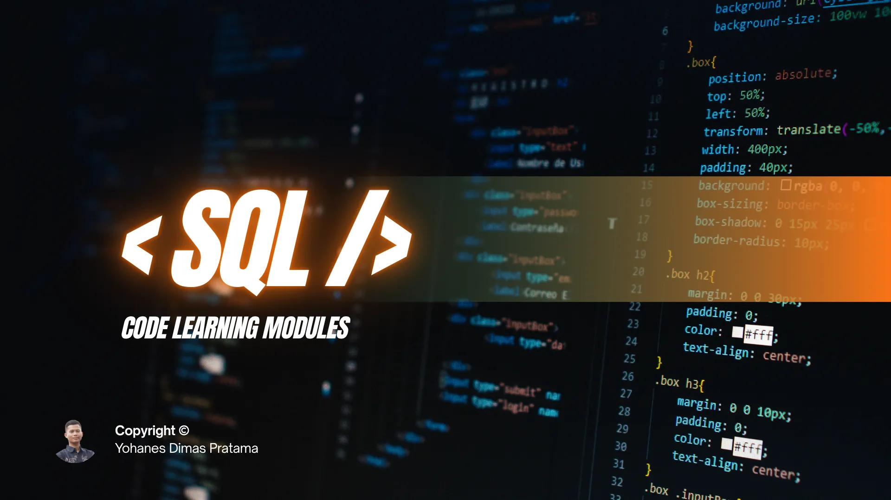

# SQL Learning Modules




## Project Overview

**SQL Learning Modules** is a structured, progressive relational database and SQL education repository comprising **18 learning modules** and **300 standalone, executable SQL scripts** (`001` through `300`). Built around the embedded [Chinook_Sqlite.sqlite](Chinook_Sqlite.sqlite) relational database, the curriculum guides learners from foundational query syntax, filtering, and scalar functions through multi-table joins, recursive CTEs, ACID transactions, window functions, triggers, query optimization, JSON processing, and 20 applied SQL capstone projects. Each module includes a dedicated Indonesian-language study guide (`README.md`), commented `.sql` source files, and verified execution output captures in `output/`.

## Learning Objectives

The curriculum is designed to build practical fluency in relational database querying, schema modeling, transactional safety, and analytical SQL directly against a real multi-table dataset. Upon working through the 18 modules, learners develop the following intended competencies:

- **Core Querying & Data Transformation:** Construct structured `SELECT` statements with `WHERE` filtering, multi-column `ORDER BY` sorting, pagination, conditional `CASE` logic, `NULL` handling, string/math/date functions, and `GROUP BY`/`HAVING` aggregations.
- **Relational Modeling & Set Operations:** Combine normalized tables (`Artist`, `Album`, `Track`, `Customer`, `Invoice`, `InvoiceLine`, `Employee`, `Genre`, `MediaType`, `Playlist`, `PlaylistTrack`) using `INNER`, `LEFT`, `CROSS`, and self-joins, alongside subqueries, CTEs, recursive hierarchies, and set operators (`UNION`, `INTERSECT`, `EXCEPT`).
- **Schema Engineering & Integrity:** Author DDL table definitions, constraints (`PRIMARY KEY`, `FOREIGN KEY`, `UNIQUE`, `CHECK`, `DEFAULT`), views, B-tree indexes, `TEMP` tables, and safe `INSERT`/`UPDATE`/`DELETE` DML workflows.
- **Transactional Control & Automation:** Apply `BEGIN`/`COMMIT`/`ROLLBACK`, `SAVEPOINT`, concurrency isolation concepts, row-level `BEFORE`/`AFTER` triggers, and access-control patterns (`PRAGMA`, RBAC concepts, and audit logging).
- **Analytical SQL & Performance Tuning:** Implement window functions (`OVER`, `PARTITION BY`, `ROW_NUMBER`, `RANK`, `DENSE_RANK`, `LAG`/`LEAD`, running totals, moving averages), inspect execution plans with `EXPLAIN QUERY PLAN`, write SARGable predicates, parse JSON payloads, and deliver end-to-end analytical and OLTP/OLAP SQL projects.

## Learning Level & Approach

The repository follows a progressive, module-based self-study architecture that advances systematically from beginner syntax to intermediate relational engineering and advanced analytical and performance-tuning topics. Each `.sql` script focuses on a single atomic concept with inline explanatory comments (written in Indonesian) and is paired with a corresponding PNG execution capture (`output/*.png`) and per-module Markdown guide.

| Attribute | Description |
| :--- | :--- |
| **Learning Level** | Beginner to Advanced (progressive 18-module track) |
| **Learning Approach** | Module-Based & Project-Based (17 topical modules + 1 capstone module) |
| **Learning Format** | Per-module Markdown guides + 300 executable `.sql` scripts + 300 `output/*.png` captures |
| **Programming Focus** | Relational SQL (SQLite execution with cross-dialect notes for PostgreSQL, MySQL, and SQL Server) |
| **Sample Database** | `Chinook_Sqlite.sqlite` (11 relational tables covering a digital music store domain) |

## Learning Path & Curriculum

The curriculum is organized into 18 sequential modules grouped across three progressive tiers: Foundations (`Modules 01–06`), Database Engineering & Reliability (`Modules 07–11`), and Advanced Analytics, Administration & Capstones (`Modules 12–18`).

1. **Foundations of Querying (`Modules 01–06`):** SQL syntax, projection, filtering, sorting, expressions, aggregation, multi-table joins, subqueries, CTEs, and set operations.
2. **Data Manipulation, Schema & Transactions (`Modules 07–11`):** DML operations, DDL schema creation, relational constraints, views, B-tree indexes, and ACID transaction control.
3. **Analytics, Automation, Tuning & Capstones (`Modules 12–18`):** Window functions, procedural routines, triggers, access control, `EXPLAIN QUERY PLAN` optimization, JSON/data cleaning, and 20 applied projects.

| Order | Module | Main Topics | Materials |
| :---: | :--- | :--- | :--- |
| 01 | [Introduction to SQL & Query Structure](module-01-pengenalan-sql-dan-struktur-query/README.md) | Comments, literals, dates, `SELECT`, aliases, `DISTINCT`, `NULL`, case sensitivity | 15 `.sql` scripts + 15 outputs |
| 02 | [SELECT, Filtering, and Sorting](module-02-select-filtering-dan-sorting/README.md) | `WHERE`, logical/comparison operators, `BETWEEN`, `IN`, `LIKE`, `ORDER BY`, `LIMIT`/`OFFSET` | 20 `.sql` scripts + 20 outputs |
| 03 | [SQL Expressions & Functions](module-03-ekspresi-dan-fungsi-sql/README.md) | `CASE`, `COALESCE`, `NULLIF`, `CAST`, string, numeric, and date functions | 20 `.sql` scripts + 20 outputs |
| 04 | [Data Aggregation & Grouping](module-04-agregasi-dan-pengelompokan-data/README.md) | `COUNT`, `SUM`, `AVG`, `MIN`/`MAX`, `GROUP BY`, `HAVING`, conditional & multidimensional aggregation | 15 `.sql` scripts + 15 outputs |
| 05 | [Joins & Table Relationships](module-05-join-dan-relasi-antartabel/README.md) | `INNER`, `LEFT`/`RIGHT`/`FULL`, `CROSS`, self-join, semi/anti-join, multi-table & bridge joins | 20 `.sql` scripts + 20 outputs |
| 06 | [Subqueries, CTEs, and Set Operations](module-06-subquery-cte-dan-set-operations/README.md) | Scalar/correlated subqueries, `EXISTS`, CTEs, recursive CTEs, `UNION`, `INTERSECT`, `EXCEPT` | 20 `.sql` scripts + 20 outputs |
| 07 | [Data Manipulation (DML)](module-07-manipulasi-data-dml/README.md) | `INSERT`, `UPDATE`, `UPDATE CASE`, `DELETE`, deduplication, `UPSERT`/`MERGE`, `RETURNING` | 20 `.sql` scripts + 20 outputs |
| 08 | [DDL & Database Structure](module-08-ddl-dan-struktur-database/README.md) | `CREATE TABLE`, SQL data types, `ALTER TABLE`, `TEMP` tables, CTAS, auto-increment patterns | 20 `.sql` scripts + 20 outputs |
| 09 | [Constraints & Database Relationships](module-09-constraints-dan-relasi-database/README.md) | `PRIMARY KEY`, `FOREIGN KEY`, `UNIQUE`, `CHECK`, composite keys, `CASCADE`/`RESTRICT`/`SET NULL` | 15 `.sql` scripts + 15 outputs |
| 10 | [Views & Indexes](module-10-views-dan-indexes/README.md) | Standard/updatable views, B-tree, unique, composite, partial, expression, covering indexes | 15 `.sql` scripts + 15 outputs |
| 11 | [Transactions & Concurrency](module-11-transactions-dan-concurrency/README.md) | `BEGIN`, `COMMIT`, `ROLLBACK`, `SAVEPOINT`, ACID, isolation levels, locking, deadlocks | 15 `.sql` scripts + 15 outputs |
| 12 | [Window Functions & Data Analysis](module-12-window-functions-dan-analisis-data/README.md) | `OVER`, `PARTITION BY`, `ROW_NUMBER`, `RANK`, `DENSE_RANK`, `NTILE`, `LAG`/`LEAD`, running totals | 20 `.sql` scripts + 20 outputs |
| 13 | [Stored Procedures & Functions](module-13-stored-procedures-dan-functions/README.md) | Procedural SQL patterns, scalar/table functions, parameters, control flow, dynamic SQL | 15 `.sql` scripts + 15 outputs |
| 14 | [Triggers & Database Automation](module-14-triggers-dan-otomatisasi-database/README.md) | `BEFORE`/`AFTER` `INSERT`/`UPDATE`/`DELETE` triggers, validation, audit logs, cascade effects | 10 `.sql` scripts + 10 outputs |
| 15 | [Database Security & Access Control](module-15-database-security-dan-access-control/README.md) | Users, `GRANT`/`REVOKE`, RBAC, least privilege, column/row-level security, audit logging | 10 `.sql` scripts + 10 outputs |
| 16 | [Query Optimization & Performance](module-16-query-optimization-dan-performance/README.md) | `EXPLAIN QUERY PLAN`, scan vs. index search, selectivity, SARGable predicates, keyset pagination | 15 `.sql` scripts + 15 outputs |
| 17 | [Import, Export, JSON & Data Cleaning](module-17-import-export-json-dan-data-cleaning/README.md) | CSV staging, `json_valid`/`json_extract`, date standardization, `NULL`/duplicate cleaning, migration | 15 `.sql` scripts + 15 outputs |
| 18 | [Practical SQL Projects](module-18-proyek-praktik-sql/README.md) | 20 applied schema, RFM segmentation, star schema, ETL, audit, and optimization capstones | 20 `.sql` scripts + 20 outputs |

## Learning Modules & Contents

Each module directory contains a comprehensive `README.md` indexing all submodules, inline source explanations, execution commands, and output screenshots. Below is the navigable module index linking to each module guide alongside representative scripts and execution captures.

### Module 01 — Introduction to SQL & Query Structure
- **Module Guide:** [Open Module 01 README](module-01-pengenalan-sql-dan-struktur-query/README.md) (`001`–`015`, 15 scripts)
- **Representative Submodules:**
  - `001` SQL Comments: [Source](module-01-pengenalan-sql-dan-struktur-query/001_sql_comments.sql) | [Output](module-01-pengenalan-sql-dan-struktur-query/output/001_sql_comments.png)
  - `006` Column Projection (`SELECT`): [Source](module-01-pengenalan-sql-dan-struktur-query/006_select_columns.sql) | [Output](module-01-pengenalan-sql-dan-struktur-query/output/006_select_columns.png)
  - `010` Unique Values (`DISTINCT`): [Source](module-01-pengenalan-sql-dan-struktur-query/010_distinct_values.sql) | [Output](module-01-pengenalan-sql-dan-struktur-query/output/010_distinct_values.png)
  - `013` `NULL` Fundamentals: [Source](module-01-pengenalan-sql-dan-struktur-query/013_sql_null_basics.sql) | [Output](module-01-pengenalan-sql-dan-struktur-query/output/013_sql_null_basics.png)

### Module 02 — SELECT, Filtering, and Sorting
- **Module Guide:** [Open Module 02 README](module-02-select-filtering-dan-sorting/README.md) (`016`–`035`, 20 scripts)
- **Representative Submodules:**
  - `016` `WHERE` Clause Filtering: [Source](module-02-select-filtering-dan-sorting/016_where_clause.sql) | [Output](module-02-select-filtering-dan-sorting/output/016_where_clause.png)
  - `022` Pattern Matching (`LIKE`): [Source](module-02-select-filtering-dan-sorting/022_like_operator.sql) | [Output](module-02-select-filtering-dan-sorting/output/022_like_operator.png)
  - `029` Multi-Column `ORDER BY`: [Source](module-02-select-filtering-dan-sorting/029_order_by_multiple_columns.sql) | [Output](module-02-select-filtering-dan-sorting/output/029_order_by_multiple_columns.png)
  - `035` Combined Filtering & Sorting: [Source](module-02-select-filtering-dan-sorting/035_filtering_and_sorting_combined.sql) | [Output](module-02-select-filtering-dan-sorting/output/035_filtering_and_sorting_combined.png)

### Module 03 — SQL Expressions & Built-in Functions
- **Module Guide:** [Open Module 03 README](module-03-ekspresi-dan-fungsi-sql/README.md) (`036`–`055`, 20 scripts)
- **Representative Submodules:**
  - `036` Conditional `CASE` Expression: [Source](module-03-ekspresi-dan-fungsi-sql/036_case_expression.sql) | [Output](module-03-ekspresi-dan-fungsi-sql/output/036_case_expression.png)
  - `038` `COALESCE` Null Handling: [Source](module-03-ekspresi-dan-fungsi-sql/038_coalesce_function.sql) | [Output](module-03-ekspresi-dan-fungsi-sql/output/038_coalesce_function.png)
  - `040` Type Conversion (`CAST`): [Source](module-03-ekspresi-dan-fungsi-sql/040_cast_conversion.sql) | [Output](module-03-ekspresi-dan-fungsi-sql/output/040_cast_conversion.png)
  - `055` Date Arithmetic: [Source](module-03-ekspresi-dan-fungsi-sql/055_date_arithmetic.sql) | [Output](module-03-ekspresi-dan-fungsi-sql/output/055_date_arithmetic.png)

### Module 04 — Data Aggregation & Grouping
- **Module Guide:** [Open Module 04 README](module-04-agregasi-dan-pengelompokan-data/README.md) (`056`–`070`, 15 scripts)
- **Representative Submodules:**
  - `057` `COUNT(DISTINCT)`: [Source](module-04-agregasi-dan-pengelompokan-data/057_count_distinct.sql) | [Output](module-04-agregasi-dan-pengelompokan-data/output/057_count_distinct.png)
  - `063` `HAVING` Group Filtering: [Source](module-04-agregasi-dan-pengelompokan-data/063_having_clause.sql) | [Output](module-04-agregasi-dan-pengelompokan-data/output/063_having_clause.png)
  - `065` Conditional Aggregation: [Source](module-04-agregasi-dan-pengelompokan-data/065_conditional_aggregation.sql) | [Output](module-04-agregasi-dan-pengelompokan-data/output/065_conditional_aggregation.png)
  - `070` `GROUPING SETS`: [Source](module-04-agregasi-dan-pengelompokan-data/070_grouping_sets.sql) | [Output](module-04-agregasi-dan-pengelompokan-data/output/070_grouping_sets.png)

### Module 05 — Joins & Multi-Table Relationships
- **Module Guide:** [Open Module 05 README](module-05-join-dan-relasi-antartabel/README.md) (`071`–`090`, 20 scripts)
- **Representative Submodules:**
  - `071` `INNER JOIN`: [Source](module-05-join-dan-relasi-antartabel/071_inner_join.sql) | [Output](module-05-join-dan-relasi-antartabel/output/071_inner_join.png)
  - `076` `SELF JOIN`: [Source](module-05-join-dan-relasi-antartabel/076_self_join.sql) | [Output](module-05-join-dan-relasi-antartabel/output/076_self_join.png)
  - `085` Anti-Join Pattern: [Source](module-05-join-dan-relasi-antartabel/085_anti_join.sql) | [Output](module-05-join-dan-relasi-antartabel/output/085_anti_join.png)
  - `089` Bridge Table (`N:M`) Join: [Source](module-05-join-dan-relasi-antartabel/089_bridge_table_join.sql) | [Output](module-05-join-dan-relasi-antartabel/output/089_bridge_table_join.png)

### Module 06 — Subqueries, CTEs, and Set Operations
- **Module Guide:** [Open Module 06 README](module-06-subquery-cte-dan-set-operations/README.md) (`091`–`110`, 20 scripts)
- **Representative Submodules:**
  - `094` Correlated Subquery: [Source](module-06-subquery-cte-dan-set-operations/094_correlated_subquery.sql) | [Output](module-06-subquery-cte-dan-set-operations/output/094_correlated_subquery.png)
  - `101` Common Table Expression (`WITH`): [Source](module-06-subquery-cte-dan-set-operations/101_cte_basic.sql) | [Output](module-06-subquery-cte-dan-set-operations/output/101_cte_basic.png)
  - `103` Recursive CTE: [Source](module-06-subquery-cte-dan-set-operations/103_recursive_cte.sql) | [Output](module-06-subquery-cte-dan-set-operations/output/103_recursive_cte.png)
  - `106` `INTERSECT` Set Operator: [Source](module-06-subquery-cte-dan-set-operations/106_intersect_operator.sql) | [Output](module-06-subquery-cte-dan-set-operations/output/106_intersect_operator.png)

### Module 07 — Data Manipulation Language (DML)
- **Module Guide:** [Open Module 07 README](module-07-manipulasi-data-dml/README.md) (`111`–`130`, 20 scripts)
- **Representative Submodules:**
  - `115` `INSERT ... SELECT`: [Source](module-07-manipulasi-data-dml/115_insert_select.sql) | [Output](module-07-manipulasi-data-dml/output/115_insert_select.png)
  - `119` Conditional `UPDATE` with `CASE`: [Source](module-07-manipulasi-data-dml/119_update_with_case.sql) | [Output](module-07-manipulasi-data-dml/output/119_update_with_case.png)
  - `122` Deleting Duplicate Records: [Source](module-07-manipulasi-data-dml/122_delete_duplicates.sql) | [Output](module-07-manipulasi-data-dml/output/122_delete_duplicates.png)
  - `127` `RETURNING` Clause: [Source](module-07-manipulasi-data-dml/127_returning_clause.sql) | [Output](module-07-manipulasi-data-dml/output/127_returning_clause.png)

### Module 08 — DDL & Database Structure
- **Module Guide:** [Open Module 08 README](module-08-ddl-dan-struktur-database/README.md) (`131`–`150`, 20 scripts)
- **Representative Submodules:**
  - `134` `CREATE TABLE`: [Source](module-08-ddl-dan-struktur-database/134_create_table.sql) | [Output](module-08-ddl-dan-struktur-database/output/134_create_table.png)
  - `137` Decimal Precision Types: [Source](module-08-ddl-dan-struktur-database/137_decimal_precision.sql) | [Output](module-08-ddl-dan-struktur-database/output/137_decimal_precision.png)
  - `146` Temporary Tables: [Source](module-08-ddl-dan-struktur-database/146_temporary_table.sql) | [Output](module-08-ddl-dan-struktur-database/output/146_temporary_table.png)
  - `147` `CREATE TABLE AS SELECT` (CTAS): [Source](module-08-ddl-dan-struktur-database/147_create_table_as_select.sql) | [Output](module-08-ddl-dan-struktur-database/output/147_create_table_as_select.png)

### Module 09 — Constraints & Database Relationships
- **Module Guide:** [Open Module 09 README](module-09-constraints-dan-relasi-database/README.md) (`151`–`165`, 15 scripts)
- **Representative Submodules:**
  - `152` `FOREIGN KEY` Integrity: [Source](module-09-constraints-dan-relasi-database/152_foreign_key.sql) | [Output](module-09-constraints-dan-relasi-database/output/152_foreign_key.png)
  - `155` `CHECK` Constraints: [Source](module-09-constraints-dan-relasi-database/155_check_constraint.sql) | [Output](module-09-constraints-dan-relasi-database/output/155_check_constraint.png)
  - `159` `ON DELETE CASCADE`: [Source](module-09-constraints-dan-relasi-database/159_on_delete_cascade.sql) | [Output](module-09-constraints-dan-relasi-database/output/159_on_delete_cascade.png)
  - `165` Many-to-Many (`N:M`) Modeling: [Source](module-09-constraints-dan-relasi-database/165_many_to_many_relationship.sql) | [Output](module-09-constraints-dan-relasi-database/output/165_many_to_many_relationship.png)

### Module 10 — Views & Indexes
- **Module Guide:** [Open Module 10 README](module-10-views-dan-indexes/README.md) (`166`–`180`, 15 scripts)
- **Representative Submodules:**
  - `166` `CREATE VIEW`: [Source](module-10-views-dan-indexes/166_create_view.sql) | [Output](module-10-views-dan-indexes/output/166_create_view.png)
  - `173` Composite Index: [Source](module-10-views-dan-indexes/173_composite_index.sql) | [Output](module-10-views-dan-indexes/output/173_composite_index.png)
  - `174` Partial Index: [Source](module-10-views-dan-indexes/174_partial_index.sql) | [Output](module-10-views-dan-indexes/output/174_partial_index.png)
  - `176` Covering Index: [Source](module-10-views-dan-indexes/176_covering_index.sql) | [Output](module-10-views-dan-indexes/output/176_covering_index.png)

### Module 11 — Transactions & Concurrency
- **Module Guide:** [Open Module 11 README](module-11-transactions-dan-concurrency/README.md) (`181`–`195`, 15 scripts)
- **Representative Submodules:**
  - `182` `COMMIT` Transaction: [Source](module-11-transactions-dan-concurrency/182_commit_transaction.sql) | [Output](module-11-transactions-dan-concurrency/output/182_commit_transaction.png)
  - `184` `SAVEPOINT` Checkpoints: [Source](module-11-transactions-dan-concurrency/184_savepoint_transaction.sql) | [Output](module-11-transactions-dan-concurrency/output/184_savepoint_transaction.png)
  - `186` ACID Properties: [Source](module-11-transactions-dan-concurrency/186_acid_properties.sql) | [Output](module-11-transactions-dan-concurrency/output/186_acid_properties.png)
  - `193` Deadlock Scenarios: [Source](module-11-transactions-dan-concurrency/193_deadlock_scenario.sql) | [Output](module-11-transactions-dan-concurrency/output/193_deadlock_scenario.png)

### Module 12 — Window Functions & Data Analysis
- **Module Guide:** [Open Module 12 README](module-12-window-functions-dan-analisis-data/README.md) (`196`–`215`, 20 scripts)
- **Representative Submodules:**
  - `199` `ROW_NUMBER` Ranking: [Source](module-12-window-functions-dan-analisis-data/199_row_number.sql) | [Output](module-12-window-functions-dan-analisis-data/output/199_row_number.png)
  - `203` `LAG` Period Comparison: [Source](module-12-window-functions-dan-analisis-data/203_lag_function.sql) | [Output](module-12-window-functions-dan-analisis-data/output/203_lag_function.png)
  - `207` Running Total: [Source](module-12-window-functions-dan-analisis-data/207_running_total.sql) | [Output](module-12-window-functions-dan-analisis-data/output/207_running_total.png)
  - `213` Top-N per Group: [Source](module-12-window-functions-dan-analisis-data/213_top_n_per_group.sql) | [Output](module-12-window-functions-dan-analisis-data/output/213_top_n_per_group.png)

### Module 13 — Stored Procedures & Functions
- **Module Guide:** [Open Module 13 README](module-13-stored-procedures-dan-functions/README.md) (`216`–`230`, 15 scripts)
- **Representative Submodules:**
  - `216` Stored Procedure Patterns: [Source](module-13-stored-procedures-dan-functions/216_create_stored_procedure.sql) | [Output](module-13-stored-procedures-dan-functions/output/216_create_stored_procedure.png)
  - `220` Scalar Functions: [Source](module-13-stored-procedures-dan-functions/220_scalar_function.sql) | [Output](module-13-stored-procedures-dan-functions/output/220_scalar_function.png)
  - `226` Routine Exception Handling: [Source](module-13-stored-procedures-dan-functions/226_exception_handling_routine.sql) | [Output](module-13-stored-procedures-dan-functions/output/226_exception_handling_routine.png)
  - `230` Stored Routine Testing: [Source](module-13-stored-procedures-dan-functions/230_stored_routine_testing.sql) | [Output](module-13-stored-procedures-dan-functions/output/230_stored_routine_testing.png)

### Module 14 — Triggers & Database Automation
- **Module Guide:** [Open Module 14 README](module-14-triggers-dan-otomatisasi-database/README.md) (`231`–`240`, 10 scripts)
- **Representative Submodules:**
  - `231` `BEFORE INSERT` Validation Trigger: [Source](module-14-triggers-dan-otomatisasi-database/231_before_insert_trigger.sql) | [Output](module-14-triggers-dan-otomatisasi-database/output/231_before_insert_trigger.png)
  - `234` `AFTER UPDATE` Trigger: [Source](module-14-triggers-dan-otomatisasi-database/234_after_update_trigger.sql) | [Output](module-14-triggers-dan-otomatisasi-database/output/234_after_update_trigger.png)
  - `237` Audit Log Trigger: [Source](module-14-triggers-dan-otomatisasi-database/237_audit_log_trigger.sql) | [Output](module-14-triggers-dan-otomatisasi-database/output/237_audit_log_trigger.png)
  - `240` Disabling & Dropping Triggers: [Source](module-14-triggers-dan-otomatisasi-database/240_disable_drop_trigger.sql) | [Output](module-14-triggers-dan-otomatisasi-database/output/240_disable_drop_trigger.png)

### Module 15 — Database Security & Access Control
- **Module Guide:** [Open Module 15 README](module-15-database-security-dan-access-control/README.md) (`241`–`250`, 10 scripts)
- **Representative Submodules:**
  - `241` User & Session Access Concepts: [Source](module-15-database-security-dan-access-control/241_create_database_user.sql) | [Output](module-15-database-security-dan-access-control/output/241_create_database_user.png)
  - `245` Role-Based Access (`CREATE ROLE`): [Source](module-15-database-security-dan-access-control/245_create_database_role.sql) | [Output](module-15-database-security-dan-access-control/output/245_create_database_role.png)
  - `247` Least Privilege Design: [Source](module-15-database-security-dan-access-control/247_least_privilege_design.sql) | [Output](module-15-database-security-dan-access-control/output/247_least_privilege_design.png)
  - `250` Database Audit Logging: [Source](module-15-database-security-dan-access-control/250_database_audit_logging.sql) | [Output](module-15-database-security-dan-access-control/output/250_database_audit_logging.png)

### Module 16 — Query Optimization & Performance
- **Module Guide:** [Open Module 16 README](module-16-query-optimization-dan-performance/README.md) (`251`–`265`, 15 scripts)
- **Representative Submodules:**
  - `251` `EXPLAIN QUERY PLAN`: [Source](module-16-query-optimization-dan-performance/251_explain_query_plan.sql) | [Output](module-16-query-optimization-dan-performance/output/251_explain_query_plan.png)
  - `255` SARGable Queries: [Source](module-16-query-optimization-dan-performance/255_sargable_queries.sql) | [Output](module-16-query-optimization-dan-performance/output/255_sargable_queries.png)
  - `258` Keyset Pagination Optimization: [Source](module-16-query-optimization-dan-performance/258_query_pagination_optimization.sql) | [Output](module-16-query-optimization-dan-performance/output/258_query_pagination_optimization.png)
  - `265` Execution Plan Comparison: [Source](module-16-query-optimization-dan-performance/265_execution_plan_comparison.sql) | [Output](module-16-query-optimization-dan-performance/output/265_execution_plan_comparison.png)

### Module 17 — Import, Export, JSON, and Data Cleaning
- **Module Guide:** [Open Module 17 README](module-17-import-export-json-dan-data-cleaning/README.md) (`266`–`280`, 15 scripts)
- **Representative Submodules:**
  - `266` CSV Staging Import: [Source](module-17-import-export-json-dan-data-cleaning/266_import_csv.sql) | [Output](module-17-import-export-json-dan-data-cleaning/output/266_import_csv.png)
  - `271` JSON Document Storage (`json_valid`): [Source](module-17-import-export-json-dan-data-cleaning/271_json_storage.sql) | [Output](module-17-import-export-json-dan-data-cleaning/output/271_json_storage.png)
  - `272` JSON Extraction: [Source](module-17-import-export-json-dan-data-cleaning/272_json_extract.sql) | [Output](module-17-import-export-json-dan-data-cleaning/output/272_json_extract.png)
  - `278` Data Quality Checks: [Source](module-17-import-export-json-dan-data-cleaning/278_data_quality_checks.sql) | [Output](module-17-import-export-json-dan-data-cleaning/output/278_data_quality_checks.png)

### Module 18 — Practical SQL Projects
- **Module Guide:** [Open Module 18 README](module-18-proyek-praktik-sql/README.md) (`281`–`300`, 20 capstone scripts)
- **Representative Submodules:**
  - `281` Student & GPA Database: [Source](module-18-proyek-praktik-sql/281_student_database_project.sql) | [Output](module-18-proyek-praktik-sql/output/281_student_database_project.png)
  - `288` Chinook Music Store Analysis: [Source](module-18-proyek-praktik-sql/288_music_store_analysis_project.sql) | [Output](module-18-proyek-praktik-sql/output/288_music_store_analysis_project.png)
  - `292` Star Schema Data Warehouse: [Source](module-18-proyek-praktik-sql/292_data_warehouse_star_schema_project.sql) | [Output](module-18-proyek-praktik-sql/output/292_data_warehouse_star_schema_project.png)
  - `300` Comprehensive Database Capstone: [Source](module-18-proyek-praktik-sql/300_comprehensive_database_project.sql) | [Output](module-18-proyek-praktik-sql/output/300_comprehensive_database_project.png)

## Projects & Coding Challenges

Module 18 delivers 20 applied SQL mini-projects and capstone implementations spanning transactional schema design, business analytics, data warehousing, security, and query tuning. Each file is a self-contained SQL implementation ready to execute against `Chinook_Sqlite.sqlite` (using `TEMP` tables for isolated transactional schemas so the base Chinook database remains intact).

| Project | Learning Focus | Source Script |
| :--- | :--- | :--- |
| Student & Academic Grades | Relational schema design (`Mahasiswa`, `NilaiUjian`), foreign keys, weighted GPA aggregation | [281_student_database_project.sql](module-18-proyek-praktik-sql/281_student_database_project.sql) |
| Library, Inventory & POS Cashier | Transactional catalog, stock tracking, and point-of-sale billing models | [282](module-18-proyek-praktik-sql/282_library_database_project.sql), [283](module-18-proyek-praktik-sql/283_inventory_database_project.sql), [284](module-18-proyek-praktik-sql/284_cashier_database_project.sql) |
| E-Commerce & Human Resources | Order fulfillment tracking (`GROUP_CONCAT`) and HR organizational querying | [285](module-18-proyek-praktik-sql/285_ecommerce_database_project.sql), [286](module-18-proyek-praktik-sql/286_human_resources_database_project.sql) |
| Sales, Music Store & Film Analytics | Multi-table revenue joins (`Artist` -> `Album` -> `Track` -> `InvoiceLine`) and KPI summaries | [287](module-18-proyek-praktik-sql/287_sales_analysis_project.sql), [288](module-18-proyek-praktik-sql/288_music_store_analysis_project.sql), [289](module-18-proyek-praktik-sql/289_film_rental_analysis_project.sql) |
| RFM Customer Segmentation | Recency, Frequency, and Monetary tier classification using `CASE` and `COUNT`/`SUM` | [290_customer_segmentation_project.sql](module-18-proyek-praktik-sql/290_customer_segmentation_project.sql) |
| Dashboard Queries & Star Schema | Executive KPI reporting and OLAP `DimCustomer`/`DimTrack`/`FactSales` star schema | [291](module-18-proyek-praktik-sql/291_sales_dashboard_queries_project.sql), [292](module-18-proyek-praktik-sql/292_data_warehouse_star_schema_project.sql) |
| ETL Staging & Data Audit | Extract-transform staging tables and change-audit logging workflows | [293](module-18-proyek-praktik-sql/293_etl_staging_project.sql), [294](module-18-proyek-praktik-sql/294_database_audit_project.sql) |
| RBAC, Transactions & Stored Logic | Role-based access simulation, order transaction atomicity, and modular business logic | [295](module-18-proyek-praktik-sql/295_role_based_access_project.sql), [296](module-18-proyek-praktik-sql/296_transaction_order_processing_project.sql), [297](module-18-proyek-praktik-sql/297_stored_procedure_business_logic_project.sql) |
| Optimization, Migration & Capstone | `EXPLAIN QUERY PLAN` tuning, ANSI SQL cross-dialect schema, and CTE + `DENSE_RANK` market share analysis | [298](module-18-proyek-praktik-sql/298_query_optimization_project.sql), [299](module-18-proyek-praktik-sql/299_cross_database_migration_project.sql), [300](module-18-proyek-praktik-sql/300_comprehensive_database_project.sql) |

## Programming Languages & Tech Stack

| Category | Technology | Purpose |
| :--- | :--- | :--- |
| **Query Language** | SQL (SQLite dialect + ANSI SQL / PostgreSQL / MySQL / SQL Server comparative notes) | Core language taught across all 300 lesson and project scripts |
| **Database Engine** | SQLite | Embedded file-based relational database engine executing all module scripts |
| **Sample Dataset** | Chinook SQLite Database (`Chinook_Sqlite.sqlite`) | 11-table digital media store schema (`Artist`, `Album`, `Track`, `Customer`, `Invoice`, `InvoiceLine`, `Employee`, `Genre`, `MediaType`, `Playlist`, `PlaylistTrack`) |
| **Execution Clients** | `sqlite3` CLI & Python (`sqlite3` standard library) | Command-line and programmatic script runners documented across module guides |
| **Documentation** | Markdown & PNG Output Captures | Per-module curriculum guides (`README.md`) and verified result screenshots (`output/*.png`) |

## Prerequisites & Setup

No external package installations or remote database servers are required to run the curriculum. Every script executes locally against the bundled [Chinook_Sqlite.sqlite](Chinook_Sqlite.sqlite) database file.

- **Required:** Either the `sqlite3` command-line client or Python (which includes the built-in `sqlite3` module in its standard library).
- **Optional:** A visual SQLite database browser or IDE extension (such as DB Browser for SQLite, DBeaver, or VS Code SQLite extensions) for inspecting schemas and browsing query plans interactively.
- **Setup:** Clone the repository and navigate into the project root directory:

```bash
git clone https://github.com/weztcy/SQL-Learning-Modules.git
cd "SQL-Learning-Modules"
```

## Code Execution & Usage

All 300 SQL scripts are self-contained and designed to run from inside their respective module directories, referencing `../Chinook_Sqlite.sqlite` as documented in each module's `README.md`.

1. **Navigate into a module folder** (for example, Module 01 or Module 18):

```bash
cd module-01-pengenalan-sql-dan-struktur-query
```

2. **Execute a script using the `sqlite3` CLI** (recommended for viewing formatted query result tables directly):

```bash
sqlite3 -header -column ../Chinook_Sqlite.sqlite < 006_select_columns.sql
```

3. **Or execute a script using Python's built-in `sqlite3` module** (as documented in each module guide):

```bash
python -c "import sqlite3; conn=sqlite3.connect('../Chinook_Sqlite.sqlite'); print(conn.cursor().executescript(open('006_select_columns.sql', encoding='utf-8').read()))"
```

4. **Inspect multi-statement query results in Python** when running `SELECT` scripts programmatically:

```bash
python -c "import sqlite3; conn=sqlite3.connect('../Chinook_Sqlite.sqlite'); cur=conn.execute(open('006_select_columns.sql', encoding='utf-8').read()); print(cur.fetchall())"
```

## Contributing

Contributions that enhance clarity, fix dialect notes, or expand verified SQL examples are welcome. Follow the workflow below to propose changes:

1. Fork the repository.
2. Create a branch for the change.
3. Add or improve learning materials, source code, exercises, or documentation.
4. Verify code examples and links where practical.
5. Commit and push the branch.
6. Open a pull request with a clear explanation.

## License

This project is licensed under the MIT License.
See the [LICENSE](LICENSE) file for details.

## Author & Contact

**Yohanes Dimas Pratama**

- GitHub: [github.com/weztcy](https://github.com/weztcy)
- Portfolio: [yohanesdimas.com](https://yohanesdimas.com)
- LinkedIn: [linkedin.com/in/yohanes-dimas](https://www.linkedin.com/in/yohanes-dimas)
