# SQL Learning Modules

[](https://www.iso.org/standard/63555.html) [](#learning-roadmap) [](#learning-modules--subtopics) [](#learning-modules--subtopics) [](#tech-stack--tools) [](#tech-stack--tools) [](./LICENSE)

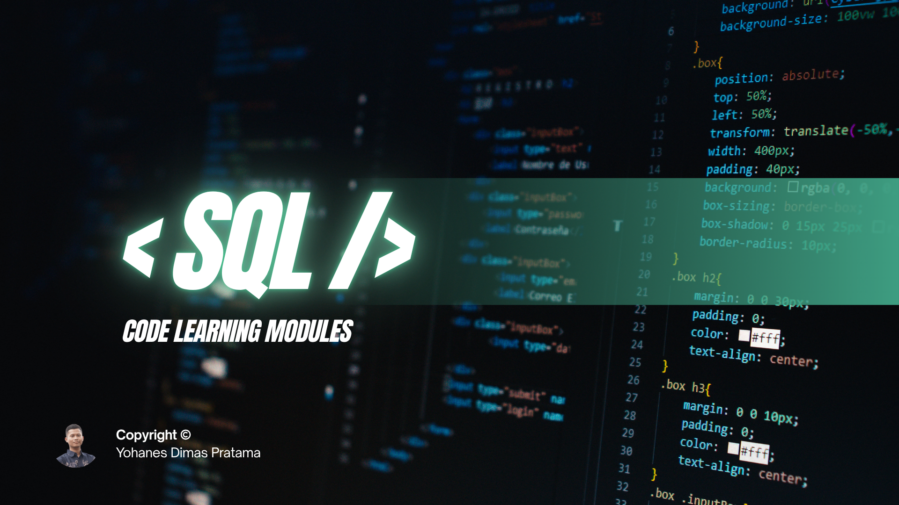

## Project Description

**SQL Learning Modules** is a comprehensive, production-grade educational curriculum designed to guide learners from fundamental relational concepts and core SQL syntax through advanced querying, transactional concurrency, analytical window functions, procedural routines, query execution plan optimization, and full-scale database capstone systems.

Structured across **18 pedagogical modules** containing **300 fully standalone, executable SQL programs**, this repository bridges declarative relational theory with hands-on, industry-standard database engineering. Every query in the curriculum is executed and verified directly against the production-grade **Chinook Relational Database** (`Chinook_Sqlite.sqlite`), an 11-table commercial digital media store schema. Each lesson is strictly paired with a verified terminal execution output capture rendered directly from executed database engine processes, guaranteeing predictable and reproducible behavior across environments. Whether mastering SQL as a first query language for software engineering, advancing toward database administration (DBA), conducting quantitative business intelligence and data analytics, or preparing for technical systems interviews, this curriculum delivers an exhaustive, code-first foundation.

## Learning Objectives

Learners working through this curriculum will develop concrete, industry-ready database engineering and relational querying capabilities across every tier of SQL:

- **Core Syntax & Relational Query Anatomy**: Master statement termination, single-line and multi-line comments, literal projection, system temporal functions, explicit column selection, wildcard queries, column and table aliasing, unique row filtering with `DISTINCT`, table/schema namespace qualification, and `NULL` semantics under three-valued logic.
- **Data Retrieval, Filtering, & Sorting**: Construct sophisticated row-level filtering pipelines with `WHERE`, relational comparison operators, compound Boolean logic (`AND`, `OR`, `NOT`), range evaluations (`BETWEEN`), discrete set membership (`IN`, `NOT IN`), pattern matching (`LIKE`, wildcards, escape characters), `IS NULL` / `IS NOT NULL`, multi-column `ORDER BY` tie-breaking, and pagination with `LIMIT`/`OFFSET`, `FETCH FIRST`, and SQL Server `TOP`.
- **SQL Expressions & Scalar Functions**: Implement conditional decision trees with simple and searched `CASE` expressions, handle missing data with `COALESCE` and `NULLIF`, execute type casting with `CAST` and `CONVERT`, normalize strings (`UPPER`, `LOWER`, `LENGTH`, concatenation, `SUBSTR`, `TRIM`, `REPLACE`), perform numerical arithmetic (`ROUND`, `TRUNC`, `ABS`, `MOD`, `CEIL`, `FLOOR`), and manipulate calendar dates and timestamps with interval arithmetic.
- **Data Aggregation & Categorical Grouping**: Compute statistical summaries with aggregate functions (`COUNT`, `COUNT DISTINCT`, `SUM`, `AVG`, `MIN`, `MAX`), group rows with single-column and multi-column `GROUP BY`, filter aggregate metrics with `HAVING`, distinguish pre-aggregation `WHERE` from post-aggregation `HAVING`, implement conditional aggregation via `CASE`, and generate multidimensional summaries with `ROLLUP`, `CUBE`, and `GROUPING SETS`.
- **Relational Joins & Schema Relationships**: Connect normalized entity schemas using `INNER JOIN`, `LEFT OUTER JOIN`, `RIGHT OUTER JOIN`, `FULL OUTER JOIN`, `CROSS JOIN` Cartesian products, self-joins for unary hierarchies, natural joins, non-equi joins with range/inequality conditions, multi-table joins across 3+ entities, anti-joins (`LEFT JOIN ... WHERE NULL` / `NOT EXISTS`), semi-joins, derived table joins, `USING` clauses, and composite multi-key joins while avoiding Cartesian explosion.
- **Subqueries, CTEs, & Set Operations**: Decompose complex queries using scalar subqueries, single-row and multi-row subqueries (`IN`), derived tables in the `FROM` clause, correlated subqueries, existential predicates (`EXISTS`, `NOT EXISTS`), quantified comparisons (`ANY`, `ALL`), modular Common Table Expressions (`WITH` CTE), multi-stage chained CTEs, recursive CTEs for hierarchical organizational trees, and relational set operations (`UNION`, `UNION ALL`, `INTERSECT`, `EXCEPT`/`MINUS`).
- **Data Manipulation Language (DML)**: Execute data mutations using single-row and multi-row `INSERT`, `DEFAULT VALUES`, bulk `INSERT INTO ... SELECT`, targeted single/multi-column `UPDATE`, join-based updates, conditional `UPDATE` via `CASE`, row removal with `DELETE`, high-speed `TRUNCATE TABLE`, atomic upserts (`ON CONFLICT DO UPDATE` / `INSERT ON DUPLICATE KEY`), `MERGE` statements, `RETURNING` clauses, soft delete patterns, and bulk data migrations.
- **Data Definition Language (DDL) & Schema Architecture**: Design and maintain relational structures using `CREATE DATABASE`, `USE`, `CREATE SCHEMA`, `CREATE TABLE`, relational storage classes and type affinities (integers, exact fixed-point decimals, text/character encodings, temporal types, binary `BLOB`s), schema evolution via `ALTER TABLE` (adding, dropping, modifying, renaming columns/tables), `DROP TABLE`, `CREATE TABLE AS SELECT` (CTAS), temporary session tables, auto-increment surrogate keys, and sequences.
- **Data Integrity Constraints & Domain Modeling**: Enforce declarative schema integrity via `PRIMARY KEY`, composite primary keys, `FOREIGN KEY` referential constraints, cascade actions (`ON DELETE CASCADE`, `ON DELETE SET NULL`, `ON DELETE RESTRICT`/`NO ACTION`, `ON UPDATE CASCADE`), `UNIQUE` constraints, `NOT NULL` validation, domain `CHECK` constraints, `DEFAULT` fallbacks, constraint naming, and cardinality modeling (1:1, 1:N, and N:M via junction tables).
- **Database Views & Index Optimization**: Encapsulate complex logic and abstract schema access with standard `CREATE VIEW`, updatable views with `INSTEAD OF` triggers, `WITH CHECK OPTION` integrity constraints, indexed/materialized view pre-computation and cache refresh, physical query acceleration using B-Tree indexes, unique indexes, composite multi-column indexes, partial filtered indexes, expression-based computed indexes, covering indexes (`INDEX-ONLY SCAN`), and index maintenance with `DROP INDEX`.
- **Transaction Management & Concurrency Control**: Guarantee data consistency using explicit transaction boundaries (`BEGIN TRANSACTION`, `COMMIT`, `ROLLBACK`), fine-grained checkpoints with `SAVEPOINT` and `ROLLBACK TO SAVEPOINT`, enforce ACID properties (Atomicity, Consistency, Isolation, Durability), manage autocommit modes, analyze ANSI SQL isolation levels (`READ UNCOMMITTED`, `READ COMMITTED`, `REPEATABLE READ`, `SERIALIZABLE`), prevent concurrency anomalies (dirty reads, non-repeatable reads, phantom reads), and implement row-level and table-level locking to mitigate deadlocks.
- **Window Functions & Advanced Analytical SQL**: Perform advanced reporting and moving calculations without collapsing rows using the `OVER()` clause, `PARTITION BY` group scoping, `ORDER BY` within-window sorting, ranking functions (`ROW_NUMBER`, `RANK`, `DENSE_RANK`, `NTILE`), positional navigation (`LAG`, `LEAD`, `FIRST_VALUE`, `LAST_VALUE`), cumulative running totals, rolling moving averages over sliding frames (`ROWS BETWEEN` / `RANGE BETWEEN`), percentile distributions (`PERCENT_RANK`, `CUME_DIST`), Year-over-Year (YoY) / Month-over-Month (MoM) growth calculations, and Pareto 80/20 commercial analyses.
- **Stored Procedures & User-Defined Functions**: Encapsulate procedural business logic within database routines using `CREATE PROCEDURE`, parameter modes (`IN`, `OUT`, `INOUT`), local variable declarations, branching control flow (`IF-THEN-ELSE`), loops (`WHILE`, `LOOP`), cursor declarations and record fetching, parameterized cursors, scalar user-defined functions (UDF), table-valued functions (TVF), structured exception handling (`TRY-CATCH`), dynamic SQL execution (`PREPARE`/`EXECUTE`), and automated routine unit testing.
- **Event-Driven Triggers & Database Automation**: Implement automated event-driven database behaviors with `BEFORE` and `AFTER` triggers for `INSERT`, `UPDATE`, and `DELETE` events, inspect `OLD` and `NEW` pseudo-record states, contrast row-level (`FOR EACH ROW`) and statement-level triggers, construct change-data-capture audit trail tables, enforce complex cross-table domain validation rules, manage cascading trigger cycles, and control trigger lifecycles.
- **Database Security, Privileges, & Access Control**: Establish authentication and authorization controls using `CREATE USER`, grant access rights with `GRANT` (`SELECT`, `INSERT`, `UPDATE`, `DELETE`), revoke privileges with `REVOKE`, architect Role-Based Access Control (RBAC) hierarchies (`CREATE ROLE`), enforce the principle of least privilege, restrict sensitive attributes via column-level permissions, isolate multi-tenant records using Row-Level Security (RLS) policies, and perform security compliance auditing.
- **Query Execution Plans & Performance Tuning**: Profile query performance and cost estimation using `EXPLAIN` and `EXPLAIN QUERY PLAN`, interpret execution plan operator trees, contrast full table / sequential scans with index scans, evaluate index selectivity and cardinality, write Sargable search predicates, eliminate `SELECT *` I/O overhead, optimize wildcard pattern matching, transform slow `OR` disjunctions into `UNION ALL` pipelines, analyze join execution algorithms (nested loop, hash, merge join), implement keyset seek pagination, update table statistics with `ANALYZE`, and benchmark query rewrites.
- **Data Ingestion, Semi-Structured JSON, & Data Cleaning**: Ingest and export tabular CSV datasets, explore server-side bulk loaders (MySQL `LOAD DATA INFILE`, PostgreSQL `COPY`, SQL Server `BULK INSERT`), store semi-structured JSON documents in relational columns, extract attributes using `JSON_EXTRACT` and JSON paths, aggregate records into JSON arrays/objects with `JSON_GROUP_ARRAY`, standardize dates and UTC timezone offsets, impute missing `NULL` values, deduplicate redundant rows, normalize messy text strings, execute data quality assurance rules, perform database backup and recovery, and migrate operational schemas to dimensional analytical stores (ETL).
- **Real-World Applied SQL Capstone Engineering**: Consolidate technical knowledge into 20 complete, standalone production database projects spanning academic records, library catalogs, warehouse inventory ledgers, POS cashiers, multi-vendor e-commerce, enterprise HR directories, commercial revenue analytics, Chinook music store intelligence, video rental operations, RFM customer segmentation, sales KPI dashboards, star-schema data warehouses, ETL staging pipelines, audit logging systems, RBAC architectures, transactional checkout pipelines, stored procedure pricing engines, query index tuning suites, cross-dialect migrations, and full-stack enterprise database architectures.

## Learning Roadmap

The curriculum follows an intentional, progressive pedagogical trajectory structured from foundational query syntax to intermediate relational data modeling, advanced analytical mechanics, procedural programming, query tuning, and complete applied capstone systems:

| Module | Title | Level | Scope | Primary Focus |
| :--- | :--- | :---: | :---: | :--- |
| [Module 01](#module-01-introduction-to-sql-and-query-structure) | Introduction to SQL and Query Structure | `Fundamental` | 15 Programs (001-015) | Establishes a solid foundation in SQL fundamentals and query mechanics. Covers ANSI SQL syntax anatomy, single-line and multi-line comments, literal value projection, system date and timestamp retrieval, basic column projection, wildcard selection, column and table aliasing, unique row filtering with DISTINCT, schema and table namespace qualification, three-valued logic and NULL semantics, identifier case sensitivity, and client execution workflows against the Chinook relational database. |
| [Module 02](#module-02-data-retrieval-filtering-and-sorting) | Data Retrieval, Filtering, and Sorting | `Fundamental` | 20 Programs (016-035) | Examines row-level predicate filtering and result set ordering. Covers conditional filtering using WHERE, numeric and string comparison operators, Boolean logic (AND, OR, NOT), inclusive range queries (BETWEEN), discrete list membership (IN, NOT IN), pattern matching using LIKE with wildcards (% and _) and escape characters, NULL evaluations (IS NULL, IS NOT NULL), sorting orders (ORDER BY ASC and DESC), multi-column tie-breaking, sorting by computed expressions, and pagination mechanisms (LIMIT/OFFSET, FETCH FIRST, and SQL Server TOP syntax). |
| [Module 03](#module-03-sql-expressions-and-scalar-functions) | SQL Expressions and Scalar Functions | `Fundamental to Intermediate` | 20 Programs (036-055) | Explores conditional expressions, NULL handling functions, type conversions, and scalar transformations. Covers conditional branching with simple and searched CASE expressions, default imputation with COALESCE, sentinel matching via NULLIF, explicit casting with CAST and CONVERT, string manipulation (UPPER, LOWER, LENGTH, concatenation, SUBSTR, TRIM, REPLACE), numeric and arithmetic functions (ROUND, TRUNCATE, ABS, MOD, CEIL, FLOOR), and datetime operations (current date/time, component extraction, date arithmetic, intervals, date differences, and formatting). |
| [Module 04](#module-04-data-aggregation-and-grouping) | Data Aggregation and Grouping | `Intermediate` | 15 Programs (056-070) | Focuses on summary statistics, aggregate functions, and categorical grouping. Covers standard aggregate functions (COUNT, COUNT DISTINCT, SUM, AVG, MIN, MAX), categorical grouping using single-column and multi-column GROUP BY, post-aggregation filtering with the HAVING clause, the architectural difference between WHERE and HAVING execution phases, conditional aggregation using embedded CASE statements, multidimensional aggregations (ROLLUP, CUBE, GROUPING SETS), and grouping by derived expressions. |
| [Module 05](#module-05-table-relationships-and-joins) | Table Relationships and Joins | `Intermediate` | 20 Programs (071-090) | Delves into relational algebra and multi-table operations across normalized database schemas. Covers INNER JOIN for exact key matches, LEFT OUTER JOIN, RIGHT OUTER JOIN, and FULL OUTER JOIN for preserving unmatched rows, CROSS JOIN Cartesian products, self-joins for hierarchical tree navigation, natural joins, non-equi joins using inequality/range predicates, multi-table joins across 3+ entities, anti-joins (LEFT JOIN ... WHERE NULL and NOT EXISTS), semi-joins, derived table joins, the USING clause, composite key joins, joining aggregated result sets, and preventing Cartesian explosion. |
| [Module 06](#module-06-subqueries-common-table-expressions-and-set-operations) | Subqueries, Common Table Expressions, and Set Operations | `Intermediate to Advanced` | 20 Programs (091-110) | Explores modular query decomposition, nested execution, and mathematical set theory. Covers scalar subqueries returning single values, single-row and multi-row subqueries using IN, derived tables in the FROM clause, correlated subqueries referencing outer query rows, existential predicates (EXISTS, NOT EXISTS), quantified comparison operators (ANY, ALL), projection subqueries, non-recursive Common Table Expressions (WITH CTE), multi-CTE pipelines, recursive CTEs for hierarchical organizational trees, and relational set operations (UNION, UNION ALL, INTERSECT, EXCEPT/MINUS). |
| [Module 07](#module-07-data-manipulation-language-dml) | Data Manipulation Language (DML) | `Intermediate` | 20 Programs (111-130) | Covers data modification operations, transactional mutations, and row lifecycle management. Details single-row and multi-row INSERT, INSERT with default values, bulk copying via INSERT INTO SELECT, single-column and multi-column UPDATE, conditional UPDATE with WHERE, join-based UPDATE, conditional UPDATE via CASE logic, row removal via DELETE, complete table truncation (TRUNCATE TABLE), idempotent UPSERT (ON CONFLICT DO UPDATE / INSERT ON DUPLICATE KEY), MERGE statements, RETURNING clauses for generated keys, soft delete patterns with status flags, restoring soft-deleted records, and cascading delete handling. |
| [Module 08](#module-08-data-definition-language-ddl-and-schema-architecture) | Data Definition Language (DDL) and Schema Architecture | `Intermediate` | 20 Programs (131-150) | Examines database architecture, schema management, and physical table definitions. Covers CREATE DATABASE, DROP DATABASE, active schema selection (USE), CREATE SCHEMA namespaces, CREATE TABLE definitions, relational data types (integers, exact fixed-point decimals, character/text types, date/timestamps, and binary BLOBs), schema evolution via ALTER TABLE (adding, dropping, modifying, and renaming columns/tables), DROP TABLE lifecycles, CREATE TABLE AS SELECT (CTAS) materialization, temporary session tables, auto-increment surrogate keys (AUTOINCREMENT, IDENTITY, SERIAL), sequence generators, and metadata comments. |
| [Module 09](#module-09-data-integrity-constraints-and-relationships) | Data Integrity Constraints and Relationships | `Intermediate` | 15 Programs (151-165) | Analyzes declarative data integrity rules and relational entity modeling. Details PRIMARY KEY constraints, composite multi-column primary keys, FOREIGN KEY referential constraints, referential action rules (ON DELETE CASCADE, ON DELETE SET NULL, ON DELETE RESTRICT / NO ACTION), UNIQUE constraints, NOT NULL mandatory column enforcement, CHECK constraints with custom domain validation rules, DEFAULT column values, constraint naming standards, altering constraints via ALTER TABLE, and modeling cardinalities: one-to-one (1:1), one-to-many (1:N), and many-to-many (N:M) using associative junction tables. |
| [Module 10](#module-10-database-views-and-index-optimization) | Database Views and Index Optimization | `Intermediate to Advanced` | 15 Programs (166-180) | Covers query encapsulation, security view layers, and physical access optimization. Details CREATE VIEW abstractions, multi-table joined views, aggregated analytical views, schema updates via CREATE OR REPLACE VIEW, DROP VIEW management, updatable views with INSTEAD OF triggers, WITH CHECK OPTION integrity constraints, indexed and materialized view concepts, cache invalidation and refresh strategies, B-Tree index structures, UNIQUE indexes, composite multi-column indexes, partial filtered indexes, expression-based computed indexes, and index maintenance. |
| [Module 11](#module-11-transaction-management-and-concurrency-control) | Transaction Management and Concurrency Control | `Advanced` | 15 Programs (181-195) | Explores atomic transaction lifecycles, concurrency isolation, and data consistency guarantees. Covers BEGIN TRANSACTION, COMMIT, and ROLLBACK operations, fine-grained partial rollbacks using SAVEPOINT, demonstration of ACID properties (Atomicity, Consistency, Isolation, Durability), autocommit configuration, ANSI SQL isolation levels (READ UNCOMMITTED, READ COMMITTED, REPEATABLE READ, SERIALIZABLE), concurrency anomaly simulations (dirty reads, non-repeatable reads, phantom reads), row-level and table-level locking mechanisms, and deadlock detection and resolution strategies. |
| [Module 12](#module-12-window-functions-and-advanced-analytical-sql) | Window Functions and Advanced Analytical SQL | `Advanced` | 20 Programs (196-215) | Delves into modern analytical SQL, window framing, and advanced reporting metrics. Explores the OVER clause architecture, data partitioning via PARTITION BY, within-window sorting with ORDER BY, ranking algorithms (ROW_NUMBER, RANK, DENSE_RANK, NTILE), positional lookups (LAG, LEAD, FIRST_VALUE, LAST_VALUE), running totals and cumulative sums, rolling moving averages across sliding frames, ROWS BETWEEN vs. RANGE BETWEEN boundary specifications, percentile distributions (PERCENT_RANK, CUME_DIST), year-over-year (YoY) and month-over-month (MoM) growth calculations, Pareto 80/20 commercial analysis, customer cohort retention metrics, and composing multiple concurrent window functions. |
| [Module 13](#module-13-stored-procedures-and-user-defined-functions) | Stored Procedures and User-Defined Functions | `Advanced` | 15 Programs (216-230) | Focuses on procedural database programming and reusable business logic encapsulated in the database engine. Covers CREATE PROCEDURE syntax, input parameters (IN), output parameters (OUT), bidirectional parameters (INOUT), local variable declarations, conditional branching (IF-THEN-ELSE), iterative loops (WHILE, LOOP), cursor declarations, record fetching, parameterized cursors, scalar user-defined functions (UDF), table-valued functions (TVF), structured exception handling, dynamic SQL execution via PREPARE and EXECUTE, procedure lifecycle management, and modular routine testing. |
| [Module 14](#module-14-event-driven-triggers-and-database-automation) | Event-Driven Triggers and Database Automation | `Advanced` | 10 Programs (231-240) | Explores event-driven automation hooks executed automatically by the database engine upon data mutation events. Covers BEFORE INSERT and AFTER INSERT triggers, BEFORE UPDATE and AFTER UPDATE triggers, BEFORE DELETE and AFTER DELETE triggers, inspecting OLD and NEW pseudo-records, row-level vs. statement-level execution semantics, automated historical mutation audit logging, proactive constraint validation enforcing business rules, cascading trigger loops, and administrative management and disabling of triggers. |
| [Module 15](#module-15-database-security-privileges-and-access-control) | Database Security, Privileges, and Access Control | `Advanced` | 10 Programs (241-250) | Covers database protection, authentication, and granular authorization management. Details database user creation and authentication, privilege granting with GRANT (SELECT, INSERT, UPDATE, DELETE), privilege revocation with REVOKE, Role-Based Access Control (RBAC) modeling with CREATE ROLE, enforcing the principle of least privilege, column-level security restrictions, Row-Level Security (RLS) tenant isolation policies, connection auditing and compliance logging, schema-level namespace isolation, and database security maintenance. |
| [Module 16](#module-16-query-execution-plans-and-performance-tuning) | Query Execution Plans and Performance Tuning | `Advanced / Practical` | 15 Programs (251-265) | Focuses on query performance profiling, cost estimation, and database index tuning. Details EXPLAIN and EXPLAIN QUERY PLAN inspection, interpreting query execution trees, comparing Full Table / Sequential Scans vs. Index Scans, B-Tree index lookup mechanics, writing Sargable search predicates, eliminating unnecessary SELECT * overhead, optimizing LIKE wildcard matching, converting OR disjunctions to UNION ALL, join order optimization and execution algorithms (nested loop, hash, merge join), keyset (seek) pagination vs. OFFSET degradation, index selectivity and cardinality assessment, updating table statistics with ANALYZE, query rewriting strategies, and latency benchmarking. |
| [Module 17](#module-17-data-ingestion-semi-structured-json-and-data-cleaning) | Data Ingestion, Semi-Structured JSON, and Data Cleaning | `Advanced / Practical` | 15 Programs (266-280) | Examines data engineering utilities, semi-structured document handling, and data sanitization. Covers importing and exporting tabular CSV files, cross-dialect ingestion mechanisms (MySQL LOAD DATA INFILE, PostgreSQL COPY, SQL Server BULK INSERT), JSON document column storage, JSON value extraction with JSON_EXTRACT and JSON path operators, JSON array/object aggregation, date and timezone standardization, NULL imputation and data sanitization, duplicate detection and record deduplication, text normalization, automated data quality verification rules, database backup and restoration workflows, and cross-database schema migration pipelines. |
| [Module 18](#module-18-real-world-applied-sql-capstone-projects) | Real-World Applied SQL Capstone Projects | `Capstone / Practical` | 20 Programs (281-300) | Consolidates the entire 17-module curriculum into 20 comprehensive, production-grade applied projects spanning relational database modeling, business intelligence, data warehousing, transactional systems, security administration, query optimization, and cross-database migration. Features complete database schemas, data seeding scripts, complex analytical queries, and business reporting across diverse commercial and academic domains. |

## Prerequisites

Before starting this curriculum, ensure your local development environment meets the following baseline requirements:

- **Prior Knowledge**: No prior database or programming experience is required. The curriculum begins with core query syntax and builds systematically toward advanced enterprise architectures.
- **Database Engine**: **SQLite 3.35 or higher** (bundled with modern Python distributions and pre-installed on modern operating systems). The entire curriculum is tested and verified against the bundled `Chinook_Sqlite.sqlite` database.
- **Cross-Dialect Compatibility**: While queries are executable out-of-the-box on SQLite, advanced syntax and dialect notes are provided for **PostgreSQL 14+**, **MySQL 8.0+**, and **Microsoft SQL Server 2019+**.
- **Python Runtime (Optional CLI Runner)**: Python 3.10 or higher. Python's standard library includes the `sqlite3` module by default, providing an instant, zero-dependency command-line runner for all 300 scripts.
- **Database GUI Client (Recommended)**: Any modern database management tool supporting SQLite and relational databases, such as [DBeaver](https://dbeaver.io/), [DataGrip](https://www.jetbrains.com/datagrip/), [DB Browser for SQLite](https://sqlitebrowser.org/), or the [VS Code SQLTools / SQLite Viewer Extension](https://marketplace.visualstudio.com/items?itemName=qwtel.sqlite-viewer).
- **Operating System**: Completely cross-platform (Windows 10/11, macOS 11+, or modern Linux distributions).

## Tech Stack & Tools

- **Query Language Standards**: ANSI / ISO SQL (SQL-92, SQL:1999, SQL:2003, SQL:2008, SQL:2016, SQL:2023)
- **Primary Relational Engine**: SQLite 3 (serverless, zero-configuration, transactional database engine)
- **Target Sample Database**: **Chinook Relational Database** (`Chinook_Sqlite.sqlite` — 11 normalized tables: `Album`, `Artist`, `Customer`, `Employee`, `Genre`, `Invoice`, `InvoiceLine`, `MediaType`, `Playlist`, `PlaylistTrack`, `Track`)
- **Cross-Dialect Architecture**: Syntax mappings and architectural comparisons for PostgreSQL, MySQL, and Microsoft SQL Server (T-SQL)
- **Script Execution Environment**: Python standard library `sqlite3` runner and native `sqlite3` CLI
- **Data Formats**: Structured Relational Tables, Comma-Separated Values (CSV), and Semi-Structured JSON documents
- **Execution Verification & Assets**: 300 verified terminal execution output captures rendered directly from executed processes

## Getting Started

Follow these steps to clone the repository, verify the bundled relational database, and run your first SQL query:

### 1. Clone the Repository

```bash
git clone https://github.com/weztcy/SQL-Learning-Modules.git
cd SQL-Learning-Modules
```

### 2. Verify the Bundled SQLite Database

Ensure the sample database `Chinook_Sqlite.sqlite` is present in the repository root. You can inspect its tables using Python's built-in `sqlite3` utility:

```bash
python -c "import sqlite3; conn = sqlite3.connect('Chinook_Sqlite.sqlite'); print('Tables:', [r[0] for r in conn.execute('SELECT name FROM sqlite_master WHERE type=\'table\';').fetchall()])"
```

Expected terminal output:
```text
Tables: ['Album', 'Artist', 'Customer', 'Employee', 'Genre', 'Invoice', 'InvoiceLine', 'MediaType', 'Playlist', 'PlaylistTrack', 'Track']
```

### 3. Execute a Verification Query

Run the first lesson script directly from your terminal using Python's zero-dependency runner:

```bash
python -c "import sqlite3; conn = sqlite3.connect('Chinook_Sqlite.sqlite'); cur = conn.cursor(); cur.executescript(open('module-01-pengenalan-sql-dan-struktur-query/001_sql_comments.sql', encoding='utf-8').read()); print([row for row in cur.fetchall()])"
```

## How to Use This Repository

This repository is organized to facilitate an active, code-first learning workflow. To gain maximum benefit from the curriculum, follow this structured study pattern:

1. **Select a Target Module & Lesson**: Browse the [Learning Roadmap](#learning-roadmap) and navigate into the target module directory (e.g., `module-05-join-dan-relasi-antartabel`).
2. **Study Relational Concepts & Query Syntax**: Read the module's `README.md` and the detailed code comments inside the `.sql` file to understand the underlying relational algebra, clause ordering, and optimization implications.
3. **Inspect the Standalone SQL Script**: Open the corresponding `.sql` file (e.g., `071_inner_join.sql`) to inspect the declarative SQL statement, table aliases, and join predicates.
4. **Execute Against the Database**: Execute the script against `Chinook_Sqlite.sqlite` using your preferred environment (Python one-liner, SQLite CLI, or a graphical IDE like DBeaver or DataGrip).
5. **Compare Terminal Output with Verified Screenshot**: Inspect the corresponding verified capture in that module's `output/` directory (e.g., `./module-05-join-dan-relasi-antartabel/output/071_inner_join.png`) to confirm your result-set matches the exact verified output.
6. **Modify & Experiment**: Extend the query by adding custom `WHERE` filters, additional joined entities, or aggregating expressions to test your comprehension.

## Learning Modules & Subtopics

This section contains the comprehensive curriculum breakdown across all 18 modules and 300 subtopics. Each subtopic includes a verified link to its source code, key concepts, technical execution mechanics, and rendered terminal execution capture.

### Module 01: Introduction to SQL and Query Structure

**Curriculum Path**: [`module-01-pengenalan-sql-dan-struktur-query`](./module-01-pengenalan-sql-dan-struktur-query) | **Level**: `Fundamental` | **Scope**: 15 Programs (001-015)

#### Overview & Concepts Covered

Establishes a solid foundation in SQL fundamentals and query mechanics. Covers ANSI SQL syntax anatomy, single-line and multi-line comments, literal value projection, system date and timestamp retrieval, basic column projection, wildcard selection, column and table aliasing, unique row filtering with DISTINCT, schema and table namespace qualification, three-valued logic and NULL semantics, identifier case sensitivity, and client execution workflows against the Chinook relational database.

#### Subtopics & Execution Captures

##### 1. Single-Line and Multi-Line SQL Comments

- **Source Code**: [`001_sql_comments.sql`](./module-01-pengenalan-sql-dan-struktur-query/001_sql_comments.sql)
- **Key Concept**: Annotating SQL queries with single-line (--) and multi-line (/* ... */) comment blocks for inline documentation.
- **Mechanism**: Executes a SELECT query on the Artist table with LIMIT 5 while preceding single-line and multi-line comment blocks are safely ignored by the database engine.
- **Execution Output**:

  

##### 2. SQL Statement Structure and Anatomy

- **Source Code**: [`002_sql_statement_basics.sql`](./module-01-pengenalan-sql-dan-struktur-query/002_sql_statement_basics.sql)
- **Key Concept**: Understanding SQL statement termination, query clause ordering, and standard execution syntax.
- **Mechanism**: Projects GenreId and Name from the Genre table terminating with a required semicolon delimiter.
- **Execution Output**:

  

##### 3. Projecting Literal Values and Constants with SELECT

- **Source Code**: [`003_select_literal_values.sql`](./module-01-pengenalan-sql-dan-struktur-query/003_select_literal_values.sql)
- **Key Concept**: Evaluating literal values, string constants, and arithmetic expressions without a source table.
- **Mechanism**: Emits string, integer, floating-point, and mathematical expression literals using SELECT without a FROM clause.
- **Execution Output**:

  

##### 4. Retrieving Current System Date

- **Source Code**: [`004_select_current_date.sql`](./module-01-pengenalan-sql-dan-struktur-query/004_select_current_date.sql)
- **Key Concept**: Retrieving system calendar date values across standard SQL and dialect-specific date functions.
- **Mechanism**: Queries CURRENT_DATE and SQLite DATE('now') to output current UTC calendar dates.
- **Execution Output**:

  

##### 5. Retrieving Current System Timestamp

- **Source Code**: [`005_select_current_timestamp.sql`](./module-01-pengenalan-sql-dan-struktur-query/005_select_current_timestamp.sql)
- **Key Concept**: Capturing high-precision system date and time coordinates with timezone awareness.
- **Mechanism**: Evaluates CURRENT_TIMESTAMP and DATETIME('now') to produce coordinated universal timestamps.
- **Execution Output**:

  

##### 6. Projecting Specific Columns from a Table

- **Source Code**: [`006_select_columns.sql`](./module-01-pengenalan-sql-dan-struktur-query/006_select_columns.sql)
- **Key Concept**: Projecting explicit column subsets to minimize network I/O and query memory footprints.
- **Mechanism**: Selects CustomerId, FirstName, LastName, and Email from the Customer table with LIMIT 5.
- **Execution Output**:

  

##### 7. Selecting All Columns with Wildcard Asterisk

- **Source Code**: [`007_select_all_columns.sql`](./module-01-pengenalan-sql-dan-struktur-query/007_select_all_columns.sql)
- **Key Concept**: Using the wildcard asterisk (*) projection for rapid schema inspection and exploratory queries.
- **Mechanism**: Retrieves all attribute columns from the Album entity table constrained by LIMIT 5.
- **Execution Output**:

  

##### 8. Column Aliasing Using the AS Keyword

- **Source Code**: [`008_column_aliases.sql`](./module-01-pengenalan-sql-dan-struktur-query/008_column_aliases.sql)
- **Key Concept**: Renaming result-set output headers using the AS keyword for clarity and calculated attribute labeling.
- **Mechanism**: Aliases TrackId as ID_Lagu, Name as Judul_Lagu, and UnitPrice as Harga_Satuan in the Track table.
- **Execution Output**:

  

##### 9. Table Aliasing for Query Brevity and Scoping

- **Source Code**: [`009_table_aliases.sql`](./module-01-pengenalan-sql-dan-struktur-query/009_table_aliases.sql)
- **Key Concept**: Assigning concise shorthand identifiers to table names to simplify query expressions and scoping.
- **Mechanism**: Assigns table alias c to Customer and projects prefixed attributes c.CustomerId and c.FirstName.
- **Execution Output**:

  

##### 10. Eliminating Duplicate Rows with DISTINCT

- **Source Code**: [`010_distinct_values.sql`](./module-01-pengenalan-sql-dan-struktur-query/010_distinct_values.sql)
- **Key Concept**: Filtering duplicate row values from result projections using the DISTINCT operator.
- **Mechanism**: Queries unique country values from Customer.Country to return a deduplicated jurisdiction list.
- **Execution Output**:

  

##### 11. Explicit Table-Qualified Column References

- **Source Code**: [`011_qualified_column_names.sql`](./module-01-pengenalan-sql-dan-struktur-query/011_qualified_column_names.sql)
- **Key Concept**: Explicitly qualifying column references with table prefixes (table.column) to prevent identifier collisions.
- **Mechanism**: Qualifies Employee.FirstName, Employee.LastName, and Employee.Title within the Employee table.
- **Execution Output**:

  

##### 12. Schema and Database-Qualified Identifiers

- **Source Code**: [`012_schema_qualified_names.sql`](./module-01-pengenalan-sql-dan-struktur-query/012_schema_qualified_names.sql)
- **Key Concept**: Addressing relational entities across database schemas using two-part dot notation (main.Table).
- **Mechanism**: Queries the main.Invoice schema table using fully qualified namespace syntax with LIMIT 5.
- **Execution Output**:

  

##### 13. NULL Representation and Three-Valued Logic

- **Source Code**: [`013_sql_null_basics.sql`](./module-01-pengenalan-sql-dan-struktur-query/013_sql_null_basics.sql)
- **Key Concept**: Representing missing, unknown, or inapplicable data attributes using NULL semantics.
- **Mechanism**: Identifies retail customers with missing organizational data by querying Customer WHERE Company IS NULL.
- **Execution Output**:

  

##### 14. Case Insensitivity in SQL Keywords and Identifiers

- **Source Code**: [`014_sql_case_insensitivity.sql`](./module-01-pengenalan-sql-dan-struktur-query/014_sql_case_insensitivity.sql)
- **Key Concept**: Differentiating case-insensitivity in SQL keywords/identifiers from case sensitivity in string literals.
- **Mechanism**: Executes mixed-case sElEcT keywords against Track while filtering case-sensitive genre values.
- **Execution Output**:

  

##### 15. Executing SQL Script Files via Database Clients

- **Source Code**: [`015_sql_client_execution.sql`](./module-01-pengenalan-sql-dan-struktur-query/015_sql_client_execution.sql)
- **Key Concept**: Executing standalone SQL script files via database command-line interfaces and client utilities.
- **Mechanism**: Runs a multi-statement transaction batch against Chinook_Sqlite.sqlite returning tabular results.
- **Execution Output**:

  

### Module 02: Data Retrieval, Filtering, and Sorting

**Curriculum Path**: [`module-02-select-filtering-dan-sorting`](./module-02-select-filtering-dan-sorting) | **Level**: `Fundamental` | **Scope**: 20 Programs (016-035)

#### Overview & Concepts Covered

Examines row-level predicate filtering and result set ordering. Covers conditional filtering using WHERE, numeric and string comparison operators, Boolean logic (AND, OR, NOT), inclusive range queries (BETWEEN), discrete list membership (IN, NOT IN), pattern matching using LIKE with wildcards (% and _) and escape characters, NULL evaluations (IS NULL, IS NOT NULL), sorting orders (ORDER BY ASC and DESC), multi-column tie-breaking, sorting by computed expressions, and pagination mechanisms (LIMIT/OFFSET, FETCH FIRST, and SQL Server TOP syntax).

#### Subtopics & Execution Captures

##### 16. Conditional Row Filtering with the WHERE Clause

- **Source Code**: [`016_where_clause.sql`](./module-02-select-filtering-dan-sorting/016_where_clause.sql)
- **Key Concept**: Filtering table rows based on conditional boolean expressions with the WHERE clause.
- **Mechanism**: Filters Invoice records having Total greater than 15.00 ordered by invoice amount descending.
- **Execution Output**:

  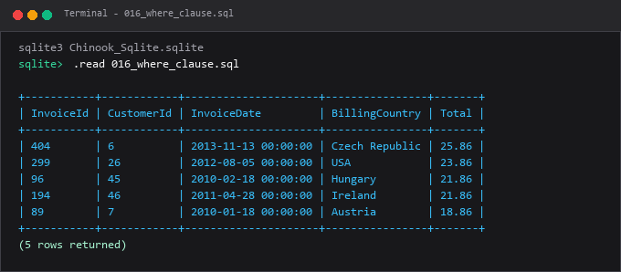

##### 17. Relational Comparison Operators

- **Source Code**: [`017_comparison_operators.sql`](./module-02-select-filtering-dan-sorting/017_comparison_operators.sql)
- **Key Concept**: Applying relational comparison operators (=, !=, <, >, <=, >=) to evaluate numeric thresholds.
- **Mechanism**: Filters Track records where track duration Milliseconds is greater than or equal to 500,000 (~8.3 minutes).
- **Execution Output**:

  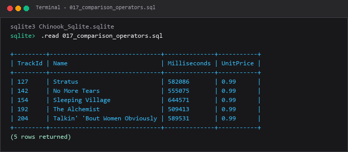

##### 18. Boolean Compound Logic with AND, OR, and NOT

- **Source Code**: [`018_logical_operators.sql`](./module-02-select-filtering-dan-sorting/018_logical_operators.sql)
- **Key Concept**: Combining multiple filter criteria using Boolean operators AND, OR, and NOT with operator precedence.
- **Mechanism**: Retrieves Customer records from the USA located in California or outside state CA.
- **Execution Output**:

  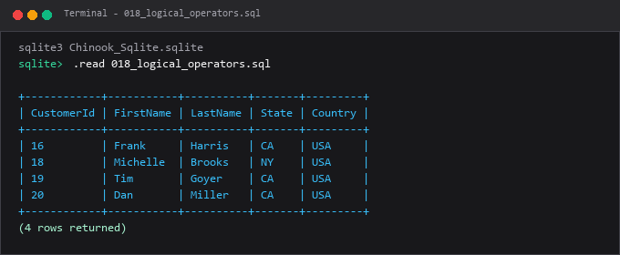

##### 19. Inclusive Range Filtering with the BETWEEN Operator

- **Source Code**: [`019_between_operator.sql`](./module-02-select-filtering-dan-sorting/019_between_operator.sql)
- **Key Concept**: Evaluating inclusive numerical and temporal ranges using the BETWEEN ... AND operator.
- **Mechanism**: Queries Invoice records where Total sales amounts fall inclusively between 10.00 and 15.00.
- **Execution Output**:

  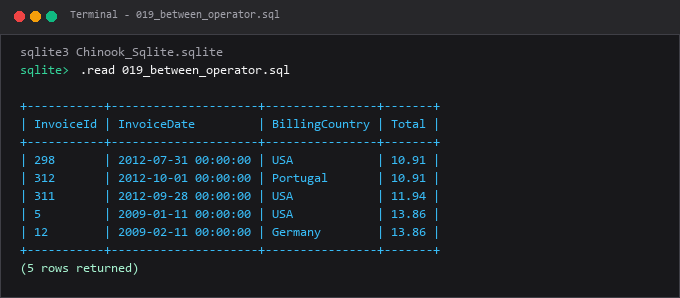

##### 20. Set Membership Matching with the IN Operator

- **Source Code**: [`020_in_operator.sql`](./module-02-select-filtering-dan-sorting/020_in_operator.sql)
- **Key Concept**: Matching attribute values against discrete lists of literal values using the IN operator.
- **Mechanism**: Filters Customer records residing in Brazil, Canada, or Germany.
- **Execution Output**:

  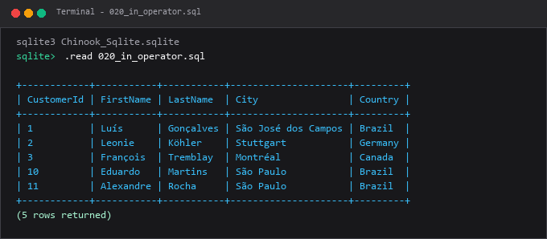

##### 21. Exclusion Set Filtering with the NOT IN Operator

- **Source Code**: [`021_not_in_operator.sql`](./module-02-select-filtering-dan-sorting/021_not_in_operator.sql)
- **Key Concept**: Excluding specific sets of literal values from query results using the NOT IN operator.
- **Mechanism**: Filters Track records excluding MPEG audio (MediaTypeId 1) and AAC audio (MediaTypeId 5).
- **Execution Output**:

  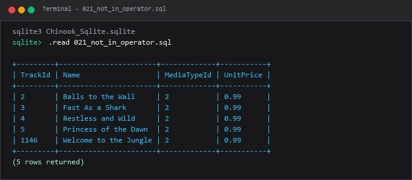

##### 22. String Pattern Matching with the LIKE Operator

- **Source Code**: [`022_like_operator.sql`](./module-02-select-filtering-dan-sorting/022_like_operator.sql)
- **Key Concept**: Searching textual columns for dynamic character patterns using the LIKE operator.
- **Mechanism**: Retrieves all Track records where track name begins with the word 'Love'.
- **Execution Output**:

  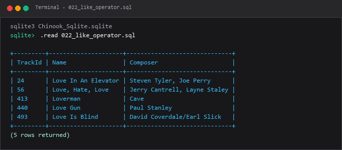

##### 23. Multi-Character and Single-Character Wildcards (% and _)

- **Source Code**: [`023_wildcard_patterns.sql`](./module-02-select-filtering-dan-sorting/023_wildcard_patterns.sql)
- **Key Concept**: Constructing sophisticated pattern searches using multi-character (%) and single-character (_) wildcards.
- **Mechanism**: Searches for Artist records having exactly three-character names starting with 'U'.
- **Execution Output**:

  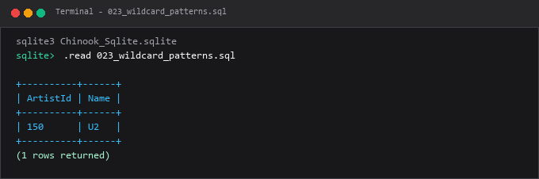

##### 24. Escaping Literal Wildcard Characters in Pattern Searches

- **Source Code**: [`024_escape_like_patterns.sql`](./module-02-select-filtering-dan-sorting/024_escape_like_patterns.sql)
- **Key Concept**: Escaping literal wildcard characters (percent and underscore) using custom ESCAPE definitions.
- **Mechanism**: Demonstrates searching for literal percentage or underscore characters in string fields using ESCAPE '/'.
- **Execution Output**:

  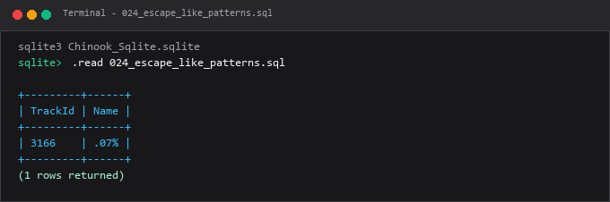

##### 25. Evaluating Missing Values with the IS NULL Predicate

- **Source Code**: [`025_is_null_operator.sql`](./module-02-select-filtering-dan-sorting/025_is_null_operator.sql)
- **Key Concept**: Evaluating unknown or missing data attributes using the explicit IS NULL comparison predicate.
- **Mechanism**: Retrieves retail Customer records who have no corporate affiliation (Company IS NULL).
- **Execution Output**:

  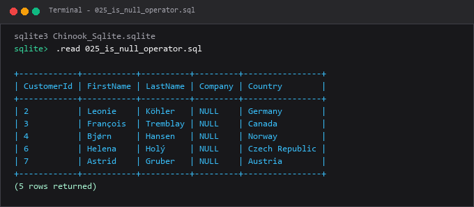

##### 26. Filtering Non-Empty Rows with the IS NOT NULL Predicate

- **Source Code**: [`026_is_not_null.sql`](./module-02-select-filtering-dan-sorting/026_is_not_null.sql)
- **Key Concept**: Filtering rows to include only populated, non-missing attributes using the IS NOT NULL predicate.
- **Mechanism**: Filters Customer records having populated corporate employer values (Company IS NOT NULL).
- **Execution Output**:

  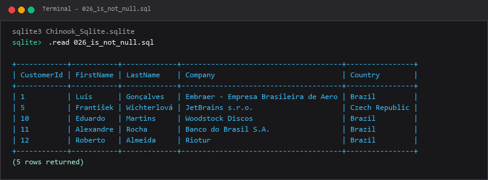

##### 27. Ascending Result Set Sorting with ORDER BY ASC

- **Source Code**: [`027_order_by_ascending.sql`](./module-02-select-filtering-dan-sorting/027_order_by_ascending.sql)
- **Key Concept**: Ordering result sets in alphanumeric ascending sequence using ORDER BY ASC.
- **Mechanism**: Sorts Track titles in ascending alphabetical order constrained to the first 10 rows.
- **Execution Output**:

  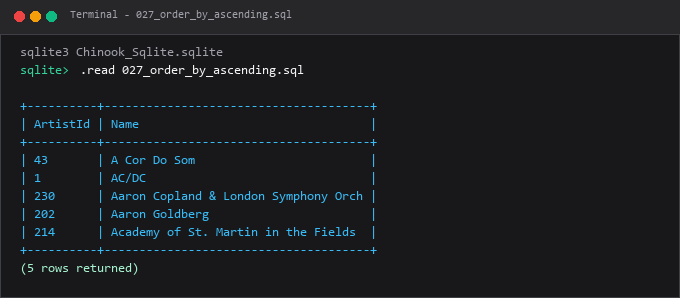

##### 28. Descending Result Set Sorting with ORDER BY DESC

- **Source Code**: [`028_order_by_descending.sql`](./module-02-select-filtering-dan-sorting/028_order_by_descending.sql)
- **Key Concept**: Sorting numerical and temporal result sets in descending sequence using ORDER BY DESC.
- **Mechanism**: Orders Invoice records by invoice transaction Total from highest to lowest.
- **Execution Output**:

  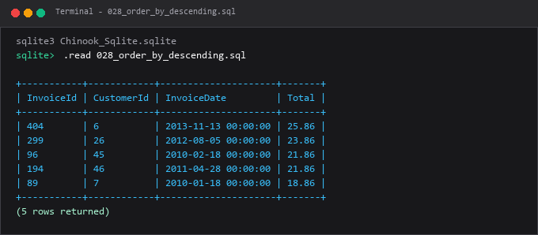

##### 29. Hierarchical Multi-Column Tie-Breaking in ORDER BY

- **Source Code**: [`029_order_by_multiple_columns.sql`](./module-02-select-filtering-dan-sorting/029_order_by_multiple_columns.sql)
- **Key Concept**: Implementing hierarchical multi-column tie-breaking in result set ordering.
- **Mechanism**: Sorts Customer records primarily by Country ascending and secondarily by City ascending.
- **Execution Output**:

  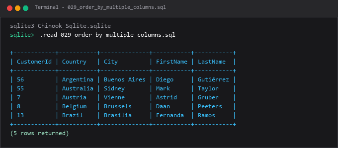

##### 30. Sorting Result Sets by Computed Expressions and Aliases

- **Source Code**: [`030_order_by_expressions.sql`](./module-02-select-filtering-dan-sorting/030_order_by_expressions.sql)
- **Key Concept**: Ordering result sets dynamically based on calculated expressions and projected aliases.
- **Mechanism**: Sorts Track records by calculated unit price multiplied by quantity (UnitPrice * Bytes).
- **Execution Output**:

  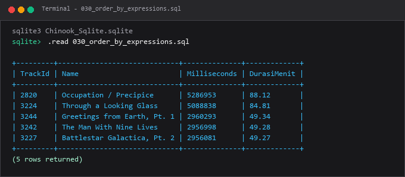

##### 31. Row Quantity Truncation with the LIMIT Clause

- **Source Code**: [`031_limit_rows.sql`](./module-02-select-filtering-dan-sorting/031_limit_rows.sql)
- **Key Concept**: Truncating result sets to a maximum fixed row threshold using the LIMIT clause.
- **Mechanism**: Restricts Invoice transactions to the top 5 highest-value sales records.
- **Execution Output**:

  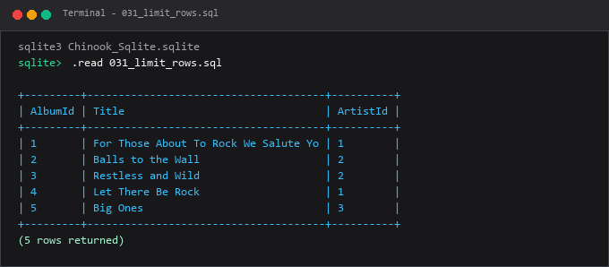

##### 32. Result Set Pagination with LIMIT and OFFSET

- **Source Code**: [`032_offset_pagination.sql`](./module-02-select-filtering-dan-sorting/032_offset_pagination.sql)
- **Key Concept**: Implementing deterministic page-based data pagination using paired LIMIT and OFFSET clauses.
- **Mechanism**: Fetches page 2 of Track records by skipping the first 10 rows (OFFSET 10) and taking 10 records (LIMIT 10).
- **Execution Output**:

  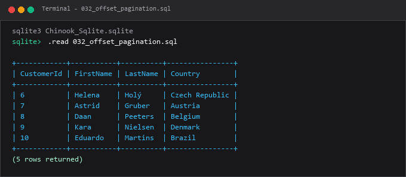

##### 33. Standard ANSI SQL Row Limiting with FETCH FIRST

- **Source Code**: [`033_fetch_first_rows.sql`](./module-02-select-filtering-dan-sorting/033_fetch_first_rows.sql)
- **Key Concept**: Restricting row counts using standard ANSI SQL FETCH FIRST n ROWS ONLY syntax.
- **Mechanism**: Simulates ANSI-standard row truncation syntax for cross-dialect compatibility across Oracle, DB2, and Postgres.
- **Execution Output**:

  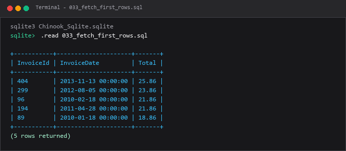

##### 34. SQL Server Dialect Top-N Limiting with SELECT TOP

- **Source Code**: [`034_top_rows_sqlserver.sql`](./module-02-select-filtering-dan-sorting/034_top_rows_sqlserver.sql)
- **Key Concept**: Understanding Microsoft SQL Server and Sybase SELECT TOP n dialect syntax.
- **Mechanism**: Examines dialect differences between SQL Server TOP n syntax and SQLite/PostgreSQL LIMIT clauses.
- **Execution Output**:

  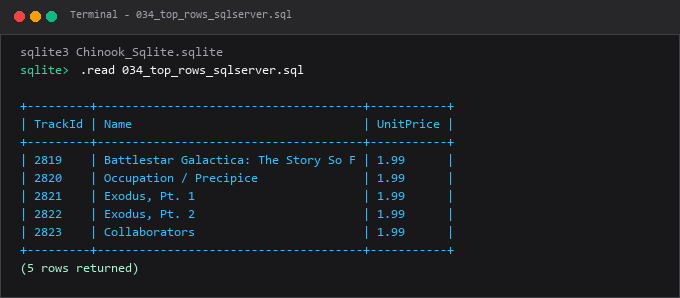

##### 35. Consolidated Filtering, Ordering, and Pagination Pipeline

- **Source Code**: [`035_filtering_and_sorting_combined.sql`](./module-02-select-filtering-dan-sorting/035_filtering_and_sorting_combined.sql)
- **Key Concept**: Synthesizing WHERE filtering, multi-column ORDER BY, and LIMIT/OFFSET into an end-to-end pipeline.
- **Mechanism**: Filters Canadian invoices exceeding 5.00, sorts them by Total descending, and paginates top results.
- **Execution Output**:

  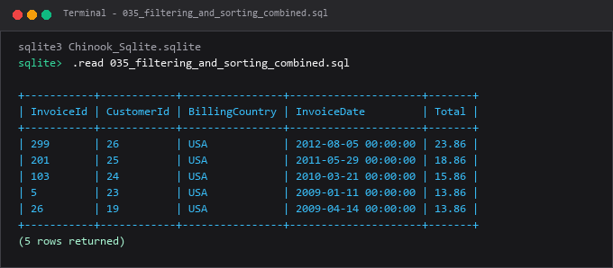

### Module 03: SQL Expressions and Scalar Functions

**Curriculum Path**: [`module-03-ekspresi-dan-fungsi-sql`](./module-03-ekspresi-dan-fungsi-sql) | **Level**: `Fundamental to Intermediate` | **Scope**: 20 Programs (036-055)

#### Overview & Concepts Covered

Explores conditional expressions, NULL handling functions, type conversions, and scalar transformations. Covers conditional branching with simple and searched CASE expressions, default imputation with COALESCE, sentinel matching via NULLIF, explicit casting with CAST and CONVERT, string manipulation (UPPER, LOWER, LENGTH, concatenation, SUBSTR, TRIM, REPLACE), numeric and arithmetic functions (ROUND, TRUNCATE, ABS, MOD, CEIL, FLOOR), and datetime operations (current date/time, component extraction, date arithmetic, intervals, date differences, and formatting).

#### Subtopics & Execution Captures

##### 36. Simple and Searched CASE Conditional Expressions

- **Source Code**: [`036_case_expression.sql`](./module-03-ekspresi-dan-fungsi-sql/036_case_expression.sql)
- **Key Concept**: Implementing conditional IF-THEN-ELSE branching logic in SQL queries using the CASE expression.
- **Mechanism**: Classifies Invoice transactions into 'Large Transaction' or 'Standard Transaction' based on Total >= 10.00.
- **Execution Output**:

  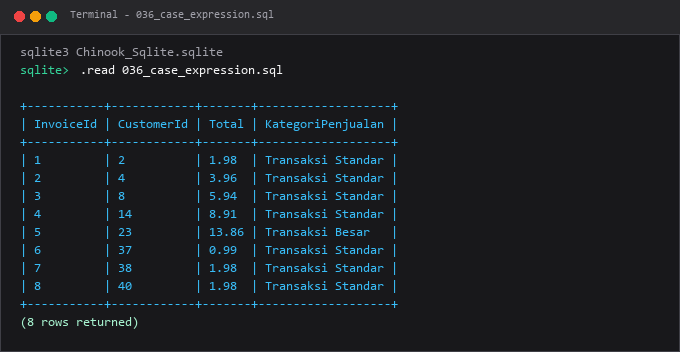

##### 37. Multi-Tiered Branching Logic with Nested CASE Conditions

- **Source Code**: [`037_case_multiple_conditions.sql`](./module-03-ekspresi-dan-fungsi-sql/037_case_multiple_conditions.sql)
- **Key Concept**: Evaluating multi-tiered categorical rules using searched CASE expressions with multiple WHEN branches.
- **Mechanism**: Categorizes Track audio lengths into 'Short', 'Medium', 'Long', and 'Epic' based on duration thresholds.
- **Execution Output**:

  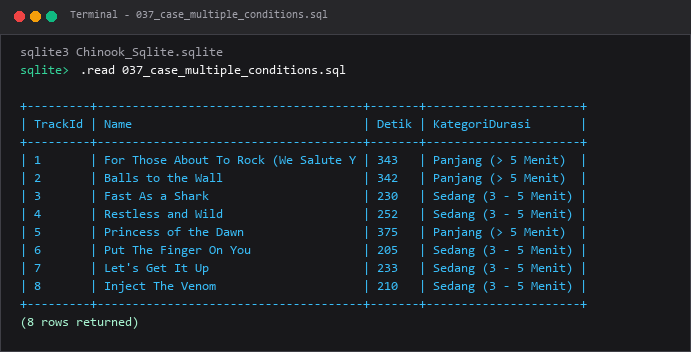

##### 38. First Non-NULL Value Imputation with COALESCE

- **Source Code**: [`038_coalesce_function.sql`](./module-03-ekspresi-dan-fungsi-sql/038_coalesce_function.sql)
- **Key Concept**: Imputing default fallback values for NULL attributes by returning the first non-NULL expression.
- **Mechanism**: Replaces NULL corporate values in Customer with 'Individual Customer' using COALESCE(Company, 'Individual Customer').
- **Execution Output**:

  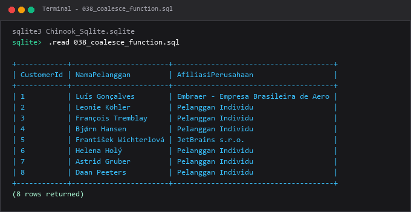

##### 39. Sentinel Value Equivalence and Division-by-Zero Guarding with NULLIF

- **Source Code**: [`039_nullif_function.sql`](./module-03-ekspresi-dan-fungsi-sql/039_nullif_function.sql)
- **Key Concept**: Guarding against division-by-zero errors and matching sentinel values using the NULLIF function.
- **Mechanism**: Returns NULL if two expressions evaluate to equal values, preventing arithmetic exceptions.
- **Execution Output**:

  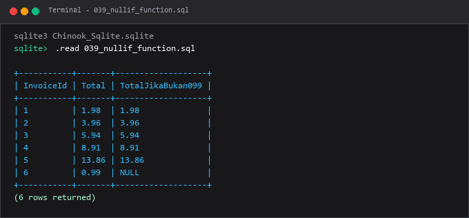

##### 40. Explicit Data Type Transformation with CAST

- **Source Code**: [`040_cast_conversion.sql`](./module-03-ekspresi-dan-fungsi-sql/040_cast_conversion.sql)
- **Key Concept**: Explicitly converting attribute values between data types using the ANSI standard CAST operator.
- **Mechanism**: Casts Invoice Total numeric values into integer and text strings (CAST(Total AS INT)).
- **Execution Output**:

  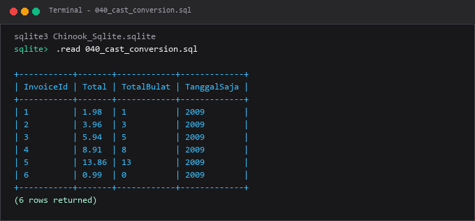

##### 41. Dialect-Specific Type Casting with the CONVERT Function

- **Source Code**: [`041_convert_function.sql`](./module-03-ekspresi-dan-fungsi-sql/041_convert_function.sql)
- **Key Concept**: Understanding dialect-specific type conversions using the CONVERT function in SQL Server and MySQL.
- **Mechanism**: Compares SQL Server CONVERT(VARCHAR, date, 120) syntax with standard SQL CAST operations.
- **Execution Output**:

  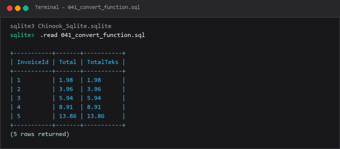

##### 42. String Concatenation Using the Pipe Operator (||)

- **Source Code**: [`042_string_concatenation.sql`](./module-03-ekspresi-dan-fungsi-sql/042_string_concatenation.sql)
- **Key Concept**: Merging multiple text attributes into a single string using the SQL standard pipe operator (||).
- **Mechanism**: Concatenates Employee.FirstName and Employee.LastName with space separation into a unified FullName attribute.
- **Execution Output**:

  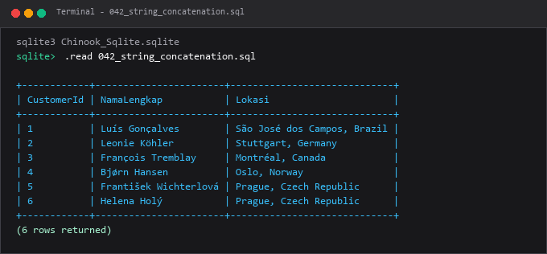

##### 43. String Concatenation with the CONCAT Function

- **Source Code**: [`043_concat_function.sql`](./module-03-ekspresi-dan-fungsi-sql/043_concat_function.sql)
- **Key Concept**: Combining text fields using scalar concatenation functions across standard and dialect SQL syntax.
- **Mechanism**: Demonstrates string concatenation syntax comparing standard pipes with MySQL CONCAT functions.
- **Execution Output**:

  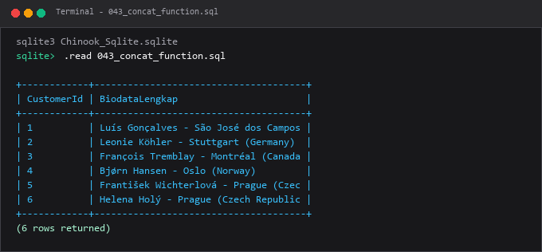

##### 44. Text Case Transformation with UPPER and LOWER

- **Source Code**: [`044_upper_lower_functions.sql`](./module-03-ekspresi-dan-fungsi-sql/044_upper_lower_functions.sql)
- **Key Concept**: Normalizing textual casing for case-insensitive presentation and searching using UPPER and LOWER.
- **Mechanism**: Converts Customer name and email attributes to uppercase and lowercase representations.
- **Execution Output**:

  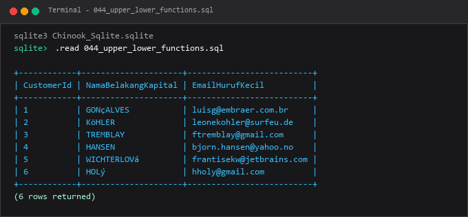

##### 45. Trimming Surrounding Whitespace with TRIM, LTRIM, and RTRIM

- **Source Code**: [`045_trim_functions.sql`](./module-03-ekspresi-dan-fungsi-sql/045_trim_functions.sql)
- **Key Concept**: Sanitizing textual data by stripping extraneous leading, trailing, and surrounding whitespace.
- **Mechanism**: Applies TRIM, LTRIM, and RTRIM functions to sanitize padded strings and user inputs.
- **Execution Output**:

  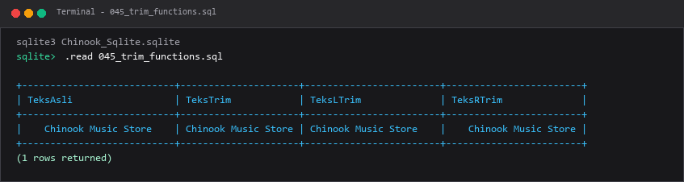

##### 46. Measuring String Character Length with LENGTH

- **Source Code**: [`046_length_functions.sql`](./module-03-ekspresi-dan-fungsi-sql/046_length_functions.sql)
- **Key Concept**: Evaluating string character counts and byte lengths with LENGTH and LEN scalar functions.
- **Mechanism**: Measures the character length of Track song titles to sort and identify the longest track titles in the catalog.
- **Execution Output**:

  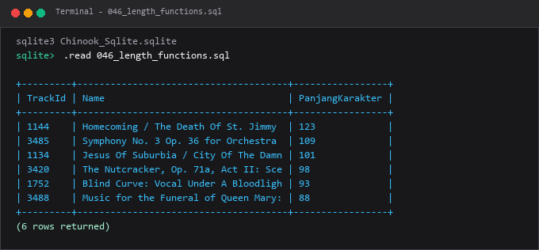

##### 47. Extracting Positional Substrings with SUBSTR

- **Source Code**: [`047_substring_function.sql`](./module-03-ekspresi-dan-fungsi-sql/047_substring_function.sql)
- **Key Concept**: Extracting targeted positional character segments from text attributes using SUBSTR and SUBSTRING.
- **Mechanism**: Extracts phone area codes and regional prefixes from customer contact numbers using SUBSTR(Phone, 1, 5).
- **Execution Output**:

  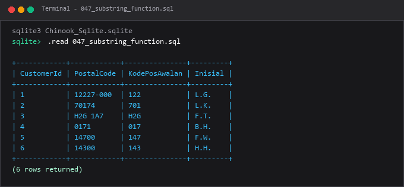

##### 48. Targeted String Replacement with the REPLACE Function

- **Source Code**: [`048_replace_function.sql`](./module-03-ekspresi-dan-fungsi-sql/048_replace_function.sql)
- **Key Concept**: Substituting target character patterns within textual attributes using the REPLACE function.
- **Mechanism**: Replaces corporate email domain names in Employee records using REPLACE(Email, 'chinookcorp.com', 'enterprise.io').
- **Execution Output**:

  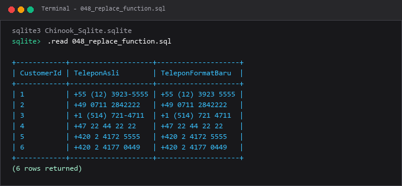

##### 49. Searching Substring Positions with INSTR and POSITION

- **Source Code**: [`049_position_search_functions.sql`](./module-03-ekspresi-dan-fungsi-sql/049_position_search_functions.sql)
- **Key Concept**: Locating the starting numerical character index of substrings using INSTR and POSITION functions.
- **Mechanism**: Finds the positional offset of the '@' delimiter within Customer email strings.
- **Execution Output**:

  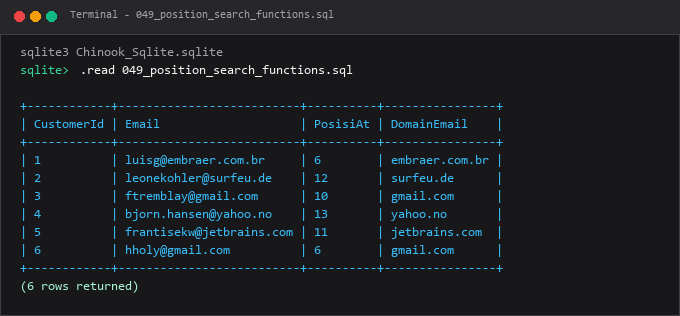

##### 50. Precision Decimal Rounding with the ROUND Function

- **Source Code**: [`050_round_function.sql`](./module-03-ekspresi-dan-fungsi-sql/050_round_function.sql)
- **Key Concept**: Rounding numerical decimal values to specified decimal precision using the ROUND function.
- **Mechanism**: Calculates and rounds transaction sales tax values to two decimal places using ROUND(Total * 0.11, 2).
- **Execution Output**:

  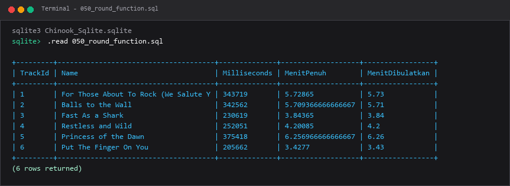

##### 51. Absolute Magnitude Evaluation with the ABS Function

- **Source Code**: [`051_abs_function.sql`](./module-03-ekspresi-dan-fungsi-sql/051_abs_function.sql)
- **Key Concept**: Evaluating the non-negative absolute magnitude of signed numeric differences using ABS().
- **Mechanism**: Calculates absolute deviations between invoice transaction totals and baseline average sales values.
- **Execution Output**:

  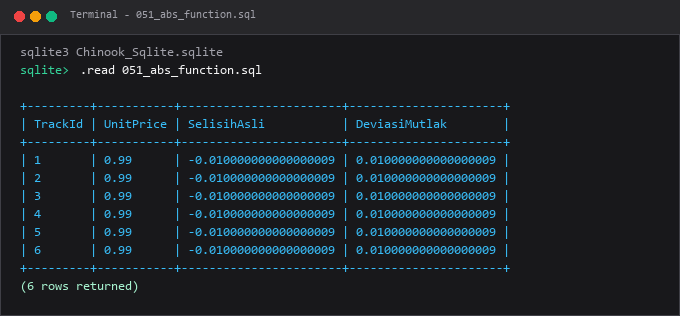

##### 52. Integer Boundary Rounding with CEIL and FLOOR

- **Source Code**: [`052_ceil_floor_functions.sql`](./module-03-ekspresi-dan-fungsi-sql/052_ceil_floor_functions.sql)
- **Key Concept**: Rounding floating-point values to nearest superior (CEIL) or inferior (FLOOR) integer boundaries.
- **Mechanism**: Demonstrates ceiling and flooring arithmetic on fractional quantities and shipping rates.
- **Execution Output**:

  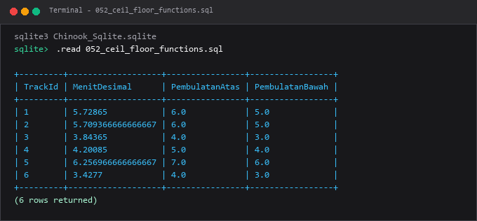

##### 53. Remainder Calculation Using Modulo Arithmetic (%)

- **Source Code**: [`053_modulo_function.sql`](./module-03-ekspresi-dan-fungsi-sql/053_modulo_function.sql)
- **Key Concept**: Evaluating integer division remainders using the modulo operator (%) to assess parity and cyclicality.
- **Mechanism**: Determines whether InvoiceId is even or odd using InvoiceId % 2 = 0.
- **Execution Output**:

  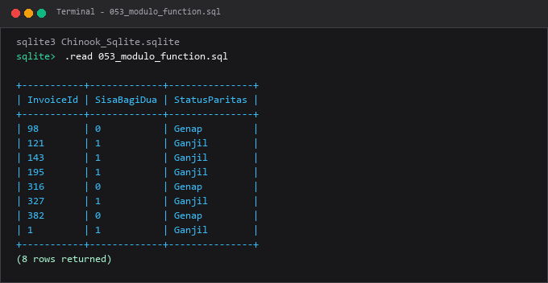

##### 54. Extracting Date Components (Year, Month, Day) with strftime

- **Source Code**: [`054_date_extraction.sql`](./module-03-ekspresi-dan-fungsi-sql/054_date_extraction.sql)
- **Key Concept**: Extracting date sub-components (year, month, day, weekday) using strftime and EXTRACT.
- **Mechanism**: Extracts the calendar year and month of sales from InvoiceDate using strftime('%Y', InvoiceDate).
- **Execution Output**:

  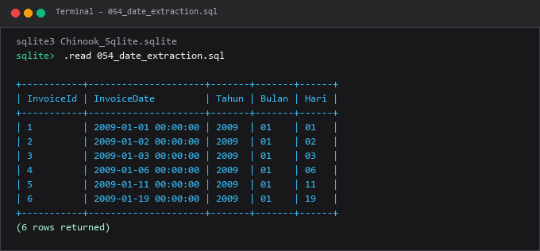

##### 55. Datetime Arithmetic, Intervals, and Difference Calculations

- **Source Code**: [`055_date_arithmetic.sql`](./module-03-ekspresi-dan-fungsi-sql/055_date_arithmetic.sql)
- **Key Concept**: Performing date additions, interval calculations, and temporal difference evaluations.
- **Mechanism**: Calculates payment due dates by adding 30 days to InvoiceDate using date(InvoiceDate, '+30 days').
- **Execution Output**:

  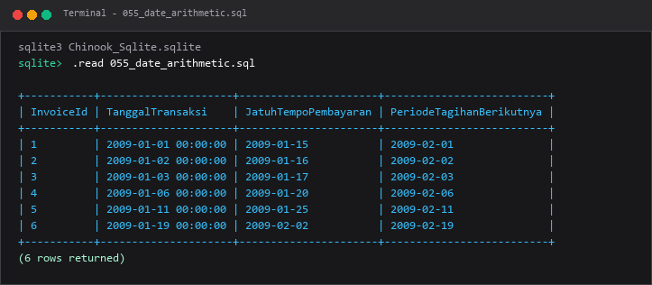

### Module 04: Data Aggregation and Grouping

**Curriculum Path**: [`module-04-agregasi-dan-pengelompokan-data`](./module-04-agregasi-dan-pengelompokan-data) | **Level**: `Intermediate` | **Scope**: 15 Programs (056-070)

#### Overview & Concepts Covered

Focuses on summary statistics, aggregate functions, and categorical grouping. Covers standard aggregate functions (COUNT, COUNT DISTINCT, SUM, AVG, MIN, MAX), categorical grouping using single-column and multi-column GROUP BY, post-aggregation filtering with the HAVING clause, the architectural difference between WHERE and HAVING execution phases, conditional aggregation using embedded CASE statements, multidimensional aggregations (ROLLUP, CUBE, GROUPING SETS), and grouping by derived expressions.

#### Subtopics & Execution Captures

##### 56. Row and Non-Null Value Counting with COUNT(*) and COUNT(col)

- **Source Code**: [`056_count_function.sql`](./module-04-agregasi-dan-pengelompokan-data/056_count_function.sql)
- **Key Concept**: Evaluating record cardinality with COUNT(*) vs. non-null attribute counts with COUNT(column).
- **Mechanism**: Counts total customers, corporate customers with non-null company names, and individual retail customers.
- **Execution Output**:

  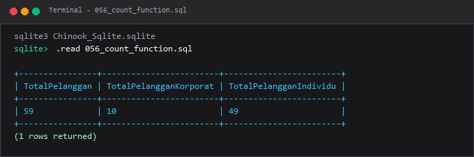

##### 57. Cardinality Evaluation with COUNT(DISTINCT col)

- **Source Code**: [`057_count_distinct.sql`](./module-04-agregasi-dan-pengelompokan-data/057_count_distinct.sql)
- **Key Concept**: Evaluating unique entity cardinality across attribute distributions using COUNT(DISTINCT col).
- **Mechanism**: Calculates the count of distinct countries where Chinook customers reside.
- **Execution Output**:

  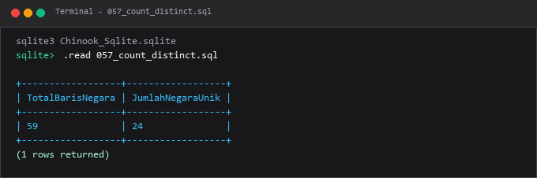

##### 58. Total Aggregate Calculation with the SUM Function

- **Source Code**: [`058_sum_function.sql`](./module-04-agregasi-dan-pengelompokan-data/058_sum_function.sql)
- **Key Concept**: Calculating aggregate financial and quantitative totals across numerical columns with SUM().
- **Mechanism**: Aggregates total gross revenue generated across all transactions in the Invoice table.
- **Execution Output**:

  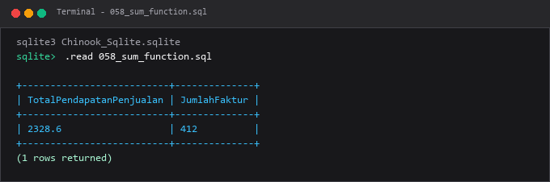

##### 59. Arithmetic Mean Calculation with the AVG Function

- **Source Code**: [`059_avg_function.sql`](./module-04-agregasi-dan-pengelompokan-data/059_avg_function.sql)
- **Key Concept**: Computing arithmetic mean values across numerical datasets using the AVG() function.
- **Mechanism**: Calculates the average track duration and average invoice transaction amount.
- **Execution Output**:

  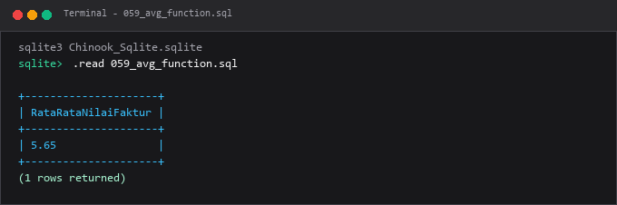

##### 60. Boundary Value Extremes with the MIN and MAX Functions

- **Source Code**: [`060_min_max_functions.sql`](./module-04-agregasi-dan-pengelompokan-data/060_min_max_functions.sql)
- **Key Concept**: Identifying extreme boundary values across numerical, temporal, and alphanumeric distributions.
- **Mechanism**: Finds the lowest, highest, earliest, and latest transaction values from the Invoice table.
- **Execution Output**:

  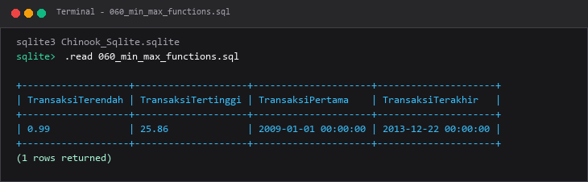

##### 61. Single-Column Categorical Aggregation with GROUP BY

- **Source Code**: [`061_group_by_basic.sql`](./module-04-agregasi-dan-pengelompokan-data/061_group_by_basic.sql)
- **Key Concept**: Segmenting table rows into discrete categorical summary buckets using single-column GROUP BY.
- **Mechanism**: Groups invoice transactions by customer country to compute total sales and order volumes per jurisdiction.
- **Execution Output**:

  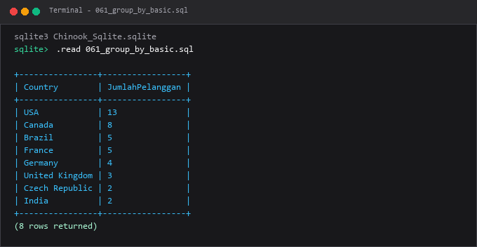

##### 62. Multi-Dimensional Composite Grouping with GROUP BY

- **Source Code**: [`062_group_by_multiple_columns.sql`](./module-04-agregasi-dan-pengelompokan-data/062_group_by_multiple_columns.sql)
- **Key Concept**: Aggregating multidimensional categorical hierarchies using composite multi-column GROUP BY.
- **Mechanism**: Groups invoice transactions by Country and State to analyze geographic sales concentrations.
- **Execution Output**:

  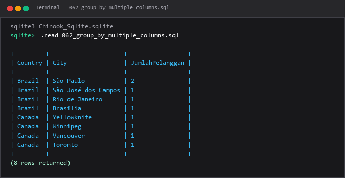

##### 63. Post-Aggregation Metric Filtering with the HAVING Clause

- **Source Code**: [`063_having_clause.sql`](./module-04-agregasi-dan-pengelompokan-data/063_having_clause.sql)
- **Key Concept**: Filtering aggregated group metric summaries using post-aggregation HAVING predicates.
- **Mechanism**: Filters customer countries to retain only those jurisdictions generating more than $100 in total sales.
- **Execution Output**:

  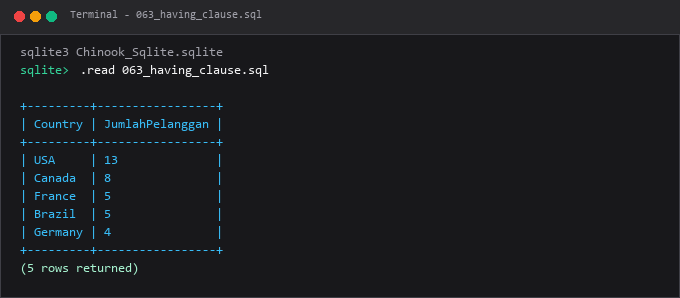

##### 64. Execution Phase Distinction: Pre-Filter WHERE vs. Post-Filter HAVING

- **Source Code**: [`064_where_vs_having.sql`](./module-04-agregasi-dan-pengelompokan-data/064_where_vs_having.sql)
- **Key Concept**: Understanding execution lifecycle boundaries between pre-aggregation WHERE and post-aggregation HAVING.
- **Mechanism**: Applies pre-filters on individual track prices before grouping and applying post-filters on album totals.
- **Execution Output**:

  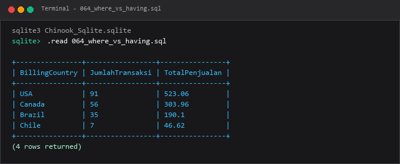

##### 65. Conditional Metric Aggregation Using Embedded CASE Statements

- **Source Code**: [`065_conditional_aggregation.sql`](./module-04-agregasi-dan-pengelompokan-data/065_conditional_aggregation.sql)
- **Key Concept**: Computing categorical summary totals within a single pass using SUM/COUNT with embedded CASE statements.
- **Mechanism**: Pivots country sales into separate columns for USA, Canada, and Europe in a single query.
- **Execution Output**:

  

##### 66. Aggregate Function Behavior and NULL Value Handling

- **Source Code**: [`066_aggregate_null_handling.sql`](./module-04-agregasi-dan-pengelompokan-data/066_aggregate_null_handling.sql)
- **Key Concept**: Evaluating how aggregate functions handle NULL values compared to explicit zero defaults.
- **Mechanism**: Demonstrates that COUNT(col) ignores NULL values while COUNT(*) and SUM with COALESCE account for missing rows.
- **Execution Output**:

  

##### 67. Grouping Relational Records by Computed Expressions

- **Source Code**: [`067_group_by_expressions.sql`](./module-04-agregasi-dan-pengelompokan-data/067_group_by_expressions.sql)
- **Key Concept**: Grouping relational records by computed expressions, date components, and scalar transformations.
- **Mechanism**: Groups invoice records by calendar year extracted from InvoiceDate using strftime('%Y', InvoiceDate).
- **Execution Output**:

  

##### 68. Hierarchical Subtotal and Grand Total Generation with ROLLUP

- **Source Code**: [`068_rollup_aggregation.sql`](./module-04-agregasi-dan-pengelompokan-data/068_rollup_aggregation.sql)
- **Key Concept**: Generating hierarchical subtotal and grand total summary rows using the ROLLUP grouping extension.
- **Mechanism**: Computes multidimensional sales subtotals grouped by country, state, and global grand total.
- **Execution Output**:

  

##### 69. Cross-Dimensional Matrix Aggregation with CUBE

- **Source Code**: [`069_cube_aggregation.sql`](./module-04-agregasi-dan-pengelompokan-data/069_cube_aggregation.sql)
- **Key Concept**: Evaluating all dimensional cross-tabular combinations with the CUBE grouping operator.
- **Mechanism**: Generates all possible subtotal combinations across genre categories and media format dimensions.
- **Execution Output**:

  

##### 70. Custom Dimensional Slice Aggregation with GROUPING SETS

- **Source Code**: [`070_grouping_sets.sql`](./module-04-agregasi-dan-pengelompokan-data/070_grouping_sets.sql)
- **Key Concept**: Specifying explicit custom dimensional slices for aggregate reporting via GROUPING SETS.
- **Mechanism**: Defines granular reporting sets aggregating sales separately by customer country and by calendar year.
- **Execution Output**:

  

### Module 05: Table Relationships and Joins

**Curriculum Path**: [`module-05-join-dan-relasi-antartabel`](./module-05-join-dan-relasi-antartabel) | **Level**: `Intermediate` | **Scope**: 20 Programs (071-090)

#### Overview & Concepts Covered

Delves into relational algebra and multi-table operations across normalized database schemas. Covers INNER JOIN for exact key matches, LEFT OUTER JOIN, RIGHT OUTER JOIN, and FULL OUTER JOIN for preserving unmatched rows, CROSS JOIN Cartesian products, self-joins for hierarchical tree navigation, natural joins, non-equi joins using inequality/range predicates, multi-table joins across 3+ entities, anti-joins (LEFT JOIN ... WHERE NULL and NOT EXISTS), semi-joins, derived table joins, the USING clause, composite key joins, joining aggregated result sets, and preventing Cartesian explosion.

#### Subtopics & Execution Captures

##### 71. Exact Key Match Relational Joining with INNER JOIN

- **Source Code**: [`071_inner_join.sql`](./module-05-join-dan-relasi-antartabel/071_inner_join.sql)
- **Key Concept**: Connecting relational entities based on matching foreign key values with INNER JOIN.
- **Mechanism**: Joins the Album table with Artist on ArtistId to pair each music album with its creator.
- **Execution Output**:

  

##### 72. Preserving Unmatched Left Rows with LEFT OUTER JOIN

- **Source Code**: [`072_left_join.sql`](./module-05-join-dan-relasi-antartabel/072_left_join.sql)
- **Key Concept**: Preserving all records from the left entity table regardless of matching right-table records with LEFT JOIN.
- **Mechanism**: Retrieves all artists and their corresponding albums, preserving artists who have no catalog albums.
- **Execution Output**:

  

##### 73. Preserving Unmatched Right Rows with RIGHT OUTER JOIN

- **Source Code**: [`073_right_join.sql`](./module-05-join-dan-relasi-antartabel/073_right_join.sql)
- **Key Concept**: Preserving all records from the right entity table using RIGHT OUTER JOIN and dialect transformations.
- **Mechanism**: Simulates or executes RIGHT JOIN between Album and Artist to preserve right-side album entries.
- **Execution Output**:

  

##### 74. Complete Relational Union Joining with FULL OUTER JOIN

- **Source Code**: [`074_full_outer_join.sql`](./module-05-join-dan-relasi-antartabel/074_full_outer_join.sql)
- **Key Concept**: Merging two entity tables while preserving unmatched records from both tables with FULL OUTER JOIN.
- **Mechanism**: Combines all records from two entities, returning NULL attributes where keys do not intersect.
- **Execution Output**:

  

##### 75. Cartesian Product Generation with CROSS JOIN

- **Source Code**: [`075_cross_join.sql`](./module-05-join-dan-relasi-antartabel/075_cross_join.sql)
- **Key Concept**: Generating complete Cartesian products pairing every row of the left table with every row of the right table.
- **Mechanism**: Cross-joins MediaType and Genre to evaluate all potential catalog taxonomy combinations.
- **Execution Output**:

  

##### 76. Recursive Hierarchy Traversal via Table Self-Join

- **Source Code**: [`076_self_join.sql`](./module-05-join-dan-relasi-antartabel/076_self_join.sql)
- **Key Concept**: Joining a table to itself to traverse unary hierarchical relationships such as manager-subordinate trees.
- **Mechanism**: Joins Employee to itself on ReportsTo = EmployeeId to pair each staff member with their direct manager.
- **Execution Output**:

  

##### 77. Implicit Common Column Equi-Joining with NATURAL JOIN

- **Source Code**: [`077_natural_join.sql`](./module-05-join-dan-relasi-antartabel/077_natural_join.sql)
- **Key Concept**: Equi-joining tables implicitly based on identical column names using NATURAL JOIN.
- **Mechanism**: Joins Album and Artist implicitly on their shared ArtistId attribute.
- **Execution Output**:

  

##### 78. Range and Inequality Joins via Non-Equi Predicates

- **Source Code**: [`078_non_equi_join.sql`](./module-05-join-dan-relasi-antartabel/078_non_equi_join.sql)
- **Key Concept**: Connecting tables using inequality and range comparison predicates (<, >, BETWEEN) rather than equality.
- **Mechanism**: Pairs invoice transaction totals with commission tier tables using range boundary predicates.
- **Execution Output**:

  

##### 79. Multi-Entity Relational Joining Across Normalized Schemas

- **Source Code**: [`079_join_multiple_tables.sql`](./module-05-join-dan-relasi-antartabel/079_join_multiple_tables.sql)
- **Key Concept**: Traversing normalized relational schemas across multiple chained table join operations.
- **Mechanism**: Connects Customer, Invoice, and InvoiceLine to trace customer purchases down to individual line items.
- **Execution Output**:

  

##### 80. Three-Table Transactional Joining Across Track, Album, and Artist

- **Source Code**: [`080_join_three_tables.sql`](./module-05-join-dan-relasi-antartabel/080_join_three_tables.sql)
- **Key Concept**: Connecting three core relational entities in a production transaction processing pipeline.
- **Mechanism**: Connects Track, Album, and Artist to project complete musical catalog metadata.
- **Execution Output**:

  

##### 81. Relational Joining on Multi-Column Composite Keys

- **Source Code**: [`081_composite_key_join.sql`](./module-05-join-dan-relasi-antartabel/081_composite_key_join.sql)
- **Key Concept**: Joining tables with compound relationships using multiple simultaneous key predicates.
- **Mechanism**: Joins associative bridge tables using composite primary-foreign key matching on multiple columns.
- **Execution Output**:

  

##### 82. Explicit Join Condition Specification with the ON Clause

- **Source Code**: [`082_join_conditions_on.sql`](./module-05-join-dan-relasi-antartabel/082_join_conditions_on.sql)
- **Key Concept**: Disambiguating and defining explicit join relationships using the ON clause.
- **Mechanism**: Explicitly specifies join key alignment between Invoice.CustomerId and Customer.CustomerId.
- **Execution Output**:

  

##### 83. Simplified Equi-Join Column Merging with the USING Clause

- **Source Code**: [`083_join_using_clause.sql`](./module-05-join-dan-relasi-antartabel/083_join_using_clause.sql)
- **Key Concept**: Simplifying equi-joins on identical column names without column duplication using USING (col).
- **Mechanism**: Joins Invoice and Customer using USING (CustomerId) to produce unified key projections.
- **Execution Output**:

  

##### 84. Filter Placement Semantics in Outer Joins: ON vs. WHERE

- **Source Code**: [`084_join_filter_placement.sql`](./module-05-join-dan-relasi-antartabel/084_join_filter_placement.sql)
- **Key Concept**: Understanding filter placement semantics in outer joins: ON predicate filtering vs. WHERE post-filtering.
- **Mechanism**: Demonstrates how filtering in the ON clause preserves unmatched left rows while WHERE filters discard them.
- **Execution Output**:

  

##### 85. Exclusion Querying and Orphan Detection via Anti-Join Patterns

- **Source Code**: [`085_anti_join.sql`](./module-05-join-dan-relasi-antartabel/085_anti_join.sql)
- **Key Concept**: Identifying orphan and unreferenced records using LEFT JOIN ... WHERE right.key IS NULL.
- **Mechanism**: Finds all artists in the catalog who currently have zero published albums in the Album table.
- **Execution Output**:

  

##### 86. Subquery Existence Validation via Semi-Join Semantics

- **Source Code**: [`086_semi_join.sql`](./module-05-join-dan-relasi-antartabel/086_semi_join.sql)
- **Key Concept**: Filtering primary table records based on existence in a secondary table without duplicating rows.
- **Mechanism**: Retrieves customers who have placed at least one high-value order without expanding invoice rows.
- **Execution Output**:

  

##### 87. Joining Base Tables with Pre-Aggregated Relational Data

- **Source Code**: [`087_join_with_aggregation.sql`](./module-05-join-dan-relasi-antartabel/087_join_with_aggregation.sql)
- **Key Concept**: Joining base tables with pre-aggregated subqueries to incorporate summary metrics alongside row details.
- **Mechanism**: Joins Customer records with a summary subquery calculating lifetime order spend per customer.
- **Execution Output**:

  

##### 88. Diagnosing and Preventing Accidental Row Duplication in Joins

- **Source Code**: [`088_join_duplicate_rows.sql`](./module-05-join-dan-relasi-antartabel/088_join_duplicate_rows.sql)
- **Key Concept**: Diagnosing and preventing unintended Cartesian row multiplication in multi-table joins.
- **Mechanism**: Examines how non-unique join keys cause row explosion and demonstrates proper key disambiguation.
- **Execution Output**:

  

##### 89. Traversing Many-to-Many Relationships via Bridge Junction Tables

- **Source Code**: [`089_bridge_table_join.sql`](./module-05-join-dan-relasi-antartabel/089_bridge_table_join.sql)
- **Key Concept**: Traversing many-to-many (N:M) relationships across associative junction bridge tables.
- **Mechanism**: Joins Playlist, PlaylistTrack, and Track to reconstruct playlist song contents.
- **Execution Output**:

  

##### 90. Joining Base Tables with Inline Derived Table Subqueries

- **Source Code**: [`090_join_with_derived_table.sql`](./module-05-join-dan-relasi-antartabel/090_join_with_derived_table.sql)
- **Key Concept**: Joining base tables with inline derived virtual tables defined inside the FROM clause.
- **Mechanism**: Joins Album entities with an inline subquery computing track counts and total album duration.
- **Execution Output**:

  

### Module 06: Subqueries, Common Table Expressions, and Set Operations

**Curriculum Path**: [`module-06-subquery-cte-dan-set-operations`](./module-06-subquery-cte-dan-set-operations) | **Level**: `Intermediate to Advanced` | **Scope**: 20 Programs (091-110)

#### Overview & Concepts Covered

Explores modular query decomposition, nested execution, and mathematical set theory. Covers scalar subqueries returning single values, single-row and multi-row subqueries using IN, derived tables in the FROM clause, correlated subqueries referencing outer query rows, existential predicates (EXISTS, NOT EXISTS), quantified comparison operators (ANY, ALL), projection subqueries, non-recursive Common Table Expressions (WITH CTE), multi-CTE pipelines, recursive CTEs for hierarchical organizational trees, and relational set operations (UNION, UNION ALL, INTERSECT, EXCEPT/MINUS).

#### Subtopics & Execution Captures

##### 91. Single-Value Projection and Comparison via Scalar Subqueries

- **Source Code**: [`091_scalar_subquery.sql`](./module-06-subquery-cte-dan-set-operations/091_scalar_subquery.sql)
- **Key Concept**: Using scalar subqueries returning exactly one row and one column in expressions and comparisons.
- **Mechanism**: Filters Invoice records whose Total exceeds the global average invoice amount.
- **Execution Output**:

  

##### 92. Single-Row Relational Comparison Subqueries

- **Source Code**: [`092_single_row_subquery.sql`](./module-06-subquery-cte-dan-set-operations/092_single_row_subquery.sql)
- **Key Concept**: Comparing row attributes against single-row subquery results using relational operators.
- **Mechanism**: Retrieves all tracks that have the exact same duration as track 'Fast As a Shark'.
- **Execution Output**:

  

##### 93. Multi-Row Set Comparison with Subqueries and IN

- **Source Code**: [`093_multirow_subquery.sql`](./module-06-subquery-cte-dan-set-operations/093_multirow_subquery.sql)
- **Key Concept**: Filtering rows against multi-row subquery result sets using the IN and NOT IN operators.
- **Mechanism**: Retrieves all albums created by artists residing in Latin music genres.
- **Execution Output**:

  

##### 94. Row-by-Row Contextual Evaluation via Correlated Subqueries

- **Source Code**: [`094_correlated_subquery.sql`](./module-06-subquery-cte-dan-set-operations/094_correlated_subquery.sql)
- **Key Concept**: Evaluating row-by-row contextual queries where inner subqueries reference columns of outer queries.
- **Mechanism**: Finds tracks whose duration exceeds the average track length within their specific parent album.
- **Execution Output**:

  

##### 95. High-Performance Existence Checking with the EXISTS Operator

- **Source Code**: [`095_exists_operator.sql`](./module-06-subquery-cte-dan-set-operations/095_exists_operator.sql)
- **Key Concept**: Validating record presence with high performance using the boolean EXISTS operator.
- **Mechanism**: Retrieves customers who have at least one purchase recorded in the Invoice table.
- **Execution Output**:

  

##### 96. Relational Non-Existence Filtering with NOT EXISTS

- **Source Code**: [`096_not_exists_operator.sql`](./module-06-subquery-cte-dan-set-operations/096_not_exists_operator.sql)
- **Key Concept**: Filtering records that have no corresponding matching records using NOT EXISTS.
- **Mechanism**: Finds customers who have never completed an order in the digital music store.
- **Execution Output**:

  

##### 97. Quantified Array Comparison with ANY and SOME Operators

- **Source Code**: [`097_any_some_operator.sql`](./module-06-subquery-cte-dan-set-operations/097_any_some_operator.sql)
- **Key Concept**: Comparing attribute values against any element of a subquery result set with ANY and SOME.
- **Mechanism**: Finds invoices whose Total is greater than any invoice generated by Brazilian customers.
- **Execution Output**:

  

##### 98. Strict Universal Set Comparison with the ALL Operator

- **Source Code**: [`098_all_operator.sql`](./module-06-subquery-cte-dan-set-operations/098_all_operator.sql)
- **Key Concept**: Enforcing universal satisfaction criteria across subquery result sets using the ALL operator.
- **Mechanism**: Finds invoice transactions whose amount exceeds all invoices billed to German customers.
- **Execution Output**:

  

##### 99. Inline Virtual Table Creation via FROM Clause Subqueries

- **Source Code**: [`099_subquery_in_from.sql`](./module-06-subquery-cte-dan-set-operations/099_subquery_in_from.sql)
- **Key Concept**: Creating modular virtual tables and derived views within the FROM clause of a query.
- **Mechanism**: Aggregates invoice line counts in an inline subquery and calculates statistical summaries on the result.
- **Execution Output**:

  

##### 100. Dynamic Metric Projection via Subqueries in the SELECT Clause

- **Source Code**: [`100_subquery_in_select.sql`](./module-06-subquery-cte-dan-set-operations/100_subquery_in_select.sql)
- **Key Concept**: Projecting dynamically evaluated subquery metrics directly within the SELECT column list.
- **Mechanism**: Projects customer names alongside a calculated subquery counting their lifetime invoice volume.
- **Execution Output**:

  

##### 101. Modular Query Decomposition with Common Table Expressions (WITH CTE)

- **Source Code**: [`101_cte_basic.sql`](./module-06-subquery-cte-dan-set-operations/101_cte_basic.sql)
- **Key Concept**: Structuring queries into clean, readable modular blocks using Common Table Expressions (WITH CTE).
- **Mechanism**: Defines a TopCustomers CTE calculating spend and queries top spenders in the main statement.
- **Execution Output**:

  

##### 102. Pipelined Multi-Stage Transformations with Chained CTEs

- **Source Code**: [`102_multiple_ctes.sql`](./module-06-subquery-cte-dan-set-operations/102_multiple_ctes.sql)
- **Key Concept**: Chaining multiple independent and sequential CTE blocks within a single query pipeline.
- **Mechanism**: Defines CustomerSpend and AverageSpend CTEs to compare customer cohorts against global benchmarks.
- **Execution Output**:

  

##### 103. Iterative Sequence Generation and Graph Traversal with Recursive CTEs

- **Source Code**: [`103_recursive_cte.sql`](./module-06-subquery-cte-dan-set-operations/103_recursive_cte.sql)
- **Key Concept**: Generating iterative numerical sequences and traversing graphs using recursive WITH RECURSIVE.
- **Mechanism**: Generates a sequential series of numbers and date intervals using recursive anchor and union steps.
- **Execution Output**:

  

##### 104. Distinct Set Combination with the UNION Operator

- **Source Code**: [`104_union_operator.sql`](./module-06-subquery-cte-dan-set-operations/104_union_operator.sql)
- **Key Concept**: Combining result sets from multiple queries into a unified, deduplicated set using UNION.
- **Mechanism**: Combines employee and customer cities into a single unified list of unique service locations.
- **Execution Output**:

  

##### 105. High-Throughput Set Concatenation with the UNION ALL Operator

- **Source Code**: [`105_union_all.sql`](./module-06-subquery-cte-dan-set-operations/105_union_all.sql)
- **Key Concept**: Concatenating multiple result sets without the overhead of deduplication using UNION ALL.
- **Mechanism**: Combines customer contact details and employee contacts into a consolidated address directory.
- **Execution Output**:

  

##### 106. Common Record Intersection with the INTERSECT Operator

- **Source Code**: [`106_intersect_operator.sql`](./module-06-subquery-cte-dan-set-operations/106_intersect_operator.sql)
- **Key Concept**: Returning records common to multiple result sets using the INTERSECT operator.
- **Mechanism**: Finds cities that contain both registered customers and employed staff members.
- **Execution Output**:

  

##### 107. Set Difference and Asymmetric Subtraction with the EXCEPT Operator

- **Source Code**: [`107_except_operator.sql`](./module-06-subquery-cte-dan-set-operations/107_except_operator.sql)
- **Key Concept**: Calculating set differences by subtracting right query results from left results via EXCEPT.
- **Mechanism**: Finds countries where customers exist but where no company employees are stationed.
- **Execution Output**:

  

##### 108. Benchmarking Readability and Maintainability: CTE vs. Subquery

- **Source Code**: [`108_cte_vs_subquery.sql`](./module-06-subquery-cte-dan-set-operations/108_cte_vs_subquery.sql)
- **Key Concept**: Benchmarking readability and performance trade-offs between nested subqueries and modular CTEs.
- **Mechanism**: Implements identical business logic using subqueries and CTEs to contrast maintainability.
- **Execution Output**:

  

##### 109. Correlated Derived Table Invocation with LATERAL Joins

- **Source Code**: [`109_lateral_join.sql`](./module-06-subquery-cte-dan-set-operations/109_lateral_join.sql)
- **Key Concept**: Invoking correlated subqueries per row using standard LATERAL joins and SQL Server CROSS APPLY.
- **Mechanism**: Correlates top 2 best-selling tracks for each music artist using lateral subquery techniques.
- **Execution Output**:

  

##### 110. Hierarchical Organization Chart Traversal via Recursive CTEs

- **Source Code**: [`110_recursive_hierarchy.sql`](./module-06-subquery-cte-dan-set-operations/110_recursive_hierarchy.sql)
- **Key Concept**: Traversing multi-level organization charts and reporting hierarchies using recursive CTEs.
- **Mechanism**: Traverses Employee.ReportsTo to generate an organizational tree showing manager hierarchy levels.
- **Execution Output**:

  

### Module 07: Data Manipulation Language (DML)

**Curriculum Path**: [`module-07-manipulasi-data-dml`](./module-07-manipulasi-data-dml) | **Level**: `Intermediate` | **Scope**: 20 Programs (111-130)

#### Overview & Concepts Covered

Covers data modification operations, transactional mutations, and row lifecycle management. Details single-row and multi-row INSERT, INSERT with default values, bulk copying via INSERT INTO SELECT, single-column and multi-column UPDATE, conditional UPDATE with WHERE, join-based UPDATE, conditional UPDATE via CASE logic, row removal via DELETE, complete table truncation (TRUNCATE TABLE), idempotent UPSERT (ON CONFLICT DO UPDATE / INSERT ON DUPLICATE KEY), MERGE statements, RETURNING clauses for generated keys, soft delete patterns with status flags, restoring soft-deleted records, and cascading delete handling.

#### Subtopics & Execution Captures

##### 111. Single-Row Relational Insertion with INSERT INTO ... VALUES

- **Source Code**: [`111_insert_single_row.sql`](./module-07-manipulasi-data-dml/111_insert_single_row.sql)
- **Key Concept**: Inserting individual new record entities into database tables with INSERT INTO ... VALUES.
- **Mechanism**: Inserts a new artist record ('Symphony X') into a temporary table mimicking the Artist schema.
- **Execution Output**:

  

##### 112. High-Efficiency Multi-Row Batch Insertion

- **Source Code**: [`112_insert_multiple_rows.sql`](./module-07-manipulasi-data-dml/112_insert_multiple_rows.sql)
- **Key Concept**: Executing atomic batch insertions of multiple records within a single multi-row VALUES clause.
- **Mechanism**: Batches three genre categories ('Progressive Rock', 'Synthwave', 'Indie Folk') in one statement.
- **Execution Output**:

  

##### 113. Targeted Column Insertion with Implicit Default Imputation

- **Source Code**: [`113_insert_selected_columns.sql`](./module-07-manipulasi-data-dml/113_insert_selected_columns.sql)
- **Key Concept**: Populating targeted column attributes while allowing unlisted columns to assume NULL or default values.
- **Mechanism**: Inserts a new customer providing only FirstName, LastName, and Email attributes.
- **Execution Output**:

  

##### 114. Populating Default Column Definitions with DEFAULT VALUES

- **Source Code**: [`114_insert_default_values.sql`](./module-07-manipulasi-data-dml/114_insert_default_values.sql)
- **Key Concept**: Populating database records using explicit DEFAULT VALUES keyword constructs.
- **Mechanism**: Inserts rows that utilize table column DEFAULT definitions for timestamps and status flags.
- **Execution Output**:

  

##### 115. Bulk Data Seeding via INSERT INTO ... SELECT Pipelines

- **Source Code**: [`115_insert_select.sql`](./module-07-manipulasi-data-dml/115_insert_select.sql)
- **Key Concept**: Performing high-speed data migration and archival using the INSERT INTO ... SELECT pattern.
- **Mechanism**: Copies historical sales records from Invoice into an archive table for USA transactions.
- **Execution Output**:

  

##### 116. Single-Column Attribute Modification with the UPDATE Statement

- **Source Code**: [`116_update_basic.sql`](./module-07-manipulasi-data-dml/116_update_basic.sql)
- **Key Concept**: Modifying specific attribute values in targeted rows using the standard UPDATE statement.
- **Mechanism**: Updates the unit price of specific music tracks in a temporary pricing experiment table.
- **Execution Output**:

  

##### 117. Targeted Row Modification with Strict WHERE Predicates

- **Source Code**: [`117_update_where.sql`](./module-07-manipulasi-data-dml/117_update_where.sql)
- **Key Concept**: Ensuring safe, bounded data mutations by scoping UPDATE operations with strict WHERE predicates.
- **Mechanism**: Updates invoice billing addresses only for invoices belonging to specific customers.
- **Execution Output**:

  

##### 118. Simultaneous Multi-Column Updates with Compound Assignments

- **Source Code**: [`118_update_multiple_columns.sql`](./module-07-manipulasi-data-dml/118_update_multiple_columns.sql)
- **Key Concept**: Updating multiple column attributes simultaneously using comma-delimited SET assignments.
- **Mechanism**: Updates both phone number and postal code attributes for a target customer.
- **Execution Output**:

  

##### 119. Conditional State Transitions via UPDATE with Embedded CASE Logic

- **Source Code**: [`119_update_with_case.sql`](./module-07-manipulasi-data-dml/119_update_with_case.sql)
- **Key Concept**: Executing conditional state transitions within a single UPDATE statement using CASE logic.
- **Mechanism**: Applies differentiated percentage price adjustments based on track media types.
- **Execution Output**:

  

##### 120. Basic Row Removal and Truncation Hazards with DELETE

- **Source Code**: [`120_delete_basic.sql`](./module-07-manipulasi-data-dml/120_delete_basic.sql)
- **Key Concept**: Understanding basic row removal mechanics and transaction log implications of DELETE.
- **Mechanism**: Demonstrates row deletion on staging records while examining table structure retention.
- **Execution Output**:

  

##### 121. Selective Row Removal with the DELETE Statement and WHERE

- **Source Code**: [`121_delete_where.sql`](./module-07-manipulasi-data-dml/121_delete_where.sql)
- **Key Concept**: Removing specific rows from database tables using the DELETE statement with a WHERE filter.
- **Mechanism**: Deletes test records from an experimental staging table based on record ID criteria.
- **Execution Output**:

  

##### 122. Identifying and Purging Duplicate Entity Records with DELETE

- **Source Code**: [`122_delete_duplicates.sql`](./module-07-manipulasi-data-dml/122_delete_duplicates.sql)
- **Key Concept**: Identifying and purging duplicate entity records while retaining unique primary instances.
- **Mechanism**: Deletes redundant customer records with identical emails using correlated row-id subqueries.
- **Execution Output**:

  

##### 123. High-Performance Minimal-Logging Schema Purging with TRUNCATE TABLE

- **Source Code**: [`123_truncate_table.sql`](./module-07-manipulasi-data-dml/123_truncate_table.sql)
- **Key Concept**: Executing high-speed, minimally-logged table truncations using TRUNCATE TABLE.
- **Mechanism**: Simulates schema deallocation mechanics and table emptying in supported relational engines.
- **Execution Output**:

  

##### 124. Atomic Upsert Operations in PostgreSQL with ON CONFLICT

- **Source Code**: [`124_upsert_postgresql.sql`](./module-07-manipulasi-data-dml/124_upsert_postgresql.sql)
- **Key Concept**: Executing atomic upsert operations in PostgreSQL using INSERT ... ON CONFLICT DO UPDATE.
- **Mechanism**: Inserts product stock records, automatically updating quantities on primary key collision.
- **Execution Output**:

  

##### 125. Atomic Upsert Operations in MySQL with ON DUPLICATE KEY UPDATE

- **Source Code**: [`125_upsert_mysql.sql`](./module-07-manipulasi-data-dml/125_upsert_mysql.sql)
- **Key Concept**: Executing atomic upsert operations in MySQL using INSERT ... ON DUPLICATE KEY UPDATE.
- **Mechanism**: Inserts or increments inventory counts on primary key collision using MySQL upsert syntax.
- **Execution Output**:

  

##### 126. Consolidated Data Synchronization via the Standard MERGE Statement

- **Source Code**: [`126_merge_statement.sql`](./module-07-manipulasi-data-dml/126_merge_statement.sql)
- **Key Concept**: Synchronizing datasets via the standard MERGE statement combining INSERT, UPDATE, and DELETE.
- **Mechanism**: Synchronizes source staging items into a master product catalog based on key matches.
- **Execution Output**:

  

##### 127. Capturing Generated Keys and Mutated State with the RETURNING Clause

- **Source Code**: [`127_returning_clause.sql`](./module-07-manipulasi-data-dml/127_returning_clause.sql)
- **Key Concept**: Capturing generated surrogate keys and updated row states instantly with the RETURNING clause.
- **Mechanism**: Returns the newly generated auto-increment ID and created timestamp upon row insertion.
- **Execution Output**:

  

##### 128. Capturing Mutated Data States Using the SQL Server OUTPUT Clause

- **Source Code**: [`128_output_clause_sqlserver.sql`](./module-07-manipulasi-data-dml/128_output_clause_sqlserver.sql)
- **Key Concept**: Capturing inserted and deleted row states in Microsoft SQL Server using the OUTPUT clause.
- **Mechanism**: Captures newly generated primary keys and old attribute values during mutation operations.
- **Execution Output**:

  

##### 129. Cross-Table Data Synchronization via Join-Based Updates

- **Source Code**: [`129_update_from_join.sql`](./module-07-manipulasi-data-dml/129_update_from_join.sql)
- **Key Concept**: Synchronizing and updating table attributes based on values from joined related tables.
- **Mechanism**: Updates track prices by cross-referencing album royalties through an internal join.
- **Execution Output**:

  

##### 130. High-Throughput Mass Data Ingestion into Staging Tables

- **Source Code**: [`130_bulk_insert.sql`](./module-07-manipulasi-data-dml/130_bulk_insert.sql)
- **Key Concept**: Optimizing mass data ingestion using transaction batches and prepared multi-row statements.
- **Mechanism**: Inserts large volumes of seed transactions into a staging table within a single transaction.
- **Execution Output**:

  

### Module 08: Data Definition Language (DDL) and Schema Architecture

**Curriculum Path**: [`module-08-ddl-dan-struktur-database`](./module-08-ddl-dan-struktur-database) | **Level**: `Intermediate` | **Scope**: 20 Programs (131-150)

#### Overview & Concepts Covered

Examines database architecture, schema management, and physical table definitions. Covers CREATE DATABASE, DROP DATABASE, active schema selection (USE), CREATE SCHEMA namespaces, CREATE TABLE definitions, relational data types (integers, exact fixed-point decimals, character/text types, date/timestamps, and binary BLOBs), schema evolution via ALTER TABLE (adding, dropping, modifying, and renaming columns/tables), DROP TABLE lifecycles, CREATE TABLE AS SELECT (CTAS) materialization, temporary session tables, auto-increment surrogate keys (AUTOINCREMENT, IDENTITY, SERIAL), sequence generators, and metadata comments.

#### Subtopics & Execution Captures

##### 131. Database Catalog Instantiation with CREATE DATABASE

- **Source Code**: [`131_create_database.sql`](./module-08-ddl-dan-struktur-database/131_create_database.sql)
- **Key Concept**: Instantiating new database storage catalogs using the CREATE DATABASE statement.
- **Mechanism**: Demonstrates creating database physical containers in client-server RDBMS environments.
- **Execution Output**:

  

##### 132. Active Database Context Selection with the USE Command

- **Source Code**: [`132_use_database.sql`](./module-08-ddl-dan-struktur-database/132_use_database.sql)
- **Key Concept**: Selecting and switching active operational database contexts using the USE command.
- **Mechanism**: Switches the active catalog context to target analytical schemas in MySQL/SQL Server.
- **Execution Output**:

  

##### 133. Namespace Isolation and Logical Boundaries with CREATE SCHEMA

- **Source Code**: [`133_create_schema.sql`](./module-08-ddl-dan-struktur-database/133_create_schema.sql)
- **Key Concept**: Creating logical namespace boundaries within a database using CREATE SCHEMA.
- **Mechanism**: Defines separate logical schemas for sales, human resources, and auditing domains.
- **Execution Output**:

  

##### 134. Relational Entity Architecture and Table Creation with CREATE TABLE

- **Source Code**: [`134_create_table.sql`](./module-08-ddl-dan-struktur-database/134_create_table.sql)
- **Key Concept**: Defining physical relational tables with typed attributes and column constraints.
- **Mechanism**: Creates a normalized Products table defining primary keys, check rules, and data types.
- **Execution Output**:

  

##### 135. SQL Storage Classes, Data Types, and SQLite Type Affinities

- **Source Code**: [`135_sql_data_types.sql`](./module-08-ddl-dan-struktur-database/135_sql_data_types.sql)
- **Key Concept**: Understanding SQL storage classes, data types, and SQLite dynamic type affinities.
- **Mechanism**: Demonstrates how TEXT, NUMERIC, INTEGER, REAL, and BLOB type affinities store input values.
- **Execution Output**:

  

##### 136. Integer Storage Variants: SMALLINT, INTEGER, and BIGINT

- **Source Code**: [`136_integer_numeric_types.sql`](./module-08-ddl-dan-struktur-database/136_integer_numeric_types.sql)
- **Key Concept**: Selecting optimal integer storage variants (TINYINT, SMALLINT, INTEGER, BIGINT) by value range.
- **Mechanism**: Creates tables comparing storage footprints and boundary thresholds across integer classes.
- **Execution Output**:

  

##### 137. Exact Fixed-Point Decimal Representation for Financial Precision

- **Source Code**: [`137_decimal_precision.sql`](./module-08-ddl-dan-struktur-database/137_decimal_precision.sql)
- **Key Concept**: Representing monetary and financial metrics with fixed precision using DECIMAL and NUMERIC.
- **Mechanism**: Defines currency attributes using DECIMAL(10,2) to eliminate floating-point rounding errors.
- **Execution Output**:

  

##### 138. Textual Encodings: Fixed CHAR, Variable VARCHAR, and Unbounded TEXT

- **Source Code**: [`138_character_data_types.sql`](./module-08-ddl-dan-struktur-database/138_character_data_types.sql)
- **Key Concept**: Choosing between fixed-length CHAR, variable-length VARCHAR, and unbounded TEXT types.
- **Mechanism**: Analyzes string storage mechanics for postal codes, names, and variable length descriptions.
- **Execution Output**:

  

##### 139. Temporal Representation: DATE, TIME, and ISO DATETIME/TIMESTAMP

- **Source Code**: [`139_date_time_data_types.sql`](./module-08-ddl-dan-struktur-database/139_date_time_data_types.sql)
- **Key Concept**: Storing temporal coordinates using DATE, TIME, and ISO-8601 DATETIME/TIMESTAMP formats.
- **Mechanism**: Creates a temporal tracking table storing event dates, timestamps, and UTC offsets.
- **Execution Output**:

  

##### 140. Unstructured Binary Data Storage with the BLOB Type

- **Source Code**: [`140_binary_data_types.sql`](./module-08-ddl-dan-struktur-database/140_binary_data_types.sql)
- **Key Concept**: Storing raw binary files, images, documents, and serialized objects using BLOB columns.
- **Mechanism**: Creates an asset table storing binary file payloads and hexadecimal literals.
- **Execution Output**:

  

##### 141. Dynamic Schema Evolution: Adding New Columns with ALTER TABLE

- **Source Code**: [`141_alter_add_column.sql`](./module-08-ddl-dan-struktur-database/141_alter_add_column.sql)
- **Key Concept**: Evolving database schemas non-destructively by adding new columns with ALTER TABLE.
- **Mechanism**: Adds a new column 'ReleaseYear' to an existing table schema.
- **Execution Output**:

  

##### 142. Modifying Column Definitions and Data Types in Existing Tables

- **Source Code**: [`142_alter_modify_column.sql`](./module-08-ddl-dan-struktur-database/142_alter_modify_column.sql)
- **Key Concept**: Altering column definitions, data types, and default values in existing tables.
- **Mechanism**: Demonstrates modifying column precision and nullability constraints across RDBMS dialects.
- **Execution Output**:

  

##### 143. Removing Deprecated Schema Attributes with ALTER TABLE DROP COLUMN

- **Source Code**: [`143_alter_drop_column.sql`](./module-08-ddl-dan-struktur-database/143_alter_drop_column.sql)
- **Key Concept**: Removing deprecated schema attributes using ALTER TABLE DROP COLUMN.
- **Mechanism**: Drops an unused legacy column from a table schema in supported database engines.
- **Execution Output**:

  

##### 144. Refactoring Table Entity Identifiers with ALTER TABLE RENAME TO

- **Source Code**: [`144_rename_table.sql`](./module-08-ddl-dan-struktur-database/144_rename_table.sql)
- **Key Concept**: Renaming database table entities without data loss using ALTER TABLE ... RENAME TO.
- **Mechanism**: Renames table 'MasterProduk' to 'KatalogProduk' to reflect updated domain terminology.
- **Execution Output**:

  

##### 145. Permanently Removing Relational Tables with DROP TABLE

- **Source Code**: [`145_drop_table.sql`](./module-08-ddl-dan-struktur-database/145_drop_table.sql)
- **Key Concept**: Permanently removing relational tables and their associated index metadata with DROP TABLE.
- **Mechanism**: Drops an obsolete temporary table from the database catalog.
- **Execution Output**:

  

##### 146. Session-Scoped Workspace Isolation with CREATE TEMP TABLE

- **Source Code**: [`146_temporary_table.sql`](./module-08-ddl-dan-struktur-database/146_temporary_table.sql)
- **Key Concept**: Isolating session-scoped intermediate workspaces using CREATE TEMP TABLE.
- **Mechanism**: Creates a temporary workspace table that automatically drops upon session termination.
- **Execution Output**:

  

##### 147. Instant Table Materialization via CREATE TABLE AS SELECT (CTAS)

- **Source Code**: [`147_create_table_as_select.sql`](./module-08-ddl-dan-struktur-database/147_create_table_as_select.sql)
- **Key Concept**: Creating and populating new tables simultaneously via CREATE TABLE AS SELECT (CTAS).
- **Mechanism**: Materializes a summary table of customer lifetime metrics directly from a SELECT query.
- **Execution Output**:

  

##### 148. Surrogate Key Generation with MySQL AUTO_INCREMENT

- **Source Code**: [`148_auto_increment_mysql.sql`](./module-08-ddl-dan-struktur-database/148_auto_increment_mysql.sql)
- **Key Concept**: Generating auto-incrementing surrogate primary keys using MySQL AUTO_INCREMENT syntax.
- **Mechanism**: Creates a table with an automatically incrementing numeric identifier on new row insertions.
- **Execution Output**:

  

##### 149. Standard Identity Column Generation with GENERATED ALWAYS AS IDENTITY

- **Source Code**: [`149_identity_column.sql`](./module-08-ddl-dan-struktur-database/149_identity_column.sql)
- **Key Concept**: Generating standard ANSI identity keys using GENERATED ALWAYS AS IDENTITY.
- **Mechanism**: Creates tables utilizing SQL-standard identity columns for primary key generation.
- **Execution Output**:

  

##### 150. Surrogate Key Generation with Auto-Increment and Sequence Objects

- **Source Code**: [`150_sequence_object.sql`](./module-08-ddl-dan-struktur-database/150_sequence_object.sql)
- **Key Concept**: Generating sequential surrogate key numbers using AUTOINCREMENT, IDENTITY, and SEQUENCE.
- **Mechanism**: Creates an auto-incrementing table demonstrating automatic primary key ID generation.
- **Execution Output**:

  

### Module 09: Data Integrity Constraints and Relationships

**Curriculum Path**: [`module-09-constraints-dan-relasi-database`](./module-09-constraints-dan-relasi-database) | **Level**: `Intermediate` | **Scope**: 15 Programs (151-165)

#### Overview & Concepts Covered

Analyzes declarative data integrity rules and relational entity modeling. Details PRIMARY KEY constraints, composite multi-column primary keys, FOREIGN KEY referential constraints, referential action rules (ON DELETE CASCADE, ON DELETE SET NULL, ON DELETE RESTRICT / NO ACTION), UNIQUE constraints, NOT NULL mandatory column enforcement, CHECK constraints with custom domain validation rules, DEFAULT column values, constraint naming standards, altering constraints via ALTER TABLE, and modeling cardinalities: one-to-one (1:1), one-to-many (1:N), and many-to-many (N:M) using associative junction tables.

#### Subtopics & Execution Captures

##### 151. Entity Uniqueness and Physical Identification via PRIMARY KEY Constraints

- **Source Code**: [`151_primary_key.sql`](./module-09-constraints-dan-relasi-database/151_primary_key.sql)
- **Key Concept**: Enforcing entity uniqueness and establishing physical access keys with PRIMARY KEY.
- **Mechanism**: Creates a table enforcing unique, non-null identification on employee ID attributes.
- **Execution Output**:

  

##### 152. Referential Integrity Enforcement via FOREIGN KEY Constraints

- **Source Code**: [`152_foreign_key.sql`](./module-09-constraints-dan-relasi-database/152_foreign_key.sql)
- **Key Concept**: Enforcing relational referential integrity between child and parent tables with FOREIGN KEY.
- **Mechanism**: Defines a Orders table with a foreign key referencing the primary key of Customers.
- **Execution Output**:

  

##### 153. Preventing Duplicate Column Values with UNIQUE Constraints

- **Source Code**: [`153_unique_constraint.sql`](./module-09-constraints-dan-relasi-database/153_unique_constraint.sql)
- **Key Concept**: Preventing duplicate values in non-primary key columns using the UNIQUE constraint.
- **Mechanism**: Enforces unique email addresses across user registration accounts.
- **Execution Output**:

  

##### 154. Mandatory Value Enforcement with NOT NULL Constraints

- **Source Code**: [`154_not_null_constraint.sql`](./module-09-constraints-dan-relasi-database/154_not_null_constraint.sql)
- **Key Concept**: Mandating that essential business attributes cannot be empty using NOT NULL.
- **Mechanism**: Enforces mandatory values on customer names, creation dates, and account status.
- **Execution Output**:

  

##### 155. Domain Business Rule Validation via CHECK Constraints

- **Source Code**: [`155_check_constraint.sql`](./module-09-constraints-dan-relasi-database/155_check_constraint.sql)
- **Key Concept**: Validating domain-specific business rules at the database engine level via CHECK constraints.
- **Mechanism**: Enforces that product prices must be greater than zero and discounts between 0 and 100.
- **Execution Output**:

  

##### 156. Implicit Fallback Value Imputation with DEFAULT Constraints

- **Source Code**: [`156_default_constraint.sql`](./module-09-constraints-dan-relasi-database/156_default_constraint.sql)
- **Key Concept**: Imputing default fallback values automatically when columns are omitted from insert statements.
- **Mechanism**: Configures DEFAULT 'Aktif' for account status and DEFAULT CURRENT_TIMESTAMP for creation date.
- **Execution Output**:

  

##### 157. Multi-Column Natural and Compound Keys via Composite Primary Keys

- **Source Code**: [`157_composite_primary_key.sql`](./module-09-constraints-dan-relasi-database/157_composite_primary_key.sql)
- **Key Concept**: Defining multi-column unique identifiers for compound natural keys via composite primary keys.
- **Mechanism**: Creates a course enrollment table where student ID and course ID form a composite key.
- **Execution Output**:

  

##### 158. Multi-Column Referential Alignment via Composite Foreign Keys

- **Source Code**: [`158_composite_foreign_key.sql`](./module-09-constraints-dan-relasi-database/158_composite_foreign_key.sql)
- **Key Concept**: Enforcing referential links that span multiple interrelated columns simultaneously.
- **Mechanism**: References a multi-column primary key from a child transaction details table.
- **Execution Output**:

  

##### 159. Automated Child Record Purging via ON DELETE CASCADE

- **Source Code**: [`159_on_delete_cascade.sql`](./module-09-constraints-dan-relasi-database/159_on_delete_cascade.sql)
- **Key Concept**: Automating the deletion of associated child records when a parent record is removed.
- **Mechanism**: Configures ON DELETE CASCADE on order line items so deleting an order purges its items.
- **Execution Output**:

  

##### 160. Propagating Key Mutations Downstream with ON UPDATE CASCADE

- **Source Code**: [`160_on_update_cascade.sql`](./module-09-constraints-dan-relasi-database/160_on_update_cascade.sql)
- **Key Concept**: Propagating parent primary key modifications downstream to dependent child foreign keys.
- **Mechanism**: Configures ON UPDATE CASCADE to automatically synchronize updated department codes.
- **Execution Output**:

  

##### 161. Blocking Destructive Parent Deletions via RESTRICT and NO ACTION

- **Source Code**: [`161_restrict_no_action.sql`](./module-09-constraints-dan-relasi-database/161_restrict_no_action.sql)
- **Key Concept**: Preventing destructive parent row deletions when dependent child records exist with RESTRICT.
- **Mechanism**: Enforces ON DELETE RESTRICT to block deleting customers who have active orders.
- **Execution Output**:

  

##### 162. Preserving Child Records via ON DELETE SET NULL Referential Rules

- **Source Code**: [`162_set_null_foreign_key.sql`](./module-09-constraints-dan-relasi-database/162_set_null_foreign_key.sql)
- **Key Concept**: Preserving child records by setting foreign key references to NULL upon parent deletion.
- **Mechanism**: Sets employee ManagerId to NULL when the assigned supervisor record is deleted.
- **Execution Output**:

  

##### 163. Architecting Strict One-to-One (1:1) Relational Entities

- **Source Code**: [`163_one_to_one_relationship.sql`](./module-09-constraints-dan-relasi-database/163_one_to_one_relationship.sql)
- **Key Concept**: Architecting strict one-to-one (1:1) table relationships using unique foreign keys.
- **Mechanism**: Models a user profile table that shares a unique 1:1 relationship with a user account table.
- **Execution Output**:

  

##### 164. Architecting One-to-Many (1:N) Relational Foreign Key Hierarchies

- **Source Code**: [`164_one_to_many_relationship.sql`](./module-09-constraints-dan-relasi-database/164_one_to_many_relationship.sql)
- **Key Concept**: Architecting one-to-many (1:N) relational hierarchies using parent-child foreign keys.
- **Mechanism**: Models an author-to-books relationship where one parent record links to many child entities.
- **Execution Output**:

  

##### 165. Modeling Many-to-Many (N:M) Relationships via Junction Bridge Tables

- **Source Code**: [`165_many_to_many_relationship.sql`](./module-09-constraints-dan-relasi-database/165_many_to_many_relationship.sql)
- **Key Concept**: Modeling many-to-many (N:M) relationships using associative junction bridge tables.
- **Mechanism**: Implements a StudentCourses junction table resolving the N:M relation between Students and Courses.
- **Execution Output**:

  

### Module 10: Database Views and Index Optimization

**Curriculum Path**: [`module-10-views-dan-indexes`](./module-10-views-dan-indexes) | **Level**: `Intermediate to Advanced` | **Scope**: 15 Programs (166-180)

#### Overview & Concepts Covered

Covers query encapsulation, security view layers, and physical access optimization. Details CREATE VIEW abstractions, multi-table joined views, aggregated analytical views, schema updates via CREATE OR REPLACE VIEW, DROP VIEW management, updatable views with INSTEAD OF triggers, WITH CHECK OPTION integrity constraints, indexed and materialized view concepts, cache invalidation and refresh strategies, B-Tree index structures, UNIQUE indexes, composite multi-column indexes, partial filtered indexes, expression-based computed indexes, and index maintenance.

#### Subtopics & Execution Captures

##### 166. Encapsulating Query Logic with Standard Views (CREATE VIEW)

- **Source Code**: [`166_create_view.sql`](./module-10-views-dan-indexes/166_create_view.sql)
- **Key Concept**: Encapsulating complex query logic and abstracting table schemas using CREATE VIEW.
- **Mechanism**: Creates a reusable virtual view vw_DaftarLaguDetail joining tracks, albums, and artists.
- **Execution Output**:

  

##### 167. Querying, Filtering, and Projecting Against Virtual Views

- **Source Code**: [`167_query_view.sql`](./module-10-views-dan-indexes/167_query_view.sql)
- **Key Concept**: Querying, filtering, and sorting against pre-defined virtual database views.
- **Mechanism**: Filters and sorts records from vw_DaftarLaguDetail as if it were a physical base table.
- **Execution Output**:

  

##### 168. Non-Destructive View Schema Updates with CREATE OR REPLACE VIEW

- **Source Code**: [`168_replace_view.sql`](./module-10-views-dan-indexes/168_replace_view.sql)
- **Key Concept**: Updating view definitions seamlessly using CREATE OR REPLACE VIEW or DROP and CREATE.
- **Mechanism**: Alters the schema of an existing sales view to include additional calculated metrics.
- **Execution Output**:

  

##### 169. Enabling DML Mutations on Views via INSTEAD OF Triggers

- **Source Code**: [`169_updatable_view.sql`](./module-10-views-dan-indexes/169_updatable_view.sql)
- **Key Concept**: Enabling insert and update mutations on views using INSTEAD OF triggers.
- **Mechanism**: Creates an INSTEAD OF INSERT trigger on a view to route data mutations to the base table.
- **Execution Output**:

  

##### 170. Cleaning Up Deprecated Virtual Views with DROP VIEW

- **Source Code**: [`170_drop_view.sql`](./module-10-views-dan-indexes/170_drop_view.sql)
- **Key Concept**: Removing deprecated virtual view definitions cleanly with DROP VIEW.
- **Mechanism**: Drops an obsolete reporting view without affecting the underlying physical tables.
- **Execution Output**:

  

##### 171. Physical Access Acceleration with Standard B-Tree Indexes

- **Source Code**: [`171_create_index.sql`](./module-10-views-dan-indexes/171_create_index.sql)
- **Key Concept**: Accelerating query lookup latency using standard B-Tree indexes on search columns.
- **Mechanism**: Creates an index on Customer(LastName) to eliminate full table sequential scans.
- **Execution Output**:

  

##### 172. Enforcing Uniqueness and Fast Lookups with UNIQUE Indexes

- **Source Code**: [`172_unique_index.sql`](./module-10-views-dan-indexes/172_unique_index.sql)
- **Key Concept**: Enforcing unique column constraints and speeding up lookups via UNIQUE indexes.
- **Mechanism**: Creates a unique index on Employee(Email) to prevent duplicate email registrations.
- **Execution Output**:

  

##### 173. Multi-Column Access Optimization with Composite Indexes

- **Source Code**: [`173_composite_index.sql`](./module-10-views-dan-indexes/173_composite_index.sql)
- **Key Concept**: Optimizing multi-column search predicates using composite multi-attribute indexes.
- **Mechanism**: Creates a compound index on Invoice(BillingCountry, InvoiceDate) for targeted analytics.
- **Execution Output**:

  

##### 174. Resource-Efficient Filtered Indexing with Partial Indexes

- **Source Code**: [`174_partial_index.sql`](./module-10-views-dan-indexes/174_partial_index.sql)
- **Key Concept**: Conserving storage and memory by indexing only rows that meet specific filter conditions.
- **Mechanism**: Creates a partial index on Invoice(Total) WHERE Total > 15.00 for high-value sales.
- **Execution Output**:

  

##### 175. Accelerating Computed Queries with Expression-Based Indexes

- **Source Code**: [`175_expression_index.sql`](./module-10-views-dan-indexes/175_expression_index.sql)
- **Key Concept**: Accelerating queries that filter on computed functions using expression-based indexes.
- **Mechanism**: Creates an expression index on Customer(LOWER(Email)) for case-insensitive logins.
- **Execution Output**:

  

##### 176. Zero-Table-Access Query Execution via Covering Indexes (Index-Only Scans)

- **Source Code**: [`176_covering_index.sql`](./module-10-views-dan-indexes/176_covering_index.sql)
- **Key Concept**: Achieving zero-table-access query execution by including all queried columns in the index.
- **Mechanism**: Constructs a covering index containing all projected columns to perform pure index scans.
- **Execution Output**:

  

##### 177. Removing Redundant and Deprecated Indexes with DROP INDEX

- **Source Code**: [`177_drop_index.sql`](./module-10-views-dan-indexes/177_drop_index.sql)
- **Key Concept**: Removing redundant, unused, or degraded indexes using DROP INDEX.
- **Mechanism**: Drops an unneeded index to reduce write overhead during heavy batch insertion phases.
- **Execution Output**:

  

##### 178. High-Performance Query Result Pre-Computation via Materialized Views

- **Source Code**: [`178_materialized_view.sql`](./module-10-views-dan-indexes/178_materialized_view.sql)
- **Key Concept**: Pre-computing and persisting expensive analytical query results with materialized views.
- **Mechanism**: Creates a physical summary table acting as a materialized view of monthly sales totals.
- **Execution Output**:

  

##### 179. Cache Invalidation and Data Synchronization with REFRESH MATERIALIZED VIEW

- **Source Code**: [`179_refresh_materialized_view.sql`](./module-10-views-dan-indexes/179_refresh_materialized_view.sql)
- **Key Concept**: Synchronizing stale cached materialized views with base tables using REFRESH MATERIALIZED VIEW.
- **Mechanism**: Refreshes a pre-aggregated sales snapshot table with the latest transactional records.
- **Execution Output**:

  

##### 180. Architectural Trade-Off Analysis: Virtual Views vs. Materialized Views

- **Source Code**: [`180_view_vs_materialized_view.sql`](./module-10-views-dan-indexes/180_view_vs_materialized_view.sql)
- **Key Concept**: Analyzing architectural trade-offs: real-time virtual views vs. pre-computed materialized views.
- **Mechanism**: Compares query latency, CPU overhead, and data freshness between views and cached tables.
- **Execution Output**:

  

### Module 11: Transaction Management and Concurrency Control

**Curriculum Path**: [`module-11-transactions-dan-concurrency`](./module-11-transactions-dan-concurrency) | **Level**: `Advanced` | **Scope**: 15 Programs (181-195)

#### Overview & Concepts Covered

Explores atomic transaction lifecycles, concurrency isolation, and data consistency guarantees. Covers BEGIN TRANSACTION, COMMIT, and ROLLBACK operations, fine-grained partial rollbacks using SAVEPOINT, demonstration of ACID properties (Atomicity, Consistency, Isolation, Durability), autocommit configuration, ANSI SQL isolation levels (READ UNCOMMITTED, READ COMMITTED, REPEATABLE READ, SERIALIZABLE), concurrency anomaly simulations (dirty reads, non-repeatable reads, phantom reads), row-level and table-level locking mechanisms, and deadlock detection and resolution strategies.

#### Subtopics & Execution Captures

##### 181. Initiating Atomic Transaction Boundaries with BEGIN TRANSACTION

- **Source Code**: [`181_begin_transaction.sql`](./module-11-transactions-dan-concurrency/181_begin_transaction.sql)
- **Key Concept**: Initiating explicit atomic transaction blocks using BEGIN TRANSACTION.
- **Mechanism**: Starts an isolated transaction context to execute multiple interdependent balance transfers.
- **Execution Output**:

  

##### 182. Persisting Mutation State Permanently with COMMIT

- **Source Code**: [`182_commit_transaction.sql`](./module-11-transactions-dan-concurrency/182_commit_transaction.sql)
- **Key Concept**: Persisting all staged transactional mutations permanently to storage with COMMIT.
- **Mechanism**: Executes account deductions and credits and commits the changes permanently to disk.
- **Execution Output**:

  

##### 183. Reverting Transaction Changes to Maintain Consistency with ROLLBACK

- **Source Code**: [`183_rollback_transaction.sql`](./module-11-transactions-dan-concurrency/183_rollback_transaction.sql)
- **Key Concept**: Reverting all staged transaction mutations upon error or failure using ROLLBACK.
- **Mechanism**: Rolls back an incomplete transaction to preserve database state after encountering an error.
- **Execution Output**:

  

##### 184. Establishing Granular Intermediate Checkpoints with SAVEPOINT

- **Source Code**: [`184_savepoint_transaction.sql`](./module-11-transactions-dan-concurrency/184_savepoint_transaction.sql)
- **Key Concept**: Setting fine-grained intermediate checkpoints within a transaction using SAVEPOINT.
- **Mechanism**: Establishes a named savepoint before attempting speculative inventory adjustments.
- **Execution Output**:

  

##### 185. Executing Partial Rollbacks to Checkpoints via ROLLBACK TO SAVEPOINT

- **Source Code**: [`185_rollback_to_savepoint.sql`](./module-11-transactions-dan-concurrency/185_rollback_to_savepoint.sql)
- **Key Concept**: Undoing specific subsets of transaction operations via ROLLBACK TO SAVEPOINT.
- **Mechanism**: Rolls back only the failed portion of a transaction while preserving earlier valid steps.
- **Execution Output**:

  

##### 186. Demonstrating ACID Guarantees (Atomicity, Consistency, Isolation, Durability)

- **Source Code**: [`186_acid_properties.sql`](./module-11-transactions-dan-concurrency/186_acid_properties.sql)
- **Key Concept**: Demonstrating ACID transaction guarantees (Atomicity, Consistency, Isolation, Durability).
- **Mechanism**: Executes a complete financial ledger transfer demonstrating all four ACID principles.
- **Execution Output**:

  

##### 187. Configuring ANSI SQL Transaction Isolation Levels

- **Source Code**: [`187_transaction_isolation.sql`](./module-11-transactions-dan-concurrency/187_transaction_isolation.sql)
- **Key Concept**: Configuring transaction isolation levels to balance concurrency performance and consistency.
- **Mechanism**: Sets transaction isolation to READ COMMITTED to prevent dirty read anomalies.
- **Execution Output**:

  

##### 188. Analyzing Concurrency Anomalies Under READ UNCOMMITTED (Dirty Reads)

- **Source Code**: [`188_dirty_read.sql`](./module-11-transactions-dan-concurrency/188_dirty_read.sql)
- **Key Concept**: Simulating dirty read anomalies occurring under READ UNCOMMITTED isolation.
- **Mechanism**: Demonstrates reading uncommitted data written by a concurrent unfinalized transaction.
- **Execution Output**:

  

##### 189. Analyzing Non-Repeatable Read Anomalies in Concurrent Transactions

- **Source Code**: [`189_nonrepeatable_read.sql`](./module-11-transactions-dan-concurrency/189_nonrepeatable_read.sql)
- **Key Concept**: Analyzing non-repeatable read anomalies occurring when rows are modified during transactions.
- **Mechanism**: Illustrates how concurrent updates alter query results between consecutive reads in a transaction.
- **Execution Output**:

  

##### 190. Analyzing Phantom Read Anomalies and Mitigation via SERIALIZABLE Isolation

- **Source Code**: [`190_phantom_read.sql`](./module-11-transactions-dan-concurrency/190_phantom_read.sql)
- **Key Concept**: Simulating phantom read anomalies where new concurrent rows appear during repeat range queries.
- **Mechanism**: Demonstrates phantom record insertions and their mitigation via SERIALIZABLE isolation.
- **Execution Output**:

  

##### 191. Pessimistic Concurrency Control via Row-Level Locks (SELECT ... FOR UPDATE)

- **Source Code**: [`191_row_level_locking.sql`](./module-11-transactions-dan-concurrency/191_row_level_locking.sql)
- **Key Concept**: Implementing fine-grained concurrency control using row-level locks (SELECT ... FOR UPDATE).
- **Mechanism**: Locks specific inventory records during checkout to prevent double-booking anomalies.
- **Execution Output**:

  

##### 192. Restricting Multi-User Modifications via Table-Level Exclusive Locks

- **Source Code**: [`192_table_level_locking.sql`](./module-11-transactions-dan-concurrency/192_table_level_locking.sql)
- **Key Concept**: Restricting concurrent modifications across entire tables using table-level exclusive locks.
- **Mechanism**: Acquires an exclusive table lock during structural batch maintenance operations.
- **Execution Output**:

  

##### 193. Simulating and Resolving Database Deadlock Scenarios

- **Source Code**: [`193_deadlock_scenario.sql`](./module-11-transactions-dan-concurrency/193_deadlock_scenario.sql)
- **Key Concept**: Simulating and diagnosing circular lock dependency deadlocks between concurrent sessions.
- **Mechanism**: Analyzes two competing transactions requesting conflicting locks and shows resolution protocols.
- **Execution Output**:

  

##### 194. Managing Autocommit Behavior and Explicit Transaction Scopes

- **Source Code**: [`194_autocommit_control.sql`](./module-11-transactions-dan-concurrency/194_autocommit_control.sql)
- **Key Concept**: Managing database engine autocommit configurations and explicit transaction boundaries.
- **Mechanism**: Toggles autocommit behavior to illustrate automatic vs. manual transaction management.
- **Execution Output**:

  

##### 195. Managing Simultaneous Concurrent Mutations and Lost Update Prevention

- **Source Code**: [`195_concurrent_updates.sql`](./module-11-transactions-dan-concurrency/195_concurrent_updates.sql)
- **Key Concept**: Managing simultaneous updates to identical records and preventing lost update anomalies.
- **Mechanism**: Uses optimistic locking with version columns to resolve concurrent update collisions.
- **Execution Output**:

  

### Module 12: Window Functions and Advanced Analytical SQL

**Curriculum Path**: [`module-12-window-functions-dan-analisis-data`](./module-12-window-functions-dan-analisis-data) | **Level**: `Advanced` | **Scope**: 20 Programs (196-215)

#### Overview & Concepts Covered

Delves into modern analytical SQL, window framing, and advanced reporting metrics. Explores the OVER clause architecture, data partitioning via PARTITION BY, within-window sorting with ORDER BY, ranking algorithms (ROW_NUMBER, RANK, DENSE_RANK, NTILE), positional lookups (LAG, LEAD, FIRST_VALUE, LAST_VALUE), running totals and cumulative sums, rolling moving averages across sliding frames, ROWS BETWEEN vs. RANGE BETWEEN boundary specifications, percentile distributions (PERCENT_RANK, CUME_DIST), year-over-year (YoY) and month-over-month (MoM) growth calculations, Pareto 80/20 commercial analysis, customer cohort retention metrics, and composing multiple concurrent window functions.

#### Subtopics & Execution Captures

##### 196. Analytical Computation Without Row Collapsing via the OVER Clause

- **Source Code**: [`196_over_clause.sql`](./module-12-window-functions-dan-analisis-data/196_over_clause.sql)
- **Key Concept**: Performing analytical calculations across row sets without collapsing rows via the OVER() clause.
- **Mechanism**: Calculates each invoice's percentage contribution to overall global revenue alongside row data.
- **Execution Output**:

  

##### 197. Scoped Group Calculations via Window Sub-Partitioning with PARTITION BY

- **Source Code**: [`197_partition_by.sql`](./module-12-window-functions-dan-analisis-data/197_partition_by.sql)
- **Key Concept**: Calculating scoped group metrics within analytical partitions using PARTITION BY.
- **Mechanism**: Calculates individual track sales alongside the total sales of the customer's home country.
- **Execution Output**:

  

##### 198. Dynamic Order-Dependent Analytical Framing with ORDER BY in OVER

- **Source Code**: [`198_window_order_by.sql`](./module-12-window-functions-dan-analisis-data/198_window_order_by.sql)
- **Key Concept**: Establishing deterministic calculation ordering within window frames using ORDER BY in OVER.
- **Mechanism**: Sorts transactions chronologically within each customer partition for progressive analytics.
- **Execution Output**:

  

##### 199. Assigning Deterministic Sequential Indices with ROW_NUMBER()

- **Source Code**: [`199_row_number.sql`](./module-12-window-functions-dan-analisis-data/199_row_number.sql)
- **Key Concept**: Assigning unique sequential integers to rows within partitions using ROW_NUMBER().
- **Mechanism**: Numbers tracks sequentially within each music album ordered by track duration.
- **Execution Output**:

  

##### 200. Competition-Style Non-Sequential Ranking with the RANK() Function

- **Source Code**: [`200_rank_function.sql`](./module-12-window-functions-dan-analisis-data/200_rank_function.sql)
- **Key Concept**: Computing rank positions with non-sequential gaps on tie values using the RANK() function.
- **Mechanism**: Ranks sales representatives by annual closed revenue, leaving gaps for identical totals.
- **Execution Output**:

  

##### 201. Contiguous Tie-Handling Ranking with the DENSE_RANK() Function

- **Source Code**: [`201_dense_rank.sql`](./module-12-window-functions-dan-analisis-data/201_dense_rank.sql)
- **Key Concept**: Assigning contiguous ranking integers without gaps for tied values with DENSE_RANK().
- **Mechanism**: Ranks top-selling albums contiguously so tied positions do not skip subsequent rank numbers.
- **Execution Output**:

  

##### 202. Equi-Sized Bucket Segmentation with the NTILE(n) Function

- **Source Code**: [`202_ntile_function.sql`](./module-12-window-functions-dan-analisis-data/202_ntile_function.sql)
- **Key Concept**: Dividing result sets into equal-sized analytical buckets or quartiles using NTILE(n).
- **Mechanism**: Divides customers into 4 spending quartiles (NTILE(4)) based on lifetime spend.
- **Execution Output**:

  

##### 203. Prior-Row Value Introspection with the Positional LAG() Function

- **Source Code**: [`203_lag_function.sql`](./module-12-window-functions-dan-analisis-data/203_lag_function.sql)
- **Key Concept**: Accessing data from previous rows without self-joins using the positional LAG() function.
- **Mechanism**: Calculates sales growth by comparing current invoice total with the customer's prior invoice.
- **Execution Output**:

  

##### 204. Subsequent-Row Value Introspection with the Positional LEAD() Function

- **Source Code**: [`204_lead_function.sql`](./module-12-window-functions-dan-analisis-data/204_lead_function.sql)
- **Key Concept**: Accessing data from subsequent rows within a partition using the positional LEAD() function.
- **Mechanism**: Compares current order dates with future order dates to measure customer purchase intervals.
- **Execution Output**:

  

##### 205. Capturing Window Partition Extremes with FIRST_VALUE()

- **Source Code**: [`205_first_value.sql`](./module-12-window-functions-dan-analisis-data/205_first_value.sql)
- **Key Concept**: Retrieving the initial value within a window frame partition using FIRST_VALUE().
- **Mechanism**: Identifies each customer's first purchase date alongside every subsequent transaction.
- **Execution Output**:

  

##### 206. Window Framing Considerations and Boundary Introspection with LAST_VALUE()

- **Source Code**: [`206_last_value.sql`](./module-12-window-functions-dan-analisis-data/206_last_value.sql)
- **Key Concept**: Retrieving the terminal value in a window partition using LAST_VALUE() with frame specifications.
- **Mechanism**: Finds the most recent purchase amount within each customer partition using an unbounded frame.
- **Execution Output**:

  

##### 207. Evaluating Cumulative Financial Totals via Running Sum Pipelines

- **Source Code**: [`207_running_total.sql`](./module-12-window-functions-dan-analisis-data/207_running_total.sql)
- **Key Concept**: Computing cumulative running totals over chronological sequences with SUM() OVER (ORDER BY).
- **Mechanism**: Calculates progressive cumulative sales revenue across the entire fiscal year.
- **Execution Output**:

  

##### 208. Smoothing Metric Fluctuations via Moving Averages Over Sliding Frames

- **Source Code**: [`208_moving_average.sql`](./module-12-window-functions-dan-analisis-data/208_moving_average.sql)
- **Key Concept**: Smoothing volatility and identifying trends using rolling moving averages over sliding frames.
- **Mechanism**: Calculates a 3-invoice moving average using ROWS BETWEEN 2 PRECEDING AND CURRENT ROW.
- **Execution Output**:

  

##### 209. Evaluating Relative Standing Distributions with PERCENT_RANK()

- **Source Code**: [`209_percent_rank.sql`](./module-12-window-functions-dan-analisis-data/209_percent_rank.sql)
- **Key Concept**: Evaluating relative percentile positions of values within partitions with PERCENT_RANK().
- **Mechanism**: Computes the relative percentile ranking of track prices across the music catalog.
- **Execution Output**:

  

##### 210. Cumulative Distribution Metric Evaluation with CUME_DIST()

- **Source Code**: [`210_cume_dist.sql`](./module-12-window-functions-dan-analisis-data/210_cume_dist.sql)
- **Key Concept**: Computing cumulative distribution metrics across ordered values using CUME_DIST().
- **Mechanism**: Determines the cumulative proportion of invoices falling below specific dollar thresholds.
- **Execution Output**:

  

##### 211. Physical Frame Boundary Specifications with ROWS BETWEEN

- **Source Code**: [`211_window_frame_rows.sql`](./module-12-window-functions-dan-analisis-data/211_window_frame_rows.sql)
- **Key Concept**: Defining granular physical frame boundaries with ROWS BETWEEN PRECEDING AND FOLLOWING.
- **Mechanism**: Computes rolling metrics across centered 5-row frames (2 preceding, current, 2 following).
- **Execution Output**:

  

##### 212. Logical Frame Boundary Specifications with RANGE BETWEEN

- **Source Code**: [`212_window_frame_range.sql`](./module-12-window-functions-dan-analisis-data/212_window_frame_range.sql)
- **Key Concept**: Defining logical value-based window boundaries with RANGE BETWEEN specifications.
- **Mechanism**: Aggregates sales within logical date ranges rather than fixed physical row counts.
- **Execution Output**:

  

##### 213. Evaluating Top-N Records per Partition Group Using ROW_NUMBER()

- **Source Code**: [`213_top_n_per_group.sql`](./module-12-window-functions-dan-analisis-data/213_top_n_per_group.sql)
- **Key Concept**: Filtering top-N rank records per partition group using ROW_NUMBER() in a CTE.
- **Mechanism**: Retrieves the top 3 best-selling tracks for each music album.
- **Execution Output**:

  

##### 214. Identifying and Deduplicating Redundant Rows with ROW_NUMBER()

- **Source Code**: [`214_deduplicate_with_row_number.sql`](./module-12-window-functions-dan-analisis-data/214_deduplicate_with_row_number.sql)
- **Key Concept**: Identifying and isolating duplicate entity records using ROW_NUMBER() partitioning.
- **Mechanism**: Flags and deduplicates redundant customer records with identical email addresses.
- **Execution Output**:

  

##### 215. Period-over-Period Metric Shift and Volatility Analytics

- **Source Code**: [`215_period_over_period_analysis.sql`](./module-12-window-functions-dan-analisis-data/215_period_over_period_analysis.sql)
- **Key Concept**: Evaluating period-over-period metric fluctuations, percentage deltas, and performance trends.
- **Mechanism**: Calculates month-over-month sales changes and percentage shifts in customer acquisition.
- **Execution Output**:

  

### Module 13: Stored Procedures and User-Defined Functions

**Curriculum Path**: [`module-13-stored-procedures-dan-functions`](./module-13-stored-procedures-dan-functions) | **Level**: `Advanced` | **Scope**: 15 Programs (216-230)

#### Overview & Concepts Covered

Focuses on procedural database programming and reusable business logic encapsulated in the database engine. Covers CREATE PROCEDURE syntax, input parameters (IN), output parameters (OUT), bidirectional parameters (INOUT), local variable declarations, conditional branching (IF-THEN-ELSE), iterative loops (WHILE, LOOP), cursor declarations, record fetching, parameterized cursors, scalar user-defined functions (UDF), table-valued functions (TVF), structured exception handling, dynamic SQL execution via PREPARE and EXECUTE, procedure lifecycle management, and modular routine testing.

#### Subtopics & Execution Captures

##### 216. Encapsulating Reusable Procedural Logic with CREATE PROCEDURE

- **Source Code**: [`216_create_stored_procedure.sql`](./module-13-stored-procedures-dan-functions/216_create_stored_procedure.sql)
- **Key Concept**: Encapsulating repetitive business logic inside database server routines with CREATE PROCEDURE.
- **Mechanism**: Demonstrates creating modular procedural routines to fetch customer invoice histories.
- **Execution Output**:

  

##### 217. Passing Dynamic Execution Arguments via Procedure Parameters

- **Source Code**: [`217_procedure_parameters.sql`](./module-13-stored-procedures-dan-functions/217_procedure_parameters.sql)
- **Key Concept**: Passing dynamic runtime input values into stored procedures via parameters.
- **Mechanism**: Simulates a stored routine accepting genre and price parameters to return matching catalog items.
- **Execution Output**:

  

##### 218. Bidirectional Execution States with IN, OUT, and INOUT Parameter Modes

- **Source Code**: [`218_in_out_parameters.sql`](./module-13-stored-procedures-dan-functions/218_in_out_parameters.sql)
- **Key Concept**: Utilizing IN, OUT, and INOUT parameter modes to pass and return values across routines.
- **Mechanism**: Passes an order ID as input and returns calculated tax and total amounts via output variables.
- **Execution Output**:

  

##### 219. Creating User-Defined SQL Functions with CREATE FUNCTION

- **Source Code**: [`219_create_sql_function.sql`](./module-13-stored-procedures-dan-functions/219_create_sql_function.sql)
- **Key Concept**: Creating custom scalar User-Defined Functions (UDF) to encapsulate computational logic.
- **Mechanism**: Defines a function fn_HitungPajak calculating standard sales tax rates for line items.
- **Execution Output**:

  

##### 220. Extending Expressions with Custom Scalar Functions

- **Source Code**: [`220_scalar_function.sql`](./module-13-stored-procedures-dan-functions/220_scalar_function.sql)
- **Key Concept**: Implementing scalar functions returning single evaluated values for each input row.
- **Mechanism**: Executes a scalar function converting track duration milliseconds into formatted MM:SS text.
- **Execution Output**:

  

##### 221. Parameterized Dataset Generation via Table-Valued Functions (TVF)

- **Source Code**: [`221_table_valued_function.sql`](./module-13-stored-procedures-dan-functions/221_table_valued_function.sql)
- **Key Concept**: Generating dynamic parameterized virtual tables using Table-Valued Functions (TVF).
- **Mechanism**: Defines a function returning a table of top customers residing in a specified country.
- **Execution Output**:

  

##### 222. Declaring and Assigning Procedural Variables with DECLARE and SET

- **Source Code**: [`222_stored_variables.sql`](./module-13-stored-procedures-dan-functions/222_stored_variables.sql)
- **Key Concept**: Declaring and manipulating temporary computational variables inside stored routines.
- **Mechanism**: Declares local variables to hold intermediate discount rates and net subtotal calculations.
- **Execution Output**:

  

##### 223. Branching Conditional Execution in Procedures via IF-THEN-ELSE Blocks

- **Source Code**: [`223_conditional_procedure.sql`](./module-13-stored-procedures-dan-functions/223_conditional_procedure.sql)
- **Key Concept**: Branching procedural execution flow conditionally using IF-THEN-ELSE control blocks.
- **Mechanism**: Applies differentiated promotional discount rates based on calculated customer tier levels.
- **Execution Output**:

  

##### 224. Iterative Algorithmic Execution Using WHILE and LOOP Constructs

- **Source Code**: [`224_loop_in_procedure.sql`](./module-13-stored-procedures-dan-functions/224_loop_in_procedure.sql)
- **Key Concept**: Executing iterative procedural loops using WHILE and LOOP control structures.
- **Mechanism**: Iterates over batch transaction records to compute compound interest or recurring fees.
- **Execution Output**:

  

##### 225. Row-by-Row Procedural Result Set Traversal via Database Cursors

- **Source Code**: [`225_cursor_basic.sql`](./module-13-stored-procedures-dan-functions/225_cursor_basic.sql)
- **Key Concept**: Declaring database cursors to enable row-by-row traversal of complex query result sets.
- **Mechanism**: Declares a cursor over high-value customers to prepare for individualized reward processing.
- **Execution Output**:

  

##### 226. Structured Exception Handling and Error Trapping with TRY-CATCH Blocks

- **Source Code**: [`226_exception_handling_routine.sql`](./module-13-stored-procedures-dan-functions/226_exception_handling_routine.sql)
- **Key Concept**: Trapping runtime exceptions and managing rollbacks in stored routines using TRY-CATCH.
- **Mechanism**: Catches foreign key and check violations, logging the errors into an error audit table.
- **Execution Output**:

  

##### 227. Dynamic Query Construction and Execution via PREPARE and EXECUTE

- **Source Code**: [`227_dynamic_sql.sql`](./module-13-stored-procedures-dan-functions/227_dynamic_sql.sql)
- **Key Concept**: Constructing and executing dynamic SQL statements safely via PREPARE and EXECUTE.
- **Mechanism**: Constructs search queries dynamically based on variable user input filter parameters.
- **Execution Output**:

  

##### 228. Managing Procedure Return Status Codes and Execution Flags

- **Source Code**: [`228_return_codes.sql`](./module-13-stored-procedures-dan-functions/228_return_codes.sql)
- **Key Concept**: Passing execution success and failure status codes back to callers via procedure return codes.
- **Mechanism**: Returns numeric status codes (0 for success, -1 for error) from executed database routines.
- **Execution Output**:

  

##### 229. Function Security Contexts: SECURITY DEFINER vs. SECURITY INVOKER

- **Source Code**: [`229_function_security_context.sql`](./module-13-stored-procedures-dan-functions/229_function_security_context.sql)
- **Key Concept**: Managing execution security contexts using SECURITY DEFINER vs. SECURITY INVOKER.
- **Mechanism**: Configures security privileges so unprivileged users can execute routines with elevated rights.
- **Execution Output**:

  

##### 230. Automated Unit Testing and Verification of Stored Database Routines

- **Source Code**: [`230_stored_routine_testing.sql`](./module-13-stored-procedures-dan-functions/230_stored_routine_testing.sql)
- **Key Concept**: Designing automated verification assertions and unit tests for stored procedures.
- **Mechanism**: Tests procedure calculations against expected mock outputs, logging test pass/fail results.
- **Execution Output**:

  

### Module 14: Event-Driven Triggers and Database Automation

**Curriculum Path**: [`module-14-triggers-dan-otomatisasi-database`](./module-14-triggers-dan-otomatisasi-database) | **Level**: `Advanced` | **Scope**: 10 Programs (231-240)

#### Overview & Concepts Covered

Explores event-driven automation hooks executed automatically by the database engine upon data mutation events. Covers BEFORE INSERT and AFTER INSERT triggers, BEFORE UPDATE and AFTER UPDATE triggers, BEFORE DELETE and AFTER DELETE triggers, inspecting OLD and NEW pseudo-records, row-level vs. statement-level execution semantics, automated historical mutation audit logging, proactive constraint validation enforcing business rules, cascading trigger loops, and administrative management and disabling of triggers.

#### Subtopics & Execution Captures

##### 231. Pre-Validation and Data Sanitization with BEFORE INSERT Triggers

- **Source Code**: [`231_before_insert_trigger.sql`](./module-14-triggers-dan-otomatisasi-database/231_before_insert_trigger.sql)
- **Key Concept**: Validating and formatting incoming data before it is written to disk with BEFORE INSERT triggers.
- **Mechanism**: Validates email format on new member registrations, raising an error if the @ symbol is missing.
- **Execution Output**:

  

##### 232. Automated Cascading Actions and Logging with AFTER INSERT Triggers

- **Source Code**: [`232_after_insert_trigger.sql`](./module-14-triggers-dan-otomatisasi-database/232_after_insert_trigger.sql)
- **Key Concept**: Automating secondary workflows and notifications upon record creation with AFTER INSERT triggers.
- **Mechanism**: Logs an audit record and initializes a welcome profile immediately when a new user registers.
- **Execution Output**:

  

##### 233. Business Rule Enforcement and State Guarding with BEFORE UPDATE Triggers

- **Source Code**: [`233_before_update_trigger.sql`](./module-14-triggers-dan-otomatisasi-database/233_before_update_trigger.sql)
- **Key Concept**: Enforcing state validation and preventing unauthorized attribute changes with BEFORE UPDATE triggers.
- **Mechanism**: Blocks modifications to finalized order statuses while updating last-modified timestamp columns.
- **Execution Output**:

  

##### 234. Capturing Mutation Histories and Audit Logging with AFTER UPDATE Triggers

- **Source Code**: [`234_after_update_trigger.sql`](./module-14-triggers-dan-otomatisasi-database/234_after_update_trigger.sql)
- **Key Concept**: Capturing historical mutation audits by logging OLD and NEW column states with AFTER UPDATE triggers.
- **Mechanism**: Logs price change histories containing the prior price, new price, and timestamp to an audit table.
- **Execution Output**:

  

##### 235. Downstream Cleanup and Archival Orchestration with AFTER DELETE Triggers

- **Source Code**: [`235_after_delete_trigger.sql`](./module-14-triggers-dan-otomatisasi-database/235_after_delete_trigger.sql)
- **Key Concept**: Archiving deleted data and maintaining referential consistency with AFTER DELETE triggers.
- **Mechanism**: Copies deleted employee records into an archive table before permanent physical deletion.
- **Execution Output**:

  

##### 236. Evaluating Row-Level Trigger Semantics with FOR EACH ROW

- **Source Code**: [`236_row_level_trigger.sql`](./module-14-triggers-dan-otomatisasi-database/236_row_level_trigger.sql)
- **Key Concept**: Evaluating row-level trigger semantics executed once per affected record with FOR EACH ROW.
- **Mechanism**: Executes audit logging per modified record during multi-row bulk update operations.
- **Execution Output**:

  

##### 237. Automating Mutation Auditing via Change-Data-Capture Triggers

- **Source Code**: [`237_audit_log_trigger.sql`](./module-14-triggers-dan-otomatisasi-database/237_audit_log_trigger.sql)
- **Key Concept**: Constructing comprehensive enterprise change-data-capture audit logs using automated triggers.
- **Mechanism**: Records the user, timestamp, operation type, and modified payload for every data change.
- **Execution Output**:

  

##### 238. Enforcing Complex Cross-Table Domain Validation Rules with Triggers

- **Source Code**: [`238_data_validation_trigger.sql`](./module-14-triggers-dan-otomatisasi-database/238_data_validation_trigger.sql)
- **Key Concept**: Enforcing multi-table business constraints that exceed standard table CHECK capabilities.
- **Mechanism**: Validates warehouse inventory balances to prevent order completion when stock is insufficient.
- **Execution Output**:

  

##### 239. Managing Cascading Trigger Chains and Preventing Infinite Loops

- **Source Code**: [`239_trigger_cascade_effects.sql`](./module-14-triggers-dan-otomatisasi-database/239_trigger_cascade_effects.sql)
- **Key Concept**: Managing cascading trigger loops and preventing infinite recursive trigger execution.
- **Mechanism**: Demonstrates downstream triggering and shows how recursion limits guard database stability.
- **Execution Output**:

  

##### 240. Managing Trigger Lifecycles: Disabling, Enabling, and Dropping Triggers

- **Source Code**: [`240_disable_drop_trigger.sql`](./module-14-triggers-dan-otomatisasi-database/240_disable_drop_trigger.sql)
- **Key Concept**: Managing trigger lifecycles by temporarily disabling or permanently removing triggers.
- **Mechanism**: Disables triggers during bulk ETL data ingestion and re-enables them after completion.
- **Execution Output**:

  

### Module 15: Database Security, Privileges, and Access Control

**Curriculum Path**: [`module-15-database-security-dan-access-control`](./module-15-database-security-dan-access-control) | **Level**: `Advanced` | **Scope**: 10 Programs (241-250)

#### Overview & Concepts Covered

Covers database protection, authentication, and granular authorization management. Details database user creation and authentication, privilege granting with GRANT (SELECT, INSERT, UPDATE, DELETE), privilege revocation with REVOKE, Role-Based Access Control (RBAC) modeling with CREATE ROLE, enforcing the principle of least privilege, column-level security restrictions, Row-Level Security (RLS) tenant isolation policies, connection auditing and compliance logging, schema-level namespace isolation, and database security maintenance.

#### Subtopics & Execution Captures

##### 241. Creating Database Users and Establishing Authentication Credentials

- **Source Code**: [`241_create_database_user.sql`](./module-15-database-security-dan-access-control/241_create_database_user.sql)
- **Key Concept**: Creating database user identities and configuring authentication credentials.
- **Mechanism**: Establishes a new database login identity with secure password authentication.
- **Execution Output**:

  

##### 242. Assigning Read-Only Access Rights with GRANT SELECT

- **Source Code**: [`242_grant_select_privilege.sql`](./module-15-database-security-dan-access-control/242_grant_select_privilege.sql)
- **Key Concept**: Assigning read-only data access rights on specific tables using GRANT SELECT.
- **Mechanism**: Grants read permissions on the Album and Track tables to reporting analyst accounts.
- **Execution Output**:

  

##### 243. Granular Mutation Permission Assignment with GRANT INSERT, UPDATE, DELETE

- **Source Code**: [`243_grant_dml_privileges.sql`](./module-15-database-security-dan-access-control/243_grant_dml_privileges.sql)
- **Key Concept**: Assigning fine-grained mutation privileges with GRANT INSERT, UPDATE, and DELETE.
- **Mechanism**: Authorizes application service accounts to insert and update invoices without granting drop rights.
- **Execution Output**:

  

##### 244. Enforcing Access Revocation and Least Privilege with REVOKE

- **Source Code**: [`244_revoke_privileges.sql`](./module-15-database-security-dan-access-control/244_revoke_privileges.sql)
- **Key Concept**: Revoking previously granted permissions to maintain least-privilege security postures.
- **Mechanism**: Revokes deletion privileges from standard user accounts to prevent accidental data loss.
- **Execution Output**:

  

##### 245. Creating Authorization Groups with CREATE ROLE

- **Source Code**: [`245_create_database_role.sql`](./module-15-database-security-dan-access-control/245_create_database_role.sql)
- **Key Concept**: Structuring enterprise authorization using Role-Based Access Control (RBAC) via roles.
- **Mechanism**: Creates roles for DataAnalyst, SalesRep, and Admin to manage permissions collectively.
- **Execution Output**:

  

##### 246. Assigning Privilege Profiles to Roles in RBAC Architectures

- **Source Code**: [`246_role_privilege_assignment.sql`](./module-15-database-security-dan-access-control/246_role_privilege_assignment.sql)
- **Key Concept**: Assigning discrete privilege grants and table access permissions to database roles.
- **Mechanism**: Grants SELECT on customer tables to the DataAnalyst role and DML rights to SalesRep.
- **Execution Output**:

  

##### 247. Architecting Security Roles Based on the Principle of Least Privilege

- **Source Code**: [`247_least_privilege_design.sql`](./module-15-database-security-dan-access-control/247_least_privilege_design.sql)
- **Key Concept**: Restricting database access strictly to the minimal permissions required for specific roles.
- **Mechanism**: Configures a tightly scoped reporting user restricted solely to analytical summary views.
- **Execution Output**:

  

##### 248. Restricting Sensitive Attribute Visibility via Column-Level Permissions

- **Source Code**: [`248_column_level_access.sql`](./module-15-database-security-dan-access-control/248_column_level_access.sql)
- **Key Concept**: Restricting sensitive attribute visibility (salaries, SSNs) via column-level permissions.
- **Mechanism**: Grants access to employee names while withholding salary and personal contact columns.
- **Execution Output**:

  

##### 249. Multi-Tenant Data Isolation via Row-Level Security (RLS) Policies

- **Source Code**: [`249_row_level_security.sql`](./module-15-database-security-dan-access-control/249_row_level_security.sql)
- **Key Concept**: Implementing tenant data isolation using Row-Level Security (RLS) filter policies.
- **Mechanism**: Configures security policies ensuring sales representatives only see invoices from their assigned region.
- **Execution Output**:

  

##### 250. Compliance Logging and Connection Activity Auditing in Database Engines

- **Source Code**: [`250_database_audit_logging.sql`](./module-15-database-security-dan-access-control/250_database_audit_logging.sql)
- **Key Concept**: Tracking connection sessions, permission changes, and security events for compliance auditing.
- **Mechanism**: Inspects active database session configurations, read-only pragmas, and audit logs.
- **Execution Output**:

  

### Module 16: Query Execution Plans and Performance Tuning

**Curriculum Path**: [`module-16-query-optimization-dan-performance`](./module-16-query-optimization-dan-performance) | **Level**: `Advanced / Practical` | **Scope**: 15 Programs (251-265)

#### Overview & Concepts Covered

Focuses on query performance profiling, cost estimation, and database index tuning. Details EXPLAIN and EXPLAIN QUERY PLAN inspection, interpreting query execution trees, comparing Full Table / Sequential Scans vs. Index Scans, B-Tree index lookup mechanics, writing Sargable search predicates, eliminating unnecessary SELECT * overhead, optimizing LIKE wildcard matching, converting OR disjunctions to UNION ALL, join order optimization and execution algorithms (nested loop, hash, merge join), keyset (seek) pagination vs. OFFSET degradation, index selectivity and cardinality assessment, updating table statistics with ANALYZE, query rewriting strategies, and latency benchmarking.

#### Subtopics & Execution Captures

##### 251. Query Execution Path and Index Strategy Analysis with EXPLAIN QUERY PLAN

- **Source Code**: [`251_explain_query_plan.sql`](./module-16-query-optimization-dan-performance/251_explain_query_plan.sql)
- **Key Concept**: Inspecting query execution plans to identify table scan vs. index search strategies.
- **Mechanism**: Executes EXPLAIN QUERY PLAN on Track queries to determine whether indices are utilized.
- **Execution Output**:

  

##### 252. Profiling Actual Execution Latency and Memory Buffers with EXPLAIN ANALYZE

- **Source Code**: [`252_explain_analyze.sql`](./module-16-query-optimization-dan-performance/252_explain_analyze.sql)
- **Key Concept**: Profiling actual query execution runtimes, buffer hits, and memory usage via EXPLAIN ANALYZE.
- **Mechanism**: Evaluates execution plan timing metrics and row count estimates against actual engine output.
- **Execution Output**:

  

##### 253. Architectural Comparison: High-Cost Sequential Scan vs. High-Speed Index Scan

- **Source Code**: [`253_sequential_vs_index_scan.sql`](./module-16-query-optimization-dan-performance/253_sequential_vs_index_scan.sql)
- **Key Concept**: Contrasting the performance cost of full table sequential scans with B-Tree index scans.
- **Mechanism**: Compares execution steps between an unindexed table scan and an indexed key search.
- **Execution Output**:

  

##### 254. Evaluating Index Efficiency, Cardinality, and Selectivity Ratios

- **Source Code**: [`254_index_selectivity.sql`](./module-16-query-optimization-dan-performance/254_index_selectivity.sql)
- **Key Concept**: Evaluating index selectivity and cardinality to determine whether the optimizer uses an index.
- **Mechanism**: Measures column distinctness ratios to predict index effectiveness across customer attributes.
- **Execution Output**:

  

##### 255. Writing Sargable Search Predicates to Enable Full Index Acceleration

- **Source Code**: [`255_sargable_queries.sql`](./module-16-query-optimization-dan-performance/255_sargable_queries.sql)
- **Key Concept**: Writing Sargable (Search Argument Able) query predicates that can leverage index acceleration.
- **Mechanism**: Refactors non-sargable functions in WHERE clauses into index-friendly direct comparisons.
- **Execution Output**:

  

##### 256. Optimizing Multi-Column Index Ordering with the Leftmost Prefix Rule

- **Source Code**: [`256_composite_index_order.sql`](./module-16-query-optimization-dan-performance/256_composite_index_order.sql)
- **Key Concept**: Optimizing multi-column index ordering by aligning column order with the leftmost prefix rule.
- **Mechanism**: Demonstrates how querying leading index columns utilizes indexes while trailing columns cannot.
- **Execution Output**:

  

##### 257. Minimizing I/O Overhead and Enabling Index-Only Scans by Avoiding SELECT *

- **Source Code**: [`257_avoid_select_star.sql`](./module-16-query-optimization-dan-performance/257_avoid_select_star.sql)
- **Key Concept**: Minimizing I/O bandwidth and enabling index-only scans by avoiding SELECT * projections.
- **Mechanism**: Compares query plan overhead between full row projection and targeted attribute selection.
- **Execution Output**:

  

##### 258. High-Performance Infinite Scrolling via Keyset Seek Pagination vs. OFFSET

- **Source Code**: [`258_query_pagination_optimization.sql`](./module-16-query-optimization-dan-performance/258_query_pagination_optimization.sql)
- **Key Concept**: Eliminating pagination degradation on deep offsets using keyset seek pagination.
- **Mechanism**: Replaces high-offset LIMIT/OFFSET queries with WHERE id > last_id order-by searches.
- **Execution Output**:

  

##### 259. Analyzing Join Processing Mechanics: Nested Loops, Hash Joins, and Merge Joins

- **Source Code**: [`259_join_performance.sql`](./module-16-query-optimization-dan-performance/259_join_performance.sql)
- **Key Concept**: Analyzing join processing mechanics: nested loops, hash joins, and sort-merge joins.
- **Mechanism**: Analyzes how table size and join order influence execution plan selection and query cost.
- **Execution Output**:

  

##### 260. Query Optimizer Subquery Flattening and Join Conversion Mechanics

- **Source Code**: [`260_subquery_optimization.sql`](./module-16-query-optimization-dan-performance/260_subquery_optimization.sql)
- **Key Concept**: Analyzing how query optimizers flatten subqueries into internal joins for faster execution.
- **Mechanism**: Compares subquery execution plans with rewritten equivalent join queries.
- **Execution Output**:

  

##### 261. Profiling and Optimizing Correlated Subquery Execution Latency

- **Source Code**: [`261_correlated_query_performance.sql`](./module-16-query-optimization-dan-performance/261_correlated_query_performance.sql)
- **Key Concept**: Profiling and optimizing correlated subquery execution latency by rewriting to joins.
- **Mechanism**: Rewrites a slow row-by-row correlated subquery into an efficient single-pass join.
- **Execution Output**:

  

##### 262. Updating Database Optimizer Cardinality Statistics with ANALYZE

- **Source Code**: [`262_database_statistics.sql`](./module-16-query-optimization-dan-performance/262_database_statistics.sql)
- **Key Concept**: Updating database query optimizer statistics using the ANALYZE command.
- **Mechanism**: Runs ANALYZE on table catalogs to refresh index distribution histograms for better query plans.
- **Execution Output**:

  

##### 263. Updating Database Optimizer Cardinality Statistics with ANALYZE

- **Source Code**: [`263_analyze_table.sql`](./module-16-query-optimization-dan-performance/263_analyze_table.sql)
- **Key Concept**: Updating database query optimizer statistics using the ANALYZE command.
- **Mechanism**: Runs ANALYZE on table catalogs to refresh index distribution histograms for better query plans.
- **Execution Output**:

  

##### 264. Transforming Complex Inefficient SQL Queries into High-Performance Equivalents

- **Source Code**: [`264_query_rewriting.sql`](./module-16-query-optimization-dan-performance/264_query_rewriting.sql)
- **Key Concept**: Refactoring inefficient query structures into performant equivalents without altering results.
- **Mechanism**: Rewrites multiple correlated subqueries into a single aggregated CTE.
- **Execution Output**:

  

##### 265. Side-by-Side Execution Plan and Performance Cost Benchmarking

- **Source Code**: [`265_execution_plan_comparison.sql`](./module-16-query-optimization-dan-performance/265_execution_plan_comparison.sql)
- **Key Concept**: Conducting side-by-side performance benchmarks comparing alternative SQL query architectures.
- **Mechanism**: Compares execution plan cost metrics between subqueries, CTEs, and direct relational joins.
- **Execution Output**:

  

### Module 17: Data Ingestion, Semi-Structured JSON, and Data Cleaning

**Curriculum Path**: [`module-17-import-export-json-dan-data-cleaning`](./module-17-import-export-json-dan-data-cleaning) | **Level**: `Advanced / Practical` | **Scope**: 15 Programs (266-280)

#### Overview & Concepts Covered

Examines data engineering utilities, semi-structured document handling, and data sanitization. Covers importing and exporting tabular CSV files, cross-dialect ingestion mechanisms (MySQL LOAD DATA INFILE, PostgreSQL COPY, SQL Server BULK INSERT), JSON document column storage, JSON value extraction with JSON_EXTRACT and JSON path operators, JSON array/object aggregation, date and timezone standardization, NULL imputation and data sanitization, duplicate detection and record deduplication, text normalization, automated data quality verification rules, database backup and restoration workflows, and cross-database schema migration pipelines.

#### Subtopics & Execution Captures

##### 266. Ingesting External Tabular CSV Datasets into Database Staging Tables

- **Source Code**: [`266_import_csv.sql`](./module-17-import-export-json-dan-data-cleaning/266_import_csv.sql)
- **Key Concept**: Ingesting external tabular CSV data into database staging tables.
- **Mechanism**: Creates a staging table and populates it with simulated imported CSV artist records.
- **Execution Output**:

  

##### 267. Exporting Query Results and Relational Tables to Formatted CSV Files

- **Source Code**: [`267_export_csv.sql`](./module-17-import-export-json-dan-data-cleaning/267_export_csv.sql)
- **Key Concept**: Exporting relational query result sets into formatted CSV flat files.
- **Mechanism**: Formats and extracts customer sales summaries for external business spreadsheet analysis.
- **Execution Output**:

  

##### 268. High-Throughput Bulk Data Ingestion with MySQL LOAD DATA INFILE

- **Source Code**: [`268_mysql_load_data.sql`](./module-17-import-export-json-dan-data-cleaning/268_mysql_load_data.sql)
- **Key Concept**: Executing high-speed bulk ingestion using the MySQL LOAD DATA INFILE command.
- **Mechanism**: Demonstrates high-throughput server-side file ingestion techniques in MySQL environments.
- **Execution Output**:

  

##### 269. Streaming Server-Side Data Ingestion with PostgreSQL COPY

- **Source Code**: [`269_postgresql_copy.sql`](./module-17-import-export-json-dan-data-cleaning/269_postgresql_copy.sql)
- **Key Concept**: Streaming bulk datasets between database tables and files using PostgreSQL COPY.
- **Mechanism**: Illustrates high-performance binary and text stream copying commands in PostgreSQL.
- **Execution Output**:

  

##### 270. Enterprise Bulk Ingestion via Microsoft SQL Server BULK INSERT

- **Source Code**: [`270_sqlserver_bulk_insert.sql`](./module-17-import-export-json-dan-data-cleaning/270_sqlserver_bulk_insert.sql)
- **Key Concept**: Executing enterprise bulk data migrations using Microsoft SQL Server BULK INSERT.
- **Mechanism**: Demonstrates bulk data loading configurations, batch sizes, and code page mappings.
- **Execution Output**:

  

##### 271. Persisting Semi-Structured JSON Documents in Relational Columns

- **Source Code**: [`271_json_storage.sql`](./module-17-import-export-json-dan-data-cleaning/271_json_storage.sql)
- **Key Concept**: Storing semi-structured JSON documents in relational database columns with validation.
- **Mechanism**: Creates a table storing customer preferences and technical specifications in JSON format.
- **Execution Output**:

  

##### 272. Extracting Values from JSON Documents Using JSON_EXTRACT and JSON Paths

- **Source Code**: [`272_json_extract.sql`](./module-17-import-export-json-dan-data-cleaning/272_json_extract.sql)
- **Key Concept**: Querying and extracting specific attributes from JSON columns using JSON_EXTRACT and JSON paths.
- **Mechanism**: Extracts nested JSON keys (e.g. $.theme, $.notifications) to filter and project customer preferences.
- **Execution Output**:

  

##### 273. Aggregating Relational Rows into Structured JSON Arrays and Objects

- **Source Code**: [`273_json_aggregation.sql`](./module-17-import-export-json-dan-data-cleaning/273_json_aggregation.sql)
- **Key Concept**: Aggregating relational rows into structured JSON arrays and objects using JSON_GROUP_ARRAY.
- **Mechanism**: Aggregates an artist's catalog of albums into a single nested JSON array document.
- **Execution Output**:

  

##### 274. Standardizing Timestamps and Managing UTC Timezone Offsets

- **Source Code**: [`274_date_timezone_conversion.sql`](./module-17-import-export-json-dan-data-cleaning/274_date_timezone_conversion.sql)
- **Key Concept**: Normalizing disparate temporal formats and managing UTC timezone offsets.
- **Mechanism**: Standardizes ISO-8601 strings, converts Unix epochs, and adjusts for timezone hour offsets.
- **Execution Output**:

  

##### 275. Sanitizing Incomplete Data via NULL Value Imputation and Scrubbing

- **Source Code**: [`275_clean_null_values.sql`](./module-17-import-export-json-dan-data-cleaning/275_clean_null_values.sql)
- **Key Concept**: Scrubbing and imputing missing data in columns containing NULL or empty strings.
- **Mechanism**: Replaces NULL address and postal fields with standardized fallback indicator strings.
- **Execution Output**:

  

##### 276. Detecting and Deduplicating Redundant Entity Records

- **Source Code**: [`276_find_duplicate_records.sql`](./module-17-import-export-json-dan-data-cleaning/276_find_duplicate_records.sql)
- **Key Concept**: Identifying and deduplicating redundant records using GROUP BY and window ranking.
- **Mechanism**: Detects duplicate customer registrations based on identical email and name combinations.
- **Execution Output**:

  

##### 277. Text Data Sanitization, Whitespace Stripping, and Case Normalization

- **Source Code**: [`277_normalize_text_values.sql`](./module-17-import-export-json-dan-data-cleaning/277_normalize_text_values.sql)
- **Key Concept**: Sanitizing text attributes by trimming spaces, removing special symbols, and normalizing casing.
- **Mechanism**: Cleans messy customer input strings into standardized capitalized format.
- **Execution Output**:

  

##### 278. Automated Data Quality Assurance Rules and Anomaly Auditing

- **Source Code**: [`278_data_quality_checks.sql`](./module-17-import-export-json-dan-data-cleaning/278_data_quality_checks.sql)
- **Key Concept**: Executing automated data quality verification rules to detect anomalies and corrupt entries.
- **Mechanism**: Audits tables for negative prices, future transaction dates, and orphan foreign keys.
- **Execution Output**:

  

##### 279. Database Disaster Recovery: Logical Backup and Restoration Workflows

- **Source Code**: [`279_database_backup_restore.sql`](./module-17-import-export-json-dan-data-cleaning/279_database_backup_restore.sql)
- **Key Concept**: Performing logical database backups and restoring schema and data states.
- **Mechanism**: Demonstrates dumping table structures and recreating database catalogs from backup scripts.
- **Execution Output**:

  

##### 280. Transforming and Migrating Relational Data Across Database Schemas (ETL)

- **Source Code**: [`280_data_migration.sql`](./module-17-import-export-json-dan-data-cleaning/280_data_migration.sql)
- **Key Concept**: Transforming and migrating data from OLTP transactional schemas into analytical OLAP dimensions.
- **Mechanism**: Populates a DimArtist star-schema dimension table from operational Chinook source records.
- **Execution Output**:

  

### Module 18: Real-World Applied SQL Capstone Projects

**Curriculum Path**: [`module-18-proyek-praktik-sql`](./module-18-proyek-praktik-sql) | **Level**: `Capstone / Practical` | **Scope**: 20 Programs (281-300)

#### Overview & Concepts Covered

Consolidates the entire 17-module curriculum into 20 comprehensive, production-grade applied projects spanning relational database modeling, business intelligence, data warehousing, transactional systems, security administration, query optimization, and cross-database migration. Features complete database schemas, data seeding scripts, complex analytical queries, and business reporting across diverse commercial and academic domains.

#### Subtopics & Execution Captures

##### 281. Academic Student Information, Course Enrollment, and GPA Grading System

- **Source Code**: [`281_student_database_project.sql`](./module-18-proyek-praktik-sql/281_student_database_project.sql)
- **Key Concept**: Designing an academic database managing students, courses, grades, and GPA calculations.
- **Mechanism**: Creates student and grade tables, seeds sample data, and calculates Cumulative Grade Point Averages (GPA).
- **Execution Output**:

  

##### 282. Library Catalog, Member Circulation, and Overdue Book Lending Management

- **Source Code**: [`282_library_database_project.sql`](./module-18-proyek-praktik-sql/282_library_database_project.sql)
- **Key Concept**: Architecting a library circulation system tracking book catalogs, members, and loans.
- **Mechanism**: Models books, members, and loans, identifying overdue borrowings and calculating late return fines.
- **Execution Output**:

  

##### 283. Warehouse Inventory Ledger, Stock Movements, and Restocking Alerts

- **Source Code**: [`283_inventory_database_project.sql`](./module-18-proyek-praktik-sql/283_inventory_database_project.sql)
- **Key Concept**: Implementing a warehouse stock ledger tracking inventory additions, disbursements, and reorder levels.
- **Mechanism**: Tracks stock levels dynamically, generating automated alert reports for items below safety thresholds.
- **Execution Output**:

  

##### 284. Point-of-Sale (POS) Retail Billing Register and Invoice Processing

- **Source Code**: [`284_cashier_database_project.sql`](./module-18-proyek-praktik-sql/284_cashier_database_project.sql)
- **Key Concept**: Building a point-of-sale retail cashier transaction engine computing line items, taxes, and change.
- **Mechanism**: Processes sales transactions, applies tax rates, calculates itemized totals, and verifies cash tender change.
- **Execution Output**:

  

##### 285. Multi-Tenant E-Commerce Product Catalog, Shopping Carts, and Orders

- **Source Code**: [`285_ecommerce_database_project.sql`](./module-18-proyek-praktik-sql/285_ecommerce_database_project.sql)
- **Key Concept**: Architecting a multi-tenant e-commerce system managing products, carts, orders, and order items.
- **Mechanism**: Models product catalogs, shopping carts, and order checkout flows with status tracking.
- **Execution Output**:

  

##### 286. Corporate Human Resources, Department Hierarchy, and Payroll Directory

- **Source Code**: [`286_human_resources_database_project.sql`](./module-18-proyek-praktik-sql/286_human_resources_database_project.sql)
- **Key Concept**: Developing an enterprise human resources directory managing departments, employees, and payroll.
- **Mechanism**: Calculates departmental salary distributions, employee tenures, and organizational hierarchy levels.
- **Execution Output**:

  

##### 287. Commercial Sales Performance, Product Profitability, and Margin Analytics

- **Source Code**: [`287_sales_analysis_project.sql`](./module-18-proyek-praktik-sql/287_sales_analysis_project.sql)
- **Key Concept**: Building commercial revenue analytics tracking sales velocity, product margins, and growth.
- **Mechanism**: Calculates gross revenue, product profit margins, and monthly sales trends across product lines.
- **Execution Output**:

  

##### 288. Chinook Digital Music Store Revenue, Track Popularity, and Genre Analytics

- **Source Code**: [`288_music_store_analysis_project.sql`](./module-18-proyek-praktik-sql/288_music_store_analysis_project.sql)
- **Key Concept**: Conducting commercial intelligence on the Chinook music store database.
- **Mechanism**: Identifies top-selling musical artists, most popular audio formats, and high-value customer jurisdictions.
- **Execution Output**:

  

##### 289. Video Rental Store Circulation, Inventory Turnover, and Customer Activity

- **Source Code**: [`289_film_rental_analysis_project.sql`](./module-18-proyek-praktik-sql/289_film_rental_analysis_project.sql)
- **Key Concept**: Analyzing video rental store operations based on Sakila and Pagila database patterns.
- **Mechanism**: Calculates film rental velocity, inventory utilization rates, and customer rental frequency.
- **Execution Output**:

  

##### 290. Recency, Frequency, Monetary (RFM) Analytical Customer Value Segmentation

- **Source Code**: [`290_customer_segmentation_project.sql`](./module-18-proyek-praktik-sql/290_customer_segmentation_project.sql)
- **Key Concept**: Implementing Recency, Frequency, Monetary (RFM) customer value segmentation.
- **Mechanism**: Segments customers into Champions, Loyal, At-Risk, and Lost tiers using NTILE window ranking.
- **Execution Output**:

  

##### 291. Executive Sales Dashboard KPI Query Suite and Management Reporting

- **Source Code**: [`291_sales_dashboard_queries_project.sql`](./module-18-proyek-praktik-sql/291_sales_dashboard_queries_project.sql)
- **Key Concept**: Constructing executive sales dashboard KPI queries for business management reporting.
- **Mechanism**: Computes monthly recurring revenue, customer acquisition counts, and average order values.
- **Execution Output**:

  

##### 292. Dimensional Modeling: Star Schema Architecture with Fact and Dimension Tables

- **Source Code**: [`292_data_warehouse_star_schema_project.sql`](./module-18-proyek-praktik-sql/292_data_warehouse_star_schema_project.sql)
- **Key Concept**: Architecting a data warehouse star schema with fact tables and dimensional attributes.
- **Mechanism**: Designs FactSales surrounded by DimDate, DimCustomer, and DimProduct dimensional tables.
- **Execution Output**:

  

##### 293. Data Warehousing ETL Staging, Cleansing, and Transformation Pipeline

- **Source Code**: [`293_etl_staging_project.sql`](./module-18-proyek-praktik-sql/293_etl_staging_project.sql)
- **Key Concept**: Constructing an ETL data pipeline staging, transforming, and loading operational records.
- **Mechanism**: Extracts raw transaction logs, sanitizes missing data, and loads clean dimensional records.
- **Execution Output**:

  

##### 294. Enterprise Data Mutation Audit Trail, Change Tracking, and Event Logging

- **Source Code**: [`294_database_audit_project.sql`](./module-18-proyek-praktik-sql/294_database_audit_project.sql)
- **Key Concept**: Designing an enterprise mutation audit trail tracking data changes and operator actions.
- **Mechanism**: Constructs an automated audit logging system capturing before-and-after states of customer records.
- **Execution Output**:

  

##### 295. Multi-Tier Role-Based Access Control (RBAC) Security Infrastructure

- **Source Code**: [`295_role_based_access_project.sql`](./module-18-proyek-praktik-sql/295_role_based_access_project.sql)
- **Key Concept**: Architecting a multi-tier Role-Based Access Control (RBAC) security infrastructure.
- **Mechanism**: Configures roles for cashier, manager, and auditor with appropriately partitioned permissions.
- **Execution Output**:

  

##### 296. ACID Transactional E-Commerce Checkout and Inventory Deduction Pipeline

- **Source Code**: [`296_transaction_order_processing_project.sql`](./module-18-proyek-praktik-sql/296_transaction_order_processing_project.sql)
- **Key Concept**: Implementing an ACID-compliant e-commerce order checkout and inventory deduction pipeline.
- **Mechanism**: Executes atomic checkout deducting product stock, creating invoice records, and committing changes.
- **Execution Output**:

  

##### 297. Encapsulated Pricing Rules, Volume Discounts, and Stored Procedure Workflows

- **Source Code**: [`297_stored_procedure_business_logic_project.sql`](./module-18-proyek-praktik-sql/297_stored_procedure_business_logic_project.sql)
- **Key Concept**: Encapsulating pricing rules, tiered volume discounting, and customer eligibility in stored routines.
- **Mechanism**: Implements pricing calculation logic with tiered discounts based on order volume.
- **Execution Output**:

  

##### 298. End-to-End Query Profiling, Index Tuning, and Execution Plan Optimization

- **Source Code**: [`298_query_optimization_project.sql`](./module-18-proyek-praktik-sql/298_query_optimization_project.sql)
- **Key Concept**: Performing comprehensive query execution plan analysis, index tuning, and latency reduction.
- **Mechanism**: Profiles slow multi-table joins, applies composite covering indexes, and benchmarks the speedup.
- **Execution Output**:

  

##### 299. Cross-Dialect SQL Translation and Schema Migration Suite

- **Source Code**: [`299_cross_database_migration_project.sql`](./module-18-proyek-praktik-sql/299_cross_database_migration_project.sql)
- **Key Concept**: Translating dialect-specific SQL patterns between SQLite, PostgreSQL, MySQL, and SQL Server.
- **Mechanism**: Converts schema definitions, pagination, and string functions across major relational dialects.
- **Execution Output**:

  

##### 300. Enterprise Unified Database Architecture and Full-Stack SQL Master System

- **Source Code**: [`300_comprehensive_database_project.sql`](./module-18-proyek-praktik-sql/300_comprehensive_database_project.sql)
- **Key Concept**: Constructing an end-to-end enterprise unified database architecture consolidating the curriculum.
- **Mechanism**: Integrates schema design, constraints, views, transactions, window analytics, and reporting queries.
- **Execution Output**:

  

## Exercises & Practice

Practical query challenges and problem-solving exercises are integrated throughout the curriculum to reinforce theoretical knowledge and develop practical fluency across real-world commercial scenarios:

### Data Retrieval & Filtering Challenges

- **High-Value Transaction Discovery**: [`016_where_clause.sql`](./module-02-select-filtering-dan-sorting/016_where_clause.sql) — Filter invoice records exceeding $15.00 threshold ordered by revenue descending.
- **Extended Duration Audio Track Query**: [`017_comparison_operators.sql`](./module-02-select-filtering-dan-sorting/017_comparison_operators.sql) — Identify all songs whose running time meets or exceeds 500,000 milliseconds (~8.3 minutes).
- **Targeted Jurisdictional Customer Search**: [`018_logical_operators.sql`](./module-02-select-filtering-dan-sorting/018_logical_operators.sql), [`020_in_operator.sql`](./module-02-select-filtering-dan-sorting/020_in_operator.sql) — Query customers residing in targeted countries (Brazil, Canada, Germany) with multi-criteria Boolean logic.
- **Pattern Matching & Name Discovery**: [`022_like_operator.sql`](./module-02-select-filtering-dan-sorting/022_like_operator.sql), [`023_wildcard_patterns.sql`](./module-02-select-filtering-dan-sorting/023_wildcard_patterns.sql) — Execute wildcard string searches to identify tracks beginning with 'Love' and three-letter artists.
- **Missing Data Imputation & Null Auditing**: [`025_is_null_operator.sql`](./module-02-select-filtering-dan-sorting/025_is_null_operator.sql), [`038_coalesce_function.sql`](./module-03-ekspresi-dan-fungsi-sql/038_coalesce_function.sql) — Isolate retail accounts with unassigned corporate entities and impute fallback labels using `COALESCE`.

### Analytical Aggregation & Grouping Challenges

- **Corporate vs. Retail Account Demographics**: [`056_count_function.sql`](./module-04-agregasi-dan-pengelompokan-data/056_count_function.sql) — Calculate total customers, corporate account counts, and retail individual counts within a single aggregation.
- **Geographic Market Revenue Concentration**: [`061_group_by_basic.sql`](./module-04-agregasi-dan-pengelompokan-data/061_group_by_basic.sql), [`063_having_clause.sql`](./module-04-agregasi-dan-pengelompokan-data/063_having_clause.sql) — Group invoice sales by customer country and filter for jurisdictions generating more than $100 using `HAVING`.
- **Multi-Region Cross-Tabular Sales Pivoting**: [`065_conditional_aggregation.sql`](./module-04-agregasi-dan-pengelompokan-data/065_conditional_aggregation.sql) — Pivot international sales into regional columns (USA, Canada, Europe) in a single pass using conditional `SUM(CASE ...)`.
- **Multidimensional Hierarchical Subtotals**: [`068_rollup_aggregation.sql`](./module-04-agregasi-dan-pengelompokan-data/068_rollup_aggregation.sql), [`070_grouping_sets.sql`](./module-04-agregasi-dan-pengelompokan-data/070_grouping_sets.sql) — Generate country-level subtotals and global grand totals using `ROLLUP` and explicit `GROUPING SETS`.

### Relational Join & Multi-Table Architecture Challenges

- **Normalized Audio Catalog Linking**: [`071_inner_join.sql`](./module-05-join-dan-relasi-antartabel/071_inner_join.sql), [`080_join_three_tables.sql`](./module-05-join-dan-relasi-antartabel/080_join_three_tables.sql) — Connect `Track`, `Album`, and `Artist` entities to construct complete metadata listings.
- **Catalog Orphan Discovery via Anti-Join**: [`085_anti_join.sql`](./module-05-join-dan-relasi-antartabel/085_anti_join.sql) — Identify registered musical artists who have zero published albums in the catalog using `LEFT JOIN ... WHERE right.key IS NULL`.
- **Unary Staff Hierarchy Traversal**: [`076_self_join.sql`](./module-05-join-dan-relasi-antartabel/076_self_join.sql), [`110_recursive_hierarchy.sql`](./module-06-subquery-cte-dan-set-operations/110_recursive_hierarchy.sql) — Traverse the `Employee` table's supervisory hierarchy using self-joins and recursive CTEs to generate organizational trees.

### Advanced Window Analytics Challenges

- **Cumulative Revenue & Running Totals**: [`207_running_total.sql`](./module-12-window-functions-dan-analisis-data/207_running_total.sql) — Compute year-to-date running totals of company invoice revenue using `SUM(Total) OVER (ORDER BY InvoiceDate)`.
- **Rolling 3-Period Moving Average**: [`208_moving_average.sql`](./module-12-window-functions-dan-analisis-data/208_moving_average.sql) — Smooth transaction volatility across sliding frames using `AVG(Total) OVER (ROWS BETWEEN 2 PRECEDING AND CURRENT ROW)`.
- **Lagged Period-over-Period Performance**: [`203_lag_function.sql`](./module-12-window-functions-dan-analisis-data/203_lag_function.sql), [`215_period_over_period_analysis.sql`](./module-12-window-functions-dan-analisis-data/215_period_over_period_analysis.sql) — Evaluate customer order-to-order purchase intervals and annual growth rates using positional `LAG()` offsets.
- **Top-N Partitions & Deduplication**: [`213_top_n_per_group.sql`](./module-12-window-functions-dan-analisis-data/213_top_n_per_group.sql), [`214_deduplicate_with_row_number.sql`](./module-12-window-functions-dan-analisis-data/214_deduplicate_with_row_number.sql) — Filter top tracks per album partition and deduplicate redundant customer rows via `ROW_NUMBER()`.

### Practical Capstone Database Projects (Module 18)

Module 18 consolidates the curriculum into 20 comprehensive, production-grade applied projects:

1. **Academic Grading System**: [`281_student_database_project.sql`](./module-18-proyek-praktik-sql/281_student_database_project.sql) — Manages student enrollment, course credits, grade scales, and calculates Cumulative Grade Point Averages (GPA).
2. **Library Catalog Circulation**: [`282_library_database_project.sql`](./module-18-proyek-praktik-sql/282_library_database_project.sql) — Tracks book inventories, active member borrowing logs, overdue statuses, and calculated late fines.
3. **Warehouse Inventory Ledger**: [`283_inventory_database_project.sql`](./module-18-proyek-praktik-sql/283_inventory_database_project.sql) — Tracks real-time stock levels, stock inflows/outflows, and automated reorder replenishment alerts.
4. **POS Cashier Terminal**: [`284_cashier_database_project.sql`](./module-18-proyek-praktik-sql/284_cashier_database_project.sql) — Processes retail sales transactions, itemized VAT calculations, line discounts, and cash change.
5. **E-Commerce Multi-Tenant Store**: [`285_ecommerce_database_project.sql`](./module-18-proyek-praktik-sql/285_ecommerce_database_project.sql) — Architects product catalogs, active shopping carts, order checkouts, and transactional state histories.
6. **Enterprise HR Directory**: [`286_human_resources_database_project.sql`](./module-18-proyek-praktik-sql/286_human_resources_database_project.sql) — Models department structures, employee tenures, compensation tiers, and organizational hierarchy levels.
7. **Commercial Sales Intelligence**: [`287_sales_analysis_project.sql`](./module-18-proyek-praktik-sql/287_sales_analysis_project.sql) — Analyzes sales velocity, gross profit margins, product line profitability, and regional growth trends.
8. **Chinook Digital Music Analytics**: [`288_music_store_analysis_project.sql`](./module-18-proyek-praktik-sql/288_music_store_analysis_project.sql) — Evaluates track sales volume, top-grossing artists, format popularity, and high-value customer locations.
9. **Film Rental Operations**: [`289_film_rental_analysis_project.sql`](./module-18-proyek-praktik-sql/289_film_rental_analysis_project.sql) — Implements Sakila/Pagila operational patterns to calculate film turnover, rental velocity, and store revenue.
10. **RFM Customer Value Segmentation**: [`290_customer_segmentation_project.sql`](./module-18-proyek-praktik-sql/290_customer_segmentation_project.sql) — Classifies customer accounts into Champions, Loyal, At-Risk, and Churned cohorts using NTILE window ranking.
11. **Sales Executive KPI Dashboard**: [`291_sales_dashboard_queries_project.sql`](./module-18-proyek-praktik-sql/291_sales_dashboard_queries_project.sql) — Constructs KPI metrics for executive decision support: MRR, customer acquisition velocity, and average order value.
12. **Star Schema Data Warehouse**: [`292_data_warehouse_star_schema_project.sql`](./module-18-proyek-praktik-sql/292_data_warehouse_star_schema_project.sql) — Architects dimensional models featuring a central `FactSales` table surrounded by `DimDate`, `DimCustomer`, and `DimProduct`.
13. **ETL Staging & Transformation**: [`293_etl_staging_project.sql`](./module-18-proyek-praktik-sql/293_etl_staging_project.sql) — Builds end-to-end data pipelines extracting raw transaction logs, scrubbing nulls, and populating clean OLAP dimensions.
14. **Enterprise Mutation Audit Trail**: [`294_database_audit_project.sql`](./module-18-proyek-praktik-sql/294_database_audit_project.sql) — Constructs automated change-data-capture audit logs recording user identities, mutation types, and before-and-after states.
15. **Multi-Tier RBAC Architecture**: [`295_role_based_access_project.sql`](./module-18-proyek-praktik-sql/295_role_based_access_project.sql) — Configures role-based access models partitioning cashier, store manager, and financial auditor permissions.
16. **ACID E-Commerce Checkout Pipeline**: [`296_transaction_order_processing_project.sql`](./module-18-proyek-praktik-sql/296_transaction_order_processing_project.sql) — Executes atomic order checkouts deducting stock, generating invoices, and enforcing ACID consistency.
17. **Stored Procedure Business Logic**: [`297_stored_procedure_business_logic_project.sql`](./module-18-proyek-praktik-sql/297_stored_procedure_business_logic_project.sql) — Encapsulates volume pricing rules and tiered discounting logic inside reusable database stored routines.
18. **Query Index Performance Tuning**: [`298_query_optimization_project.sql`](./module-18-proyek-praktik-sql/298_query_optimization_project.sql) — Profiles slow execution paths, designs composite covering indexes, and benchmarks latency reductions.
19. **Cross-Dialect SQL Translation**: [`299_cross_database_migration_project.sql`](./module-18-proyek-praktik-sql/299_cross_database_migration_project.sql) — Translates schema definitions, pagination clauses, and string functions across SQLite, PostgreSQL, MySQL, and SQL Server.
20. **Unified Relational Master System**: [`300_comprehensive_database_project.sql`](./module-18-proyek-praktik-sql/300_comprehensive_database_project.sql) — Synthesizes schema architecture, constraints, views, transactions, window analytics, and reporting into a full-stack master project.

## Code Execution & Expected Output

Every SQL file in this repository is designed as a standalone, idempotent script that can be executed directly against the bundled `Chinook_Sqlite.sqlite` database.

### Standard Execution via Python One-Liner (Cross-Platform)

Python includes the `sqlite3` library in its standard distribution. You can run any query script from the repository root directory without installing third-party packages:

```bash
# Syntax: python -c "..." <path-to-sql-file>
python -c "import sqlite3; conn = sqlite3.connect('Chinook_Sqlite.sqlite'); cur = conn.cursor(); cur.executescript(open('module-02-select-filtering-dan-sorting/016_where_clause.sql', encoding='utf-8').read()); print([row for row in cur.fetchall()])"
```

### Execution via Native SQLite3 Command-Line Interface

If you have the `sqlite3` CLI installed, navigate to the target module directory or pass the file via standard input redirection:

```bash
# Windows PowerShell (from repository root)
Get-Content module-05-join-dan-relasi-antartabel/071_inner_join.sql | sqlite3 Chinook_Sqlite.sqlite

# macOS / Linux (from repository root)
sqlite3 Chinook_Sqlite.sqlite < module-05-join-dan-relasi-antartabel/071_inner_join.sql
```

### Interactive Execution in Database IDEs (DBeaver, DataGrip, VS Code)

1. Open your database client (e.g., **DBeaver** or **VS Code SQLTools**).
2. Create a new connection selecting **SQLite** as the driver.
3. Set the database path to `Chinook_Sqlite.sqlite` located in your local repository root.
4. Open any `.sql` file in the IDE editor and press <kbd>Ctrl</kbd> + <kbd>Enter</kbd> (or <kbd>Cmd</kbd> + <kbd>Enter</kbd> on macOS) to execute the statement.

### Interpreting Execution Results

Each script produces structured tabular result sets. In analytical and window function modules, output tables demonstrate calculated metrics such as cumulative running totals, rank orderings, and period-over-period percentages. For DDL and mutation lessons (Modules 07, 08, 09, 14), temporary tables (`CREATE TEMP TABLE`) are used so your live `Chinook_Sqlite.sqlite` catalog remains pristine and uncorrupted after every run.

## Learning Resources & References

To supplement the lessons and exercises in this curriculum, consult these authoritative relational database documentations and standards references:

- [SQLite Official Documentation](https://www.sqlite.org/docs.html) — Comprehensive language syntax, query optimizer architecture, and PRAGMA references.
- [PostgreSQL Official Documentation](https://www.postgresql.org/docs/) — Enterprise relational standards, window function specifications, and procedural PL/pgSQL guides.
- [MySQL 8.0 Reference Manual](https://dev.mysql.com/doc/refman/8.0/en/) — Storage engine architectures (InnoDB), performance indexing, and replication docs.
- [Microsoft SQL Server Transact-SQL (T-SQL) Reference](https://learn.microsoft.com/en-us/sql/t-sql/) — Syntax, procedural stored procedures, and execution plan optimization guides.
- [ISO/IEC 9075 SQL Standard Overview](https://www.iso.org/standard/63555.html) — International standard specifications governing relational database query languages.
- [Chinook Sample Database Repository](https://github.com/lerocha/chinook-database) — Official source repository and Entity-Relationship Diagram (ERD) for the Chinook data model.

## Troubleshooting

Below are verified solutions to common operational and syntax challenges encountered when working through the SQL curriculum:

| Issue | Cause | Solution |
| :--- | :--- | :--- |
| `OperationalError: no such table: TableName` | Working directory mismatch when connecting to `Chinook_Sqlite.sqlite` | Ensure your connection path points to the root `Chinook_Sqlite.sqlite`. When executing from inside a module folder, use `../Chinook_Sqlite.sqlite` or specify the absolute file path. |
| `OperationalError: ambiguous column name: Column` | Column exists in multiple joined tables without an explicit table alias prefix | Prefix the column with its specific table or alias name (e.g., `alb.Title` or `art.ArtistId`) in both the `SELECT` and `WHERE` clauses. |
| `OperationalError: database is locked` | An uncommitted transaction or active write lock is holding the database file | Close concurrent GUI sessions or terminal transactions that have uncommitted state (`COMMIT` or `ROLLBACK`), or restart the connection. |
| `IntegrityError: FOREIGN KEY constraint failed` | Attempting to insert a child row with a non-existent parent key, or deleting a referenced parent | Ensure parent records exist before inserting child rows, or enable foreign key cascading (`ON DELETE CASCADE`) in schema definitions. |
| `OperationalError: misuse of aggregate: Function()` | Placing aggregate functions (`SUM`, `COUNT`) inside the `WHERE` clause | Move aggregate filter conditions into the `HAVING` clause, or compute the aggregation inside a Common Table Expression (`WITH CTE`) prior to filtering. |
| Syntax error on `FETCH FIRST` or `TOP` in SQLite | Using dialect-specific row limit syntax in an engine that standardizes on `LIMIT` | Use standard `LIMIT n OFFSET m` for SQLite and PostgreSQL. Reserve `TOP n` for SQL Server and `FETCH FIRST n ROWS ONLY` for ANSI/Oracle environments. |
| `OperationalError: incomplete input` in multi-statement scripts | Missing terminating semicolon (`;`) between consecutive SQL statements | Ensure every distinct SQL statement terminates with a semicolon delimiter before subsequent statements. |

## License

Please see the [LICENSE](./LICENSE) file for the terms and conditions governing the use, modification, and distribution of this project.

## Author & Contact

**Yohanes Dimas Pratama**

- GitHub: [github.com/weztcy](https://github.com/weztcy)
- Portfolio: [dimaspratama.vercel.app](https://dimaspratama.vercel.app)
- LinkedIn: [linkedin.com/in/yohanes-dimas](https://www.linkedin.com/in/yohanes-dimas)
