# Modul 01: Pengenalan SQL dan Struktur Query

## Ringkasan Ruang Lingkup Materi
Modul ini memperkenalkan dasar-dasar sintaks SQL, komentar kode, nilai literal, tanggal/waktu sistem, proyeksi kolom dasar, alias, nilai unik, kualifikasi skema dan tabel, konsep nilai NULL, serta sensitivitas huruf.

## Tujuan Pembelajaran
Memahami anatomi query SQL standar, mampu mengeksekusi instruksi dasar pada client database, dan mengidentifikasi kolom serta skema pada database relasional Chinook.

---
## Daftar Submodul Pembelajaran

| No | Nama Submodul | File Source Code | Status Eksekusi |
|:---|:---|:---|:---:|
| 001 | Komentar SQL | [001_sql_comments.sql](001_sql_comments.sql) | Siap Dijalankan |
| 002 | Struktur statement SQL | [002_sql_statement_basics.sql](002_sql_statement_basics.sql) | Siap Dijalankan |
| 003 | Menampilkan nilai literal dengan `SELECT` | [003_select_literal_values.sql](003_select_literal_values.sql) | Siap Dijalankan |
| 004 | Mengambil tanggal saat ini | [004_select_current_date.sql](004_select_current_date.sql) | Siap Dijalankan |
| 005 | Mengambil timestamp saat ini | [005_select_current_timestamp.sql](005_select_current_timestamp.sql) | Siap Dijalankan |
| 006 | Memilih kolom tabel | [006_select_columns.sql](006_select_columns.sql) | Siap Dijalankan |
| 007 | Memilih seluruh kolom dengan `SELECT *` | [007_select_all_columns.sql](007_select_all_columns.sql) | Siap Dijalankan |
| 008 | Alias kolom dengan `AS` | [008_column_aliases.sql](008_column_aliases.sql) | Siap Dijalankan |
| 009 | Alias tabel | [009_table_aliases.sql](009_table_aliases.sql) | Siap Dijalankan |
| 010 | Mengambil nilai unik dengan `DISTINCT` | [010_distinct_values.sql](010_distinct_values.sql) | Siap Dijalankan |
| 011 | Nama kolom berkualifikasi | [011_qualified_column_names.sql](011_qualified_column_names.sql) | Siap Dijalankan |
| 012 | Referensi schema dan tabel | [012_schema_qualified_names.sql](012_schema_qualified_names.sql) | Siap Dijalankan |
| 013 | Nilai `NULL` | [013_sql_null_basics.sql](013_sql_null_basics.sql) | Siap Dijalankan |
| 014 | Case sensitivity pada identifier dan nilai teks | [014_sql_case_insensitivity.sql](014_sql_case_insensitivity.sql) | Siap Dijalankan |
| 015 | Menjalankan skrip SQL melalui client database | [015_sql_client_execution.sql](015_sql_client_execution.sql) | Siap Dijalankan |

---

## Penjelasan Detail Setiap Submodul

### 001. Komentar SQL

**Tujuan Pembelajaran:**  
Memahami dan mempraktikkan konsep komentar sql menggunakan database Chinook.

**Konsep Utama:**  
Konsep dasar yang mendasari `001_sql_comments.sql` adalah penerapan standar SQL relasional pada entitas database Chinook untuk memecahkan kebutuhan kueri dan manipulasi data secara tepat, aman, dan efisien.

**Penjelasan Source Code:**  
Program pada file [001_sql_comments.sql](001_sql_comments.sql) mendemonstrasikan implementasi terstruktur dari konsep komentar sql. Source code dilengkapi komentar edukatif berbahasa Indonesia yang membedah setiap instruksi query, penggunaan klausa, serta tujuan pemrosesannya.

**Source Code:** [001_sql_comments.sql](001_sql_comments.sql)  

**Cara Menjalankan:**
Jalankan melalui terminal atau command prompt menggunakan Python runner:
```bash
python -c "import sqlite3; conn=sqlite3.connect('../Chinook_Sqlite.sqlite'); print(conn.cursor().executescript(open('001_sql_comments.sql', encoding='utf-8').read()))"
```
Atau menggunakan sqlite3 CLI:
```bash
sqlite3 ../Chinook_Sqlite.sqlite < 001_sql_comments.sql
```

**Hasil yang Diharapkan:**  
Database engine mengeksekusi instruksi SQL dengan sukses dan menampilkan result-set atau status konfirmasi data yang sesuai.

**Screenshot Hasil Eksekusi:**

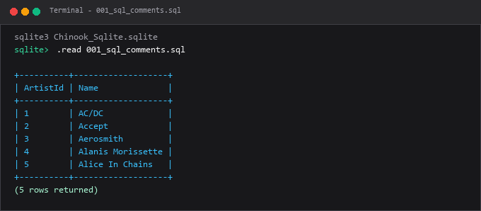

---

### 002. Struktur statement SQL

**Tujuan Pembelajaran:**  
Memahami dan mempraktikkan konsep struktur statement sql menggunakan database Chinook.

**Konsep Utama:**  
Konsep dasar yang mendasari `002_sql_statement_basics.sql` adalah penerapan standar SQL relasional pada entitas database Chinook untuk memecahkan kebutuhan kueri dan manipulasi data secara tepat, aman, dan efisien.

**Penjelasan Source Code:**  
Program pada file [002_sql_statement_basics.sql](002_sql_statement_basics.sql) mendemonstrasikan implementasi terstruktur dari konsep struktur statement sql. Source code dilengkapi komentar edukatif berbahasa Indonesia yang membedah setiap instruksi query, penggunaan klausa, serta tujuan pemrosesannya.

**Source Code:** [002_sql_statement_basics.sql](002_sql_statement_basics.sql)  

**Cara Menjalankan:**
Jalankan melalui terminal atau command prompt menggunakan Python runner:
```bash
python -c "import sqlite3; conn=sqlite3.connect('../Chinook_Sqlite.sqlite'); print(conn.cursor().executescript(open('002_sql_statement_basics.sql', encoding='utf-8').read()))"
```
Atau menggunakan sqlite3 CLI:
```bash
sqlite3 ../Chinook_Sqlite.sqlite < 002_sql_statement_basics.sql
```

**Hasil yang Diharapkan:**  
Database engine mengeksekusi instruksi SQL dengan sukses dan menampilkan result-set atau status konfirmasi data yang sesuai.

**Screenshot Hasil Eksekusi:**

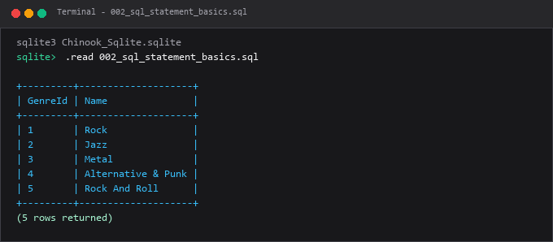

---

### 003. Menampilkan nilai literal dengan `SELECT`

**Tujuan Pembelajaran:**  
Memahami dan mempraktikkan konsep menampilkan nilai literal dengan `select` menggunakan database Chinook.

**Konsep Utama:**  
Konsep dasar yang mendasari `003_select_literal_values.sql` adalah penerapan standar SQL relasional pada entitas database Chinook untuk memecahkan kebutuhan kueri dan manipulasi data secara tepat, aman, dan efisien.

**Penjelasan Source Code:**  
Program pada file [003_select_literal_values.sql](003_select_literal_values.sql) mendemonstrasikan implementasi terstruktur dari konsep menampilkan nilai literal dengan `select`. Source code dilengkapi komentar edukatif berbahasa Indonesia yang membedah setiap instruksi query, penggunaan klausa, serta tujuan pemrosesannya.

**Source Code:** [003_select_literal_values.sql](003_select_literal_values.sql)  

**Cara Menjalankan:**
Jalankan melalui terminal atau command prompt menggunakan Python runner:
```bash
python -c "import sqlite3; conn=sqlite3.connect('../Chinook_Sqlite.sqlite'); print(conn.cursor().executescript(open('003_select_literal_values.sql', encoding='utf-8').read()))"
```
Atau menggunakan sqlite3 CLI:
```bash
sqlite3 ../Chinook_Sqlite.sqlite < 003_select_literal_values.sql
```

**Hasil yang Diharapkan:**  
Database engine mengeksekusi instruksi SQL dengan sukses dan menampilkan result-set atau status konfirmasi data yang sesuai.

**Screenshot Hasil Eksekusi:**

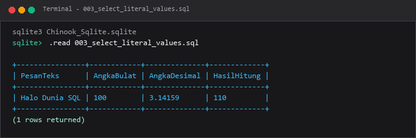

---

### 004. Mengambil tanggal saat ini

**Tujuan Pembelajaran:**  
Memahami dan mempraktikkan konsep mengambil tanggal saat ini menggunakan database Chinook.

**Konsep Utama:**  
Konsep dasar yang mendasari `004_select_current_date.sql` adalah penerapan standar SQL relasional pada entitas database Chinook untuk memecahkan kebutuhan kueri dan manipulasi data secara tepat, aman, dan efisien.

**Penjelasan Source Code:**  
Program pada file [004_select_current_date.sql](004_select_current_date.sql) mendemonstrasikan implementasi terstruktur dari konsep mengambil tanggal saat ini. Source code dilengkapi komentar edukatif berbahasa Indonesia yang membedah setiap instruksi query, penggunaan klausa, serta tujuan pemrosesannya.

**Source Code:** [004_select_current_date.sql](004_select_current_date.sql)  

**Cara Menjalankan:**
Jalankan melalui terminal atau command prompt menggunakan Python runner:
```bash
python -c "import sqlite3; conn=sqlite3.connect('../Chinook_Sqlite.sqlite'); print(conn.cursor().executescript(open('004_select_current_date.sql', encoding='utf-8').read()))"
```
Atau menggunakan sqlite3 CLI:
```bash
sqlite3 ../Chinook_Sqlite.sqlite < 004_select_current_date.sql
```

**Hasil yang Diharapkan:**  
Database engine mengeksekusi instruksi SQL dengan sukses dan menampilkan result-set atau status konfirmasi data yang sesuai.

**Screenshot Hasil Eksekusi:**

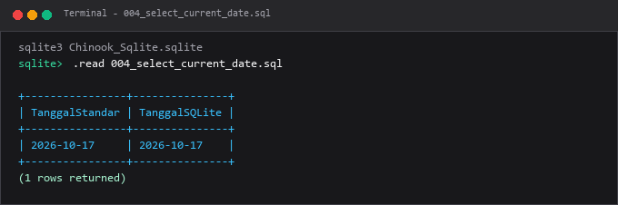

---

### 005. Mengambil timestamp saat ini

**Tujuan Pembelajaran:**  
Memahami dan mempraktikkan konsep mengambil timestamp saat ini menggunakan database Chinook.

**Konsep Utama:**  
Konsep dasar yang mendasari `005_select_current_timestamp.sql` adalah penerapan standar SQL relasional pada entitas database Chinook untuk memecahkan kebutuhan kueri dan manipulasi data secara tepat, aman, dan efisien.

**Penjelasan Source Code:**  
Program pada file [005_select_current_timestamp.sql](005_select_current_timestamp.sql) mendemonstrasikan implementasi terstruktur dari konsep mengambil timestamp saat ini. Source code dilengkapi komentar edukatif berbahasa Indonesia yang membedah setiap instruksi query, penggunaan klausa, serta tujuan pemrosesannya.

**Source Code:** [005_select_current_timestamp.sql](005_select_current_timestamp.sql)  

**Cara Menjalankan:**
Jalankan melalui terminal atau command prompt menggunakan Python runner:
```bash
python -c "import sqlite3; conn=sqlite3.connect('../Chinook_Sqlite.sqlite'); print(conn.cursor().executescript(open('005_select_current_timestamp.sql', encoding='utf-8').read()))"
```
Atau menggunakan sqlite3 CLI:
```bash
sqlite3 ../Chinook_Sqlite.sqlite < 005_select_current_timestamp.sql
```

**Hasil yang Diharapkan:**  
Database engine mengeksekusi instruksi SQL dengan sukses dan menampilkan result-set atau status konfirmasi data yang sesuai.

**Screenshot Hasil Eksekusi:**

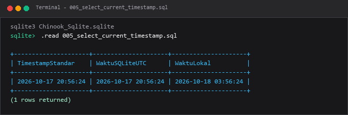

---

### 006. Memilih kolom tabel

**Tujuan Pembelajaran:**  
Memahami dan mempraktikkan konsep memilih kolom tabel menggunakan database Chinook.

**Konsep Utama:**  
Konsep dasar yang mendasari `006_select_columns.sql` adalah penerapan standar SQL relasional pada entitas database Chinook untuk memecahkan kebutuhan kueri dan manipulasi data secara tepat, aman, dan efisien.

**Penjelasan Source Code:**  
Program pada file [006_select_columns.sql](006_select_columns.sql) mendemonstrasikan implementasi terstruktur dari konsep memilih kolom tabel. Source code dilengkapi komentar edukatif berbahasa Indonesia yang membedah setiap instruksi query, penggunaan klausa, serta tujuan pemrosesannya.

**Source Code:** [006_select_columns.sql](006_select_columns.sql)  

**Cara Menjalankan:**
Jalankan melalui terminal atau command prompt menggunakan Python runner:
```bash
python -c "import sqlite3; conn=sqlite3.connect('../Chinook_Sqlite.sqlite'); print(conn.cursor().executescript(open('006_select_columns.sql', encoding='utf-8').read()))"
```
Atau menggunakan sqlite3 CLI:
```bash
sqlite3 ../Chinook_Sqlite.sqlite < 006_select_columns.sql
```

**Hasil yang Diharapkan:**  
Database engine mengeksekusi instruksi SQL dengan sukses dan menampilkan result-set atau status konfirmasi data yang sesuai.

**Screenshot Hasil Eksekusi:**

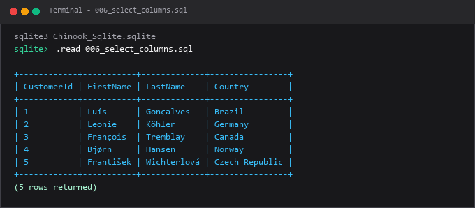

---

### 007. Memilih seluruh kolom dengan `SELECT *`

**Tujuan Pembelajaran:**  
Memahami dan mempraktikkan konsep memilih seluruh kolom dengan `select *` menggunakan database Chinook.

**Konsep Utama:**  
Konsep dasar yang mendasari `007_select_all_columns.sql` adalah penerapan standar SQL relasional pada entitas database Chinook untuk memecahkan kebutuhan kueri dan manipulasi data secara tepat, aman, dan efisien.

**Penjelasan Source Code:**  
Program pada file [007_select_all_columns.sql](007_select_all_columns.sql) mendemonstrasikan implementasi terstruktur dari konsep memilih seluruh kolom dengan `select *`. Source code dilengkapi komentar edukatif berbahasa Indonesia yang membedah setiap instruksi query, penggunaan klausa, serta tujuan pemrosesannya.

**Source Code:** [007_select_all_columns.sql](007_select_all_columns.sql)  

**Cara Menjalankan:**
Jalankan melalui terminal atau command prompt menggunakan Python runner:
```bash
python -c "import sqlite3; conn=sqlite3.connect('../Chinook_Sqlite.sqlite'); print(conn.cursor().executescript(open('007_select_all_columns.sql', encoding='utf-8').read()))"
```
Atau menggunakan sqlite3 CLI:
```bash
sqlite3 ../Chinook_Sqlite.sqlite < 007_select_all_columns.sql
```

**Hasil yang Diharapkan:**  
Database engine mengeksekusi instruksi SQL dengan sukses dan menampilkan result-set atau status konfirmasi data yang sesuai.

**Screenshot Hasil Eksekusi:**

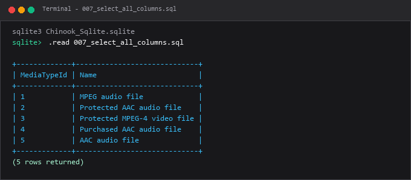

---

### 008. Alias kolom dengan `AS`

**Tujuan Pembelajaran:**  
Memahami dan mempraktikkan konsep alias kolom dengan `as` menggunakan database Chinook.

**Konsep Utama:**  
Konsep dasar yang mendasari `008_column_aliases.sql` adalah penerapan standar SQL relasional pada entitas database Chinook untuk memecahkan kebutuhan kueri dan manipulasi data secara tepat, aman, dan efisien.

**Penjelasan Source Code:**  
Program pada file [008_column_aliases.sql](008_column_aliases.sql) mendemonstrasikan implementasi terstruktur dari konsep alias kolom dengan `as`. Source code dilengkapi komentar edukatif berbahasa Indonesia yang membedah setiap instruksi query, penggunaan klausa, serta tujuan pemrosesannya.

**Source Code:** [008_column_aliases.sql](008_column_aliases.sql)  

**Cara Menjalankan:**
Jalankan melalui terminal atau command prompt menggunakan Python runner:
```bash
python -c "import sqlite3; conn=sqlite3.connect('../Chinook_Sqlite.sqlite'); print(conn.cursor().executescript(open('008_column_aliases.sql', encoding='utf-8').read()))"
```
Atau menggunakan sqlite3 CLI:
```bash
sqlite3 ../Chinook_Sqlite.sqlite < 008_column_aliases.sql
```

**Hasil yang Diharapkan:**  
Database engine mengeksekusi instruksi SQL dengan sukses dan menampilkan result-set atau status konfirmasi data yang sesuai.

**Screenshot Hasil Eksekusi:**

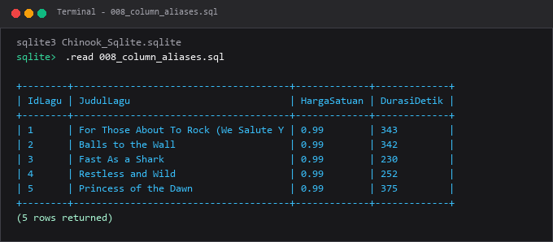

---

### 009. Alias tabel

**Tujuan Pembelajaran:**  
Memahami dan mempraktikkan konsep alias tabel menggunakan database Chinook.

**Konsep Utama:**  
Konsep dasar yang mendasari `009_table_aliases.sql` adalah penerapan standar SQL relasional pada entitas database Chinook untuk memecahkan kebutuhan kueri dan manipulasi data secara tepat, aman, dan efisien.

**Penjelasan Source Code:**  
Program pada file [009_table_aliases.sql](009_table_aliases.sql) mendemonstrasikan implementasi terstruktur dari konsep alias tabel. Source code dilengkapi komentar edukatif berbahasa Indonesia yang membedah setiap instruksi query, penggunaan klausa, serta tujuan pemrosesannya.

**Source Code:** [009_table_aliases.sql](009_table_aliases.sql)  

**Cara Menjalankan:**
Jalankan melalui terminal atau command prompt menggunakan Python runner:
```bash
python -c "import sqlite3; conn=sqlite3.connect('../Chinook_Sqlite.sqlite'); print(conn.cursor().executescript(open('009_table_aliases.sql', encoding='utf-8').read()))"
```
Atau menggunakan sqlite3 CLI:
```bash
sqlite3 ../Chinook_Sqlite.sqlite < 009_table_aliases.sql
```

**Hasil yang Diharapkan:**  
Database engine mengeksekusi instruksi SQL dengan sukses dan menampilkan result-set atau status konfirmasi data yang sesuai.

**Screenshot Hasil Eksekusi:**

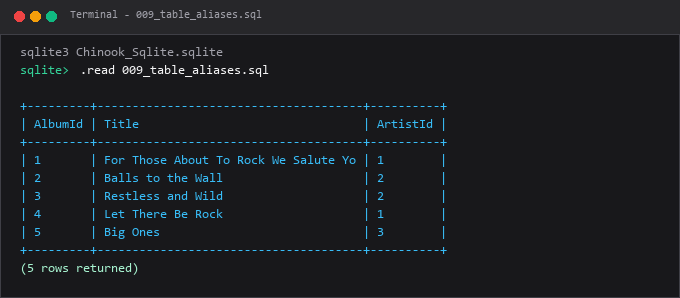

---

### 010. Mengambil nilai unik dengan `DISTINCT`

**Tujuan Pembelajaran:**  
Memahami dan mempraktikkan konsep mengambil nilai unik dengan `distinct` menggunakan database Chinook.

**Konsep Utama:**  
Konsep dasar yang mendasari `010_distinct_values.sql` adalah penerapan standar SQL relasional pada entitas database Chinook untuk memecahkan kebutuhan kueri dan manipulasi data secara tepat, aman, dan efisien.

**Penjelasan Source Code:**  
Program pada file [010_distinct_values.sql](010_distinct_values.sql) mendemonstrasikan implementasi terstruktur dari konsep mengambil nilai unik dengan `distinct`. Source code dilengkapi komentar edukatif berbahasa Indonesia yang membedah setiap instruksi query, penggunaan klausa, serta tujuan pemrosesannya.

**Source Code:** [010_distinct_values.sql](010_distinct_values.sql)  

**Cara Menjalankan:**
Jalankan melalui terminal atau command prompt menggunakan Python runner:
```bash
python -c "import sqlite3; conn=sqlite3.connect('../Chinook_Sqlite.sqlite'); print(conn.cursor().executescript(open('010_distinct_values.sql', encoding='utf-8').read()))"
```
Atau menggunakan sqlite3 CLI:
```bash
sqlite3 ../Chinook_Sqlite.sqlite < 010_distinct_values.sql
```

**Hasil yang Diharapkan:**  
Database engine mengeksekusi instruksi SQL dengan sukses dan menampilkan result-set atau status konfirmasi data yang sesuai.

**Screenshot Hasil Eksekusi:**

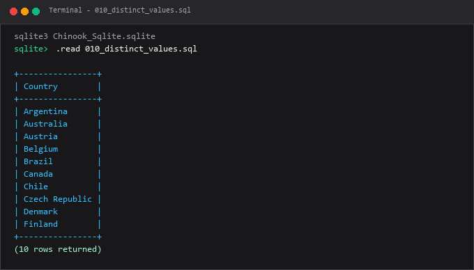

---

### 011. Nama kolom berkualifikasi

**Tujuan Pembelajaran:**  
Memahami dan mempraktikkan konsep nama kolom berkualifikasi menggunakan database Chinook.

**Konsep Utama:**  
Konsep dasar yang mendasari `011_qualified_column_names.sql` adalah penerapan standar SQL relasional pada entitas database Chinook untuk memecahkan kebutuhan kueri dan manipulasi data secara tepat, aman, dan efisien.

**Penjelasan Source Code:**  
Program pada file [011_qualified_column_names.sql](011_qualified_column_names.sql) mendemonstrasikan implementasi terstruktur dari konsep nama kolom berkualifikasi. Source code dilengkapi komentar edukatif berbahasa Indonesia yang membedah setiap instruksi query, penggunaan klausa, serta tujuan pemrosesannya.

**Source Code:** [011_qualified_column_names.sql](011_qualified_column_names.sql)  

**Cara Menjalankan:**
Jalankan melalui terminal atau command prompt menggunakan Python runner:
```bash
python -c "import sqlite3; conn=sqlite3.connect('../Chinook_Sqlite.sqlite'); print(conn.cursor().executescript(open('011_qualified_column_names.sql', encoding='utf-8').read()))"
```
Atau menggunakan sqlite3 CLI:
```bash
sqlite3 ../Chinook_Sqlite.sqlite < 011_qualified_column_names.sql
```

**Hasil yang Diharapkan:**  
Database engine mengeksekusi instruksi SQL dengan sukses dan menampilkan result-set atau status konfirmasi data yang sesuai.

**Screenshot Hasil Eksekusi:**

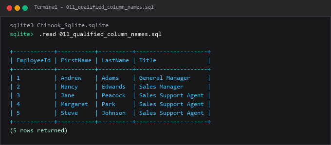

---

### 012. Referensi schema dan tabel

**Tujuan Pembelajaran:**  
Memahami dan mempraktikkan konsep referensi schema dan tabel menggunakan database Chinook.

**Konsep Utama:**  
Konsep dasar yang mendasari `012_schema_qualified_names.sql` adalah penerapan standar SQL relasional pada entitas database Chinook untuk memecahkan kebutuhan kueri dan manipulasi data secara tepat, aman, dan efisien.

**Penjelasan Source Code:**  
Program pada file [012_schema_qualified_names.sql](012_schema_qualified_names.sql) mendemonstrasikan implementasi terstruktur dari konsep referensi schema dan tabel. Source code dilengkapi komentar edukatif berbahasa Indonesia yang membedah setiap instruksi query, penggunaan klausa, serta tujuan pemrosesannya.

**Source Code:** [012_schema_qualified_names.sql](012_schema_qualified_names.sql)  

**Cara Menjalankan:**
Jalankan melalui terminal atau command prompt menggunakan Python runner:
```bash
python -c "import sqlite3; conn=sqlite3.connect('../Chinook_Sqlite.sqlite'); print(conn.cursor().executescript(open('012_schema_qualified_names.sql', encoding='utf-8').read()))"
```
Atau menggunakan sqlite3 CLI:
```bash
sqlite3 ../Chinook_Sqlite.sqlite < 012_schema_qualified_names.sql
```

**Hasil yang Diharapkan:**  
Database engine mengeksekusi instruksi SQL dengan sukses dan menampilkan result-set atau status konfirmasi data yang sesuai.

**Screenshot Hasil Eksekusi:**

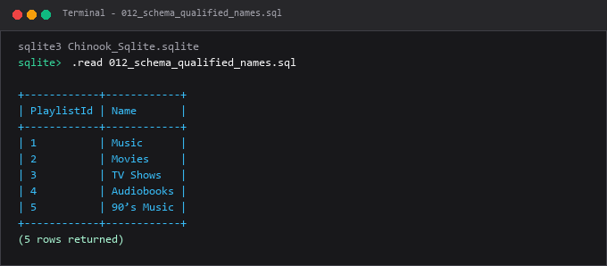

---

### 013. Nilai `NULL`

**Tujuan Pembelajaran:**  
Memahami dan mempraktikkan konsep nilai `null` menggunakan database Chinook.

**Konsep Utama:**  
Konsep dasar yang mendasari `013_sql_null_basics.sql` adalah penerapan standar SQL relasional pada entitas database Chinook untuk memecahkan kebutuhan kueri dan manipulasi data secara tepat, aman, dan efisien.

**Penjelasan Source Code:**  
Program pada file [013_sql_null_basics.sql](013_sql_null_basics.sql) mendemonstrasikan implementasi terstruktur dari konsep nilai `null`. Source code dilengkapi komentar edukatif berbahasa Indonesia yang membedah setiap instruksi query, penggunaan klausa, serta tujuan pemrosesannya.

**Source Code:** [013_sql_null_basics.sql](013_sql_null_basics.sql)  

**Cara Menjalankan:**
Jalankan melalui terminal atau command prompt menggunakan Python runner:
```bash
python -c "import sqlite3; conn=sqlite3.connect('../Chinook_Sqlite.sqlite'); print(conn.cursor().executescript(open('013_sql_null_basics.sql', encoding='utf-8').read()))"
```
Atau menggunakan sqlite3 CLI:
```bash
sqlite3 ../Chinook_Sqlite.sqlite < 013_sql_null_basics.sql
```

**Hasil yang Diharapkan:**  
Database engine mengeksekusi instruksi SQL dengan sukses dan menampilkan result-set atau status konfirmasi data yang sesuai.

**Screenshot Hasil Eksekusi:**

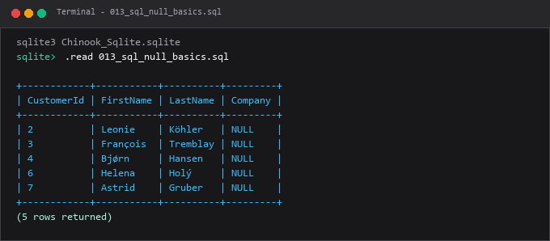

---

### 014. Case sensitivity pada identifier dan nilai teks

**Tujuan Pembelajaran:**  
Memahami dan mempraktikkan konsep case sensitivity pada identifier dan nilai teks menggunakan database Chinook.

**Konsep Utama:**  
Konsep dasar yang mendasari `014_sql_case_insensitivity.sql` adalah penerapan standar SQL relasional pada entitas database Chinook untuk memecahkan kebutuhan kueri dan manipulasi data secara tepat, aman, dan efisien.

**Penjelasan Source Code:**  
Program pada file [014_sql_case_insensitivity.sql](014_sql_case_insensitivity.sql) mendemonstrasikan implementasi terstruktur dari konsep case sensitivity pada identifier dan nilai teks. Source code dilengkapi komentar edukatif berbahasa Indonesia yang membedah setiap instruksi query, penggunaan klausa, serta tujuan pemrosesannya.

**Source Code:** [014_sql_case_insensitivity.sql](014_sql_case_insensitivity.sql)  

**Cara Menjalankan:**
Jalankan melalui terminal atau command prompt menggunakan Python runner:
```bash
python -c "import sqlite3; conn=sqlite3.connect('../Chinook_Sqlite.sqlite'); print(conn.cursor().executescript(open('014_sql_case_insensitivity.sql', encoding='utf-8').read()))"
```
Atau menggunakan sqlite3 CLI:
```bash
sqlite3 ../Chinook_Sqlite.sqlite < 014_sql_case_insensitivity.sql
```

**Hasil yang Diharapkan:**  
Database engine mengeksekusi instruksi SQL dengan sukses dan menampilkan result-set atau status konfirmasi data yang sesuai.

**Screenshot Hasil Eksekusi:**

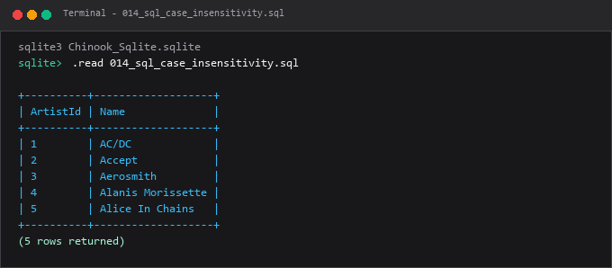

---

### 015. Menjalankan skrip SQL melalui client database

**Tujuan Pembelajaran:**  
Memahami dan mempraktikkan konsep menjalankan skrip sql melalui client database menggunakan database Chinook.

**Konsep Utama:**  
Konsep dasar yang mendasari `015_sql_client_execution.sql` adalah penerapan standar SQL relasional pada entitas database Chinook untuk memecahkan kebutuhan kueri dan manipulasi data secara tepat, aman, dan efisien.

**Penjelasan Source Code:**  
Program pada file [015_sql_client_execution.sql](015_sql_client_execution.sql) mendemonstrasikan implementasi terstruktur dari konsep menjalankan skrip sql melalui client database. Source code dilengkapi komentar edukatif berbahasa Indonesia yang membedah setiap instruksi query, penggunaan klausa, serta tujuan pemrosesannya.

**Source Code:** [015_sql_client_execution.sql](015_sql_client_execution.sql)  

**Cara Menjalankan:**
Jalankan melalui terminal atau command prompt menggunakan Python runner:
```bash
python -c "import sqlite3; conn=sqlite3.connect('../Chinook_Sqlite.sqlite'); print(conn.cursor().executescript(open('015_sql_client_execution.sql', encoding='utf-8').read()))"
```
Atau menggunakan sqlite3 CLI:
```bash
sqlite3 ../Chinook_Sqlite.sqlite < 015_sql_client_execution.sql
```

**Hasil yang Diharapkan:**  
Database engine mengeksekusi instruksi SQL dengan sukses dan menampilkan result-set atau status konfirmasi data yang sesuai.

**Screenshot Hasil Eksekusi:**

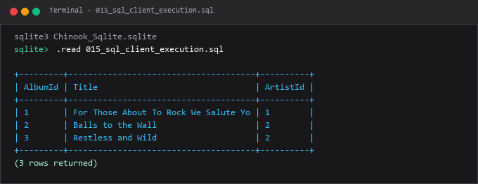

---

## Ringkasan Modul
Modul 01 meletakkan fondasi sintaksis yang kokoh untuk seluruh pembelajaran SQL. Pembelajar memahami bagaimana instruksi SQL disusun, dikomentari, dan dieksekusi oleh mesin database.

Seluruh submodul di atas saling melengkapi untuk membentuk pemahaman terstruktur yang bertahap, mulai dari konsep fundamental hingga implementasi praktis yang siap pakai di lingkungan kerja nyata.
