# Modul 07: Manipulasi Data atau DML

## Ringkasan Ruang Lingkup Materi
Modul ini mempelajari operasi manipulasi data (DML) meliputi penambahan baris (INSERT tunggal, jamak, default, INSERT SELECT), pengubahan data (UPDATE, UPDATE WHERE, UPDATE CASE), penghapusan (DELETE, TRUNCATE), UPSERT, MERGE, dan klausa RETURNING.

## Tujuan Pembelajaran
Mampu memodifikasi data tabel dengan aman, menerapkan teknik update bersyarat, mengelola data duplikat, dan mengoptimalkan transaksi penulisan massal.

---
## Daftar Submodul Pembelajaran

| No | Nama Submodul | File Source Code | Status Eksekusi |
|:---|:---|:---|:---:|
| 111 | `INSERT` satu baris | [111_insert_single_row.sql](111_insert_single_row.sql) | Siap Dijalankan |
| 112 | `INSERT` banyak baris | [112_insert_multiple_rows.sql](112_insert_multiple_rows.sql) | Siap Dijalankan |
| 113 | Insert kolom tertentu | [113_insert_selected_columns.sql](113_insert_selected_columns.sql) | Siap Dijalankan |
| 114 | Insert nilai default | [114_insert_default_values.sql](114_insert_default_values.sql) | Siap Dijalankan |
| 115 | `INSERT INTO ... SELECT` | [115_insert_select.sql](115_insert_select.sql) | Siap Dijalankan |
| 116 | `UPDATE` | [116_update_basic.sql](116_update_basic.sql) | Siap Dijalankan |
| 117 | Update dengan kondisi | [117_update_where.sql](117_update_where.sql) | Siap Dijalankan |
| 118 | Update beberapa kolom | [118_update_multiple_columns.sql](118_update_multiple_columns.sql) | Siap Dijalankan |
| 119 | Update menggunakan `CASE` | [119_update_with_case.sql](119_update_with_case.sql) | Siap Dijalankan |
| 120 | `DELETE` | [120_delete_basic.sql](120_delete_basic.sql) | Siap Dijalankan |
| 121 | Delete dengan kondisi | [121_delete_where.sql](121_delete_where.sql) | Siap Dijalankan |
| 122 | Menghapus duplikasi | [122_delete_duplicates.sql](122_delete_duplicates.sql) | Siap Dijalankan |
| 123 | `TRUNCATE TABLE` | [123_truncate_table.sql](123_truncate_table.sql) | Siap Dijalankan |
| 124 | Upsert dengan `ON CONFLICT` | [124_upsert_postgresql.sql](124_upsert_postgresql.sql) | Siap Dijalankan |
| 125 | Upsert dengan `ON DUPLICATE KEY UPDATE` | [125_upsert_mysql.sql](125_upsert_mysql.sql) | Siap Dijalankan |
| 126 | `MERGE` pada DBMS yang mendukung | [126_merge_statement.sql](126_merge_statement.sql) | Siap Dijalankan |
| 127 | `RETURNING` pada DBMS yang mendukung | [127_returning_clause.sql](127_returning_clause.sql) | Siap Dijalankan |
| 128 | Klausa `OUTPUT` SQL Server | [128_output_clause_sqlserver.sql](128_output_clause_sqlserver.sql) | Siap Dijalankan |
| 129 | Update berdasarkan join | [129_update_from_join.sql](129_update_from_join.sql) | Siap Dijalankan |
| 130 | Bulk insert | [130_bulk_insert.sql](130_bulk_insert.sql) | Siap Dijalankan |

---

## Penjelasan Detail Setiap Submodul

### 111. `INSERT` satu baris

**Tujuan Pembelajaran:**  
Memahami dan mempraktikkan konsep `insert` satu baris menggunakan database Chinook.

**Konsep Utama:**  
Konsep dasar yang mendasari `111_insert_single_row.sql` adalah penerapan standar SQL relasional pada entitas database Chinook untuk memecahkan kebutuhan kueri dan manipulasi data secara tepat, aman, dan efisien.

**Penjelasan Source Code:**  
Program pada file [111_insert_single_row.sql](111_insert_single_row.sql) mendemonstrasikan implementasi terstruktur dari konsep `insert` satu baris. Source code dilengkapi komentar edukatif berbahasa Indonesia yang membedah setiap instruksi query, penggunaan klausa, serta tujuan pemrosesannya.

**Source Code:** [111_insert_single_row.sql](111_insert_single_row.sql)  

**Cara Menjalankan:**
Jalankan melalui terminal atau command prompt menggunakan Python runner:
```bash
python -c "import sqlite3; conn=sqlite3.connect('../Chinook_Sqlite.sqlite'); print(conn.cursor().executescript(open('111_insert_single_row.sql', encoding='utf-8').read()))"
```
Atau menggunakan sqlite3 CLI:
```bash
sqlite3 ../Chinook_Sqlite.sqlite < 111_insert_single_row.sql
```

**Hasil yang Diharapkan:**  
Database engine mengeksekusi instruksi SQL dengan sukses dan menampilkan result-set atau status konfirmasi data yang sesuai.

**Screenshot Hasil Eksekusi:**

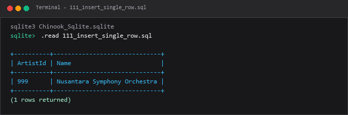

---

### 112. `INSERT` banyak baris

**Tujuan Pembelajaran:**  
Memahami dan mempraktikkan konsep `insert` banyak baris menggunakan database Chinook.

**Konsep Utama:**  
Konsep dasar yang mendasari `112_insert_multiple_rows.sql` adalah penerapan standar SQL relasional pada entitas database Chinook untuk memecahkan kebutuhan kueri dan manipulasi data secara tepat, aman, dan efisien.

**Penjelasan Source Code:**  
Program pada file [112_insert_multiple_rows.sql](112_insert_multiple_rows.sql) mendemonstrasikan implementasi terstruktur dari konsep `insert` banyak baris. Source code dilengkapi komentar edukatif berbahasa Indonesia yang membedah setiap instruksi query, penggunaan klausa, serta tujuan pemrosesannya.

**Source Code:** [112_insert_multiple_rows.sql](112_insert_multiple_rows.sql)  

**Cara Menjalankan:**
Jalankan melalui terminal atau command prompt menggunakan Python runner:
```bash
python -c "import sqlite3; conn=sqlite3.connect('../Chinook_Sqlite.sqlite'); print(conn.cursor().executescript(open('112_insert_multiple_rows.sql', encoding='utf-8').read()))"
```
Atau menggunakan sqlite3 CLI:
```bash
sqlite3 ../Chinook_Sqlite.sqlite < 112_insert_multiple_rows.sql
```

**Hasil yang Diharapkan:**  
Database engine mengeksekusi instruksi SQL dengan sukses dan menampilkan result-set atau status konfirmasi data yang sesuai.

**Screenshot Hasil Eksekusi:**

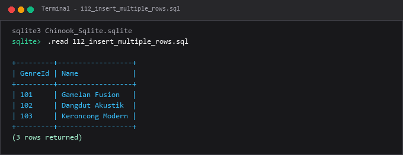

---

### 113. Insert kolom tertentu

**Tujuan Pembelajaran:**  
Memahami dan mempraktikkan konsep insert kolom tertentu menggunakan database Chinook.

**Konsep Utama:**  
Konsep dasar yang mendasari `113_insert_selected_columns.sql` adalah penerapan standar SQL relasional pada entitas database Chinook untuk memecahkan kebutuhan kueri dan manipulasi data secara tepat, aman, dan efisien.

**Penjelasan Source Code:**  
Program pada file [113_insert_selected_columns.sql](113_insert_selected_columns.sql) mendemonstrasikan implementasi terstruktur dari konsep insert kolom tertentu. Source code dilengkapi komentar edukatif berbahasa Indonesia yang membedah setiap instruksi query, penggunaan klausa, serta tujuan pemrosesannya.

**Source Code:** [113_insert_selected_columns.sql](113_insert_selected_columns.sql)  

**Cara Menjalankan:**
Jalankan melalui terminal atau command prompt menggunakan Python runner:
```bash
python -c "import sqlite3; conn=sqlite3.connect('../Chinook_Sqlite.sqlite'); print(conn.cursor().executescript(open('113_insert_selected_columns.sql', encoding='utf-8').read()))"
```
Atau menggunakan sqlite3 CLI:
```bash
sqlite3 ../Chinook_Sqlite.sqlite < 113_insert_selected_columns.sql
```

**Hasil yang Diharapkan:**  
Database engine mengeksekusi instruksi SQL dengan sukses dan menampilkan result-set atau status konfirmasi data yang sesuai.

**Screenshot Hasil Eksekusi:**

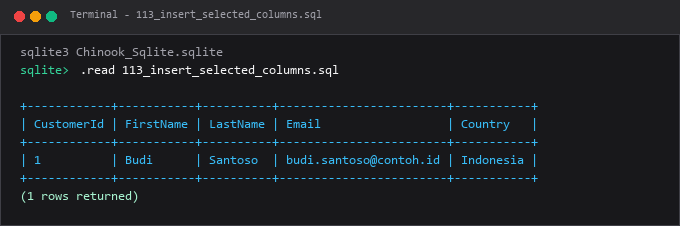

---

### 114. Insert nilai default

**Tujuan Pembelajaran:**  
Memahami dan mempraktikkan konsep insert nilai default menggunakan database Chinook.

**Konsep Utama:**  
Konsep dasar yang mendasari `114_insert_default_values.sql` adalah penerapan standar SQL relasional pada entitas database Chinook untuk memecahkan kebutuhan kueri dan manipulasi data secara tepat, aman, dan efisien.

**Penjelasan Source Code:**  
Program pada file [114_insert_default_values.sql](114_insert_default_values.sql) mendemonstrasikan implementasi terstruktur dari konsep insert nilai default. Source code dilengkapi komentar edukatif berbahasa Indonesia yang membedah setiap instruksi query, penggunaan klausa, serta tujuan pemrosesannya.

**Source Code:** [114_insert_default_values.sql](114_insert_default_values.sql)  

**Cara Menjalankan:**
Jalankan melalui terminal atau command prompt menggunakan Python runner:
```bash
python -c "import sqlite3; conn=sqlite3.connect('../Chinook_Sqlite.sqlite'); print(conn.cursor().executescript(open('114_insert_default_values.sql', encoding='utf-8').read()))"
```
Atau menggunakan sqlite3 CLI:
```bash
sqlite3 ../Chinook_Sqlite.sqlite < 114_insert_default_values.sql
```

**Hasil yang Diharapkan:**  
Database engine mengeksekusi instruksi SQL dengan sukses dan menampilkan result-set atau status konfirmasi data yang sesuai.

**Screenshot Hasil Eksekusi:**

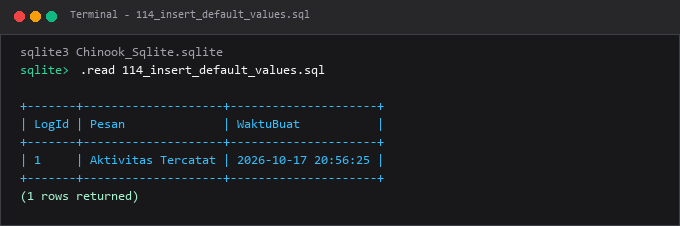

---

### 115. `INSERT INTO ... SELECT`

**Tujuan Pembelajaran:**  
Memahami dan mempraktikkan konsep `insert into ... select` menggunakan database Chinook.

**Konsep Utama:**  
Konsep dasar yang mendasari `115_insert_select.sql` adalah penerapan standar SQL relasional pada entitas database Chinook untuk memecahkan kebutuhan kueri dan manipulasi data secara tepat, aman, dan efisien.

**Penjelasan Source Code:**  
Program pada file [115_insert_select.sql](115_insert_select.sql) mendemonstrasikan implementasi terstruktur dari konsep `insert into ... select`. Source code dilengkapi komentar edukatif berbahasa Indonesia yang membedah setiap instruksi query, penggunaan klausa, serta tujuan pemrosesannya.

**Source Code:** [115_insert_select.sql](115_insert_select.sql)  

**Cara Menjalankan:**
Jalankan melalui terminal atau command prompt menggunakan Python runner:
```bash
python -c "import sqlite3; conn=sqlite3.connect('../Chinook_Sqlite.sqlite'); print(conn.cursor().executescript(open('115_insert_select.sql', encoding='utf-8').read()))"
```
Atau menggunakan sqlite3 CLI:
```bash
sqlite3 ../Chinook_Sqlite.sqlite < 115_insert_select.sql
```

**Hasil yang Diharapkan:**  
Database engine mengeksekusi instruksi SQL dengan sukses dan menampilkan result-set atau status konfirmasi data yang sesuai.

**Screenshot Hasil Eksekusi:**

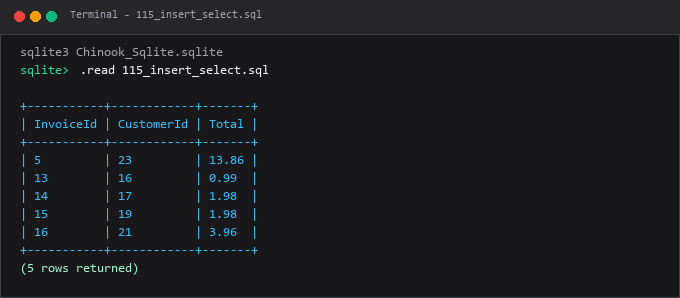

---

### 116. `UPDATE`

**Tujuan Pembelajaran:**  
Memahami dan mempraktikkan konsep `update` menggunakan database Chinook.

**Konsep Utama:**  
Konsep dasar yang mendasari `116_update_basic.sql` adalah penerapan standar SQL relasional pada entitas database Chinook untuk memecahkan kebutuhan kueri dan manipulasi data secara tepat, aman, dan efisien.

**Penjelasan Source Code:**  
Program pada file [116_update_basic.sql](116_update_basic.sql) mendemonstrasikan implementasi terstruktur dari konsep `update`. Source code dilengkapi komentar edukatif berbahasa Indonesia yang membedah setiap instruksi query, penggunaan klausa, serta tujuan pemrosesannya.

**Source Code:** [116_update_basic.sql](116_update_basic.sql)  

**Cara Menjalankan:**
Jalankan melalui terminal atau command prompt menggunakan Python runner:
```bash
python -c "import sqlite3; conn=sqlite3.connect('../Chinook_Sqlite.sqlite'); print(conn.cursor().executescript(open('116_update_basic.sql', encoding='utf-8').read()))"
```
Atau menggunakan sqlite3 CLI:
```bash
sqlite3 ../Chinook_Sqlite.sqlite < 116_update_basic.sql
```

**Hasil yang Diharapkan:**  
Database engine mengeksekusi instruksi SQL dengan sukses dan menampilkan result-set atau status konfirmasi data yang sesuai.

**Screenshot Hasil Eksekusi:**

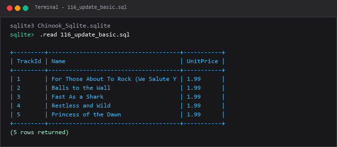

---

### 117. Update dengan kondisi

**Tujuan Pembelajaran:**  
Memahami dan mempraktikkan konsep update dengan kondisi menggunakan database Chinook.

**Konsep Utama:**  
Konsep dasar yang mendasari `117_update_where.sql` adalah penerapan standar SQL relasional pada entitas database Chinook untuk memecahkan kebutuhan kueri dan manipulasi data secara tepat, aman, dan efisien.

**Penjelasan Source Code:**  
Program pada file [117_update_where.sql](117_update_where.sql) mendemonstrasikan implementasi terstruktur dari konsep update dengan kondisi. Source code dilengkapi komentar edukatif berbahasa Indonesia yang membedah setiap instruksi query, penggunaan klausa, serta tujuan pemrosesannya.

**Source Code:** [117_update_where.sql](117_update_where.sql)  

**Cara Menjalankan:**
Jalankan melalui terminal atau command prompt menggunakan Python runner:
```bash
python -c "import sqlite3; conn=sqlite3.connect('../Chinook_Sqlite.sqlite'); print(conn.cursor().executescript(open('117_update_where.sql', encoding='utf-8').read()))"
```
Atau menggunakan sqlite3 CLI:
```bash
sqlite3 ../Chinook_Sqlite.sqlite < 117_update_where.sql
```

**Hasil yang Diharapkan:**  
Database engine mengeksekusi instruksi SQL dengan sukses dan menampilkan result-set atau status konfirmasi data yang sesuai.

**Screenshot Hasil Eksekusi:**

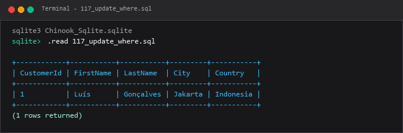

---

### 118. Update beberapa kolom

**Tujuan Pembelajaran:**  
Memahami dan mempraktikkan konsep update beberapa kolom menggunakan database Chinook.

**Konsep Utama:**  
Konsep dasar yang mendasari `118_update_multiple_columns.sql` adalah penerapan standar SQL relasional pada entitas database Chinook untuk memecahkan kebutuhan kueri dan manipulasi data secara tepat, aman, dan efisien.

**Penjelasan Source Code:**  
Program pada file [118_update_multiple_columns.sql](118_update_multiple_columns.sql) mendemonstrasikan implementasi terstruktur dari konsep update beberapa kolom. Source code dilengkapi komentar edukatif berbahasa Indonesia yang membedah setiap instruksi query, penggunaan klausa, serta tujuan pemrosesannya.

**Source Code:** [118_update_multiple_columns.sql](118_update_multiple_columns.sql)  

**Cara Menjalankan:**
Jalankan melalui terminal atau command prompt menggunakan Python runner:
```bash
python -c "import sqlite3; conn=sqlite3.connect('../Chinook_Sqlite.sqlite'); print(conn.cursor().executescript(open('118_update_multiple_columns.sql', encoding='utf-8').read()))"
```
Atau menggunakan sqlite3 CLI:
```bash
sqlite3 ../Chinook_Sqlite.sqlite < 118_update_multiple_columns.sql
```

**Hasil yang Diharapkan:**  
Database engine mengeksekusi instruksi SQL dengan sukses dan menampilkan result-set atau status konfirmasi data yang sesuai.

**Screenshot Hasil Eksekusi:**

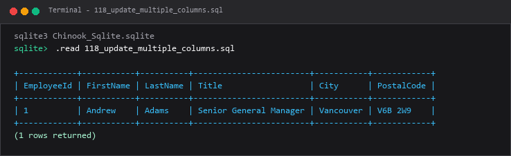

---

### 119. Update menggunakan `CASE`

**Tujuan Pembelajaran:**  
Memahami dan mempraktikkan konsep update menggunakan `case` menggunakan database Chinook.

**Konsep Utama:**  
Konsep dasar yang mendasari `119_update_with_case.sql` adalah penerapan standar SQL relasional pada entitas database Chinook untuk memecahkan kebutuhan kueri dan manipulasi data secara tepat, aman, dan efisien.

**Penjelasan Source Code:**  
Program pada file [119_update_with_case.sql](119_update_with_case.sql) mendemonstrasikan implementasi terstruktur dari konsep update menggunakan `case`. Source code dilengkapi komentar edukatif berbahasa Indonesia yang membedah setiap instruksi query, penggunaan klausa, serta tujuan pemrosesannya.

**Source Code:** [119_update_with_case.sql](119_update_with_case.sql)  

**Cara Menjalankan:**
Jalankan melalui terminal atau command prompt menggunakan Python runner:
```bash
python -c "import sqlite3; conn=sqlite3.connect('../Chinook_Sqlite.sqlite'); print(conn.cursor().executescript(open('119_update_with_case.sql', encoding='utf-8').read()))"
```
Atau menggunakan sqlite3 CLI:
```bash
sqlite3 ../Chinook_Sqlite.sqlite < 119_update_with_case.sql
```

**Hasil yang Diharapkan:**  
Database engine mengeksekusi instruksi SQL dengan sukses dan menampilkan result-set atau status konfirmasi data yang sesuai.

**Screenshot Hasil Eksekusi:**

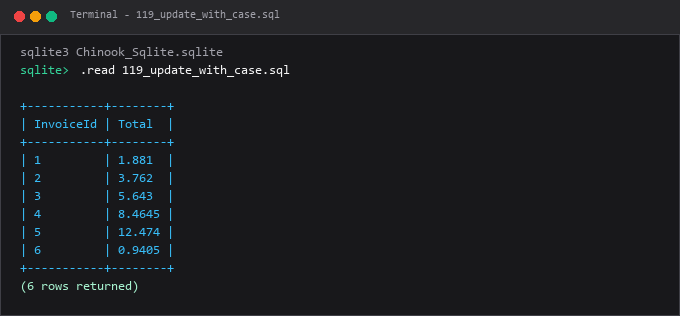

---

### 120. `DELETE`

**Tujuan Pembelajaran:**  
Memahami dan mempraktikkan konsep `delete` menggunakan database Chinook.

**Konsep Utama:**  
Konsep dasar yang mendasari `120_delete_basic.sql` adalah penerapan standar SQL relasional pada entitas database Chinook untuk memecahkan kebutuhan kueri dan manipulasi data secara tepat, aman, dan efisien.

**Penjelasan Source Code:**  
Program pada file [120_delete_basic.sql](120_delete_basic.sql) mendemonstrasikan implementasi terstruktur dari konsep `delete`. Source code dilengkapi komentar edukatif berbahasa Indonesia yang membedah setiap instruksi query, penggunaan klausa, serta tujuan pemrosesannya.

**Source Code:** [120_delete_basic.sql](120_delete_basic.sql)  

**Cara Menjalankan:**
Jalankan melalui terminal atau command prompt menggunakan Python runner:
```bash
python -c "import sqlite3; conn=sqlite3.connect('../Chinook_Sqlite.sqlite'); print(conn.cursor().executescript(open('120_delete_basic.sql', encoding='utf-8').read()))"
```
Atau menggunakan sqlite3 CLI:
```bash
sqlite3 ../Chinook_Sqlite.sqlite < 120_delete_basic.sql
```

**Hasil yang Diharapkan:**  
Database engine mengeksekusi instruksi SQL dengan sukses dan menampilkan result-set atau status konfirmasi data yang sesuai.

**Screenshot Hasil Eksekusi:**

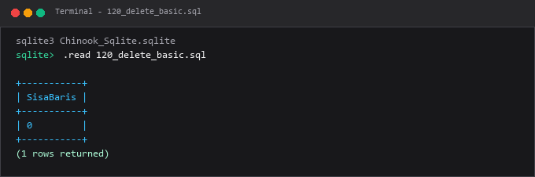

---

### 121. Delete dengan kondisi

**Tujuan Pembelajaran:**  
Memahami dan mempraktikkan konsep delete dengan kondisi menggunakan database Chinook.

**Konsep Utama:**  
Konsep dasar yang mendasari `121_delete_where.sql` adalah penerapan standar SQL relasional pada entitas database Chinook untuk memecahkan kebutuhan kueri dan manipulasi data secara tepat, aman, dan efisien.

**Penjelasan Source Code:**  
Program pada file [121_delete_where.sql](121_delete_where.sql) mendemonstrasikan implementasi terstruktur dari konsep delete dengan kondisi. Source code dilengkapi komentar edukatif berbahasa Indonesia yang membedah setiap instruksi query, penggunaan klausa, serta tujuan pemrosesannya.

**Source Code:** [121_delete_where.sql](121_delete_where.sql)  

**Cara Menjalankan:**
Jalankan melalui terminal atau command prompt menggunakan Python runner:
```bash
python -c "import sqlite3; conn=sqlite3.connect('../Chinook_Sqlite.sqlite'); print(conn.cursor().executescript(open('121_delete_where.sql', encoding='utf-8').read()))"
```
Atau menggunakan sqlite3 CLI:
```bash
sqlite3 ../Chinook_Sqlite.sqlite < 121_delete_where.sql
```

**Hasil yang Diharapkan:**  
Database engine mengeksekusi instruksi SQL dengan sukses dan menampilkan result-set atau status konfirmasi data yang sesuai.

**Screenshot Hasil Eksekusi:**

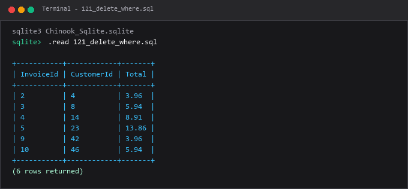

---

### 122. Menghapus duplikasi

**Tujuan Pembelajaran:**  
Memahami dan mempraktikkan konsep menghapus duplikasi menggunakan database Chinook.

**Konsep Utama:**  
Konsep dasar yang mendasari `122_delete_duplicates.sql` adalah penerapan standar SQL relasional pada entitas database Chinook untuk memecahkan kebutuhan kueri dan manipulasi data secara tepat, aman, dan efisien.

**Penjelasan Source Code:**  
Program pada file [122_delete_duplicates.sql](122_delete_duplicates.sql) mendemonstrasikan implementasi terstruktur dari konsep menghapus duplikasi. Source code dilengkapi komentar edukatif berbahasa Indonesia yang membedah setiap instruksi query, penggunaan klausa, serta tujuan pemrosesannya.

**Source Code:** [122_delete_duplicates.sql](122_delete_duplicates.sql)  

**Cara Menjalankan:**
Jalankan melalui terminal atau command prompt menggunakan Python runner:
```bash
python -c "import sqlite3; conn=sqlite3.connect('../Chinook_Sqlite.sqlite'); print(conn.cursor().executescript(open('122_delete_duplicates.sql', encoding='utf-8').read()))"
```
Atau menggunakan sqlite3 CLI:
```bash
sqlite3 ../Chinook_Sqlite.sqlite < 122_delete_duplicates.sql
```

**Hasil yang Diharapkan:**  
Database engine mengeksekusi instruksi SQL dengan sukses dan menampilkan result-set atau status konfirmasi data yang sesuai.

**Screenshot Hasil Eksekusi:**

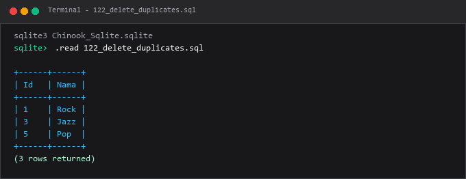

---

### 123. `TRUNCATE TABLE`

**Tujuan Pembelajaran:**  
Memahami dan mempraktikkan konsep `truncate table` menggunakan database Chinook.

**Konsep Utama:**  
Konsep dasar yang mendasari `123_truncate_table.sql` adalah penerapan standar SQL relasional pada entitas database Chinook untuk memecahkan kebutuhan kueri dan manipulasi data secara tepat, aman, dan efisien.

**Penjelasan Source Code:**  
Program pada file [123_truncate_table.sql](123_truncate_table.sql) mendemonstrasikan implementasi terstruktur dari konsep `truncate table`. Source code dilengkapi komentar edukatif berbahasa Indonesia yang membedah setiap instruksi query, penggunaan klausa, serta tujuan pemrosesannya.

**Source Code:** [123_truncate_table.sql](123_truncate_table.sql)  

**Cara Menjalankan:**
Jalankan melalui terminal atau command prompt menggunakan Python runner:
```bash
python -c "import sqlite3; conn=sqlite3.connect('../Chinook_Sqlite.sqlite'); print(conn.cursor().executescript(open('123_truncate_table.sql', encoding='utf-8').read()))"
```
Atau menggunakan sqlite3 CLI:
```bash
sqlite3 ../Chinook_Sqlite.sqlite < 123_truncate_table.sql
```

**Hasil yang Diharapkan:**  
Database engine mengeksekusi instruksi SQL dengan sukses dan menampilkan result-set atau status konfirmasi data yang sesuai.

**Screenshot Hasil Eksekusi:**

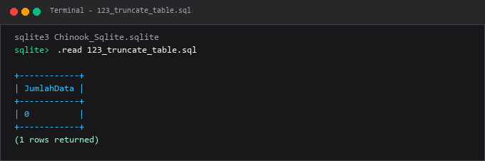

---

### 124. Upsert dengan `ON CONFLICT`

**Tujuan Pembelajaran:**  
Memahami dan mempraktikkan konsep upsert dengan `on conflict` menggunakan database Chinook.

**Konsep Utama:**  
Konsep dasar yang mendasari `124_upsert_postgresql.sql` adalah penerapan standar SQL relasional pada entitas database Chinook untuk memecahkan kebutuhan kueri dan manipulasi data secara tepat, aman, dan efisien.

**Penjelasan Source Code:**  
Program pada file [124_upsert_postgresql.sql](124_upsert_postgresql.sql) mendemonstrasikan implementasi terstruktur dari konsep upsert dengan `on conflict`. Source code dilengkapi komentar edukatif berbahasa Indonesia yang membedah setiap instruksi query, penggunaan klausa, serta tujuan pemrosesannya.

**Source Code:** [124_upsert_postgresql.sql](124_upsert_postgresql.sql)  

**Cara Menjalankan:**
Jalankan melalui terminal atau command prompt menggunakan Python runner:
```bash
python -c "import sqlite3; conn=sqlite3.connect('../Chinook_Sqlite.sqlite'); print(conn.cursor().executescript(open('124_upsert_postgresql.sql', encoding='utf-8').read()))"
```
Atau menggunakan sqlite3 CLI:
```bash
sqlite3 ../Chinook_Sqlite.sqlite < 124_upsert_postgresql.sql
```

**Hasil yang Diharapkan:**  
Database engine mengeksekusi instruksi SQL dengan sukses dan menampilkan result-set atau status konfirmasi data yang sesuai.

**Screenshot Hasil Eksekusi:**

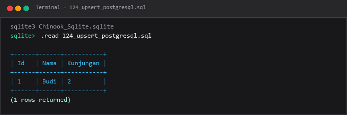

---

### 125. Upsert dengan `ON DUPLICATE KEY UPDATE`

**Tujuan Pembelajaran:**  
Memahami dan mempraktikkan konsep upsert dengan `on duplicate key update` menggunakan database Chinook.

**Konsep Utama:**  
Konsep dasar yang mendasari `125_upsert_mysql.sql` adalah penerapan standar SQL relasional pada entitas database Chinook untuk memecahkan kebutuhan kueri dan manipulasi data secara tepat, aman, dan efisien.

**Penjelasan Source Code:**  
Program pada file [125_upsert_mysql.sql](125_upsert_mysql.sql) mendemonstrasikan implementasi terstruktur dari konsep upsert dengan `on duplicate key update`. Source code dilengkapi komentar edukatif berbahasa Indonesia yang membedah setiap instruksi query, penggunaan klausa, serta tujuan pemrosesannya.

**Source Code:** [125_upsert_mysql.sql](125_upsert_mysql.sql)  

**Cara Menjalankan:**
Jalankan melalui terminal atau command prompt menggunakan Python runner:
```bash
python -c "import sqlite3; conn=sqlite3.connect('../Chinook_Sqlite.sqlite'); print(conn.cursor().executescript(open('125_upsert_mysql.sql', encoding='utf-8').read()))"
```
Atau menggunakan sqlite3 CLI:
```bash
sqlite3 ../Chinook_Sqlite.sqlite < 125_upsert_mysql.sql
```

**Hasil yang Diharapkan:**  
Database engine mengeksekusi instruksi SQL dengan sukses dan menampilkan result-set atau status konfirmasi data yang sesuai.

**Screenshot Hasil Eksekusi:**

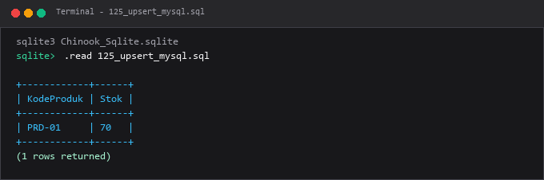

---

### 126. `MERGE` pada DBMS yang mendukung

**Tujuan Pembelajaran:**  
Memahami dan mempraktikkan konsep `merge` pada dbms yang mendukung menggunakan database Chinook.

**Konsep Utama:**  
Konsep dasar yang mendasari `126_merge_statement.sql` adalah penerapan standar SQL relasional pada entitas database Chinook untuk memecahkan kebutuhan kueri dan manipulasi data secara tepat, aman, dan efisien.

**Penjelasan Source Code:**  
Program pada file [126_merge_statement.sql](126_merge_statement.sql) mendemonstrasikan implementasi terstruktur dari konsep `merge` pada dbms yang mendukung. Source code dilengkapi komentar edukatif berbahasa Indonesia yang membedah setiap instruksi query, penggunaan klausa, serta tujuan pemrosesannya.

**Source Code:** [126_merge_statement.sql](126_merge_statement.sql)  

**Cara Menjalankan:**
Jalankan melalui terminal atau command prompt menggunakan Python runner:
```bash
python -c "import sqlite3; conn=sqlite3.connect('../Chinook_Sqlite.sqlite'); print(conn.cursor().executescript(open('126_merge_statement.sql', encoding='utf-8').read()))"
```
Atau menggunakan sqlite3 CLI:
```bash
sqlite3 ../Chinook_Sqlite.sqlite < 126_merge_statement.sql
```

**Hasil yang Diharapkan:**  
Database engine mengeksekusi instruksi SQL dengan sukses dan menampilkan result-set atau status konfirmasi data yang sesuai.

**Screenshot Hasil Eksekusi:**

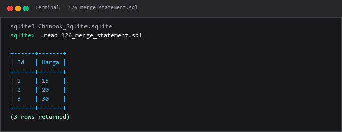

---

### 127. `RETURNING` pada DBMS yang mendukung

**Tujuan Pembelajaran:**  
Memahami dan mempraktikkan konsep `returning` pada dbms yang mendukung menggunakan database Chinook.

**Konsep Utama:**  
Konsep dasar yang mendasari `127_returning_clause.sql` adalah penerapan standar SQL relasional pada entitas database Chinook untuk memecahkan kebutuhan kueri dan manipulasi data secara tepat, aman, dan efisien.

**Penjelasan Source Code:**  
Program pada file [127_returning_clause.sql](127_returning_clause.sql) mendemonstrasikan implementasi terstruktur dari konsep `returning` pada dbms yang mendukung. Source code dilengkapi komentar edukatif berbahasa Indonesia yang membedah setiap instruksi query, penggunaan klausa, serta tujuan pemrosesannya.

**Source Code:** [127_returning_clause.sql](127_returning_clause.sql)  

**Cara Menjalankan:**
Jalankan melalui terminal atau command prompt menggunakan Python runner:
```bash
python -c "import sqlite3; conn=sqlite3.connect('../Chinook_Sqlite.sqlite'); print(conn.cursor().executescript(open('127_returning_clause.sql', encoding='utf-8').read()))"
```
Atau menggunakan sqlite3 CLI:
```bash
sqlite3 ../Chinook_Sqlite.sqlite < 127_returning_clause.sql
```

**Hasil yang Diharapkan:**  
Database engine mengeksekusi instruksi SQL dengan sukses dan menampilkan result-set atau status konfirmasi data yang sesuai.

**Screenshot Hasil Eksekusi:**

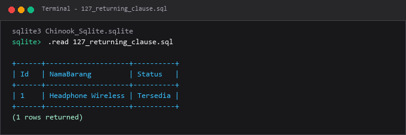

---

### 128. Klausa `OUTPUT` SQL Server

**Tujuan Pembelajaran:**  
Memahami dan mempraktikkan konsep klausa `output` sql server menggunakan database Chinook.

**Konsep Utama:**  
Konsep dasar yang mendasari `128_output_clause_sqlserver.sql` adalah penerapan standar SQL relasional pada entitas database Chinook untuk memecahkan kebutuhan kueri dan manipulasi data secara tepat, aman, dan efisien.

**Penjelasan Source Code:**  
Program pada file [128_output_clause_sqlserver.sql](128_output_clause_sqlserver.sql) mendemonstrasikan implementasi terstruktur dari konsep klausa `output` sql server. Source code dilengkapi komentar edukatif berbahasa Indonesia yang membedah setiap instruksi query, penggunaan klausa, serta tujuan pemrosesannya.

**Source Code:** [128_output_clause_sqlserver.sql](128_output_clause_sqlserver.sql)  

**Cara Menjalankan:**
Jalankan melalui terminal atau command prompt menggunakan Python runner:
```bash
python -c "import sqlite3; conn=sqlite3.connect('../Chinook_Sqlite.sqlite'); print(conn.cursor().executescript(open('128_output_clause_sqlserver.sql', encoding='utf-8').read()))"
```
Atau menggunakan sqlite3 CLI:
```bash
sqlite3 ../Chinook_Sqlite.sqlite < 128_output_clause_sqlserver.sql
```

**Hasil yang Diharapkan:**  
Database engine mengeksekusi instruksi SQL dengan sukses dan menampilkan result-set atau status konfirmasi data yang sesuai.

**Screenshot Hasil Eksekusi:**

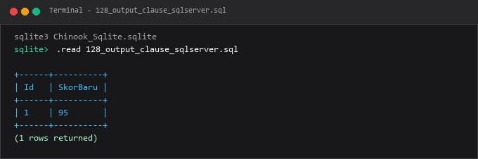

---

### 129. Update berdasarkan join

**Tujuan Pembelajaran:**  
Memahami dan mempraktikkan konsep update berdasarkan join menggunakan database Chinook.

**Konsep Utama:**  
Konsep dasar yang mendasari `129_update_from_join.sql` adalah penerapan standar SQL relasional pada entitas database Chinook untuk memecahkan kebutuhan kueri dan manipulasi data secara tepat, aman, dan efisien.

**Penjelasan Source Code:**  
Program pada file [129_update_from_join.sql](129_update_from_join.sql) mendemonstrasikan implementasi terstruktur dari konsep update berdasarkan join. Source code dilengkapi komentar edukatif berbahasa Indonesia yang membedah setiap instruksi query, penggunaan klausa, serta tujuan pemrosesannya.

**Source Code:** [129_update_from_join.sql](129_update_from_join.sql)  

**Cara Menjalankan:**
Jalankan melalui terminal atau command prompt menggunakan Python runner:
```bash
python -c "import sqlite3; conn=sqlite3.connect('../Chinook_Sqlite.sqlite'); print(conn.cursor().executescript(open('129_update_from_join.sql', encoding='utf-8').read()))"
```
Atau menggunakan sqlite3 CLI:
```bash
sqlite3 ../Chinook_Sqlite.sqlite < 129_update_from_join.sql
```

**Hasil yang Diharapkan:**  
Database engine mengeksekusi instruksi SQL dengan sukses dan menampilkan result-set atau status konfirmasi data yang sesuai.

**Screenshot Hasil Eksekusi:**

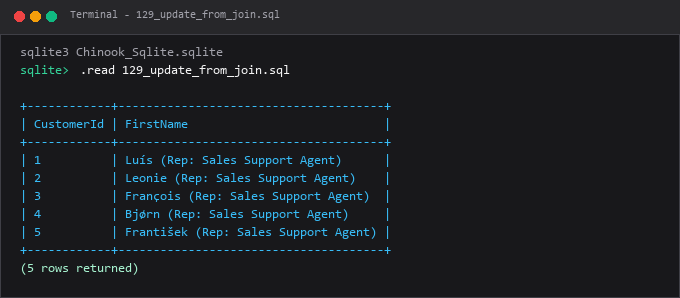

---

### 130. Bulk insert

**Tujuan Pembelajaran:**  
Memahami dan mempraktikkan konsep bulk insert menggunakan database Chinook.

**Konsep Utama:**  
Konsep dasar yang mendasari `130_bulk_insert.sql` adalah penerapan standar SQL relasional pada entitas database Chinook untuk memecahkan kebutuhan kueri dan manipulasi data secara tepat, aman, dan efisien.

**Penjelasan Source Code:**  
Program pada file [130_bulk_insert.sql](130_bulk_insert.sql) mendemonstrasikan implementasi terstruktur dari konsep bulk insert. Source code dilengkapi komentar edukatif berbahasa Indonesia yang membedah setiap instruksi query, penggunaan klausa, serta tujuan pemrosesannya.

**Source Code:** [130_bulk_insert.sql](130_bulk_insert.sql)  

**Cara Menjalankan:**
Jalankan melalui terminal atau command prompt menggunakan Python runner:
```bash
python -c "import sqlite3; conn=sqlite3.connect('../Chinook_Sqlite.sqlite'); print(conn.cursor().executescript(open('130_bulk_insert.sql', encoding='utf-8').read()))"
```
Atau menggunakan sqlite3 CLI:
```bash
sqlite3 ../Chinook_Sqlite.sqlite < 130_bulk_insert.sql
```

**Hasil yang Diharapkan:**  
Database engine mengeksekusi instruksi SQL dengan sukses dan menampilkan result-set atau status konfirmasi data yang sesuai.

**Screenshot Hasil Eksekusi:**

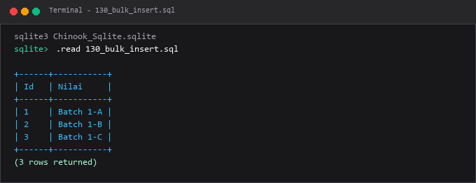

---

## Ringkasan Modul
Modul 07 mengajarkan manajemen siklus hidup data (Create, Read, Update, Delete) dengan penekanan pada integritas dan keamanan modifikasi data.

Seluruh submodul di atas saling melengkapi untuk membentuk pemahaman terstruktur yang bertahap, mulai dari konsep fundamental hingga implementasi praktis yang siap pakai di lingkungan kerja nyata.
