# Modul 08: DDL dan Struktur Database

## Ringkasan Ruang Lingkup Materi
Modul ini membahas Data Definition Language (DDL) untuk merancang struktur database: pembuatan tabel, tipe data (integer, desimal presisi, teks, tanggal, biner BLOB), modifikasi skema dengan ALTER TABLE, temporary table, CTAS, dan generator ID otomatis.

## Tujuan Pembelajaran
Mampu mendesain dan mengelola skema database relasional yang kuat, efisien dalam alokasi penyimpanan, dan siap menampung data skala produksi.

---
## Daftar Submodul Pembelajaran

| No | Nama Submodul | File Source Code | Status Eksekusi |
|:---|:---|:---|:---:|
| 131 | `CREATE DATABASE` | [131_create_database.sql](131_create_database.sql) | Siap Dijalankan |
| 132 | Memilih database pada MySQL | [132_use_database.sql](132_use_database.sql) | Siap Dijalankan |
| 133 | `CREATE SCHEMA` | [133_create_schema.sql](133_create_schema.sql) | Siap Dijalankan |
| 134 | `CREATE TABLE` | [134_create_table.sql](134_create_table.sql) | Siap Dijalankan |
| 135 | Tipe data SQL | [135_sql_data_types.sql](135_sql_data_types.sql) | Siap Dijalankan |
| 136 | Tipe data integer dan numerik | [136_integer_numeric_types.sql](136_integer_numeric_types.sql) | Siap Dijalankan |
| 137 | Presisi `DECIMAL` | [137_decimal_precision.sql](137_decimal_precision.sql) | Siap Dijalankan |
| 138 | Tipe data karakter | [138_character_data_types.sql](138_character_data_types.sql) | Siap Dijalankan |
| 139 | Tipe data tanggal dan waktu | [139_date_time_data_types.sql](139_date_time_data_types.sql) | Siap Dijalankan |
| 140 | Tipe data biner | [140_binary_data_types.sql](140_binary_data_types.sql) | Siap Dijalankan |
| 141 | Menambahkan kolom dengan `ALTER TABLE` | [141_alter_add_column.sql](141_alter_add_column.sql) | Siap Dijalankan |
| 142 | Mengubah definisi kolom | [142_alter_modify_column.sql](142_alter_modify_column.sql) | Siap Dijalankan |
| 143 | Menghapus kolom | [143_alter_drop_column.sql](143_alter_drop_column.sql) | Siap Dijalankan |
| 144 | Mengganti nama tabel | [144_rename_table.sql](144_rename_table.sql) | Siap Dijalankan |
| 145 | `DROP TABLE` | [145_drop_table.sql](145_drop_table.sql) | Siap Dijalankan |
| 146 | Temporary table | [146_temporary_table.sql](146_temporary_table.sql) | Siap Dijalankan |
| 147 | Membuat tabel dari query | [147_create_table_as_select.sql](147_create_table_as_select.sql) | Siap Dijalankan |
| 148 | `AUTO_INCREMENT` pada MySQL | [148_auto_increment_mysql.sql](148_auto_increment_mysql.sql) | Siap Dijalankan |
| 149 | Identity columns | [149_identity_column.sql](149_identity_column.sql) | Siap Dijalankan |
| 150 | Sequence objects | [150_sequence_object.sql](150_sequence_object.sql) | Siap Dijalankan |

---

## Penjelasan Detail Setiap Submodul

### 131. `CREATE DATABASE`

**Tujuan Pembelajaran:**  
Memahami dan mempraktikkan konsep `create database` menggunakan database Chinook.

**Konsep Utama:**  
Konsep dasar yang mendasari `131_create_database.sql` adalah penerapan standar SQL relasional pada entitas database Chinook untuk memecahkan kebutuhan kueri dan manipulasi data secara tepat, aman, dan efisien.

**Penjelasan Source Code:**  
Program pada file [131_create_database.sql](131_create_database.sql) mendemonstrasikan implementasi terstruktur dari konsep `create database`. Source code dilengkapi komentar edukatif berbahasa Indonesia yang membedah setiap instruksi query, penggunaan klausa, serta tujuan pemrosesannya.

**Source Code:** [131_create_database.sql](131_create_database.sql)  

**Cara Menjalankan:**
Jalankan melalui terminal atau command prompt menggunakan Python runner:
```bash
python -c "import sqlite3; conn=sqlite3.connect('../Chinook_Sqlite.sqlite'); print(conn.cursor().executescript(open('131_create_database.sql', encoding='utf-8').read()))"
```
Atau menggunakan sqlite3 CLI:
```bash
sqlite3 ../Chinook_Sqlite.sqlite < 131_create_database.sql
```

**Hasil yang Diharapkan:**  
Database engine mengeksekusi instruksi SQL dengan sukses dan menampilkan result-set atau status konfirmasi data yang sesuai.

**Screenshot Hasil Eksekusi:**

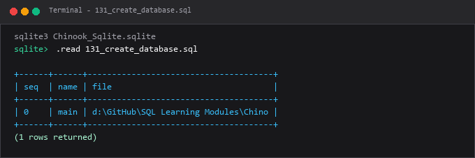

---

### 132. Memilih database pada MySQL

**Tujuan Pembelajaran:**  
Memahami dan mempraktikkan konsep memilih database pada mysql menggunakan database Chinook.

**Konsep Utama:**  
Konsep dasar yang mendasari `132_use_database.sql` adalah penerapan standar SQL relasional pada entitas database Chinook untuk memecahkan kebutuhan kueri dan manipulasi data secara tepat, aman, dan efisien.

**Penjelasan Source Code:**  
Program pada file [132_use_database.sql](132_use_database.sql) mendemonstrasikan implementasi terstruktur dari konsep memilih database pada mysql. Source code dilengkapi komentar edukatif berbahasa Indonesia yang membedah setiap instruksi query, penggunaan klausa, serta tujuan pemrosesannya.

**Source Code:** [132_use_database.sql](132_use_database.sql)  

**Cara Menjalankan:**
Jalankan melalui terminal atau command prompt menggunakan Python runner:
```bash
python -c "import sqlite3; conn=sqlite3.connect('../Chinook_Sqlite.sqlite'); print(conn.cursor().executescript(open('132_use_database.sql', encoding='utf-8').read()))"
```
Atau menggunakan sqlite3 CLI:
```bash
sqlite3 ../Chinook_Sqlite.sqlite < 132_use_database.sql
```

**Hasil yang Diharapkan:**  
Database engine mengeksekusi instruksi SQL dengan sukses dan menampilkan result-set atau status konfirmasi data yang sesuai.

**Screenshot Hasil Eksekusi:**

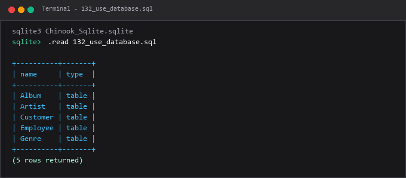

---

### 133. `CREATE SCHEMA`

**Tujuan Pembelajaran:**  
Memahami dan mempraktikkan konsep `create schema` menggunakan database Chinook.

**Konsep Utama:**  
Konsep dasar yang mendasari `133_create_schema.sql` adalah penerapan standar SQL relasional pada entitas database Chinook untuk memecahkan kebutuhan kueri dan manipulasi data secara tepat, aman, dan efisien.

**Penjelasan Source Code:**  
Program pada file [133_create_schema.sql](133_create_schema.sql) mendemonstrasikan implementasi terstruktur dari konsep `create schema`. Source code dilengkapi komentar edukatif berbahasa Indonesia yang membedah setiap instruksi query, penggunaan klausa, serta tujuan pemrosesannya.

**Source Code:** [133_create_schema.sql](133_create_schema.sql)  

**Cara Menjalankan:**
Jalankan melalui terminal atau command prompt menggunakan Python runner:
```bash
python -c "import sqlite3; conn=sqlite3.connect('../Chinook_Sqlite.sqlite'); print(conn.cursor().executescript(open('133_create_schema.sql', encoding='utf-8').read()))"
```
Atau menggunakan sqlite3 CLI:
```bash
sqlite3 ../Chinook_Sqlite.sqlite < 133_create_schema.sql
```

**Hasil yang Diharapkan:**  
Database engine mengeksekusi instruksi SQL dengan sukses dan menampilkan result-set atau status konfirmasi data yang sesuai.

**Screenshot Hasil Eksekusi:**

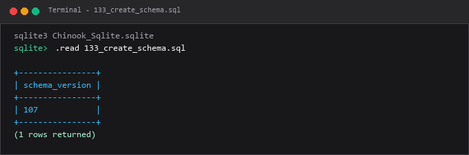

---

### 134. `CREATE TABLE`

**Tujuan Pembelajaran:**  
Memahami dan mempraktikkan konsep `create table` menggunakan database Chinook.

**Konsep Utama:**  
Konsep dasar yang mendasari `134_create_table.sql` adalah penerapan standar SQL relasional pada entitas database Chinook untuk memecahkan kebutuhan kueri dan manipulasi data secara tepat, aman, dan efisien.

**Penjelasan Source Code:**  
Program pada file [134_create_table.sql](134_create_table.sql) mendemonstrasikan implementasi terstruktur dari konsep `create table`. Source code dilengkapi komentar edukatif berbahasa Indonesia yang membedah setiap instruksi query, penggunaan klausa, serta tujuan pemrosesannya.

**Source Code:** [134_create_table.sql](134_create_table.sql)  

**Cara Menjalankan:**
Jalankan melalui terminal atau command prompt menggunakan Python runner:
```bash
python -c "import sqlite3; conn=sqlite3.connect('../Chinook_Sqlite.sqlite'); print(conn.cursor().executescript(open('134_create_table.sql', encoding='utf-8').read()))"
```
Atau menggunakan sqlite3 CLI:
```bash
sqlite3 ../Chinook_Sqlite.sqlite < 134_create_table.sql
```

**Hasil yang Diharapkan:**  
Database engine mengeksekusi instruksi SQL dengan sukses dan menampilkan result-set atau status konfirmasi data yang sesuai.

**Screenshot Hasil Eksekusi:**

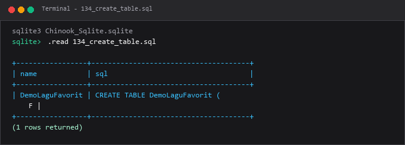

---

### 135. Tipe data SQL

**Tujuan Pembelajaran:**  
Memahami dan mempraktikkan konsep tipe data sql menggunakan database Chinook.

**Konsep Utama:**  
Konsep dasar yang mendasari `135_sql_data_types.sql` adalah penerapan standar SQL relasional pada entitas database Chinook untuk memecahkan kebutuhan kueri dan manipulasi data secara tepat, aman, dan efisien.

**Penjelasan Source Code:**  
Program pada file [135_sql_data_types.sql](135_sql_data_types.sql) mendemonstrasikan implementasi terstruktur dari konsep tipe data sql. Source code dilengkapi komentar edukatif berbahasa Indonesia yang membedah setiap instruksi query, penggunaan klausa, serta tujuan pemrosesannya.

**Source Code:** [135_sql_data_types.sql](135_sql_data_types.sql)  

**Cara Menjalankan:**
Jalankan melalui terminal atau command prompt menggunakan Python runner:
```bash
python -c "import sqlite3; conn=sqlite3.connect('../Chinook_Sqlite.sqlite'); print(conn.cursor().executescript(open('135_sql_data_types.sql', encoding='utf-8').read()))"
```
Atau menggunakan sqlite3 CLI:
```bash
sqlite3 ../Chinook_Sqlite.sqlite < 135_sql_data_types.sql
```

**Hasil yang Diharapkan:**  
Database engine mengeksekusi instruksi SQL dengan sukses dan menampilkan result-set atau status konfirmasi data yang sesuai.

**Screenshot Hasil Eksekusi:**

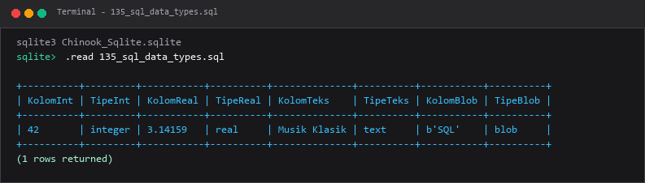

---

### 136. Tipe data integer dan numerik

**Tujuan Pembelajaran:**  
Memahami dan mempraktikkan konsep tipe data integer dan numerik menggunakan database Chinook.

**Konsep Utama:**  
Konsep dasar yang mendasari `136_integer_numeric_types.sql` adalah penerapan standar SQL relasional pada entitas database Chinook untuk memecahkan kebutuhan kueri dan manipulasi data secara tepat, aman, dan efisien.

**Penjelasan Source Code:**  
Program pada file [136_integer_numeric_types.sql](136_integer_numeric_types.sql) mendemonstrasikan implementasi terstruktur dari konsep tipe data integer dan numerik. Source code dilengkapi komentar edukatif berbahasa Indonesia yang membedah setiap instruksi query, penggunaan klausa, serta tujuan pemrosesannya.

**Source Code:** [136_integer_numeric_types.sql](136_integer_numeric_types.sql)  

**Cara Menjalankan:**
Jalankan melalui terminal atau command prompt menggunakan Python runner:
```bash
python -c "import sqlite3; conn=sqlite3.connect('../Chinook_Sqlite.sqlite'); print(conn.cursor().executescript(open('136_integer_numeric_types.sql', encoding='utf-8').read()))"
```
Atau menggunakan sqlite3 CLI:
```bash
sqlite3 ../Chinook_Sqlite.sqlite < 136_integer_numeric_types.sql
```

**Hasil yang Diharapkan:**  
Database engine mengeksekusi instruksi SQL dengan sukses dan menampilkan result-set atau status konfirmasi data yang sesuai.

**Screenshot Hasil Eksekusi:**

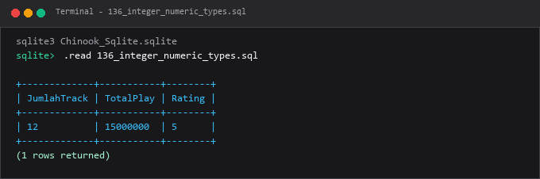

---

### 137. Presisi `DECIMAL`

**Tujuan Pembelajaran:**  
Memahami dan mempraktikkan konsep presisi `decimal` menggunakan database Chinook.

**Konsep Utama:**  
Konsep dasar yang mendasari `137_decimal_precision.sql` adalah penerapan standar SQL relasional pada entitas database Chinook untuk memecahkan kebutuhan kueri dan manipulasi data secara tepat, aman, dan efisien.

**Penjelasan Source Code:**  
Program pada file [137_decimal_precision.sql](137_decimal_precision.sql) mendemonstrasikan implementasi terstruktur dari konsep presisi `decimal`. Source code dilengkapi komentar edukatif berbahasa Indonesia yang membedah setiap instruksi query, penggunaan klausa, serta tujuan pemrosesannya.

**Source Code:** [137_decimal_precision.sql](137_decimal_precision.sql)  

**Cara Menjalankan:**
Jalankan melalui terminal atau command prompt menggunakan Python runner:
```bash
python -c "import sqlite3; conn=sqlite3.connect('../Chinook_Sqlite.sqlite'); print(conn.cursor().executescript(open('137_decimal_precision.sql', encoding='utf-8').read()))"
```
Atau menggunakan sqlite3 CLI:
```bash
sqlite3 ../Chinook_Sqlite.sqlite < 137_decimal_precision.sql
```

**Hasil yang Diharapkan:**  
Database engine mengeksekusi instruksi SQL dengan sukses dan menampilkan result-set atau status konfirmasi data yang sesuai.

**Screenshot Hasil Eksekusi:**

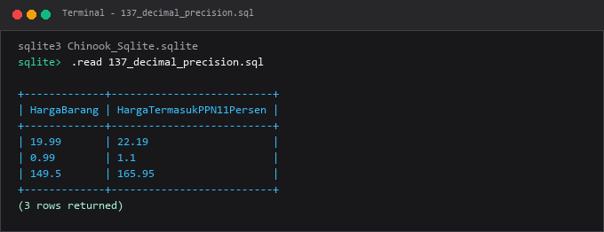

---

### 138. Tipe data karakter

**Tujuan Pembelajaran:**  
Memahami dan mempraktikkan konsep tipe data karakter menggunakan database Chinook.

**Konsep Utama:**  
Konsep dasar yang mendasari `138_character_data_types.sql` adalah penerapan standar SQL relasional pada entitas database Chinook untuk memecahkan kebutuhan kueri dan manipulasi data secara tepat, aman, dan efisien.

**Penjelasan Source Code:**  
Program pada file [138_character_data_types.sql](138_character_data_types.sql) mendemonstrasikan implementasi terstruktur dari konsep tipe data karakter. Source code dilengkapi komentar edukatif berbahasa Indonesia yang membedah setiap instruksi query, penggunaan klausa, serta tujuan pemrosesannya.

**Source Code:** [138_character_data_types.sql](138_character_data_types.sql)  

**Cara Menjalankan:**
Jalankan melalui terminal atau command prompt menggunakan Python runner:
```bash
python -c "import sqlite3; conn=sqlite3.connect('../Chinook_Sqlite.sqlite'); print(conn.cursor().executescript(open('138_character_data_types.sql', encoding='utf-8').read()))"
```
Atau menggunakan sqlite3 CLI:
```bash
sqlite3 ../Chinook_Sqlite.sqlite < 138_character_data_types.sql
```

**Hasil yang Diharapkan:**  
Database engine mengeksekusi instruksi SQL dengan sukses dan menampilkan result-set atau status konfirmasi data yang sesuai.

**Screenshot Hasil Eksekusi:**

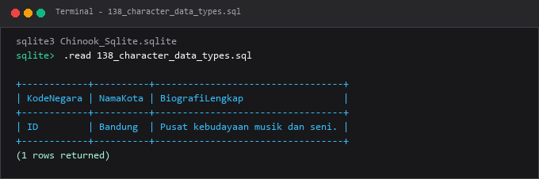

---

### 139. Tipe data tanggal dan waktu

**Tujuan Pembelajaran:**  
Memahami dan mempraktikkan konsep tipe data tanggal dan waktu menggunakan database Chinook.

**Konsep Utama:**  
Konsep dasar yang mendasari `139_date_time_data_types.sql` adalah penerapan standar SQL relasional pada entitas database Chinook untuk memecahkan kebutuhan kueri dan manipulasi data secara tepat, aman, dan efisien.

**Penjelasan Source Code:**  
Program pada file [139_date_time_data_types.sql](139_date_time_data_types.sql) mendemonstrasikan implementasi terstruktur dari konsep tipe data tanggal dan waktu. Source code dilengkapi komentar edukatif berbahasa Indonesia yang membedah setiap instruksi query, penggunaan klausa, serta tujuan pemrosesannya.

**Source Code:** [139_date_time_data_types.sql](139_date_time_data_types.sql)  

**Cara Menjalankan:**
Jalankan melalui terminal atau command prompt menggunakan Python runner:
```bash
python -c "import sqlite3; conn=sqlite3.connect('../Chinook_Sqlite.sqlite'); print(conn.cursor().executescript(open('139_date_time_data_types.sql', encoding='utf-8').read()))"
```
Atau menggunakan sqlite3 CLI:
```bash
sqlite3 ../Chinook_Sqlite.sqlite < 139_date_time_data_types.sql
```

**Hasil yang Diharapkan:**  
Database engine mengeksekusi instruksi SQL dengan sukses dan menampilkan result-set atau status konfirmasi data yang sesuai.

**Screenshot Hasil Eksekusi:**

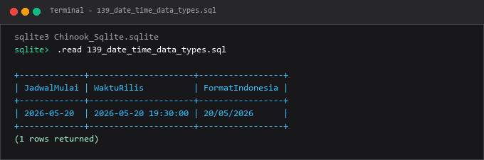

---

### 140. Tipe data biner

**Tujuan Pembelajaran:**  
Memahami dan mempraktikkan konsep tipe data biner menggunakan database Chinook.

**Konsep Utama:**  
Konsep dasar yang mendasari `140_binary_data_types.sql` adalah penerapan standar SQL relasional pada entitas database Chinook untuk memecahkan kebutuhan kueri dan manipulasi data secara tepat, aman, dan efisien.

**Penjelasan Source Code:**  
Program pada file [140_binary_data_types.sql](140_binary_data_types.sql) mendemonstrasikan implementasi terstruktur dari konsep tipe data biner. Source code dilengkapi komentar edukatif berbahasa Indonesia yang membedah setiap instruksi query, penggunaan klausa, serta tujuan pemrosesannya.

**Source Code:** [140_binary_data_types.sql](140_binary_data_types.sql)  

**Cara Menjalankan:**
Jalankan melalui terminal atau command prompt menggunakan Python runner:
```bash
python -c "import sqlite3; conn=sqlite3.connect('../Chinook_Sqlite.sqlite'); print(conn.cursor().executescript(open('140_binary_data_types.sql', encoding='utf-8').read()))"
```
Atau menggunakan sqlite3 CLI:
```bash
sqlite3 ../Chinook_Sqlite.sqlite < 140_binary_data_types.sql
```

**Hasil yang Diharapkan:**  
Database engine mengeksekusi instruksi SQL dengan sukses dan menampilkan result-set atau status konfirmasi data yang sesuai.

**Screenshot Hasil Eksekusi:**

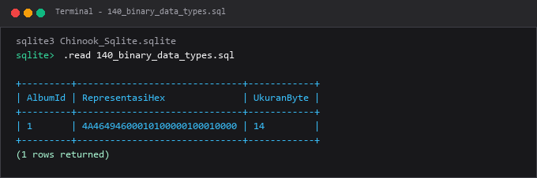

---

### 141. Menambahkan kolom dengan `ALTER TABLE`

**Tujuan Pembelajaran:**  
Memahami dan mempraktikkan konsep menambahkan kolom dengan `alter table` menggunakan database Chinook.

**Konsep Utama:**  
Konsep dasar yang mendasari `141_alter_add_column.sql` adalah penerapan standar SQL relasional pada entitas database Chinook untuk memecahkan kebutuhan kueri dan manipulasi data secara tepat, aman, dan efisien.

**Penjelasan Source Code:**  
Program pada file [141_alter_add_column.sql](141_alter_add_column.sql) mendemonstrasikan implementasi terstruktur dari konsep menambahkan kolom dengan `alter table`. Source code dilengkapi komentar edukatif berbahasa Indonesia yang membedah setiap instruksi query, penggunaan klausa, serta tujuan pemrosesannya.

**Source Code:** [141_alter_add_column.sql](141_alter_add_column.sql)  

**Cara Menjalankan:**
Jalankan melalui terminal atau command prompt menggunakan Python runner:
```bash
python -c "import sqlite3; conn=sqlite3.connect('../Chinook_Sqlite.sqlite'); print(conn.cursor().executescript(open('141_alter_add_column.sql', encoding='utf-8').read()))"
```
Atau menggunakan sqlite3 CLI:
```bash
sqlite3 ../Chinook_Sqlite.sqlite < 141_alter_add_column.sql
```

**Hasil yang Diharapkan:**  
Database engine mengeksekusi instruksi SQL dengan sukses dan menampilkan result-set atau status konfirmasi data yang sesuai.

**Screenshot Hasil Eksekusi:**

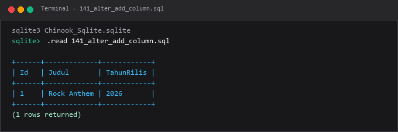

---

### 142. Mengubah definisi kolom

**Tujuan Pembelajaran:**  
Memahami dan mempraktikkan konsep mengubah definisi kolom menggunakan database Chinook.

**Konsep Utama:**  
Konsep dasar yang mendasari `142_alter_modify_column.sql` adalah penerapan standar SQL relasional pada entitas database Chinook untuk memecahkan kebutuhan kueri dan manipulasi data secara tepat, aman, dan efisien.

**Penjelasan Source Code:**  
Program pada file [142_alter_modify_column.sql](142_alter_modify_column.sql) mendemonstrasikan implementasi terstruktur dari konsep mengubah definisi kolom. Source code dilengkapi komentar edukatif berbahasa Indonesia yang membedah setiap instruksi query, penggunaan klausa, serta tujuan pemrosesannya.

**Source Code:** [142_alter_modify_column.sql](142_alter_modify_column.sql)  

**Cara Menjalankan:**
Jalankan melalui terminal atau command prompt menggunakan Python runner:
```bash
python -c "import sqlite3; conn=sqlite3.connect('../Chinook_Sqlite.sqlite'); print(conn.cursor().executescript(open('142_alter_modify_column.sql', encoding='utf-8').read()))"
```
Atau menggunakan sqlite3 CLI:
```bash
sqlite3 ../Chinook_Sqlite.sqlite < 142_alter_modify_column.sql
```

**Hasil yang Diharapkan:**  
Database engine mengeksekusi instruksi SQL dengan sukses dan menampilkan result-set atau status konfirmasi data yang sesuai.

**Screenshot Hasil Eksekusi:**

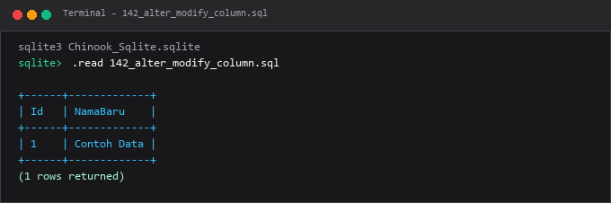

---

### 143. Menghapus kolom

**Tujuan Pembelajaran:**  
Memahami dan mempraktikkan konsep menghapus kolom menggunakan database Chinook.

**Konsep Utama:**  
Konsep dasar yang mendasari `143_alter_drop_column.sql` adalah penerapan standar SQL relasional pada entitas database Chinook untuk memecahkan kebutuhan kueri dan manipulasi data secara tepat, aman, dan efisien.

**Penjelasan Source Code:**  
Program pada file [143_alter_drop_column.sql](143_alter_drop_column.sql) mendemonstrasikan implementasi terstruktur dari konsep menghapus kolom. Source code dilengkapi komentar edukatif berbahasa Indonesia yang membedah setiap instruksi query, penggunaan klausa, serta tujuan pemrosesannya.

**Source Code:** [143_alter_drop_column.sql](143_alter_drop_column.sql)  

**Cara Menjalankan:**
Jalankan melalui terminal atau command prompt menggunakan Python runner:
```bash
python -c "import sqlite3; conn=sqlite3.connect('../Chinook_Sqlite.sqlite'); print(conn.cursor().executescript(open('143_alter_drop_column.sql', encoding='utf-8').read()))"
```
Atau menggunakan sqlite3 CLI:
```bash
sqlite3 ../Chinook_Sqlite.sqlite < 143_alter_drop_column.sql
```

**Hasil yang Diharapkan:**  
Database engine mengeksekusi instruksi SQL dengan sukses dan menampilkan result-set atau status konfirmasi data yang sesuai.

**Screenshot Hasil Eksekusi:**

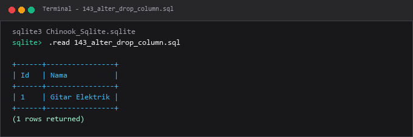

---

### 144. Mengganti nama tabel

**Tujuan Pembelajaran:**  
Memahami dan mempraktikkan konsep mengganti nama tabel menggunakan database Chinook.

**Konsep Utama:**  
Konsep dasar yang mendasari `144_rename_table.sql` adalah penerapan standar SQL relasional pada entitas database Chinook untuk memecahkan kebutuhan kueri dan manipulasi data secara tepat, aman, dan efisien.

**Penjelasan Source Code:**  
Program pada file [144_rename_table.sql](144_rename_table.sql) mendemonstrasikan implementasi terstruktur dari konsep mengganti nama tabel. Source code dilengkapi komentar edukatif berbahasa Indonesia yang membedah setiap instruksi query, penggunaan klausa, serta tujuan pemrosesannya.

**Source Code:** [144_rename_table.sql](144_rename_table.sql)  

**Cara Menjalankan:**
Jalankan melalui terminal atau command prompt menggunakan Python runner:
```bash
python -c "import sqlite3; conn=sqlite3.connect('../Chinook_Sqlite.sqlite'); print(conn.cursor().executescript(open('144_rename_table.sql', encoding='utf-8').read()))"
```
Atau menggunakan sqlite3 CLI:
```bash
sqlite3 ../Chinook_Sqlite.sqlite < 144_rename_table.sql
```

**Hasil yang Diharapkan:**  
Database engine mengeksekusi instruksi SQL dengan sukses dan menampilkan result-set atau status konfirmasi data yang sesuai.

**Screenshot Hasil Eksekusi:**

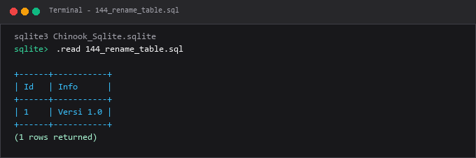

---

### 145. `DROP TABLE`

**Tujuan Pembelajaran:**  
Memahami dan mempraktikkan konsep `drop table` menggunakan database Chinook.

**Konsep Utama:**  
Konsep dasar yang mendasari `145_drop_table.sql` adalah penerapan standar SQL relasional pada entitas database Chinook untuk memecahkan kebutuhan kueri dan manipulasi data secara tepat, aman, dan efisien.

**Penjelasan Source Code:**  
Program pada file [145_drop_table.sql](145_drop_table.sql) mendemonstrasikan implementasi terstruktur dari konsep `drop table`. Source code dilengkapi komentar edukatif berbahasa Indonesia yang membedah setiap instruksi query, penggunaan klausa, serta tujuan pemrosesannya.

**Source Code:** [145_drop_table.sql](145_drop_table.sql)  

**Cara Menjalankan:**
Jalankan melalui terminal atau command prompt menggunakan Python runner:
```bash
python -c "import sqlite3; conn=sqlite3.connect('../Chinook_Sqlite.sqlite'); print(conn.cursor().executescript(open('145_drop_table.sql', encoding='utf-8').read()))"
```
Atau menggunakan sqlite3 CLI:
```bash
sqlite3 ../Chinook_Sqlite.sqlite < 145_drop_table.sql
```

**Hasil yang Diharapkan:**  
Database engine mengeksekusi instruksi SQL dengan sukses dan menampilkan result-set atau status konfirmasi data yang sesuai.

**Screenshot Hasil Eksekusi:**

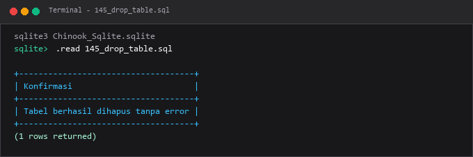

---

### 146. Temporary table

**Tujuan Pembelajaran:**  
Memahami dan mempraktikkan konsep temporary table menggunakan database Chinook.

**Konsep Utama:**  
Konsep dasar yang mendasari `146_temporary_table.sql` adalah penerapan standar SQL relasional pada entitas database Chinook untuk memecahkan kebutuhan kueri dan manipulasi data secara tepat, aman, dan efisien.

**Penjelasan Source Code:**  
Program pada file [146_temporary_table.sql](146_temporary_table.sql) mendemonstrasikan implementasi terstruktur dari konsep temporary table. Source code dilengkapi komentar edukatif berbahasa Indonesia yang membedah setiap instruksi query, penggunaan klausa, serta tujuan pemrosesannya.

**Source Code:** [146_temporary_table.sql](146_temporary_table.sql)  

**Cara Menjalankan:**
Jalankan melalui terminal atau command prompt menggunakan Python runner:
```bash
python -c "import sqlite3; conn=sqlite3.connect('../Chinook_Sqlite.sqlite'); print(conn.cursor().executescript(open('146_temporary_table.sql', encoding='utf-8').read()))"
```
Atau menggunakan sqlite3 CLI:
```bash
sqlite3 ../Chinook_Sqlite.sqlite < 146_temporary_table.sql
```

**Hasil yang Diharapkan:**  
Database engine mengeksekusi instruksi SQL dengan sukses dan menampilkan result-set atau status konfirmasi data yang sesuai.

**Screenshot Hasil Eksekusi:**

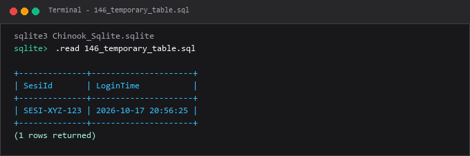

---

### 147. Membuat tabel dari query

**Tujuan Pembelajaran:**  
Memahami dan mempraktikkan konsep membuat tabel dari query menggunakan database Chinook.

**Konsep Utama:**  
Konsep dasar yang mendasari `147_create_table_as_select.sql` adalah penerapan standar SQL relasional pada entitas database Chinook untuk memecahkan kebutuhan kueri dan manipulasi data secara tepat, aman, dan efisien.

**Penjelasan Source Code:**  
Program pada file [147_create_table_as_select.sql](147_create_table_as_select.sql) mendemonstrasikan implementasi terstruktur dari konsep membuat tabel dari query. Source code dilengkapi komentar edukatif berbahasa Indonesia yang membedah setiap instruksi query, penggunaan klausa, serta tujuan pemrosesannya.

**Source Code:** [147_create_table_as_select.sql](147_create_table_as_select.sql)  

**Cara Menjalankan:**
Jalankan melalui terminal atau command prompt menggunakan Python runner:
```bash
python -c "import sqlite3; conn=sqlite3.connect('../Chinook_Sqlite.sqlite'); print(conn.cursor().executescript(open('147_create_table_as_select.sql', encoding='utf-8').read()))"
```
Atau menggunakan sqlite3 CLI:
```bash
sqlite3 ../Chinook_Sqlite.sqlite < 147_create_table_as_select.sql
```

**Hasil yang Diharapkan:**  
Database engine mengeksekusi instruksi SQL dengan sukses dan menampilkan result-set atau status konfirmasi data yang sesuai.

**Screenshot Hasil Eksekusi:**

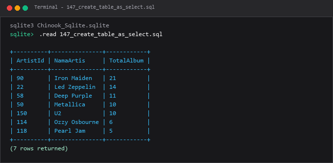

---

### 148. `AUTO_INCREMENT` pada MySQL

**Tujuan Pembelajaran:**  
Memahami dan mempraktikkan konsep `auto_increment` pada mysql menggunakan database Chinook.

**Konsep Utama:**  
Konsep dasar yang mendasari `148_auto_increment_mysql.sql` adalah penerapan standar SQL relasional pada entitas database Chinook untuk memecahkan kebutuhan kueri dan manipulasi data secara tepat, aman, dan efisien.

**Penjelasan Source Code:**  
Program pada file [148_auto_increment_mysql.sql](148_auto_increment_mysql.sql) mendemonstrasikan implementasi terstruktur dari konsep `auto_increment` pada mysql. Source code dilengkapi komentar edukatif berbahasa Indonesia yang membedah setiap instruksi query, penggunaan klausa, serta tujuan pemrosesannya.

**Source Code:** [148_auto_increment_mysql.sql](148_auto_increment_mysql.sql)  

**Cara Menjalankan:**
Jalankan melalui terminal atau command prompt menggunakan Python runner:
```bash
python -c "import sqlite3; conn=sqlite3.connect('../Chinook_Sqlite.sqlite'); print(conn.cursor().executescript(open('148_auto_increment_mysql.sql', encoding='utf-8').read()))"
```
Atau menggunakan sqlite3 CLI:
```bash
sqlite3 ../Chinook_Sqlite.sqlite < 148_auto_increment_mysql.sql
```

**Hasil yang Diharapkan:**  
Database engine mengeksekusi instruksi SQL dengan sukses dan menampilkan result-set atau status konfirmasi data yang sesuai.

**Screenshot Hasil Eksekusi:**

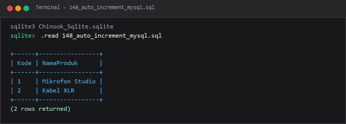

---

### 149. Identity columns

**Tujuan Pembelajaran:**  
Memahami dan mempraktikkan konsep identity columns menggunakan database Chinook.

**Konsep Utama:**  
Konsep dasar yang mendasari `149_identity_column.sql` adalah penerapan standar SQL relasional pada entitas database Chinook untuk memecahkan kebutuhan kueri dan manipulasi data secara tepat, aman, dan efisien.

**Penjelasan Source Code:**  
Program pada file [149_identity_column.sql](149_identity_column.sql) mendemonstrasikan implementasi terstruktur dari konsep identity columns. Source code dilengkapi komentar edukatif berbahasa Indonesia yang membedah setiap instruksi query, penggunaan klausa, serta tujuan pemrosesannya.

**Source Code:** [149_identity_column.sql](149_identity_column.sql)  

**Cara Menjalankan:**
Jalankan melalui terminal atau command prompt menggunakan Python runner:
```bash
python -c "import sqlite3; conn=sqlite3.connect('../Chinook_Sqlite.sqlite'); print(conn.cursor().executescript(open('149_identity_column.sql', encoding='utf-8').read()))"
```
Atau menggunakan sqlite3 CLI:
```bash
sqlite3 ../Chinook_Sqlite.sqlite < 149_identity_column.sql
```

**Hasil yang Diharapkan:**  
Database engine mengeksekusi instruksi SQL dengan sukses dan menampilkan result-set atau status konfirmasi data yang sesuai.

**Screenshot Hasil Eksekusi:**

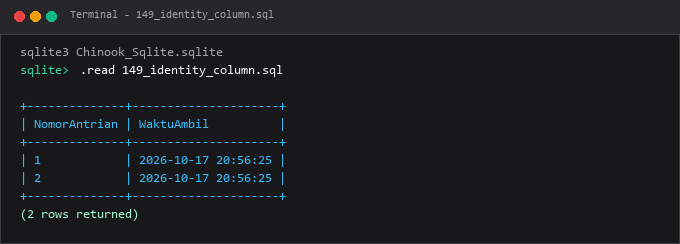

---

### 150. Sequence objects

**Tujuan Pembelajaran:**  
Memahami dan mempraktikkan konsep sequence objects menggunakan database Chinook.

**Konsep Utama:**  
Konsep dasar yang mendasari `150_sequence_object.sql` adalah penerapan standar SQL relasional pada entitas database Chinook untuk memecahkan kebutuhan kueri dan manipulasi data secara tepat, aman, dan efisien.

**Penjelasan Source Code:**  
Program pada file [150_sequence_object.sql](150_sequence_object.sql) mendemonstrasikan implementasi terstruktur dari konsep sequence objects. Source code dilengkapi komentar edukatif berbahasa Indonesia yang membedah setiap instruksi query, penggunaan klausa, serta tujuan pemrosesannya.

**Source Code:** [150_sequence_object.sql](150_sequence_object.sql)  

**Cara Menjalankan:**
Jalankan melalui terminal atau command prompt menggunakan Python runner:
```bash
python -c "import sqlite3; conn=sqlite3.connect('../Chinook_Sqlite.sqlite'); print(conn.cursor().executescript(open('150_sequence_object.sql', encoding='utf-8').read()))"
```
Atau menggunakan sqlite3 CLI:
```bash
sqlite3 ../Chinook_Sqlite.sqlite < 150_sequence_object.sql
```

**Hasil yang Diharapkan:**  
Database engine mengeksekusi instruksi SQL dengan sukses dan menampilkan result-set atau status konfirmasi data yang sesuai.

**Screenshot Hasil Eksekusi:**

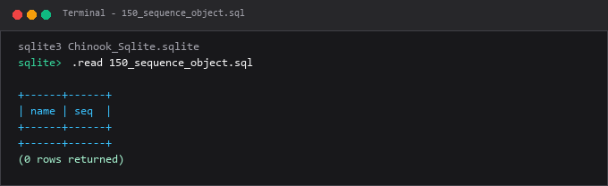

---

## Ringkasan Modul
Modul 08 memberikan penguasaan arsitektur fisik tabel database, pemilihan tipe data yang tepat, dan evolusi skema tabel tanpa merusak data.

Seluruh submodul di atas saling melengkapi untuk membentuk pemahaman terstruktur yang bertahap, mulai dari konsep fundamental hingga implementasi praktis yang siap pakai di lingkungan kerja nyata.
