# Modul 09: Constraints dan Relasi Database

## Ringkasan Ruang Lingkup Materi
Modul ini mengkaji penegakan integritas data melalui konstrain: PRIMARY KEY, FOREIGN KEY, UNIQUE, NOT NULL, CHECK, DEFAULT, kunci komposit, serta aksi referensial (CASCADE, RESTRICT, SET NULL) untuk memodelkan relasi 1:1, 1:N, dan N:M.

## Tujuan Pembelajaran
Menjamin konsistensi dan integritas referensial data di tingkat mesin database, mencegah inkonsistensi data yatim, dan memodelkan relasi dunia nyata secara akurat.

---
## Daftar Submodul Pembelajaran

| No | Nama Submodul | File Source Code | Status Eksekusi |
|:---|:---|:---|:---:|
| 151 | Primary key | [151_primary_key.sql](151_primary_key.sql) | Siap Dijalankan |
| 152 | Foreign key | [152_foreign_key.sql](152_foreign_key.sql) | Siap Dijalankan |
| 153 | Unique constraint | [153_unique_constraint.sql](153_unique_constraint.sql) | Siap Dijalankan |
| 154 | Not null constraint | [154_not_null_constraint.sql](154_not_null_constraint.sql) | Siap Dijalankan |
| 155 | Check constraint | [155_check_constraint.sql](155_check_constraint.sql) | Siap Dijalankan |
| 156 | Default constraint | [156_default_constraint.sql](156_default_constraint.sql) | Siap Dijalankan |
| 157 | Composite primary key | [157_composite_primary_key.sql](157_composite_primary_key.sql) | Siap Dijalankan |
| 158 | Composite foreign key | [158_composite_foreign_key.sql](158_composite_foreign_key.sql) | Siap Dijalankan |
| 159 | `ON DELETE CASCADE` | [159_on_delete_cascade.sql](159_on_delete_cascade.sql) | Siap Dijalankan |
| 160 | `ON UPDATE CASCADE` | [160_on_update_cascade.sql](160_on_update_cascade.sql) | Siap Dijalankan |
| 161 | `RESTRICT` dan `NO ACTION` | [161_restrict_no_action.sql](161_restrict_no_action.sql) | Siap Dijalankan |
| 162 | `ON DELETE SET NULL` | [162_set_null_foreign_key.sql](162_set_null_foreign_key.sql) | Siap Dijalankan |
| 163 | Relasi one-to-one | [163_one_to_one_relationship.sql](163_one_to_one_relationship.sql) | Siap Dijalankan |
| 164 | Relasi one-to-many | [164_one_to_many_relationship.sql](164_one_to_many_relationship.sql) | Siap Dijalankan |
| 165 | Relasi many-to-many | [165_many_to_many_relationship.sql](165_many_to_many_relationship.sql) | Siap Dijalankan |

---

## Penjelasan Detail Setiap Submodul

### 151. Primary key

**Tujuan Pembelajaran:**  
Memahami dan mempraktikkan konsep primary key menggunakan database Chinook.

**Konsep Utama:**  
Konsep dasar yang mendasari `151_primary_key.sql` adalah penerapan standar SQL relasional pada entitas database Chinook untuk memecahkan kebutuhan kueri dan manipulasi data secara tepat, aman, dan efisien.

**Penjelasan Source Code:**  
Program pada file [151_primary_key.sql](151_primary_key.sql) mendemonstrasikan implementasi terstruktur dari konsep primary key. Source code dilengkapi komentar edukatif berbahasa Indonesia yang membedah setiap instruksi query, penggunaan klausa, serta tujuan pemrosesannya.

**Source Code:** [151_primary_key.sql](151_primary_key.sql)  

**Cara Menjalankan:**
Jalankan melalui terminal atau command prompt menggunakan Python runner:
```bash
python -c "import sqlite3; conn=sqlite3.connect('../Chinook_Sqlite.sqlite'); print(conn.cursor().executescript(open('151_primary_key.sql', encoding='utf-8').read()))"
```
Atau menggunakan sqlite3 CLI:
```bash
sqlite3 ../Chinook_Sqlite.sqlite < 151_primary_key.sql
```

**Hasil yang Diharapkan:**  
Database engine mengeksekusi instruksi SQL dengan sukses dan menampilkan result-set atau status konfirmasi data yang sesuai.

**Screenshot Hasil Eksekusi:**

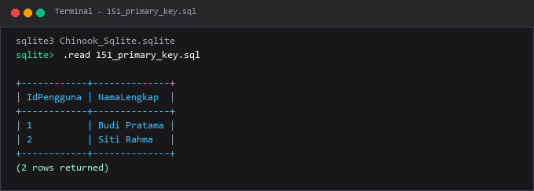

---

### 152. Foreign key

**Tujuan Pembelajaran:**  
Memahami dan mempraktikkan konsep foreign key menggunakan database Chinook.

**Konsep Utama:**  
Konsep dasar yang mendasari `152_foreign_key.sql` adalah penerapan standar SQL relasional pada entitas database Chinook untuk memecahkan kebutuhan kueri dan manipulasi data secara tepat, aman, dan efisien.

**Penjelasan Source Code:**  
Program pada file [152_foreign_key.sql](152_foreign_key.sql) mendemonstrasikan implementasi terstruktur dari konsep foreign key. Source code dilengkapi komentar edukatif berbahasa Indonesia yang membedah setiap instruksi query, penggunaan klausa, serta tujuan pemrosesannya.

**Source Code:** [152_foreign_key.sql](152_foreign_key.sql)  

**Cara Menjalankan:**
Jalankan melalui terminal atau command prompt menggunakan Python runner:
```bash
python -c "import sqlite3; conn=sqlite3.connect('../Chinook_Sqlite.sqlite'); print(conn.cursor().executescript(open('152_foreign_key.sql', encoding='utf-8').read()))"
```
Atau menggunakan sqlite3 CLI:
```bash
sqlite3 ../Chinook_Sqlite.sqlite < 152_foreign_key.sql
```

**Hasil yang Diharapkan:**  
Database engine mengeksekusi instruksi SQL dengan sukses dan menampilkan result-set atau status konfirmasi data yang sesuai.

**Screenshot Hasil Eksekusi:**

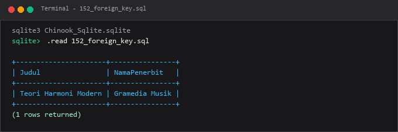

---

### 153. Unique constraint

**Tujuan Pembelajaran:**  
Memahami dan mempraktikkan konsep unique constraint menggunakan database Chinook.

**Konsep Utama:**  
Konsep dasar yang mendasari `153_unique_constraint.sql` adalah penerapan standar SQL relasional pada entitas database Chinook untuk memecahkan kebutuhan kueri dan manipulasi data secara tepat, aman, dan efisien.

**Penjelasan Source Code:**  
Program pada file [153_unique_constraint.sql](153_unique_constraint.sql) mendemonstrasikan implementasi terstruktur dari konsep unique constraint. Source code dilengkapi komentar edukatif berbahasa Indonesia yang membedah setiap instruksi query, penggunaan klausa, serta tujuan pemrosesannya.

**Source Code:** [153_unique_constraint.sql](153_unique_constraint.sql)  

**Cara Menjalankan:**
Jalankan melalui terminal atau command prompt menggunakan Python runner:
```bash
python -c "import sqlite3; conn=sqlite3.connect('../Chinook_Sqlite.sqlite'); print(conn.cursor().executescript(open('153_unique_constraint.sql', encoding='utf-8').read()))"
```
Atau menggunakan sqlite3 CLI:
```bash
sqlite3 ../Chinook_Sqlite.sqlite < 153_unique_constraint.sql
```

**Hasil yang Diharapkan:**  
Database engine mengeksekusi instruksi SQL dengan sukses dan menampilkan result-set atau status konfirmasi data yang sesuai.

**Screenshot Hasil Eksekusi:**

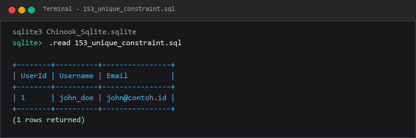

---

### 154. Not null constraint

**Tujuan Pembelajaran:**  
Memahami dan mempraktikkan konsep not null constraint menggunakan database Chinook.

**Konsep Utama:**  
Konsep dasar yang mendasari `154_not_null_constraint.sql` adalah penerapan standar SQL relasional pada entitas database Chinook untuk memecahkan kebutuhan kueri dan manipulasi data secara tepat, aman, dan efisien.

**Penjelasan Source Code:**  
Program pada file [154_not_null_constraint.sql](154_not_null_constraint.sql) mendemonstrasikan implementasi terstruktur dari konsep not null constraint. Source code dilengkapi komentar edukatif berbahasa Indonesia yang membedah setiap instruksi query, penggunaan klausa, serta tujuan pemrosesannya.

**Source Code:** [154_not_null_constraint.sql](154_not_null_constraint.sql)  

**Cara Menjalankan:**
Jalankan melalui terminal atau command prompt menggunakan Python runner:
```bash
python -c "import sqlite3; conn=sqlite3.connect('../Chinook_Sqlite.sqlite'); print(conn.cursor().executescript(open('154_not_null_constraint.sql', encoding='utf-8').read()))"
```
Atau menggunakan sqlite3 CLI:
```bash
sqlite3 ../Chinook_Sqlite.sqlite < 154_not_null_constraint.sql
```

**Hasil yang Diharapkan:**  
Database engine mengeksekusi instruksi SQL dengan sukses dan menampilkan result-set atau status konfirmasi data yang sesuai.

**Screenshot Hasil Eksekusi:**

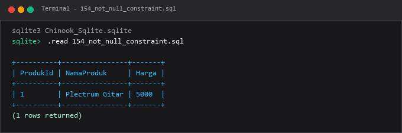

---

### 155. Check constraint

**Tujuan Pembelajaran:**  
Memahami dan mempraktikkan konsep check constraint menggunakan database Chinook.

**Konsep Utama:**  
Konsep dasar yang mendasari `155_check_constraint.sql` adalah penerapan standar SQL relasional pada entitas database Chinook untuk memecahkan kebutuhan kueri dan manipulasi data secara tepat, aman, dan efisien.

**Penjelasan Source Code:**  
Program pada file [155_check_constraint.sql](155_check_constraint.sql) mendemonstrasikan implementasi terstruktur dari konsep check constraint. Source code dilengkapi komentar edukatif berbahasa Indonesia yang membedah setiap instruksi query, penggunaan klausa, serta tujuan pemrosesannya.

**Source Code:** [155_check_constraint.sql](155_check_constraint.sql)  

**Cara Menjalankan:**
Jalankan melalui terminal atau command prompt menggunakan Python runner:
```bash
python -c "import sqlite3; conn=sqlite3.connect('../Chinook_Sqlite.sqlite'); print(conn.cursor().executescript(open('155_check_constraint.sql', encoding='utf-8').read()))"
```
Atau menggunakan sqlite3 CLI:
```bash
sqlite3 ../Chinook_Sqlite.sqlite < 155_check_constraint.sql
```

**Hasil yang Diharapkan:**  
Database engine mengeksekusi instruksi SQL dengan sukses dan menampilkan result-set atau status konfirmasi data yang sesuai.

**Screenshot Hasil Eksekusi:**

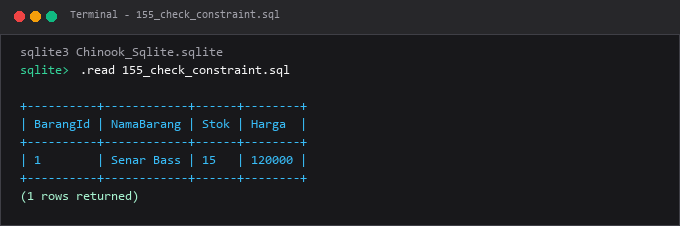

---

### 156. Default constraint

**Tujuan Pembelajaran:**  
Memahami dan mempraktikkan konsep default constraint menggunakan database Chinook.

**Konsep Utama:**  
Konsep dasar yang mendasari `156_default_constraint.sql` adalah penerapan standar SQL relasional pada entitas database Chinook untuk memecahkan kebutuhan kueri dan manipulasi data secara tepat, aman, dan efisien.

**Penjelasan Source Code:**  
Program pada file [156_default_constraint.sql](156_default_constraint.sql) mendemonstrasikan implementasi terstruktur dari konsep default constraint. Source code dilengkapi komentar edukatif berbahasa Indonesia yang membedah setiap instruksi query, penggunaan klausa, serta tujuan pemrosesannya.

**Source Code:** [156_default_constraint.sql](156_default_constraint.sql)  

**Cara Menjalankan:**
Jalankan melalui terminal atau command prompt menggunakan Python runner:
```bash
python -c "import sqlite3; conn=sqlite3.connect('../Chinook_Sqlite.sqlite'); print(conn.cursor().executescript(open('156_default_constraint.sql', encoding='utf-8').read()))"
```
Atau menggunakan sqlite3 CLI:
```bash
sqlite3 ../Chinook_Sqlite.sqlite < 156_default_constraint.sql
```

**Hasil yang Diharapkan:**  
Database engine mengeksekusi instruksi SQL dengan sukses dan menampilkan result-set atau status konfirmasi data yang sesuai.

**Screenshot Hasil Eksekusi:**

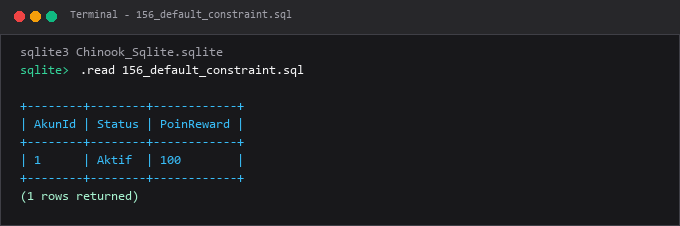

---

### 157. Composite primary key

**Tujuan Pembelajaran:**  
Memahami dan mempraktikkan konsep composite primary key menggunakan database Chinook.

**Konsep Utama:**  
Konsep dasar yang mendasari `157_composite_primary_key.sql` adalah penerapan standar SQL relasional pada entitas database Chinook untuk memecahkan kebutuhan kueri dan manipulasi data secara tepat, aman, dan efisien.

**Penjelasan Source Code:**  
Program pada file [157_composite_primary_key.sql](157_composite_primary_key.sql) mendemonstrasikan implementasi terstruktur dari konsep composite primary key. Source code dilengkapi komentar edukatif berbahasa Indonesia yang membedah setiap instruksi query, penggunaan klausa, serta tujuan pemrosesannya.

**Source Code:** [157_composite_primary_key.sql](157_composite_primary_key.sql)  

**Cara Menjalankan:**
Jalankan melalui terminal atau command prompt menggunakan Python runner:
```bash
python -c "import sqlite3; conn=sqlite3.connect('../Chinook_Sqlite.sqlite'); print(conn.cursor().executescript(open('157_composite_primary_key.sql', encoding='utf-8').read()))"
```
Atau menggunakan sqlite3 CLI:
```bash
sqlite3 ../Chinook_Sqlite.sqlite < 157_composite_primary_key.sql
```

**Hasil yang Diharapkan:**  
Database engine mengeksekusi instruksi SQL dengan sukses dan menampilkan result-set atau status konfirmasi data yang sesuai.

**Screenshot Hasil Eksekusi:**

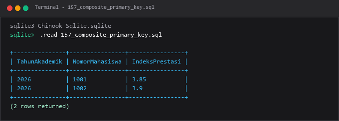

---

### 158. Composite foreign key

**Tujuan Pembelajaran:**  
Memahami dan mempraktikkan konsep composite foreign key menggunakan database Chinook.

**Konsep Utama:**  
Konsep dasar yang mendasari `158_composite_foreign_key.sql` adalah penerapan standar SQL relasional pada entitas database Chinook untuk memecahkan kebutuhan kueri dan manipulasi data secara tepat, aman, dan efisien.

**Penjelasan Source Code:**  
Program pada file [158_composite_foreign_key.sql](158_composite_foreign_key.sql) mendemonstrasikan implementasi terstruktur dari konsep composite foreign key. Source code dilengkapi komentar edukatif berbahasa Indonesia yang membedah setiap instruksi query, penggunaan klausa, serta tujuan pemrosesannya.

**Source Code:** [158_composite_foreign_key.sql](158_composite_foreign_key.sql)  

**Cara Menjalankan:**
Jalankan melalui terminal atau command prompt menggunakan Python runner:
```bash
python -c "import sqlite3; conn=sqlite3.connect('../Chinook_Sqlite.sqlite'); print(conn.cursor().executescript(open('158_composite_foreign_key.sql', encoding='utf-8').read()))"
```
Atau menggunakan sqlite3 CLI:
```bash
sqlite3 ../Chinook_Sqlite.sqlite < 158_composite_foreign_key.sql
```

**Hasil yang Diharapkan:**  
Database engine mengeksekusi instruksi SQL dengan sukses dan menampilkan result-set atau status konfirmasi data yang sesuai.

**Screenshot Hasil Eksekusi:**

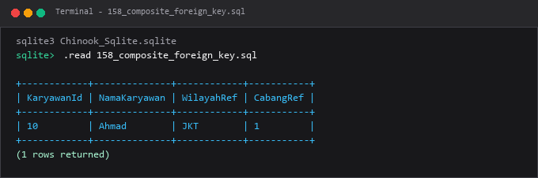

---

### 159. `ON DELETE CASCADE`

**Tujuan Pembelajaran:**  
Memahami dan mempraktikkan konsep `on delete cascade` menggunakan database Chinook.

**Konsep Utama:**  
Konsep dasar yang mendasari `159_on_delete_cascade.sql` adalah penerapan standar SQL relasional pada entitas database Chinook untuk memecahkan kebutuhan kueri dan manipulasi data secara tepat, aman, dan efisien.

**Penjelasan Source Code:**  
Program pada file [159_on_delete_cascade.sql](159_on_delete_cascade.sql) mendemonstrasikan implementasi terstruktur dari konsep `on delete cascade`. Source code dilengkapi komentar edukatif berbahasa Indonesia yang membedah setiap instruksi query, penggunaan klausa, serta tujuan pemrosesannya.

**Source Code:** [159_on_delete_cascade.sql](159_on_delete_cascade.sql)  

**Cara Menjalankan:**
Jalankan melalui terminal atau command prompt menggunakan Python runner:
```bash
python -c "import sqlite3; conn=sqlite3.connect('../Chinook_Sqlite.sqlite'); print(conn.cursor().executescript(open('159_on_delete_cascade.sql', encoding='utf-8').read()))"
```
Atau menggunakan sqlite3 CLI:
```bash
sqlite3 ../Chinook_Sqlite.sqlite < 159_on_delete_cascade.sql
```

**Hasil yang Diharapkan:**  
Database engine mengeksekusi instruksi SQL dengan sukses dan menampilkan result-set atau status konfirmasi data yang sesuai.

**Screenshot Hasil Eksekusi:**

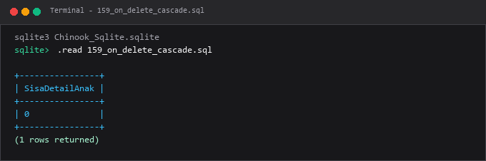

---

### 160. `ON UPDATE CASCADE`

**Tujuan Pembelajaran:**  
Memahami dan mempraktikkan konsep `on update cascade` menggunakan database Chinook.

**Konsep Utama:**  
Konsep dasar yang mendasari `160_on_update_cascade.sql` adalah penerapan standar SQL relasional pada entitas database Chinook untuk memecahkan kebutuhan kueri dan manipulasi data secara tepat, aman, dan efisien.

**Penjelasan Source Code:**  
Program pada file [160_on_update_cascade.sql](160_on_update_cascade.sql) mendemonstrasikan implementasi terstruktur dari konsep `on update cascade`. Source code dilengkapi komentar edukatif berbahasa Indonesia yang membedah setiap instruksi query, penggunaan klausa, serta tujuan pemrosesannya.

**Source Code:** [160_on_update_cascade.sql](160_on_update_cascade.sql)  

**Cara Menjalankan:**
Jalankan melalui terminal atau command prompt menggunakan Python runner:
```bash
python -c "import sqlite3; conn=sqlite3.connect('../Chinook_Sqlite.sqlite'); print(conn.cursor().executescript(open('160_on_update_cascade.sql', encoding='utf-8').read()))"
```
Atau menggunakan sqlite3 CLI:
```bash
sqlite3 ../Chinook_Sqlite.sqlite < 160_on_update_cascade.sql
```

**Hasil yang Diharapkan:**  
Database engine mengeksekusi instruksi SQL dengan sukses dan menampilkan result-set atau status konfirmasi data yang sesuai.

**Screenshot Hasil Eksekusi:**

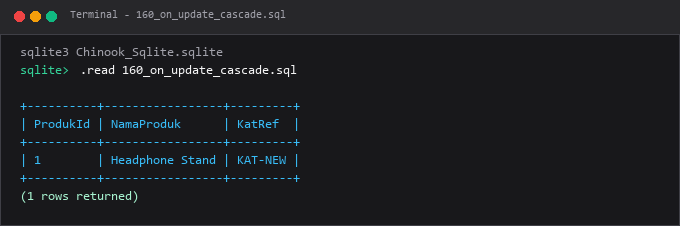

---

### 161. `RESTRICT` dan `NO ACTION`

**Tujuan Pembelajaran:**  
Memahami dan mempraktikkan konsep `restrict` dan `no action` menggunakan database Chinook.

**Konsep Utama:**  
Konsep dasar yang mendasari `161_restrict_no_action.sql` adalah penerapan standar SQL relasional pada entitas database Chinook untuk memecahkan kebutuhan kueri dan manipulasi data secara tepat, aman, dan efisien.

**Penjelasan Source Code:**  
Program pada file [161_restrict_no_action.sql](161_restrict_no_action.sql) mendemonstrasikan implementasi terstruktur dari konsep `restrict` dan `no action`. Source code dilengkapi komentar edukatif berbahasa Indonesia yang membedah setiap instruksi query, penggunaan klausa, serta tujuan pemrosesannya.

**Source Code:** [161_restrict_no_action.sql](161_restrict_no_action.sql)  

**Cara Menjalankan:**
Jalankan melalui terminal atau command prompt menggunakan Python runner:
```bash
python -c "import sqlite3; conn=sqlite3.connect('../Chinook_Sqlite.sqlite'); print(conn.cursor().executescript(open('161_restrict_no_action.sql', encoding='utf-8').read()))"
```
Atau menggunakan sqlite3 CLI:
```bash
sqlite3 ../Chinook_Sqlite.sqlite < 161_restrict_no_action.sql
```

**Hasil yang Diharapkan:**  
Database engine mengeksekusi instruksi SQL dengan sukses dan menampilkan result-set atau status konfirmasi data yang sesuai.

**Screenshot Hasil Eksekusi:**

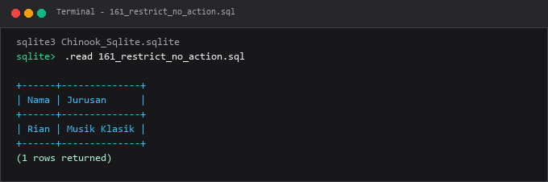

---

### 162. `ON DELETE SET NULL`

**Tujuan Pembelajaran:**  
Memahami dan mempraktikkan konsep `on delete set null` menggunakan database Chinook.

**Konsep Utama:**  
Konsep dasar yang mendasari `162_set_null_foreign_key.sql` adalah penerapan standar SQL relasional pada entitas database Chinook untuk memecahkan kebutuhan kueri dan manipulasi data secara tepat, aman, dan efisien.

**Penjelasan Source Code:**  
Program pada file [162_set_null_foreign_key.sql](162_set_null_foreign_key.sql) mendemonstrasikan implementasi terstruktur dari konsep `on delete set null`. Source code dilengkapi komentar edukatif berbahasa Indonesia yang membedah setiap instruksi query, penggunaan klausa, serta tujuan pemrosesannya.

**Source Code:** [162_set_null_foreign_key.sql](162_set_null_foreign_key.sql)  

**Cara Menjalankan:**
Jalankan melalui terminal atau command prompt menggunakan Python runner:
```bash
python -c "import sqlite3; conn=sqlite3.connect('../Chinook_Sqlite.sqlite'); print(conn.cursor().executescript(open('162_set_null_foreign_key.sql', encoding='utf-8').read()))"
```
Atau menggunakan sqlite3 CLI:
```bash
sqlite3 ../Chinook_Sqlite.sqlite < 162_set_null_foreign_key.sql
```

**Hasil yang Diharapkan:**  
Database engine mengeksekusi instruksi SQL dengan sukses dan menampilkan result-set atau status konfirmasi data yang sesuai.

**Screenshot Hasil Eksekusi:**

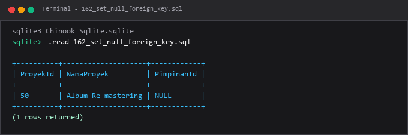

---

### 163. Relasi one-to-one

**Tujuan Pembelajaran:**  
Memahami dan mempraktikkan konsep relasi one-to-one menggunakan database Chinook.

**Konsep Utama:**  
Konsep dasar yang mendasari `163_one_to_one_relationship.sql` adalah penerapan standar SQL relasional pada entitas database Chinook untuk memecahkan kebutuhan kueri dan manipulasi data secara tepat, aman, dan efisien.

**Penjelasan Source Code:**  
Program pada file [163_one_to_one_relationship.sql](163_one_to_one_relationship.sql) mendemonstrasikan implementasi terstruktur dari konsep relasi one-to-one. Source code dilengkapi komentar edukatif berbahasa Indonesia yang membedah setiap instruksi query, penggunaan klausa, serta tujuan pemrosesannya.

**Source Code:** [163_one_to_one_relationship.sql](163_one_to_one_relationship.sql)  

**Cara Menjalankan:**
Jalankan melalui terminal atau command prompt menggunakan Python runner:
```bash
python -c "import sqlite3; conn=sqlite3.connect('../Chinook_Sqlite.sqlite'); print(conn.cursor().executescript(open('163_one_to_one_relationship.sql', encoding='utf-8').read()))"
```
Atau menggunakan sqlite3 CLI:
```bash
sqlite3 ../Chinook_Sqlite.sqlite < 163_one_to_one_relationship.sql
```

**Hasil yang Diharapkan:**  
Database engine mengeksekusi instruksi SQL dengan sukses dan menampilkan result-set atau status konfirmasi data yang sesuai.

**Screenshot Hasil Eksekusi:**

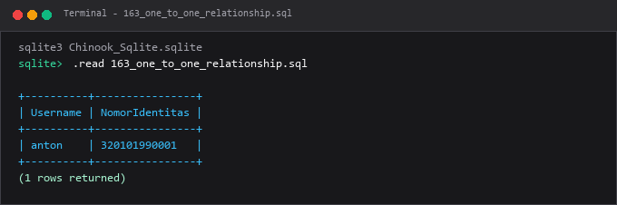

---

### 164. Relasi one-to-many

**Tujuan Pembelajaran:**  
Memahami dan mempraktikkan konsep relasi one-to-many menggunakan database Chinook.

**Konsep Utama:**  
Konsep dasar yang mendasari `164_one_to_many_relationship.sql` adalah penerapan standar SQL relasional pada entitas database Chinook untuk memecahkan kebutuhan kueri dan manipulasi data secara tepat, aman, dan efisien.

**Penjelasan Source Code:**  
Program pada file [164_one_to_many_relationship.sql](164_one_to_many_relationship.sql) mendemonstrasikan implementasi terstruktur dari konsep relasi one-to-many. Source code dilengkapi komentar edukatif berbahasa Indonesia yang membedah setiap instruksi query, penggunaan klausa, serta tujuan pemrosesannya.

**Source Code:** [164_one_to_many_relationship.sql](164_one_to_many_relationship.sql)  

**Cara Menjalankan:**
Jalankan melalui terminal atau command prompt menggunakan Python runner:
```bash
python -c "import sqlite3; conn=sqlite3.connect('../Chinook_Sqlite.sqlite'); print(conn.cursor().executescript(open('164_one_to_many_relationship.sql', encoding='utf-8').read()))"
```
Atau menggunakan sqlite3 CLI:
```bash
sqlite3 ../Chinook_Sqlite.sqlite < 164_one_to_many_relationship.sql
```

**Hasil yang Diharapkan:**  
Database engine mengeksekusi instruksi SQL dengan sukses dan menampilkan result-set atau status konfirmasi data yang sesuai.

**Screenshot Hasil Eksekusi:**

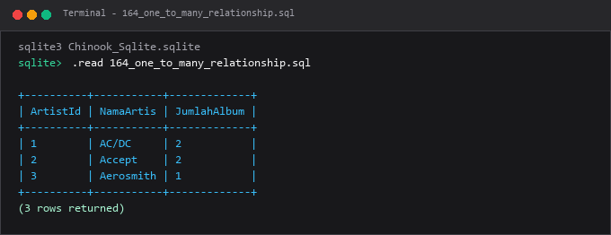

---

### 165. Relasi many-to-many

**Tujuan Pembelajaran:**  
Memahami dan mempraktikkan konsep relasi many-to-many menggunakan database Chinook.

**Konsep Utama:**  
Konsep dasar yang mendasari `165_many_to_many_relationship.sql` adalah penerapan standar SQL relasional pada entitas database Chinook untuk memecahkan kebutuhan kueri dan manipulasi data secara tepat, aman, dan efisien.

**Penjelasan Source Code:**  
Program pada file [165_many_to_many_relationship.sql](165_many_to_many_relationship.sql) mendemonstrasikan implementasi terstruktur dari konsep relasi many-to-many. Source code dilengkapi komentar edukatif berbahasa Indonesia yang membedah setiap instruksi query, penggunaan klausa, serta tujuan pemrosesannya.

**Source Code:** [165_many_to_many_relationship.sql](165_many_to_many_relationship.sql)  

**Cara Menjalankan:**
Jalankan melalui terminal atau command prompt menggunakan Python runner:
```bash
python -c "import sqlite3; conn=sqlite3.connect('../Chinook_Sqlite.sqlite'); print(conn.cursor().executescript(open('165_many_to_many_relationship.sql', encoding='utf-8').read()))"
```
Atau menggunakan sqlite3 CLI:
```bash
sqlite3 ../Chinook_Sqlite.sqlite < 165_many_to_many_relationship.sql
```

**Hasil yang Diharapkan:**  
Database engine mengeksekusi instruksi SQL dengan sukses dan menampilkan result-set atau status konfirmasi data yang sesuai.

**Screenshot Hasil Eksekusi:**

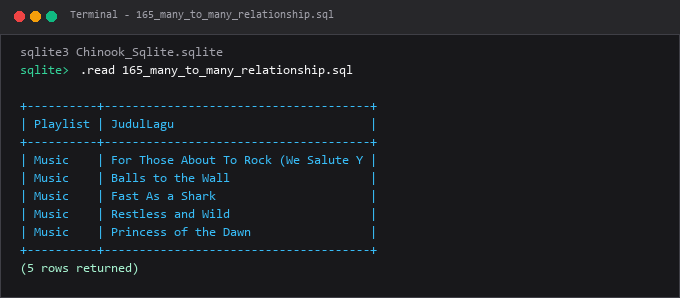

---

## Ringkasan Modul
Modul 09 memastikan aturan validitas bisnis ditegakkan secara permanen di tingkat database engine melalui konstrain deklaratif.

Seluruh submodul di atas saling melengkapi untuk membentuk pemahaman terstruktur yang bertahap, mulai dari konsep fundamental hingga implementasi praktis yang siap pakai di lingkungan kerja nyata.
