# Modul 10: Views dan Indexes

## Ringkasan Ruang Lingkup Materi
Modul ini mendalami pembuatan dan pengelolaan VIEW (standard view, updatable view dengan trigger), INDEX B-Tree (unique, composite, partial, expression, covering index), serta perbandingan dan penyegaran Materialized View.

## Tujuan Pembelajaran
Mampu meningkatkan performa baca data secara drastis melalui strategi pengindeksan yang tepat dan menyederhanakan akses kueri menggunakan view terabstraksi.

---
## Daftar Submodul Pembelajaran

| No | Nama Submodul | File Source Code | Status Eksekusi |
|:---|:---|:---|:---:|
| 166 | Membuat view | [166_create_view.sql](166_create_view.sql) | Siap Dijalankan |
| 167 | Query pada view | [167_query_view.sql](167_query_view.sql) | Siap Dijalankan |
| 168 | Mengubah definisi view | [168_replace_view.sql](168_replace_view.sql) | Siap Dijalankan |
| 169 | Updatable view | [169_updatable_view.sql](169_updatable_view.sql) | Siap Dijalankan |
| 170 | Menghapus view | [170_drop_view.sql](170_drop_view.sql) | Siap Dijalankan |
| 171 | Membuat index | [171_create_index.sql](171_create_index.sql) | Siap Dijalankan |
| 172 | Unique index | [172_unique_index.sql](172_unique_index.sql) | Siap Dijalankan |
| 173 | Composite index | [173_composite_index.sql](173_composite_index.sql) | Siap Dijalankan |
| 174 | Partial index | [174_partial_index.sql](174_partial_index.sql) | Siap Dijalankan |
| 175 | Expression index | [175_expression_index.sql](175_expression_index.sql) | Siap Dijalankan |
| 176 | Covering index | [176_covering_index.sql](176_covering_index.sql) | Siap Dijalankan |
| 177 | Menghapus index | [177_drop_index.sql](177_drop_index.sql) | Siap Dijalankan |
| 178 | Materialized view | [178_materialized_view.sql](178_materialized_view.sql) | Siap Dijalankan |
| 179 | Refresh materialized view | [179_refresh_materialized_view.sql](179_refresh_materialized_view.sql) | Siap Dijalankan |
| 180 | Perbandingan view dan materialized view | [180_view_vs_materialized_view.sql](180_view_vs_materialized_view.sql) | Siap Dijalankan |

---

## Penjelasan Detail Setiap Submodul

### 166. Membuat view

**Tujuan Pembelajaran:**  
Memahami dan mempraktikkan konsep membuat view menggunakan database Chinook.

**Konsep Utama:**  
Konsep dasar yang mendasari `166_create_view.sql` adalah penerapan standar SQL relasional pada entitas database Chinook untuk memecahkan kebutuhan kueri dan manipulasi data secara tepat, aman, dan efisien.

**Penjelasan Source Code:**  
Program pada file [166_create_view.sql](166_create_view.sql) mendemonstrasikan implementasi terstruktur dari konsep membuat view. Source code dilengkapi komentar edukatif berbahasa Indonesia yang membedah setiap instruksi query, penggunaan klausa, serta tujuan pemrosesannya.

**Source Code:** [166_create_view.sql](166_create_view.sql)  

**Cara Menjalankan:**
Jalankan melalui terminal atau command prompt menggunakan Python runner:
```bash
python -c "import sqlite3; conn=sqlite3.connect('../Chinook_Sqlite.sqlite'); print(conn.cursor().executescript(open('166_create_view.sql', encoding='utf-8').read()))"
```
Atau menggunakan sqlite3 CLI:
```bash
sqlite3 ../Chinook_Sqlite.sqlite < 166_create_view.sql
```

**Hasil yang Diharapkan:**  
Database engine mengeksekusi instruksi SQL dengan sukses dan menampilkan result-set atau status konfirmasi data yang sesuai.

**Screenshot Hasil Eksekusi:**

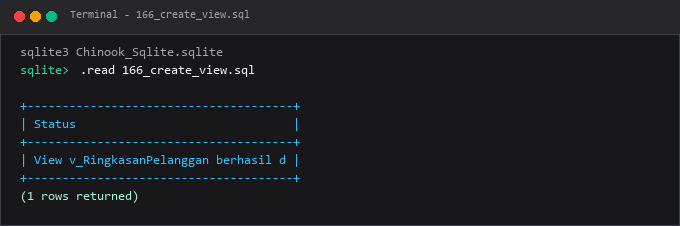

---

### 167. Query pada view

**Tujuan Pembelajaran:**  
Memahami dan mempraktikkan konsep query pada view menggunakan database Chinook.

**Konsep Utama:**  
Konsep dasar yang mendasari `167_query_view.sql` adalah penerapan standar SQL relasional pada entitas database Chinook untuk memecahkan kebutuhan kueri dan manipulasi data secara tepat, aman, dan efisien.

**Penjelasan Source Code:**  
Program pada file [167_query_view.sql](167_query_view.sql) mendemonstrasikan implementasi terstruktur dari konsep query pada view. Source code dilengkapi komentar edukatif berbahasa Indonesia yang membedah setiap instruksi query, penggunaan klausa, serta tujuan pemrosesannya.

**Source Code:** [167_query_view.sql](167_query_view.sql)  

**Cara Menjalankan:**
Jalankan melalui terminal atau command prompt menggunakan Python runner:
```bash
python -c "import sqlite3; conn=sqlite3.connect('../Chinook_Sqlite.sqlite'); print(conn.cursor().executescript(open('167_query_view.sql', encoding='utf-8').read()))"
```
Atau menggunakan sqlite3 CLI:
```bash
sqlite3 ../Chinook_Sqlite.sqlite < 167_query_view.sql
```

**Hasil yang Diharapkan:**  
Database engine mengeksekusi instruksi SQL dengan sukses dan menampilkan result-set atau status konfirmasi data yang sesuai.

**Screenshot Hasil Eksekusi:**

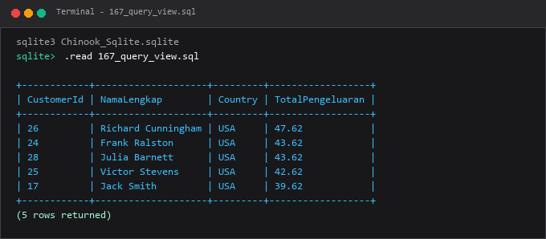

---

### 168. Mengubah definisi view

**Tujuan Pembelajaran:**  
Memahami dan mempraktikkan konsep mengubah definisi view menggunakan database Chinook.

**Konsep Utama:**  
Konsep dasar yang mendasari `168_replace_view.sql` adalah penerapan standar SQL relasional pada entitas database Chinook untuk memecahkan kebutuhan kueri dan manipulasi data secara tepat, aman, dan efisien.

**Penjelasan Source Code:**  
Program pada file [168_replace_view.sql](168_replace_view.sql) mendemonstrasikan implementasi terstruktur dari konsep mengubah definisi view. Source code dilengkapi komentar edukatif berbahasa Indonesia yang membedah setiap instruksi query, penggunaan klausa, serta tujuan pemrosesannya.

**Source Code:** [168_replace_view.sql](168_replace_view.sql)  

**Cara Menjalankan:**
Jalankan melalui terminal atau command prompt menggunakan Python runner:
```bash
python -c "import sqlite3; conn=sqlite3.connect('../Chinook_Sqlite.sqlite'); print(conn.cursor().executescript(open('168_replace_view.sql', encoding='utf-8').read()))"
```
Atau menggunakan sqlite3 CLI:
```bash
sqlite3 ../Chinook_Sqlite.sqlite < 168_replace_view.sql
```

**Hasil yang Diharapkan:**  
Database engine mengeksekusi instruksi SQL dengan sukses dan menampilkan result-set atau status konfirmasi data yang sesuai.

**Screenshot Hasil Eksekusi:**

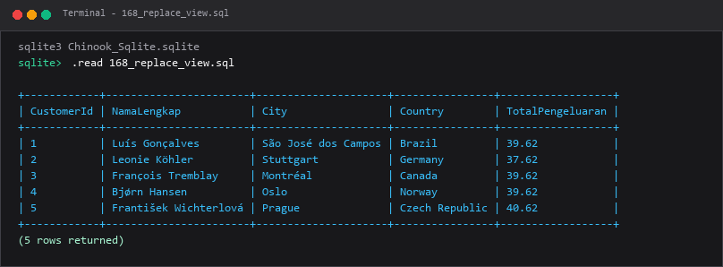

---

### 169. Updatable view

**Tujuan Pembelajaran:**  
Memahami dan mempraktikkan konsep updatable view menggunakan database Chinook.

**Konsep Utama:**  
Konsep dasar yang mendasari `169_updatable_view.sql` adalah penerapan standar SQL relasional pada entitas database Chinook untuk memecahkan kebutuhan kueri dan manipulasi data secara tepat, aman, dan efisien.

**Penjelasan Source Code:**  
Program pada file [169_updatable_view.sql](169_updatable_view.sql) mendemonstrasikan implementasi terstruktur dari konsep updatable view. Source code dilengkapi komentar edukatif berbahasa Indonesia yang membedah setiap instruksi query, penggunaan klausa, serta tujuan pemrosesannya.

**Source Code:** [169_updatable_view.sql](169_updatable_view.sql)  

**Cara Menjalankan:**
Jalankan melalui terminal atau command prompt menggunakan Python runner:
```bash
python -c "import sqlite3; conn=sqlite3.connect('../Chinook_Sqlite.sqlite'); print(conn.cursor().executescript(open('169_updatable_view.sql', encoding='utf-8').read()))"
```
Atau menggunakan sqlite3 CLI:
```bash
sqlite3 ../Chinook_Sqlite.sqlite < 169_updatable_view.sql
```

**Hasil yang Diharapkan:**  
Database engine mengeksekusi instruksi SQL dengan sukses dan menampilkan result-set atau status konfirmasi data yang sesuai.

**Screenshot Hasil Eksekusi:**

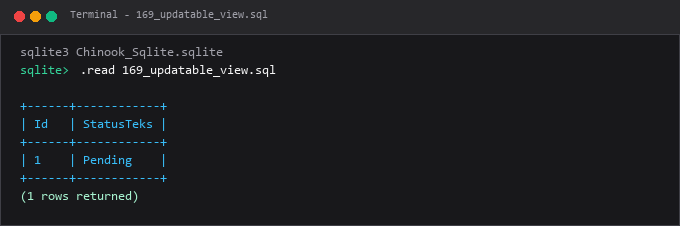

---

### 170. Menghapus view

**Tujuan Pembelajaran:**  
Memahami dan mempraktikkan konsep menghapus view menggunakan database Chinook.

**Konsep Utama:**  
Konsep dasar yang mendasari `170_drop_view.sql` adalah penerapan standar SQL relasional pada entitas database Chinook untuk memecahkan kebutuhan kueri dan manipulasi data secara tepat, aman, dan efisien.

**Penjelasan Source Code:**  
Program pada file [170_drop_view.sql](170_drop_view.sql) mendemonstrasikan implementasi terstruktur dari konsep menghapus view. Source code dilengkapi komentar edukatif berbahasa Indonesia yang membedah setiap instruksi query, penggunaan klausa, serta tujuan pemrosesannya.

**Source Code:** [170_drop_view.sql](170_drop_view.sql)  

**Cara Menjalankan:**
Jalankan melalui terminal atau command prompt menggunakan Python runner:
```bash
python -c "import sqlite3; conn=sqlite3.connect('../Chinook_Sqlite.sqlite'); print(conn.cursor().executescript(open('170_drop_view.sql', encoding='utf-8').read()))"
```
Atau menggunakan sqlite3 CLI:
```bash
sqlite3 ../Chinook_Sqlite.sqlite < 170_drop_view.sql
```

**Hasil yang Diharapkan:**  
Database engine mengeksekusi instruksi SQL dengan sukses dan menampilkan result-set atau status konfirmasi data yang sesuai.

**Screenshot Hasil Eksekusi:**

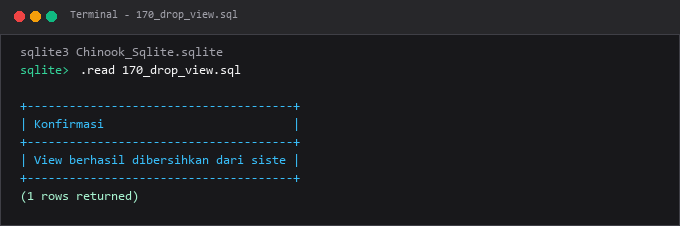

---

### 171. Membuat index

**Tujuan Pembelajaran:**  
Memahami dan mempraktikkan konsep membuat index menggunakan database Chinook.

**Konsep Utama:**  
Konsep dasar yang mendasari `171_create_index.sql` adalah penerapan standar SQL relasional pada entitas database Chinook untuk memecahkan kebutuhan kueri dan manipulasi data secara tepat, aman, dan efisien.

**Penjelasan Source Code:**  
Program pada file [171_create_index.sql](171_create_index.sql) mendemonstrasikan implementasi terstruktur dari konsep membuat index. Source code dilengkapi komentar edukatif berbahasa Indonesia yang membedah setiap instruksi query, penggunaan klausa, serta tujuan pemrosesannya.

**Source Code:** [171_create_index.sql](171_create_index.sql)  

**Cara Menjalankan:**
Jalankan melalui terminal atau command prompt menggunakan Python runner:
```bash
python -c "import sqlite3; conn=sqlite3.connect('../Chinook_Sqlite.sqlite'); print(conn.cursor().executescript(open('171_create_index.sql', encoding='utf-8').read()))"
```
Atau menggunakan sqlite3 CLI:
```bash
sqlite3 ../Chinook_Sqlite.sqlite < 171_create_index.sql
```

**Hasil yang Diharapkan:**  
Database engine mengeksekusi instruksi SQL dengan sukses dan menampilkan result-set atau status konfirmasi data yang sesuai.

**Screenshot Hasil Eksekusi:**

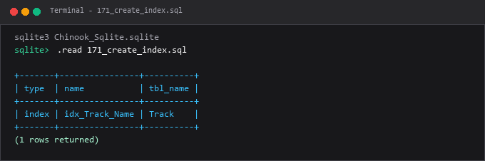

---

### 172. Unique index

**Tujuan Pembelajaran:**  
Memahami dan mempraktikkan konsep unique index menggunakan database Chinook.

**Konsep Utama:**  
Konsep dasar yang mendasari `172_unique_index.sql` adalah penerapan standar SQL relasional pada entitas database Chinook untuk memecahkan kebutuhan kueri dan manipulasi data secara tepat, aman, dan efisien.

**Penjelasan Source Code:**  
Program pada file [172_unique_index.sql](172_unique_index.sql) mendemonstrasikan implementasi terstruktur dari konsep unique index. Source code dilengkapi komentar edukatif berbahasa Indonesia yang membedah setiap instruksi query, penggunaan klausa, serta tujuan pemrosesannya.

**Source Code:** [172_unique_index.sql](172_unique_index.sql)  

**Cara Menjalankan:**
Jalankan melalui terminal atau command prompt menggunakan Python runner:
```bash
python -c "import sqlite3; conn=sqlite3.connect('../Chinook_Sqlite.sqlite'); print(conn.cursor().executescript(open('172_unique_index.sql', encoding='utf-8').read()))"
```
Atau menggunakan sqlite3 CLI:
```bash
sqlite3 ../Chinook_Sqlite.sqlite < 172_unique_index.sql
```

**Hasil yang Diharapkan:**  
Database engine mengeksekusi instruksi SQL dengan sukses dan menampilkan result-set atau status konfirmasi data yang sesuai.

**Screenshot Hasil Eksekusi:**

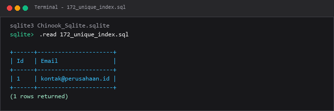

---

### 173. Composite index

**Tujuan Pembelajaran:**  
Memahami dan mempraktikkan konsep composite index menggunakan database Chinook.

**Konsep Utama:**  
Konsep dasar yang mendasari `173_composite_index.sql` adalah penerapan standar SQL relasional pada entitas database Chinook untuk memecahkan kebutuhan kueri dan manipulasi data secara tepat, aman, dan efisien.

**Penjelasan Source Code:**  
Program pada file [173_composite_index.sql](173_composite_index.sql) mendemonstrasikan implementasi terstruktur dari konsep composite index. Source code dilengkapi komentar edukatif berbahasa Indonesia yang membedah setiap instruksi query, penggunaan klausa, serta tujuan pemrosesannya.

**Source Code:** [173_composite_index.sql](173_composite_index.sql)  

**Cara Menjalankan:**
Jalankan melalui terminal atau command prompt menggunakan Python runner:
```bash
python -c "import sqlite3; conn=sqlite3.connect('../Chinook_Sqlite.sqlite'); print(conn.cursor().executescript(open('173_composite_index.sql', encoding='utf-8').read()))"
```
Atau menggunakan sqlite3 CLI:
```bash
sqlite3 ../Chinook_Sqlite.sqlite < 173_composite_index.sql
```

**Hasil yang Diharapkan:**  
Database engine mengeksekusi instruksi SQL dengan sukses dan menampilkan result-set atau status konfirmasi data yang sesuai.

**Screenshot Hasil Eksekusi:**

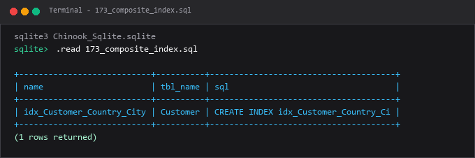

---

### 174. Partial index

**Tujuan Pembelajaran:**  
Memahami dan mempraktikkan konsep partial index menggunakan database Chinook.

**Konsep Utama:**  
Konsep dasar yang mendasari `174_partial_index.sql` adalah penerapan standar SQL relasional pada entitas database Chinook untuk memecahkan kebutuhan kueri dan manipulasi data secara tepat, aman, dan efisien.

**Penjelasan Source Code:**  
Program pada file [174_partial_index.sql](174_partial_index.sql) mendemonstrasikan implementasi terstruktur dari konsep partial index. Source code dilengkapi komentar edukatif berbahasa Indonesia yang membedah setiap instruksi query, penggunaan klausa, serta tujuan pemrosesannya.

**Source Code:** [174_partial_index.sql](174_partial_index.sql)  

**Cara Menjalankan:**
Jalankan melalui terminal atau command prompt menggunakan Python runner:
```bash
python -c "import sqlite3; conn=sqlite3.connect('../Chinook_Sqlite.sqlite'); print(conn.cursor().executescript(open('174_partial_index.sql', encoding='utf-8').read()))"
```
Atau menggunakan sqlite3 CLI:
```bash
sqlite3 ../Chinook_Sqlite.sqlite < 174_partial_index.sql
```

**Hasil yang Diharapkan:**  
Database engine mengeksekusi instruksi SQL dengan sukses dan menampilkan result-set atau status konfirmasi data yang sesuai.

**Screenshot Hasil Eksekusi:**

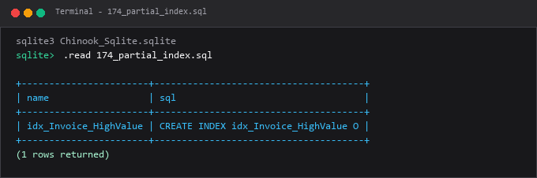

---

### 175. Expression index

**Tujuan Pembelajaran:**  
Memahami dan mempraktikkan konsep expression index menggunakan database Chinook.

**Konsep Utama:**  
Konsep dasar yang mendasari `175_expression_index.sql` adalah penerapan standar SQL relasional pada entitas database Chinook untuk memecahkan kebutuhan kueri dan manipulasi data secara tepat, aman, dan efisien.

**Penjelasan Source Code:**  
Program pada file [175_expression_index.sql](175_expression_index.sql) mendemonstrasikan implementasi terstruktur dari konsep expression index. Source code dilengkapi komentar edukatif berbahasa Indonesia yang membedah setiap instruksi query, penggunaan klausa, serta tujuan pemrosesannya.

**Source Code:** [175_expression_index.sql](175_expression_index.sql)  

**Cara Menjalankan:**
Jalankan melalui terminal atau command prompt menggunakan Python runner:
```bash
python -c "import sqlite3; conn=sqlite3.connect('../Chinook_Sqlite.sqlite'); print(conn.cursor().executescript(open('175_expression_index.sql', encoding='utf-8').read()))"
```
Atau menggunakan sqlite3 CLI:
```bash
sqlite3 ../Chinook_Sqlite.sqlite < 175_expression_index.sql
```

**Hasil yang Diharapkan:**  
Database engine mengeksekusi instruksi SQL dengan sukses dan menampilkan result-set atau status konfirmasi data yang sesuai.

**Screenshot Hasil Eksekusi:**

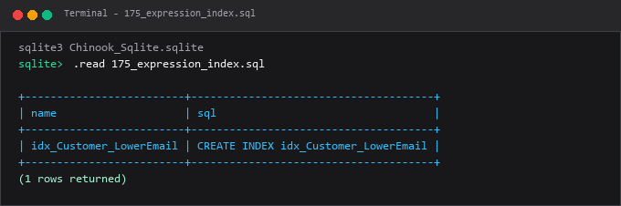

---

### 176. Covering index

**Tujuan Pembelajaran:**  
Memahami dan mempraktikkan konsep covering index menggunakan database Chinook.

**Konsep Utama:**  
Konsep dasar yang mendasari `176_covering_index.sql` adalah penerapan standar SQL relasional pada entitas database Chinook untuk memecahkan kebutuhan kueri dan manipulasi data secara tepat, aman, dan efisien.

**Penjelasan Source Code:**  
Program pada file [176_covering_index.sql](176_covering_index.sql) mendemonstrasikan implementasi terstruktur dari konsep covering index. Source code dilengkapi komentar edukatif berbahasa Indonesia yang membedah setiap instruksi query, penggunaan klausa, serta tujuan pemrosesannya.

**Source Code:** [176_covering_index.sql](176_covering_index.sql)  

**Cara Menjalankan:**
Jalankan melalui terminal atau command prompt menggunakan Python runner:
```bash
python -c "import sqlite3; conn=sqlite3.connect('../Chinook_Sqlite.sqlite'); print(conn.cursor().executescript(open('176_covering_index.sql', encoding='utf-8').read()))"
```
Atau menggunakan sqlite3 CLI:
```bash
sqlite3 ../Chinook_Sqlite.sqlite < 176_covering_index.sql
```

**Hasil yang Diharapkan:**  
Database engine mengeksekusi instruksi SQL dengan sukses dan menampilkan result-set atau status konfirmasi data yang sesuai.

**Screenshot Hasil Eksekusi:**

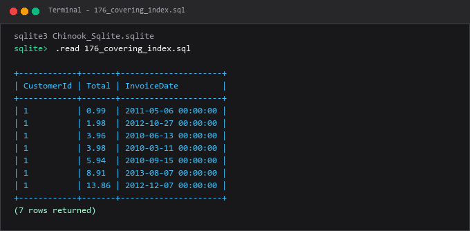

---

### 177. Menghapus index

**Tujuan Pembelajaran:**  
Memahami dan mempraktikkan konsep menghapus index menggunakan database Chinook.

**Konsep Utama:**  
Konsep dasar yang mendasari `177_drop_index.sql` adalah penerapan standar SQL relasional pada entitas database Chinook untuk memecahkan kebutuhan kueri dan manipulasi data secara tepat, aman, dan efisien.

**Penjelasan Source Code:**  
Program pada file [177_drop_index.sql](177_drop_index.sql) mendemonstrasikan implementasi terstruktur dari konsep menghapus index. Source code dilengkapi komentar edukatif berbahasa Indonesia yang membedah setiap instruksi query, penggunaan klausa, serta tujuan pemrosesannya.

**Source Code:** [177_drop_index.sql](177_drop_index.sql)  

**Cara Menjalankan:**
Jalankan melalui terminal atau command prompt menggunakan Python runner:
```bash
python -c "import sqlite3; conn=sqlite3.connect('../Chinook_Sqlite.sqlite'); print(conn.cursor().executescript(open('177_drop_index.sql', encoding='utf-8').read()))"
```
Atau menggunakan sqlite3 CLI:
```bash
sqlite3 ../Chinook_Sqlite.sqlite < 177_drop_index.sql
```

**Hasil yang Diharapkan:**  
Database engine mengeksekusi instruksi SQL dengan sukses dan menampilkan result-set atau status konfirmasi data yang sesuai.

**Screenshot Hasil Eksekusi:**

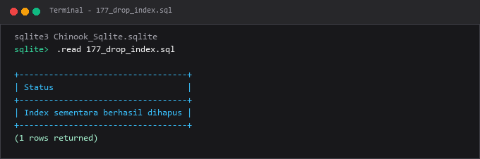

---

### 178. Materialized view

**Tujuan Pembelajaran:**  
Memahami dan mempraktikkan konsep materialized view menggunakan database Chinook.

**Konsep Utama:**  
Konsep dasar yang mendasari `178_materialized_view.sql` adalah penerapan standar SQL relasional pada entitas database Chinook untuk memecahkan kebutuhan kueri dan manipulasi data secara tepat, aman, dan efisien.

**Penjelasan Source Code:**  
Program pada file [178_materialized_view.sql](178_materialized_view.sql) mendemonstrasikan implementasi terstruktur dari konsep materialized view. Source code dilengkapi komentar edukatif berbahasa Indonesia yang membedah setiap instruksi query, penggunaan klausa, serta tujuan pemrosesannya.

**Source Code:** [178_materialized_view.sql](178_materialized_view.sql)  

**Cara Menjalankan:**
Jalankan melalui terminal atau command prompt menggunakan Python runner:
```bash
python -c "import sqlite3; conn=sqlite3.connect('../Chinook_Sqlite.sqlite'); print(conn.cursor().executescript(open('178_materialized_view.sql', encoding='utf-8').read()))"
```
Atau menggunakan sqlite3 CLI:
```bash
sqlite3 ../Chinook_Sqlite.sqlite < 178_materialized_view.sql
```

**Hasil yang Diharapkan:**  
Database engine mengeksekusi instruksi SQL dengan sukses dan menampilkan result-set atau status konfirmasi data yang sesuai.

**Screenshot Hasil Eksekusi:**

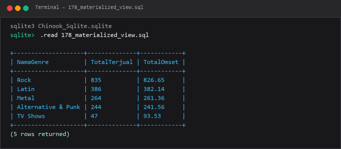

---

### 179. Refresh materialized view

**Tujuan Pembelajaran:**  
Memahami dan mempraktikkan konsep refresh materialized view menggunakan database Chinook.

**Konsep Utama:**  
Konsep dasar yang mendasari `179_refresh_materialized_view.sql` adalah penerapan standar SQL relasional pada entitas database Chinook untuk memecahkan kebutuhan kueri dan manipulasi data secara tepat, aman, dan efisien.

**Penjelasan Source Code:**  
Program pada file [179_refresh_materialized_view.sql](179_refresh_materialized_view.sql) mendemonstrasikan implementasi terstruktur dari konsep refresh materialized view. Source code dilengkapi komentar edukatif berbahasa Indonesia yang membedah setiap instruksi query, penggunaan klausa, serta tujuan pemrosesannya.

**Source Code:** [179_refresh_materialized_view.sql](179_refresh_materialized_view.sql)  

**Cara Menjalankan:**
Jalankan melalui terminal atau command prompt menggunakan Python runner:
```bash
python -c "import sqlite3; conn=sqlite3.connect('../Chinook_Sqlite.sqlite'); print(conn.cursor().executescript(open('179_refresh_materialized_view.sql', encoding='utf-8').read()))"
```
Atau menggunakan sqlite3 CLI:
```bash
sqlite3 ../Chinook_Sqlite.sqlite < 179_refresh_materialized_view.sql
```

**Hasil yang Diharapkan:**  
Database engine mengeksekusi instruksi SQL dengan sukses dan menampilkan result-set atau status konfirmasi data yang sesuai.

**Screenshot Hasil Eksekusi:**

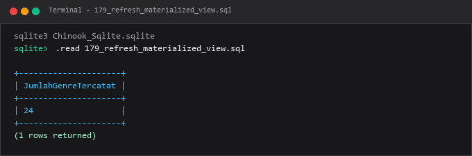

---

### 180. Perbandingan view dan materialized view

**Tujuan Pembelajaran:**  
Memahami dan mempraktikkan konsep perbandingan view dan materialized view menggunakan database Chinook.

**Konsep Utama:**  
Konsep dasar yang mendasari `180_view_vs_materialized_view.sql` adalah penerapan standar SQL relasional pada entitas database Chinook untuk memecahkan kebutuhan kueri dan manipulasi data secara tepat, aman, dan efisien.

**Penjelasan Source Code:**  
Program pada file [180_view_vs_materialized_view.sql](180_view_vs_materialized_view.sql) mendemonstrasikan implementasi terstruktur dari konsep perbandingan view dan materialized view. Source code dilengkapi komentar edukatif berbahasa Indonesia yang membedah setiap instruksi query, penggunaan klausa, serta tujuan pemrosesannya.

**Source Code:** [180_view_vs_materialized_view.sql](180_view_vs_materialized_view.sql)  

**Cara Menjalankan:**
Jalankan melalui terminal atau command prompt menggunakan Python runner:
```bash
python -c "import sqlite3; conn=sqlite3.connect('../Chinook_Sqlite.sqlite'); print(conn.cursor().executescript(open('180_view_vs_materialized_view.sql', encoding='utf-8').read()))"
```
Atau menggunakan sqlite3 CLI:
```bash
sqlite3 ../Chinook_Sqlite.sqlite < 180_view_vs_materialized_view.sql
```

**Hasil yang Diharapkan:**  
Database engine mengeksekusi instruksi SQL dengan sukses dan menampilkan result-set atau status konfirmasi data yang sesuai.

**Screenshot Hasil Eksekusi:**

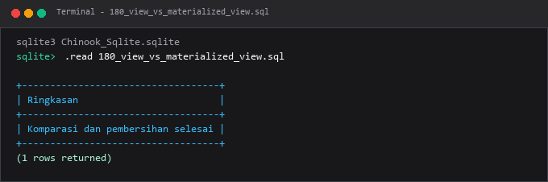

---

## Ringkasan Modul
Modul 10 menjembatani antara abstraksi antarmuka query yang ramah pengguna dengan optimasi performa akses disk melalui index.

Seluruh submodul di atas saling melengkapi untuk membentuk pemahaman terstruktur yang bertahap, mulai dari konsep fundamental hingga implementasi praktis yang siap pakai di lingkungan kerja nyata.
