# Modul 11: Transactions dan Concurrency

## Ringkasan Ruang Lingkup Materi
Modul ini membahas manajemen transaksi database, prinsip ACID, titik simpan SAVEPOINT, tingkat isolasi transaksi, pencegahan anomali konkurensi (Dirty Read, Non-Repeatable Read, Phantom Read), mekanisme locking, dan strategi pencegahan deadlock.

## Tujuan Pembelajaran
Menguasai pengelolaan transaksi konkuren yang aman untuk sistem finansial dan bisnis berskala tinggi dengan integritas data tanpa kompromi.

---
## Daftar Submodul Pembelajaran

| No | Nama Submodul | File Source Code | Status Eksekusi |
|:---|:---|:---|:---:|
| 181 | Memulai transaksi | [181_begin_transaction.sql](181_begin_transaction.sql) | Siap Dijalankan |
| 182 | `COMMIT` | [182_commit_transaction.sql](182_commit_transaction.sql) | Siap Dijalankan |
| 183 | `ROLLBACK` | [183_rollback_transaction.sql](183_rollback_transaction.sql) | Siap Dijalankan |
| 184 | `SAVEPOINT` | [184_savepoint_transaction.sql](184_savepoint_transaction.sql) | Siap Dijalankan |
| 185 | Rollback ke savepoint | [185_rollback_to_savepoint.sql](185_rollback_to_savepoint.sql) | Siap Dijalankan |
| 186 | Konsep ACID melalui eksperimen transaksi | [186_acid_properties.sql](186_acid_properties.sql) | Siap Dijalankan |
| 187 | Isolation levels | [187_transaction_isolation.sql](187_transaction_isolation.sql) | Siap Dijalankan |
| 188 | Eksperimen dirty read | [188_dirty_read.sql](188_dirty_read.sql) | Siap Dijalankan |
| 189 | Eksperimen non-repeatable read | [189_nonrepeatable_read.sql](189_nonrepeatable_read.sql) | Siap Dijalankan |
| 190 | Eksperimen phantom read | [190_phantom_read.sql](190_phantom_read.sql) | Siap Dijalankan |
| 191 | Row-level locking | [191_row_level_locking.sql](191_row_level_locking.sql) | Siap Dijalankan |
| 192 | Table-level locking | [192_table_level_locking.sql](192_table_level_locking.sql) | Siap Dijalankan |
| 193 | Simulasi deadlock | [193_deadlock_scenario.sql](193_deadlock_scenario.sql) | Siap Dijalankan |
| 194 | Pengaturan autocommit | [194_autocommit_control.sql](194_autocommit_control.sql) | Siap Dijalankan |
| 195 | Update konkuren | [195_concurrent_updates.sql](195_concurrent_updates.sql) | Siap Dijalankan |

---

## Penjelasan Detail Setiap Submodul

### 181. Memulai transaksi

**Tujuan Pembelajaran:**  
Memahami dan mempraktikkan konsep memulai transaksi menggunakan database Chinook.

**Konsep Utama:**  
Konsep dasar yang mendasari `181_begin_transaction.sql` adalah penerapan standar SQL relasional pada entitas database Chinook untuk memecahkan kebutuhan kueri dan manipulasi data secara tepat, aman, dan efisien.

**Penjelasan Source Code:**  
Program pada file [181_begin_transaction.sql](181_begin_transaction.sql) mendemonstrasikan implementasi terstruktur dari konsep memulai transaksi. Source code dilengkapi komentar edukatif berbahasa Indonesia yang membedah setiap instruksi query, penggunaan klausa, serta tujuan pemrosesannya.

**Source Code:** [181_begin_transaction.sql](181_begin_transaction.sql)  

**Cara Menjalankan:**
Jalankan melalui terminal atau command prompt menggunakan Python runner:
```bash
python -c "import sqlite3; conn=sqlite3.connect('../Chinook_Sqlite.sqlite'); print(conn.cursor().executescript(open('181_begin_transaction.sql', encoding='utf-8').read()))"
```
Atau menggunakan sqlite3 CLI:
```bash
sqlite3 ../Chinook_Sqlite.sqlite < 181_begin_transaction.sql
```

**Hasil yang Diharapkan:**  
Database engine mengeksekusi instruksi SQL dengan sukses dan menampilkan result-set atau status konfirmasi data yang sesuai.

**Screenshot Hasil Eksekusi:**

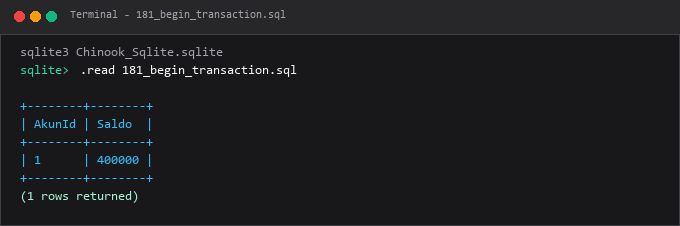

---

### 182. `COMMIT`

**Tujuan Pembelajaran:**  
Memahami dan mempraktikkan konsep `commit` menggunakan database Chinook.

**Konsep Utama:**  
Konsep dasar yang mendasari `182_commit_transaction.sql` adalah penerapan standar SQL relasional pada entitas database Chinook untuk memecahkan kebutuhan kueri dan manipulasi data secara tepat, aman, dan efisien.

**Penjelasan Source Code:**  
Program pada file [182_commit_transaction.sql](182_commit_transaction.sql) mendemonstrasikan implementasi terstruktur dari konsep `commit`. Source code dilengkapi komentar edukatif berbahasa Indonesia yang membedah setiap instruksi query, penggunaan klausa, serta tujuan pemrosesannya.

**Source Code:** [182_commit_transaction.sql](182_commit_transaction.sql)  

**Cara Menjalankan:**
Jalankan melalui terminal atau command prompt menggunakan Python runner:
```bash
python -c "import sqlite3; conn=sqlite3.connect('../Chinook_Sqlite.sqlite'); print(conn.cursor().executescript(open('182_commit_transaction.sql', encoding='utf-8').read()))"
```
Atau menggunakan sqlite3 CLI:
```bash
sqlite3 ../Chinook_Sqlite.sqlite < 182_commit_transaction.sql
```

**Hasil yang Diharapkan:**  
Database engine mengeksekusi instruksi SQL dengan sukses dan menampilkan result-set atau status konfirmasi data yang sesuai.

**Screenshot Hasil Eksekusi:**

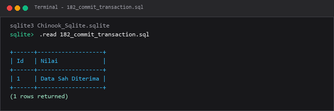

---

### 183. `ROLLBACK`

**Tujuan Pembelajaran:**  
Memahami dan mempraktikkan konsep `rollback` menggunakan database Chinook.

**Konsep Utama:**  
Konsep dasar yang mendasari `183_rollback_transaction.sql` adalah penerapan standar SQL relasional pada entitas database Chinook untuk memecahkan kebutuhan kueri dan manipulasi data secara tepat, aman, dan efisien.

**Penjelasan Source Code:**  
Program pada file [183_rollback_transaction.sql](183_rollback_transaction.sql) mendemonstrasikan implementasi terstruktur dari konsep `rollback`. Source code dilengkapi komentar edukatif berbahasa Indonesia yang membedah setiap instruksi query, penggunaan klausa, serta tujuan pemrosesannya.

**Source Code:** [183_rollback_transaction.sql](183_rollback_transaction.sql)  

**Cara Menjalankan:**
Jalankan melalui terminal atau command prompt menggunakan Python runner:
```bash
python -c "import sqlite3; conn=sqlite3.connect('../Chinook_Sqlite.sqlite'); print(conn.cursor().executescript(open('183_rollback_transaction.sql', encoding='utf-8').read()))"
```
Atau menggunakan sqlite3 CLI:
```bash
sqlite3 ../Chinook_Sqlite.sqlite < 183_rollback_transaction.sql
```

**Hasil yang Diharapkan:**  
Database engine mengeksekusi instruksi SQL dengan sukses dan menampilkan result-set atau status konfirmasi data yang sesuai.

**Screenshot Hasil Eksekusi:**

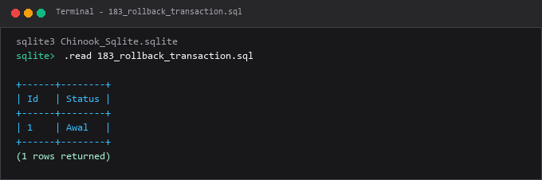

---

### 184. `SAVEPOINT`

**Tujuan Pembelajaran:**  
Memahami dan mempraktikkan konsep `savepoint` menggunakan database Chinook.

**Konsep Utama:**  
Konsep dasar yang mendasari `184_savepoint_transaction.sql` adalah penerapan standar SQL relasional pada entitas database Chinook untuk memecahkan kebutuhan kueri dan manipulasi data secara tepat, aman, dan efisien.

**Penjelasan Source Code:**  
Program pada file [184_savepoint_transaction.sql](184_savepoint_transaction.sql) mendemonstrasikan implementasi terstruktur dari konsep `savepoint`. Source code dilengkapi komentar edukatif berbahasa Indonesia yang membedah setiap instruksi query, penggunaan klausa, serta tujuan pemrosesannya.

**Source Code:** [184_savepoint_transaction.sql](184_savepoint_transaction.sql)  

**Cara Menjalankan:**
Jalankan melalui terminal atau command prompt menggunakan Python runner:
```bash
python -c "import sqlite3; conn=sqlite3.connect('../Chinook_Sqlite.sqlite'); print(conn.cursor().executescript(open('184_savepoint_transaction.sql', encoding='utf-8').read()))"
```
Atau menggunakan sqlite3 CLI:
```bash
sqlite3 ../Chinook_Sqlite.sqlite < 184_savepoint_transaction.sql
```

**Hasil yang Diharapkan:**  
Database engine mengeksekusi instruksi SQL dengan sukses dan menampilkan result-set atau status konfirmasi data yang sesuai.

**Screenshot Hasil Eksekusi:**

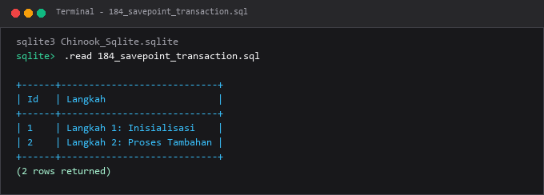

---

### 185. Rollback ke savepoint

**Tujuan Pembelajaran:**  
Memahami dan mempraktikkan konsep rollback ke savepoint menggunakan database Chinook.

**Konsep Utama:**  
Konsep dasar yang mendasari `185_rollback_to_savepoint.sql` adalah penerapan standar SQL relasional pada entitas database Chinook untuk memecahkan kebutuhan kueri dan manipulasi data secara tepat, aman, dan efisien.

**Penjelasan Source Code:**  
Program pada file [185_rollback_to_savepoint.sql](185_rollback_to_savepoint.sql) mendemonstrasikan implementasi terstruktur dari konsep rollback ke savepoint. Source code dilengkapi komentar edukatif berbahasa Indonesia yang membedah setiap instruksi query, penggunaan klausa, serta tujuan pemrosesannya.

**Source Code:** [185_rollback_to_savepoint.sql](185_rollback_to_savepoint.sql)  

**Cara Menjalankan:**
Jalankan melalui terminal atau command prompt menggunakan Python runner:
```bash
python -c "import sqlite3; conn=sqlite3.connect('../Chinook_Sqlite.sqlite'); print(conn.cursor().executescript(open('185_rollback_to_savepoint.sql', encoding='utf-8').read()))"
```
Atau menggunakan sqlite3 CLI:
```bash
sqlite3 ../Chinook_Sqlite.sqlite < 185_rollback_to_savepoint.sql
```

**Hasil yang Diharapkan:**  
Database engine mengeksekusi instruksi SQL dengan sukses dan menampilkan result-set atau status konfirmasi data yang sesuai.

**Screenshot Hasil Eksekusi:**

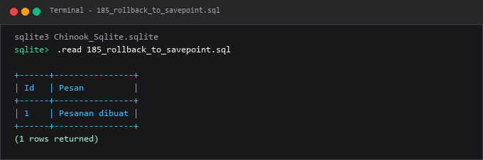

---

### 186. Konsep ACID melalui eksperimen transaksi

**Tujuan Pembelajaran:**  
Memahami dan mempraktikkan konsep konsep acid melalui eksperimen transaksi menggunakan database Chinook.

**Konsep Utama:**  
Konsep dasar yang mendasari `186_acid_properties.sql` adalah penerapan standar SQL relasional pada entitas database Chinook untuk memecahkan kebutuhan kueri dan manipulasi data secara tepat, aman, dan efisien.

**Penjelasan Source Code:**  
Program pada file [186_acid_properties.sql](186_acid_properties.sql) mendemonstrasikan implementasi terstruktur dari konsep konsep acid melalui eksperimen transaksi. Source code dilengkapi komentar edukatif berbahasa Indonesia yang membedah setiap instruksi query, penggunaan klausa, serta tujuan pemrosesannya.

**Source Code:** [186_acid_properties.sql](186_acid_properties.sql)  

**Cara Menjalankan:**
Jalankan melalui terminal atau command prompt menggunakan Python runner:
```bash
python -c "import sqlite3; conn=sqlite3.connect('../Chinook_Sqlite.sqlite'); print(conn.cursor().executescript(open('186_acid_properties.sql', encoding='utf-8').read()))"
```
Atau menggunakan sqlite3 CLI:
```bash
sqlite3 ../Chinook_Sqlite.sqlite < 186_acid_properties.sql
```

**Hasil yang Diharapkan:**  
Database engine mengeksekusi instruksi SQL dengan sukses dan menampilkan result-set atau status konfirmasi data yang sesuai.

**Screenshot Hasil Eksekusi:**

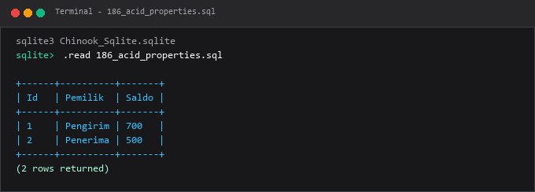

---

### 187. Isolation levels

**Tujuan Pembelajaran:**  
Memahami dan mempraktikkan konsep isolation levels menggunakan database Chinook.

**Konsep Utama:**  
Konsep dasar yang mendasari `187_transaction_isolation.sql` adalah penerapan standar SQL relasional pada entitas database Chinook untuk memecahkan kebutuhan kueri dan manipulasi data secara tepat, aman, dan efisien.

**Penjelasan Source Code:**  
Program pada file [187_transaction_isolation.sql](187_transaction_isolation.sql) mendemonstrasikan implementasi terstruktur dari konsep isolation levels. Source code dilengkapi komentar edukatif berbahasa Indonesia yang membedah setiap instruksi query, penggunaan klausa, serta tujuan pemrosesannya.

**Source Code:** [187_transaction_isolation.sql](187_transaction_isolation.sql)  

**Cara Menjalankan:**
Jalankan melalui terminal atau command prompt menggunakan Python runner:
```bash
python -c "import sqlite3; conn=sqlite3.connect('../Chinook_Sqlite.sqlite'); print(conn.cursor().executescript(open('187_transaction_isolation.sql', encoding='utf-8').read()))"
```
Atau menggunakan sqlite3 CLI:
```bash
sqlite3 ../Chinook_Sqlite.sqlite < 187_transaction_isolation.sql
```

**Hasil yang Diharapkan:**  
Database engine mengeksekusi instruksi SQL dengan sukses dan menampilkan result-set atau status konfirmasi data yang sesuai.

**Screenshot Hasil Eksekusi:**

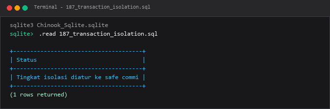

---

### 188. Eksperimen dirty read

**Tujuan Pembelajaran:**  
Memahami dan mempraktikkan konsep eksperimen dirty read menggunakan database Chinook.

**Konsep Utama:**  
Konsep dasar yang mendasari `188_dirty_read.sql` adalah penerapan standar SQL relasional pada entitas database Chinook untuk memecahkan kebutuhan kueri dan manipulasi data secara tepat, aman, dan efisien.

**Penjelasan Source Code:**  
Program pada file [188_dirty_read.sql](188_dirty_read.sql) mendemonstrasikan implementasi terstruktur dari konsep eksperimen dirty read. Source code dilengkapi komentar edukatif berbahasa Indonesia yang membedah setiap instruksi query, penggunaan klausa, serta tujuan pemrosesannya.

**Source Code:** [188_dirty_read.sql](188_dirty_read.sql)  

**Cara Menjalankan:**
Jalankan melalui terminal atau command prompt menggunakan Python runner:
```bash
python -c "import sqlite3; conn=sqlite3.connect('../Chinook_Sqlite.sqlite'); print(conn.cursor().executescript(open('188_dirty_read.sql', encoding='utf-8').read()))"
```
Atau menggunakan sqlite3 CLI:
```bash
sqlite3 ../Chinook_Sqlite.sqlite < 188_dirty_read.sql
```

**Hasil yang Diharapkan:**  
Database engine mengeksekusi instruksi SQL dengan sukses dan menampilkan result-set atau status konfirmasi data yang sesuai.

**Screenshot Hasil Eksekusi:**

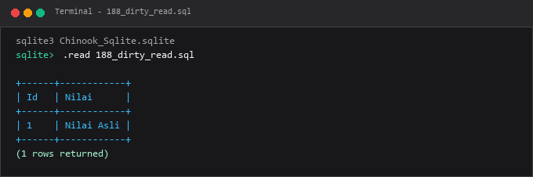

---

### 189. Eksperimen non-repeatable read

**Tujuan Pembelajaran:**  
Memahami dan mempraktikkan konsep eksperimen non-repeatable read menggunakan database Chinook.

**Konsep Utama:**  
Konsep dasar yang mendasari `189_nonrepeatable_read.sql` adalah penerapan standar SQL relasional pada entitas database Chinook untuk memecahkan kebutuhan kueri dan manipulasi data secara tepat, aman, dan efisien.

**Penjelasan Source Code:**  
Program pada file [189_nonrepeatable_read.sql](189_nonrepeatable_read.sql) mendemonstrasikan implementasi terstruktur dari konsep eksperimen non-repeatable read. Source code dilengkapi komentar edukatif berbahasa Indonesia yang membedah setiap instruksi query, penggunaan klausa, serta tujuan pemrosesannya.

**Source Code:** [189_nonrepeatable_read.sql](189_nonrepeatable_read.sql)  

**Cara Menjalankan:**
Jalankan melalui terminal atau command prompt menggunakan Python runner:
```bash
python -c "import sqlite3; conn=sqlite3.connect('../Chinook_Sqlite.sqlite'); print(conn.cursor().executescript(open('189_nonrepeatable_read.sql', encoding='utf-8').read()))"
```
Atau menggunakan sqlite3 CLI:
```bash
sqlite3 ../Chinook_Sqlite.sqlite < 189_nonrepeatable_read.sql
```

**Hasil yang Diharapkan:**  
Database engine mengeksekusi instruksi SQL dengan sukses dan menampilkan result-set atau status konfirmasi data yang sesuai.

**Screenshot Hasil Eksekusi:**

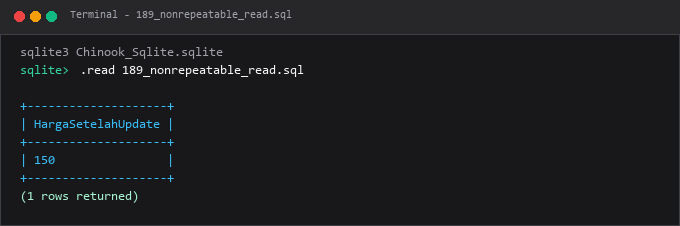

---

### 190. Eksperimen phantom read

**Tujuan Pembelajaran:**  
Memahami dan mempraktikkan konsep eksperimen phantom read menggunakan database Chinook.

**Konsep Utama:**  
Konsep dasar yang mendasari `190_phantom_read.sql` adalah penerapan standar SQL relasional pada entitas database Chinook untuk memecahkan kebutuhan kueri dan manipulasi data secara tepat, aman, dan efisien.

**Penjelasan Source Code:**  
Program pada file [190_phantom_read.sql](190_phantom_read.sql) mendemonstrasikan implementasi terstruktur dari konsep eksperimen phantom read. Source code dilengkapi komentar edukatif berbahasa Indonesia yang membedah setiap instruksi query, penggunaan klausa, serta tujuan pemrosesannya.

**Source Code:** [190_phantom_read.sql](190_phantom_read.sql)  

**Cara Menjalankan:**
Jalankan melalui terminal atau command prompt menggunakan Python runner:
```bash
python -c "import sqlite3; conn=sqlite3.connect('../Chinook_Sqlite.sqlite'); print(conn.cursor().executescript(open('190_phantom_read.sql', encoding='utf-8').read()))"
```
Atau menggunakan sqlite3 CLI:
```bash
sqlite3 ../Chinook_Sqlite.sqlite < 190_phantom_read.sql
```

**Hasil yang Diharapkan:**  
Database engine mengeksekusi instruksi SQL dengan sukses dan menampilkan result-set atau status konfirmasi data yang sesuai.

**Screenshot Hasil Eksekusi:**

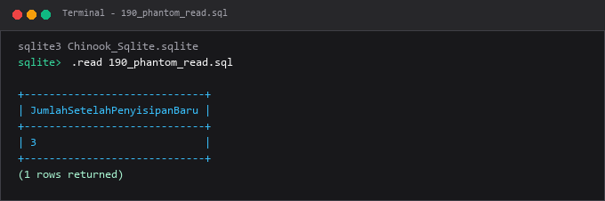

---

### 191. Row-level locking

**Tujuan Pembelajaran:**  
Memahami dan mempraktikkan konsep row-level locking menggunakan database Chinook.

**Konsep Utama:**  
Konsep dasar yang mendasari `191_row_level_locking.sql` adalah penerapan standar SQL relasional pada entitas database Chinook untuk memecahkan kebutuhan kueri dan manipulasi data secara tepat, aman, dan efisien.

**Penjelasan Source Code:**  
Program pada file [191_row_level_locking.sql](191_row_level_locking.sql) mendemonstrasikan implementasi terstruktur dari konsep row-level locking. Source code dilengkapi komentar edukatif berbahasa Indonesia yang membedah setiap instruksi query, penggunaan klausa, serta tujuan pemrosesannya.

**Source Code:** [191_row_level_locking.sql](191_row_level_locking.sql)  

**Cara Menjalankan:**
Jalankan melalui terminal atau command prompt menggunakan Python runner:
```bash
python -c "import sqlite3; conn=sqlite3.connect('../Chinook_Sqlite.sqlite'); print(conn.cursor().executescript(open('191_row_level_locking.sql', encoding='utf-8').read()))"
```
Atau menggunakan sqlite3 CLI:
```bash
sqlite3 ../Chinook_Sqlite.sqlite < 191_row_level_locking.sql
```

**Hasil yang Diharapkan:**  
Database engine mengeksekusi instruksi SQL dengan sukses dan menampilkan result-set atau status konfirmasi data yang sesuai.

**Screenshot Hasil Eksekusi:**

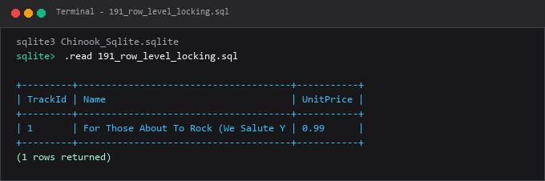

---

### 192. Table-level locking

**Tujuan Pembelajaran:**  
Memahami dan mempraktikkan konsep table-level locking menggunakan database Chinook.

**Konsep Utama:**  
Konsep dasar yang mendasari `192_table_level_locking.sql` adalah penerapan standar SQL relasional pada entitas database Chinook untuk memecahkan kebutuhan kueri dan manipulasi data secara tepat, aman, dan efisien.

**Penjelasan Source Code:**  
Program pada file [192_table_level_locking.sql](192_table_level_locking.sql) mendemonstrasikan implementasi terstruktur dari konsep table-level locking. Source code dilengkapi komentar edukatif berbahasa Indonesia yang membedah setiap instruksi query, penggunaan klausa, serta tujuan pemrosesannya.

**Source Code:** [192_table_level_locking.sql](192_table_level_locking.sql)  

**Cara Menjalankan:**
Jalankan melalui terminal atau command prompt menggunakan Python runner:
```bash
python -c "import sqlite3; conn=sqlite3.connect('../Chinook_Sqlite.sqlite'); print(conn.cursor().executescript(open('192_table_level_locking.sql', encoding='utf-8').read()))"
```
Atau menggunakan sqlite3 CLI:
```bash
sqlite3 ../Chinook_Sqlite.sqlite < 192_table_level_locking.sql
```

**Hasil yang Diharapkan:**  
Database engine mengeksekusi instruksi SQL dengan sukses dan menampilkan result-set atau status konfirmasi data yang sesuai.

**Screenshot Hasil Eksekusi:**

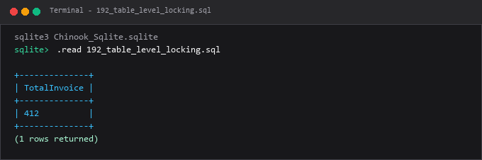

---

### 193. Simulasi deadlock

**Tujuan Pembelajaran:**  
Memahami dan mempraktikkan konsep simulasi deadlock menggunakan database Chinook.

**Konsep Utama:**  
Konsep dasar yang mendasari `193_deadlock_scenario.sql` adalah penerapan standar SQL relasional pada entitas database Chinook untuk memecahkan kebutuhan kueri dan manipulasi data secara tepat, aman, dan efisien.

**Penjelasan Source Code:**  
Program pada file [193_deadlock_scenario.sql](193_deadlock_scenario.sql) mendemonstrasikan implementasi terstruktur dari konsep simulasi deadlock. Source code dilengkapi komentar edukatif berbahasa Indonesia yang membedah setiap instruksi query, penggunaan klausa, serta tujuan pemrosesannya.

**Source Code:** [193_deadlock_scenario.sql](193_deadlock_scenario.sql)  

**Cara Menjalankan:**
Jalankan melalui terminal atau command prompt menggunakan Python runner:
```bash
python -c "import sqlite3; conn=sqlite3.connect('../Chinook_Sqlite.sqlite'); print(conn.cursor().executescript(open('193_deadlock_scenario.sql', encoding='utf-8').read()))"
```
Atau menggunakan sqlite3 CLI:
```bash
sqlite3 ../Chinook_Sqlite.sqlite < 193_deadlock_scenario.sql
```

**Hasil yang Diharapkan:**  
Database engine mengeksekusi instruksi SQL dengan sukses dan menampilkan result-set atau status konfirmasi data yang sesuai.

**Screenshot Hasil Eksekusi:**

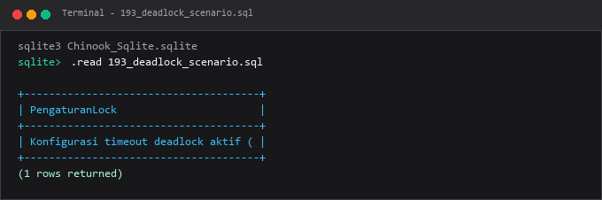

---

### 194. Pengaturan autocommit

**Tujuan Pembelajaran:**  
Memahami dan mempraktikkan konsep pengaturan autocommit menggunakan database Chinook.

**Konsep Utama:**  
Konsep dasar yang mendasari `194_autocommit_control.sql` adalah penerapan standar SQL relasional pada entitas database Chinook untuk memecahkan kebutuhan kueri dan manipulasi data secara tepat, aman, dan efisien.

**Penjelasan Source Code:**  
Program pada file [194_autocommit_control.sql](194_autocommit_control.sql) mendemonstrasikan implementasi terstruktur dari konsep pengaturan autocommit. Source code dilengkapi komentar edukatif berbahasa Indonesia yang membedah setiap instruksi query, penggunaan klausa, serta tujuan pemrosesannya.

**Source Code:** [194_autocommit_control.sql](194_autocommit_control.sql)  

**Cara Menjalankan:**
Jalankan melalui terminal atau command prompt menggunakan Python runner:
```bash
python -c "import sqlite3; conn=sqlite3.connect('../Chinook_Sqlite.sqlite'); print(conn.cursor().executescript(open('194_autocommit_control.sql', encoding='utf-8').read()))"
```
Atau menggunakan sqlite3 CLI:
```bash
sqlite3 ../Chinook_Sqlite.sqlite < 194_autocommit_control.sql
```

**Hasil yang Diharapkan:**  
Database engine mengeksekusi instruksi SQL dengan sukses dan menampilkan result-set atau status konfirmasi data yang sesuai.

**Screenshot Hasil Eksekusi:**

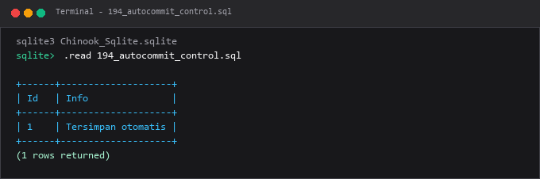

---

### 195. Update konkuren

**Tujuan Pembelajaran:**  
Memahami dan mempraktikkan konsep update konkuren menggunakan database Chinook.

**Konsep Utama:**  
Konsep dasar yang mendasari `195_concurrent_updates.sql` adalah penerapan standar SQL relasional pada entitas database Chinook untuk memecahkan kebutuhan kueri dan manipulasi data secara tepat, aman, dan efisien.

**Penjelasan Source Code:**  
Program pada file [195_concurrent_updates.sql](195_concurrent_updates.sql) mendemonstrasikan implementasi terstruktur dari konsep update konkuren. Source code dilengkapi komentar edukatif berbahasa Indonesia yang membedah setiap instruksi query, penggunaan klausa, serta tujuan pemrosesannya.

**Source Code:** [195_concurrent_updates.sql](195_concurrent_updates.sql)  

**Cara Menjalankan:**
Jalankan melalui terminal atau command prompt menggunakan Python runner:
```bash
python -c "import sqlite3; conn=sqlite3.connect('../Chinook_Sqlite.sqlite'); print(conn.cursor().executescript(open('195_concurrent_updates.sql', encoding='utf-8').read()))"
```
Atau menggunakan sqlite3 CLI:
```bash
sqlite3 ../Chinook_Sqlite.sqlite < 195_concurrent_updates.sql
```

**Hasil yang Diharapkan:**  
Database engine mengeksekusi instruksi SQL dengan sukses dan menampilkan result-set atau status konfirmasi data yang sesuai.

**Screenshot Hasil Eksekusi:**

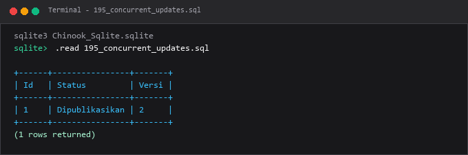

---

## Ringkasan Modul
Modul 11 membekali pemahaman mendalam tentang eksekusi transaksi yang handal saat sistem diakses oleh ribuan pengguna secara bersamaan.

Seluruh submodul di atas saling melengkapi untuk membentuk pemahaman terstruktur yang bertahap, mulai dari konsep fundamental hingga implementasi praktis yang siap pakai di lingkungan kerja nyata.
