# Modul 12: Window Functions dan Analisis Data

## Ringkasan Ruang Lingkup Materi
Modul ini mengeksplorasi fungsi analitik modern (Window Functions): klausa OVER, PARTITION BY, ROW_NUMBER, RANK, DENSE_RANK, NTILE, LAG/LEAD, FIRST/LAST_VALUE, running total, moving average, ranking persentil, dan perbandingan antar periode.

## Tujuan Pembelajaran
Mampu melakukan analisis data tingkat lanjut, perangkingan dinamis, dan kalkulasi tren kumulatif langsung di mesin database tanpa memecah integritas baris.

---
## Daftar Submodul Pembelajaran

| No | Nama Submodul | File Source Code | Status Eksekusi |
|:---|:---|:---|:---:|
| 196 | Klausa `OVER` | [196_over_clause.sql](196_over_clause.sql) | Siap Dijalankan |
| 197 | `PARTITION BY` | [197_partition_by.sql](197_partition_by.sql) | Siap Dijalankan |
| 198 | Pengurutan pada window | [198_window_order_by.sql](198_window_order_by.sql) | Siap Dijalankan |
| 199 | Fungsi `ROW_NUMBER` | [199_row_number.sql](199_row_number.sql) | Siap Dijalankan |
| 200 | Fungsi `RANK` | [200_rank_function.sql](200_rank_function.sql) | Siap Dijalankan |
| 201 | Fungsi `DENSE_RANK` | [201_dense_rank.sql](201_dense_rank.sql) | Siap Dijalankan |
| 202 | Fungsi `NTILE` | [202_ntile_function.sql](202_ntile_function.sql) | Siap Dijalankan |
| 203 | Fungsi `LAG` | [203_lag_function.sql](203_lag_function.sql) | Siap Dijalankan |
| 204 | Fungsi `LEAD` | [204_lead_function.sql](204_lead_function.sql) | Siap Dijalankan |
| 205 | Fungsi `FIRST_VALUE` | [205_first_value.sql](205_first_value.sql) | Siap Dijalankan |
| 206 | Fungsi `LAST_VALUE` | [206_last_value.sql](206_last_value.sql) | Siap Dijalankan |
| 207 | Running total | [207_running_total.sql](207_running_total.sql) | Siap Dijalankan |
| 208 | Moving average | [208_moving_average.sql](208_moving_average.sql) | Siap Dijalankan |
| 209 | Fungsi `PERCENT_RANK` | [209_percent_rank.sql](209_percent_rank.sql) | Siap Dijalankan |
| 210 | Fungsi `CUME_DIST` | [210_cume_dist.sql](210_cume_dist.sql) | Siap Dijalankan |
| 211 | Window frame `ROWS` | [211_window_frame_rows.sql](211_window_frame_rows.sql) | Siap Dijalankan |
| 212 | Window frame `RANGE` | [212_window_frame_range.sql](212_window_frame_range.sql) | Siap Dijalankan |
| 213 | Top N per grup | [213_top_n_per_group.sql](213_top_n_per_group.sql) | Siap Dijalankan |
| 214 | Deduplication dengan window function | [214_deduplicate_with_row_number.sql](214_deduplicate_with_row_number.sql) | Siap Dijalankan |
| 215 | Analisis perubahan ant periode | [215_period_over_period_analysis.sql](215_period_over_period_analysis.sql) | Siap Dijalankan |

---

## Penjelasan Detail Setiap Submodul

### 196. Klausa `OVER`

**Tujuan Pembelajaran:**  
Memahami dan mempraktikkan konsep klausa `over` menggunakan database Chinook.

**Konsep Utama:**  
Konsep dasar yang mendasari `196_over_clause.sql` adalah penerapan standar SQL relasional pada entitas database Chinook untuk memecahkan kebutuhan kueri dan manipulasi data secara tepat, aman, dan efisien.

**Penjelasan Source Code:**  
Program pada file [196_over_clause.sql](196_over_clause.sql) mendemonstrasikan implementasi terstruktur dari konsep klausa `over`. Source code dilengkapi komentar edukatif berbahasa Indonesia yang membedah setiap instruksi query, penggunaan klausa, serta tujuan pemrosesannya.

**Source Code:** [196_over_clause.sql](196_over_clause.sql)  

**Cara Menjalankan:**
Jalankan melalui terminal atau command prompt menggunakan Python runner:
```bash
python -c "import sqlite3; conn=sqlite3.connect('../Chinook_Sqlite.sqlite'); print(conn.cursor().executescript(open('196_over_clause.sql', encoding='utf-8').read()))"
```
Atau menggunakan sqlite3 CLI:
```bash
sqlite3 ../Chinook_Sqlite.sqlite < 196_over_clause.sql
```

**Hasil yang Diharapkan:**  
Database engine mengeksekusi instruksi SQL dengan sukses dan menampilkan result-set atau status konfirmasi data yang sesuai.

**Screenshot Hasil Eksekusi:**

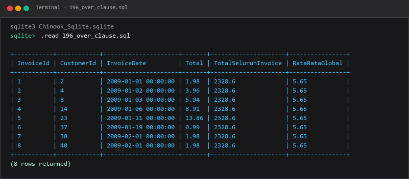

---

### 197. `PARTITION BY`

**Tujuan Pembelajaran:**  
Memahami dan mempraktikkan konsep `partition by` menggunakan database Chinook.

**Konsep Utama:**  
Konsep dasar yang mendasari `197_partition_by.sql` adalah penerapan standar SQL relasional pada entitas database Chinook untuk memecahkan kebutuhan kueri dan manipulasi data secara tepat, aman, dan efisien.

**Penjelasan Source Code:**  
Program pada file [197_partition_by.sql](197_partition_by.sql) mendemonstrasikan implementasi terstruktur dari konsep `partition by`. Source code dilengkapi komentar edukatif berbahasa Indonesia yang membedah setiap instruksi query, penggunaan klausa, serta tujuan pemrosesannya.

**Source Code:** [197_partition_by.sql](197_partition_by.sql)  

**Cara Menjalankan:**
Jalankan melalui terminal atau command prompt menggunakan Python runner:
```bash
python -c "import sqlite3; conn=sqlite3.connect('../Chinook_Sqlite.sqlite'); print(conn.cursor().executescript(open('197_partition_by.sql', encoding='utf-8').read()))"
```
Atau menggunakan sqlite3 CLI:
```bash
sqlite3 ../Chinook_Sqlite.sqlite < 197_partition_by.sql
```

**Hasil yang Diharapkan:**  
Database engine mengeksekusi instruksi SQL dengan sukses dan menampilkan result-set atau status konfirmasi data yang sesuai.

**Screenshot Hasil Eksekusi:**

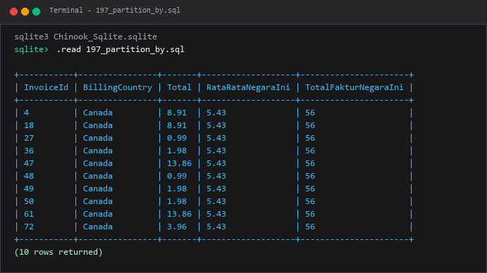

---

### 198. Pengurutan pada window

**Tujuan Pembelajaran:**  
Memahami dan mempraktikkan konsep pengurutan pada window menggunakan database Chinook.

**Konsep Utama:**  
Konsep dasar yang mendasari `198_window_order_by.sql` adalah penerapan standar SQL relasional pada entitas database Chinook untuk memecahkan kebutuhan kueri dan manipulasi data secara tepat, aman, dan efisien.

**Penjelasan Source Code:**  
Program pada file [198_window_order_by.sql](198_window_order_by.sql) mendemonstrasikan implementasi terstruktur dari konsep pengurutan pada window. Source code dilengkapi komentar edukatif berbahasa Indonesia yang membedah setiap instruksi query, penggunaan klausa, serta tujuan pemrosesannya.

**Source Code:** [198_window_order_by.sql](198_window_order_by.sql)  

**Cara Menjalankan:**
Jalankan melalui terminal atau command prompt menggunakan Python runner:
```bash
python -c "import sqlite3; conn=sqlite3.connect('../Chinook_Sqlite.sqlite'); print(conn.cursor().executescript(open('198_window_order_by.sql', encoding='utf-8').read()))"
```
Atau menggunakan sqlite3 CLI:
```bash
sqlite3 ../Chinook_Sqlite.sqlite < 198_window_order_by.sql
```

**Hasil yang Diharapkan:**  
Database engine mengeksekusi instruksi SQL dengan sukses dan menampilkan result-set atau status konfirmasi data yang sesuai.

**Screenshot Hasil Eksekusi:**

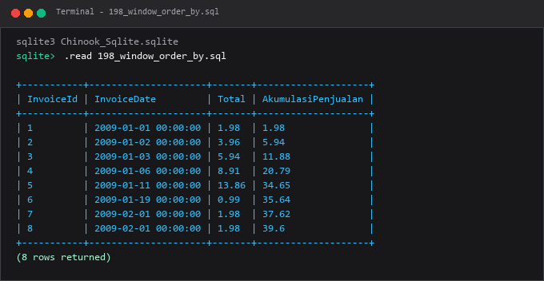

---

### 199. Fungsi `ROW_NUMBER`

**Tujuan Pembelajaran:**  
Memahami dan mempraktikkan konsep fungsi `row_number` menggunakan database Chinook.

**Konsep Utama:**  
Konsep dasar yang mendasari `199_row_number.sql` adalah penerapan standar SQL relasional pada entitas database Chinook untuk memecahkan kebutuhan kueri dan manipulasi data secara tepat, aman, dan efisien.

**Penjelasan Source Code:**  
Program pada file [199_row_number.sql](199_row_number.sql) mendemonstrasikan implementasi terstruktur dari konsep fungsi `row_number`. Source code dilengkapi komentar edukatif berbahasa Indonesia yang membedah setiap instruksi query, penggunaan klausa, serta tujuan pemrosesannya.

**Source Code:** [199_row_number.sql](199_row_number.sql)  

**Cara Menjalankan:**
Jalankan melalui terminal atau command prompt menggunakan Python runner:
```bash
python -c "import sqlite3; conn=sqlite3.connect('../Chinook_Sqlite.sqlite'); print(conn.cursor().executescript(open('199_row_number.sql', encoding='utf-8').read()))"
```
Atau menggunakan sqlite3 CLI:
```bash
sqlite3 ../Chinook_Sqlite.sqlite < 199_row_number.sql
```

**Hasil yang Diharapkan:**  
Database engine mengeksekusi instruksi SQL dengan sukses dan menampilkan result-set atau status konfirmasi data yang sesuai.

**Screenshot Hasil Eksekusi:**

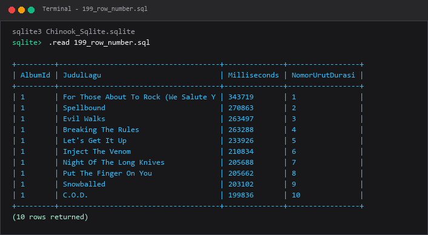

---

### 200. Fungsi `RANK`

**Tujuan Pembelajaran:**  
Memahami dan mempraktikkan konsep fungsi `rank` menggunakan database Chinook.

**Konsep Utama:**  
Konsep dasar yang mendasari `200_rank_function.sql` adalah penerapan standar SQL relasional pada entitas database Chinook untuk memecahkan kebutuhan kueri dan manipulasi data secara tepat, aman, dan efisien.

**Penjelasan Source Code:**  
Program pada file [200_rank_function.sql](200_rank_function.sql) mendemonstrasikan implementasi terstruktur dari konsep fungsi `rank`. Source code dilengkapi komentar edukatif berbahasa Indonesia yang membedah setiap instruksi query, penggunaan klausa, serta tujuan pemrosesannya.

**Source Code:** [200_rank_function.sql](200_rank_function.sql)  

**Cara Menjalankan:**
Jalankan melalui terminal atau command prompt menggunakan Python runner:
```bash
python -c "import sqlite3; conn=sqlite3.connect('../Chinook_Sqlite.sqlite'); print(conn.cursor().executescript(open('200_rank_function.sql', encoding='utf-8').read()))"
```
Atau menggunakan sqlite3 CLI:
```bash
sqlite3 ../Chinook_Sqlite.sqlite < 200_rank_function.sql
```

**Hasil yang Diharapkan:**  
Database engine mengeksekusi instruksi SQL dengan sukses dan menampilkan result-set atau status konfirmasi data yang sesuai.

**Screenshot Hasil Eksekusi:**

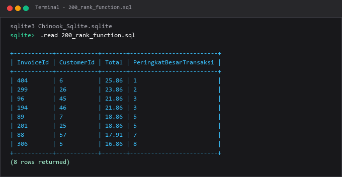

---

### 201. Fungsi `DENSE_RANK`

**Tujuan Pembelajaran:**  
Memahami dan mempraktikkan konsep fungsi `dense_rank` menggunakan database Chinook.

**Konsep Utama:**  
Konsep dasar yang mendasari `201_dense_rank.sql` adalah penerapan standar SQL relasional pada entitas database Chinook untuk memecahkan kebutuhan kueri dan manipulasi data secara tepat, aman, dan efisien.

**Penjelasan Source Code:**  
Program pada file [201_dense_rank.sql](201_dense_rank.sql) mendemonstrasikan implementasi terstruktur dari konsep fungsi `dense_rank`. Source code dilengkapi komentar edukatif berbahasa Indonesia yang membedah setiap instruksi query, penggunaan klausa, serta tujuan pemrosesannya.

**Source Code:** [201_dense_rank.sql](201_dense_rank.sql)  

**Cara Menjalankan:**
Jalankan melalui terminal atau command prompt menggunakan Python runner:
```bash
python -c "import sqlite3; conn=sqlite3.connect('../Chinook_Sqlite.sqlite'); print(conn.cursor().executescript(open('201_dense_rank.sql', encoding='utf-8').read()))"
```
Atau menggunakan sqlite3 CLI:
```bash
sqlite3 ../Chinook_Sqlite.sqlite < 201_dense_rank.sql
```

**Hasil yang Diharapkan:**  
Database engine mengeksekusi instruksi SQL dengan sukses dan menampilkan result-set atau status konfirmasi data yang sesuai.

**Screenshot Hasil Eksekusi:**

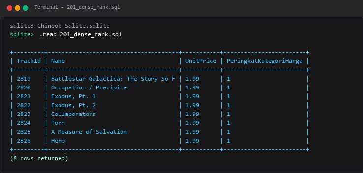

---

### 202. Fungsi `NTILE`

**Tujuan Pembelajaran:**  
Memahami dan mempraktikkan konsep fungsi `ntile` menggunakan database Chinook.

**Konsep Utama:**  
Konsep dasar yang mendasari `202_ntile_function.sql` adalah penerapan standar SQL relasional pada entitas database Chinook untuk memecahkan kebutuhan kueri dan manipulasi data secara tepat, aman, dan efisien.

**Penjelasan Source Code:**  
Program pada file [202_ntile_function.sql](202_ntile_function.sql) mendemonstrasikan implementasi terstruktur dari konsep fungsi `ntile`. Source code dilengkapi komentar edukatif berbahasa Indonesia yang membedah setiap instruksi query, penggunaan klausa, serta tujuan pemrosesannya.

**Source Code:** [202_ntile_function.sql](202_ntile_function.sql)  

**Cara Menjalankan:**
Jalankan melalui terminal atau command prompt menggunakan Python runner:
```bash
python -c "import sqlite3; conn=sqlite3.connect('../Chinook_Sqlite.sqlite'); print(conn.cursor().executescript(open('202_ntile_function.sql', encoding='utf-8').read()))"
```
Atau menggunakan sqlite3 CLI:
```bash
sqlite3 ../Chinook_Sqlite.sqlite < 202_ntile_function.sql
```

**Hasil yang Diharapkan:**  
Database engine mengeksekusi instruksi SQL dengan sukses dan menampilkan result-set atau status konfirmasi data yang sesuai.

**Screenshot Hasil Eksekusi:**

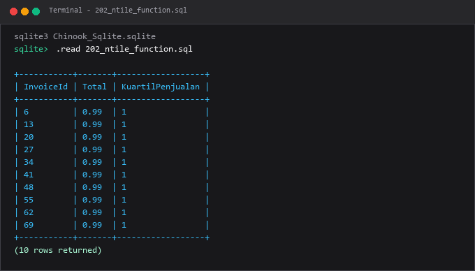

---

### 203. Fungsi `LAG`

**Tujuan Pembelajaran:**  
Memahami dan mempraktikkan konsep fungsi `lag` menggunakan database Chinook.

**Konsep Utama:**  
Konsep dasar yang mendasari `203_lag_function.sql` adalah penerapan standar SQL relasional pada entitas database Chinook untuk memecahkan kebutuhan kueri dan manipulasi data secara tepat, aman, dan efisien.

**Penjelasan Source Code:**  
Program pada file [203_lag_function.sql](203_lag_function.sql) mendemonstrasikan implementasi terstruktur dari konsep fungsi `lag`. Source code dilengkapi komentar edukatif berbahasa Indonesia yang membedah setiap instruksi query, penggunaan klausa, serta tujuan pemrosesannya.

**Source Code:** [203_lag_function.sql](203_lag_function.sql)  

**Cara Menjalankan:**
Jalankan melalui terminal atau command prompt menggunakan Python runner:
```bash
python -c "import sqlite3; conn=sqlite3.connect('../Chinook_Sqlite.sqlite'); print(conn.cursor().executescript(open('203_lag_function.sql', encoding='utf-8').read()))"
```
Atau menggunakan sqlite3 CLI:
```bash
sqlite3 ../Chinook_Sqlite.sqlite < 203_lag_function.sql
```

**Hasil yang Diharapkan:**  
Database engine mengeksekusi instruksi SQL dengan sukses dan menampilkan result-set atau status konfirmasi data yang sesuai.

**Screenshot Hasil Eksekusi:**

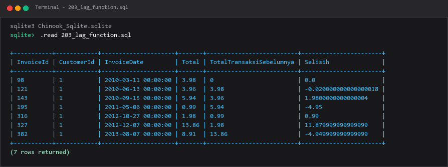

---

### 204. Fungsi `LEAD`

**Tujuan Pembelajaran:**  
Memahami dan mempraktikkan konsep fungsi `lead` menggunakan database Chinook.

**Konsep Utama:**  
Konsep dasar yang mendasari `204_lead_function.sql` adalah penerapan standar SQL relasional pada entitas database Chinook untuk memecahkan kebutuhan kueri dan manipulasi data secara tepat, aman, dan efisien.

**Penjelasan Source Code:**  
Program pada file [204_lead_function.sql](204_lead_function.sql) mendemonstrasikan implementasi terstruktur dari konsep fungsi `lead`. Source code dilengkapi komentar edukatif berbahasa Indonesia yang membedah setiap instruksi query, penggunaan klausa, serta tujuan pemrosesannya.

**Source Code:** [204_lead_function.sql](204_lead_function.sql)  

**Cara Menjalankan:**
Jalankan melalui terminal atau command prompt menggunakan Python runner:
```bash
python -c "import sqlite3; conn=sqlite3.connect('../Chinook_Sqlite.sqlite'); print(conn.cursor().executescript(open('204_lead_function.sql', encoding='utf-8').read()))"
```
Atau menggunakan sqlite3 CLI:
```bash
sqlite3 ../Chinook_Sqlite.sqlite < 204_lead_function.sql
```

**Hasil yang Diharapkan:**  
Database engine mengeksekusi instruksi SQL dengan sukses dan menampilkan result-set atau status konfirmasi data yang sesuai.

**Screenshot Hasil Eksekusi:**

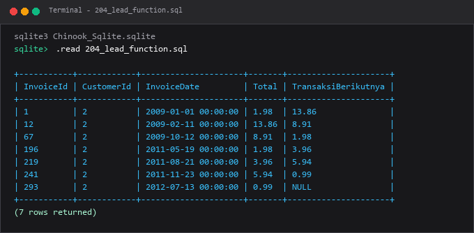

---

### 205. Fungsi `FIRST_VALUE`

**Tujuan Pembelajaran:**  
Memahami dan mempraktikkan konsep fungsi `first_value` menggunakan database Chinook.

**Konsep Utama:**  
Konsep dasar yang mendasari `205_first_value.sql` adalah penerapan standar SQL relasional pada entitas database Chinook untuk memecahkan kebutuhan kueri dan manipulasi data secara tepat, aman, dan efisien.

**Penjelasan Source Code:**  
Program pada file [205_first_value.sql](205_first_value.sql) mendemonstrasikan implementasi terstruktur dari konsep fungsi `first_value`. Source code dilengkapi komentar edukatif berbahasa Indonesia yang membedah setiap instruksi query, penggunaan klausa, serta tujuan pemrosesannya.

**Source Code:** [205_first_value.sql](205_first_value.sql)  

**Cara Menjalankan:**
Jalankan melalui terminal atau command prompt menggunakan Python runner:
```bash
python -c "import sqlite3; conn=sqlite3.connect('../Chinook_Sqlite.sqlite'); print(conn.cursor().executescript(open('205_first_value.sql', encoding='utf-8').read()))"
```
Atau menggunakan sqlite3 CLI:
```bash
sqlite3 ../Chinook_Sqlite.sqlite < 205_first_value.sql
```

**Hasil yang Diharapkan:**  
Database engine mengeksekusi instruksi SQL dengan sukses dan menampilkan result-set atau status konfirmasi data yang sesuai.

**Screenshot Hasil Eksekusi:**

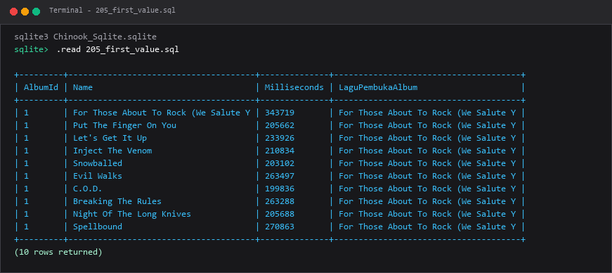

---

### 206. Fungsi `LAST_VALUE`

**Tujuan Pembelajaran:**  
Memahami dan mempraktikkan konsep fungsi `last_value` menggunakan database Chinook.

**Konsep Utama:**  
Konsep dasar yang mendasari `206_last_value.sql` adalah penerapan standar SQL relasional pada entitas database Chinook untuk memecahkan kebutuhan kueri dan manipulasi data secara tepat, aman, dan efisien.

**Penjelasan Source Code:**  
Program pada file [206_last_value.sql](206_last_value.sql) mendemonstrasikan implementasi terstruktur dari konsep fungsi `last_value`. Source code dilengkapi komentar edukatif berbahasa Indonesia yang membedah setiap instruksi query, penggunaan klausa, serta tujuan pemrosesannya.

**Source Code:** [206_last_value.sql](206_last_value.sql)  

**Cara Menjalankan:**
Jalankan melalui terminal atau command prompt menggunakan Python runner:
```bash
python -c "import sqlite3; conn=sqlite3.connect('../Chinook_Sqlite.sqlite'); print(conn.cursor().executescript(open('206_last_value.sql', encoding='utf-8').read()))"
```
Atau menggunakan sqlite3 CLI:
```bash
sqlite3 ../Chinook_Sqlite.sqlite < 206_last_value.sql
```

**Hasil yang Diharapkan:**  
Database engine mengeksekusi instruksi SQL dengan sukses dan menampilkan result-set atau status konfirmasi data yang sesuai.

**Screenshot Hasil Eksekusi:**

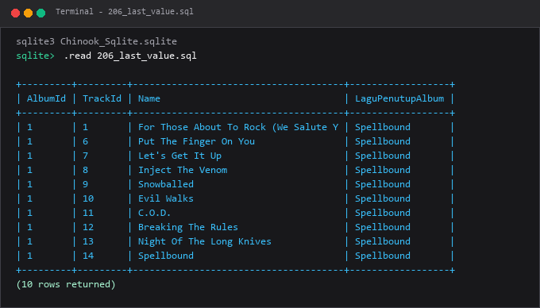

---

### 207. Running total

**Tujuan Pembelajaran:**  
Memahami dan mempraktikkan konsep running total menggunakan database Chinook.

**Konsep Utama:**  
Konsep dasar yang mendasari `207_running_total.sql` adalah penerapan standar SQL relasional pada entitas database Chinook untuk memecahkan kebutuhan kueri dan manipulasi data secara tepat, aman, dan efisien.

**Penjelasan Source Code:**  
Program pada file [207_running_total.sql](207_running_total.sql) mendemonstrasikan implementasi terstruktur dari konsep running total. Source code dilengkapi komentar edukatif berbahasa Indonesia yang membedah setiap instruksi query, penggunaan klausa, serta tujuan pemrosesannya.

**Source Code:** [207_running_total.sql](207_running_total.sql)  

**Cara Menjalankan:**
Jalankan melalui terminal atau command prompt menggunakan Python runner:
```bash
python -c "import sqlite3; conn=sqlite3.connect('../Chinook_Sqlite.sqlite'); print(conn.cursor().executescript(open('207_running_total.sql', encoding='utf-8').read()))"
```
Atau menggunakan sqlite3 CLI:
```bash
sqlite3 ../Chinook_Sqlite.sqlite < 207_running_total.sql
```

**Hasil yang Diharapkan:**  
Database engine mengeksekusi instruksi SQL dengan sukses dan menampilkan result-set atau status konfirmasi data yang sesuai.

**Screenshot Hasil Eksekusi:**

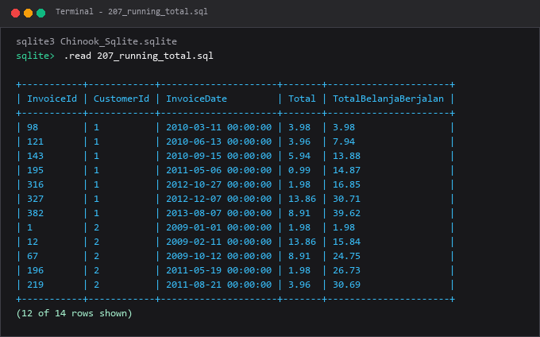

---

### 208. Moving average

**Tujuan Pembelajaran:**  
Memahami dan mempraktikkan konsep moving average menggunakan database Chinook.

**Konsep Utama:**  
Konsep dasar yang mendasari `208_moving_average.sql` adalah penerapan standar SQL relasional pada entitas database Chinook untuk memecahkan kebutuhan kueri dan manipulasi data secara tepat, aman, dan efisien.

**Penjelasan Source Code:**  
Program pada file [208_moving_average.sql](208_moving_average.sql) mendemonstrasikan implementasi terstruktur dari konsep moving average. Source code dilengkapi komentar edukatif berbahasa Indonesia yang membedah setiap instruksi query, penggunaan klausa, serta tujuan pemrosesannya.

**Source Code:** [208_moving_average.sql](208_moving_average.sql)  

**Cara Menjalankan:**
Jalankan melalui terminal atau command prompt menggunakan Python runner:
```bash
python -c "import sqlite3; conn=sqlite3.connect('../Chinook_Sqlite.sqlite'); print(conn.cursor().executescript(open('208_moving_average.sql', encoding='utf-8').read()))"
```
Atau menggunakan sqlite3 CLI:
```bash
sqlite3 ../Chinook_Sqlite.sqlite < 208_moving_average.sql
```

**Hasil yang Diharapkan:**  
Database engine mengeksekusi instruksi SQL dengan sukses dan menampilkan result-set atau status konfirmasi data yang sesuai.

**Screenshot Hasil Eksekusi:**

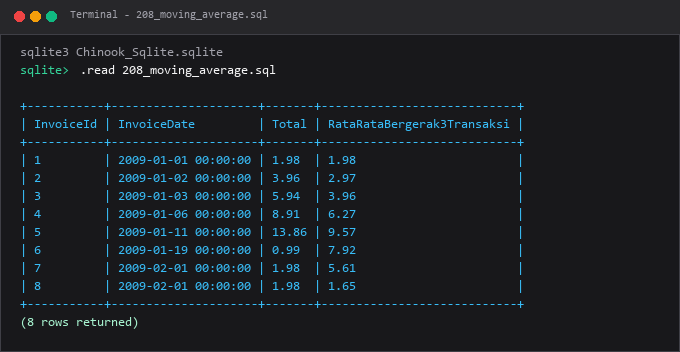

---

### 209. Fungsi `PERCENT_RANK`

**Tujuan Pembelajaran:**  
Memahami dan mempraktikkan konsep fungsi `percent_rank` menggunakan database Chinook.

**Konsep Utama:**  
Konsep dasar yang mendasari `209_percent_rank.sql` adalah penerapan standar SQL relasional pada entitas database Chinook untuk memecahkan kebutuhan kueri dan manipulasi data secara tepat, aman, dan efisien.

**Penjelasan Source Code:**  
Program pada file [209_percent_rank.sql](209_percent_rank.sql) mendemonstrasikan implementasi terstruktur dari konsep fungsi `percent_rank`. Source code dilengkapi komentar edukatif berbahasa Indonesia yang membedah setiap instruksi query, penggunaan klausa, serta tujuan pemrosesannya.

**Source Code:** [209_percent_rank.sql](209_percent_rank.sql)  

**Cara Menjalankan:**
Jalankan melalui terminal atau command prompt menggunakan Python runner:
```bash
python -c "import sqlite3; conn=sqlite3.connect('../Chinook_Sqlite.sqlite'); print(conn.cursor().executescript(open('209_percent_rank.sql', encoding='utf-8').read()))"
```
Atau menggunakan sqlite3 CLI:
```bash
sqlite3 ../Chinook_Sqlite.sqlite < 209_percent_rank.sql
```

**Hasil yang Diharapkan:**  
Database engine mengeksekusi instruksi SQL dengan sukses dan menampilkan result-set atau status konfirmasi data yang sesuai.

**Screenshot Hasil Eksekusi:**

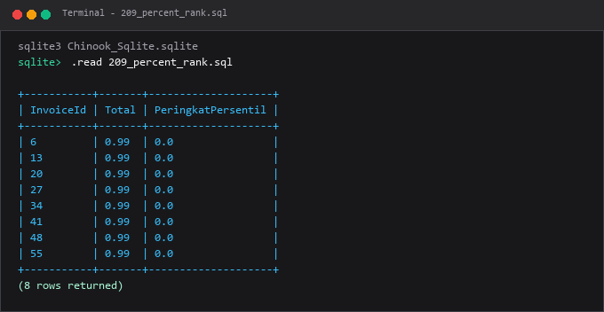

---

### 210. Fungsi `CUME_DIST`

**Tujuan Pembelajaran:**  
Memahami dan mempraktikkan konsep fungsi `cume_dist` menggunakan database Chinook.

**Konsep Utama:**  
Konsep dasar yang mendasari `210_cume_dist.sql` adalah penerapan standar SQL relasional pada entitas database Chinook untuk memecahkan kebutuhan kueri dan manipulasi data secara tepat, aman, dan efisien.

**Penjelasan Source Code:**  
Program pada file [210_cume_dist.sql](210_cume_dist.sql) mendemonstrasikan implementasi terstruktur dari konsep fungsi `cume_dist`. Source code dilengkapi komentar edukatif berbahasa Indonesia yang membedah setiap instruksi query, penggunaan klausa, serta tujuan pemrosesannya.

**Source Code:** [210_cume_dist.sql](210_cume_dist.sql)  

**Cara Menjalankan:**
Jalankan melalui terminal atau command prompt menggunakan Python runner:
```bash
python -c "import sqlite3; conn=sqlite3.connect('../Chinook_Sqlite.sqlite'); print(conn.cursor().executescript(open('210_cume_dist.sql', encoding='utf-8').read()))"
```
Atau menggunakan sqlite3 CLI:
```bash
sqlite3 ../Chinook_Sqlite.sqlite < 210_cume_dist.sql
```

**Hasil yang Diharapkan:**  
Database engine mengeksekusi instruksi SQL dengan sukses dan menampilkan result-set atau status konfirmasi data yang sesuai.

**Screenshot Hasil Eksekusi:**

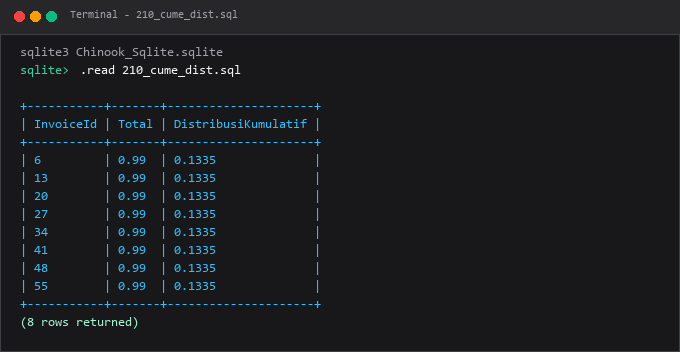

---

### 211. Window frame `ROWS`

**Tujuan Pembelajaran:**  
Memahami dan mempraktikkan konsep window frame `rows` menggunakan database Chinook.

**Konsep Utama:**  
Konsep dasar yang mendasari `211_window_frame_rows.sql` adalah penerapan standar SQL relasional pada entitas database Chinook untuk memecahkan kebutuhan kueri dan manipulasi data secara tepat, aman, dan efisien.

**Penjelasan Source Code:**  
Program pada file [211_window_frame_rows.sql](211_window_frame_rows.sql) mendemonstrasikan implementasi terstruktur dari konsep window frame `rows`. Source code dilengkapi komentar edukatif berbahasa Indonesia yang membedah setiap instruksi query, penggunaan klausa, serta tujuan pemrosesannya.

**Source Code:** [211_window_frame_rows.sql](211_window_frame_rows.sql)  

**Cara Menjalankan:**
Jalankan melalui terminal atau command prompt menggunakan Python runner:
```bash
python -c "import sqlite3; conn=sqlite3.connect('../Chinook_Sqlite.sqlite'); print(conn.cursor().executescript(open('211_window_frame_rows.sql', encoding='utf-8').read()))"
```
Atau menggunakan sqlite3 CLI:
```bash
sqlite3 ../Chinook_Sqlite.sqlite < 211_window_frame_rows.sql
```

**Hasil yang Diharapkan:**  
Database engine mengeksekusi instruksi SQL dengan sukses dan menampilkan result-set atau status konfirmasi data yang sesuai.

**Screenshot Hasil Eksekusi:**

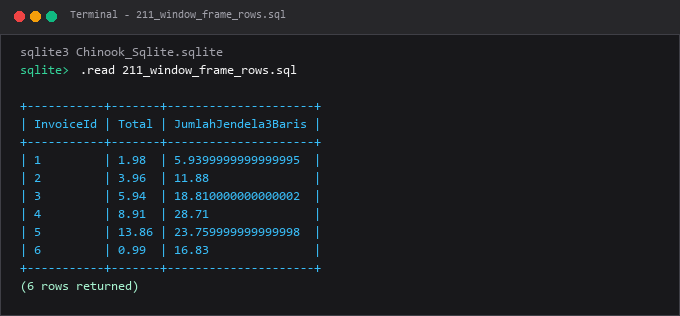

---

### 212. Window frame `RANGE`

**Tujuan Pembelajaran:**  
Memahami dan mempraktikkan konsep window frame `range` menggunakan database Chinook.

**Konsep Utama:**  
Konsep dasar yang mendasari `212_window_frame_range.sql` adalah penerapan standar SQL relasional pada entitas database Chinook untuk memecahkan kebutuhan kueri dan manipulasi data secara tepat, aman, dan efisien.

**Penjelasan Source Code:**  
Program pada file [212_window_frame_range.sql](212_window_frame_range.sql) mendemonstrasikan implementasi terstruktur dari konsep window frame `range`. Source code dilengkapi komentar edukatif berbahasa Indonesia yang membedah setiap instruksi query, penggunaan klausa, serta tujuan pemrosesannya.

**Source Code:** [212_window_frame_range.sql](212_window_frame_range.sql)  

**Cara Menjalankan:**
Jalankan melalui terminal atau command prompt menggunakan Python runner:
```bash
python -c "import sqlite3; conn=sqlite3.connect('../Chinook_Sqlite.sqlite'); print(conn.cursor().executescript(open('212_window_frame_range.sql', encoding='utf-8').read()))"
```
Atau menggunakan sqlite3 CLI:
```bash
sqlite3 ../Chinook_Sqlite.sqlite < 212_window_frame_range.sql
```

**Hasil yang Diharapkan:**  
Database engine mengeksekusi instruksi SQL dengan sukses dan menampilkan result-set atau status konfirmasi data yang sesuai.

**Screenshot Hasil Eksekusi:**

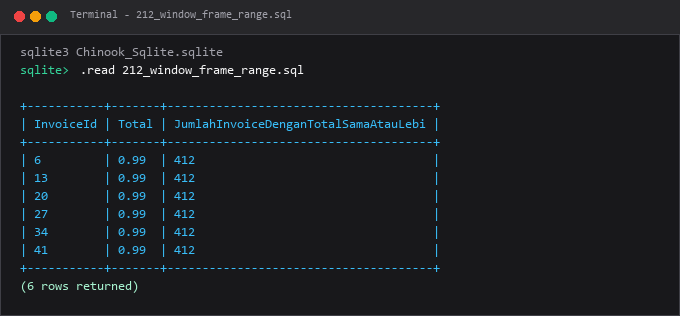

---

### 213. Top N per grup

**Tujuan Pembelajaran:**  
Memahami dan mempraktikkan konsep top n per grup menggunakan database Chinook.

**Konsep Utama:**  
Konsep dasar yang mendasari `213_top_n_per_group.sql` adalah penerapan standar SQL relasional pada entitas database Chinook untuk memecahkan kebutuhan kueri dan manipulasi data secara tepat, aman, dan efisien.

**Penjelasan Source Code:**  
Program pada file [213_top_n_per_group.sql](213_top_n_per_group.sql) mendemonstrasikan implementasi terstruktur dari konsep top n per grup. Source code dilengkapi komentar edukatif berbahasa Indonesia yang membedah setiap instruksi query, penggunaan klausa, serta tujuan pemrosesannya.

**Source Code:** [213_top_n_per_group.sql](213_top_n_per_group.sql)  

**Cara Menjalankan:**
Jalankan melalui terminal atau command prompt menggunakan Python runner:
```bash
python -c "import sqlite3; conn=sqlite3.connect('../Chinook_Sqlite.sqlite'); print(conn.cursor().executescript(open('213_top_n_per_group.sql', encoding='utf-8').read()))"
```
Atau menggunakan sqlite3 CLI:
```bash
sqlite3 ../Chinook_Sqlite.sqlite < 213_top_n_per_group.sql
```

**Hasil yang Diharapkan:**  
Database engine mengeksekusi instruksi SQL dengan sukses dan menampilkan result-set atau status konfirmasi data yang sesuai.

**Screenshot Hasil Eksekusi:**

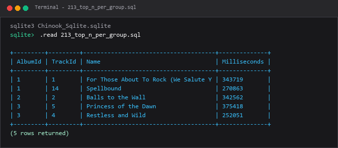

---

### 214. Deduplication dengan window function

**Tujuan Pembelajaran:**  
Memahami dan mempraktikkan konsep deduplication dengan window function menggunakan database Chinook.

**Konsep Utama:**  
Konsep dasar yang mendasari `214_deduplicate_with_row_number.sql` adalah penerapan standar SQL relasional pada entitas database Chinook untuk memecahkan kebutuhan kueri dan manipulasi data secara tepat, aman, dan efisien.

**Penjelasan Source Code:**  
Program pada file [214_deduplicate_with_row_number.sql](214_deduplicate_with_row_number.sql) mendemonstrasikan implementasi terstruktur dari konsep deduplication dengan window function. Source code dilengkapi komentar edukatif berbahasa Indonesia yang membedah setiap instruksi query, penggunaan klausa, serta tujuan pemrosesannya.

**Source Code:** [214_deduplicate_with_row_number.sql](214_deduplicate_with_row_number.sql)  

**Cara Menjalankan:**
Jalankan melalui terminal atau command prompt menggunakan Python runner:
```bash
python -c "import sqlite3; conn=sqlite3.connect('../Chinook_Sqlite.sqlite'); print(conn.cursor().executescript(open('214_deduplicate_with_row_number.sql', encoding='utf-8').read()))"
```
Atau menggunakan sqlite3 CLI:
```bash
sqlite3 ../Chinook_Sqlite.sqlite < 214_deduplicate_with_row_number.sql
```

**Hasil yang Diharapkan:**  
Database engine mengeksekusi instruksi SQL dengan sukses dan menampilkan result-set atau status konfirmasi data yang sesuai.

**Screenshot Hasil Eksekusi:**

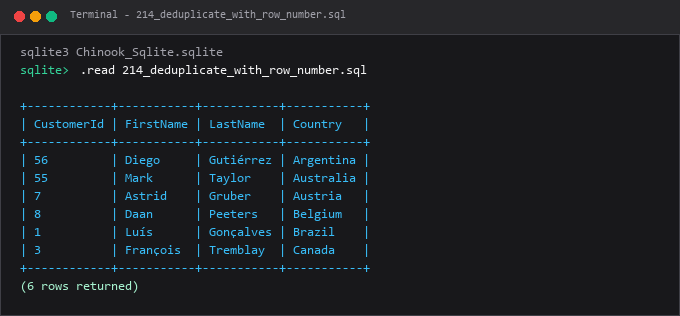

---

### 215. Analisis perubahan ant periode

**Tujuan Pembelajaran:**  
Memahami dan mempraktikkan konsep analisis perubahan ant periode menggunakan database Chinook.

**Konsep Utama:**  
Konsep dasar yang mendasari `215_period_over_period_analysis.sql` adalah penerapan standar SQL relasional pada entitas database Chinook untuk memecahkan kebutuhan kueri dan manipulasi data secara tepat, aman, dan efisien.

**Penjelasan Source Code:**  
Program pada file [215_period_over_period_analysis.sql](215_period_over_period_analysis.sql) mendemonstrasikan implementasi terstruktur dari konsep analisis perubahan ant periode. Source code dilengkapi komentar edukatif berbahasa Indonesia yang membedah setiap instruksi query, penggunaan klausa, serta tujuan pemrosesannya.

**Source Code:** [215_period_over_period_analysis.sql](215_period_over_period_analysis.sql)  

**Cara Menjalankan:**
Jalankan melalui terminal atau command prompt menggunakan Python runner:
```bash
python -c "import sqlite3; conn=sqlite3.connect('../Chinook_Sqlite.sqlite'); print(conn.cursor().executescript(open('215_period_over_period_analysis.sql', encoding='utf-8').read()))"
```
Atau menggunakan sqlite3 CLI:
```bash
sqlite3 ../Chinook_Sqlite.sqlite < 215_period_over_period_analysis.sql
```

**Hasil yang Diharapkan:**  
Database engine mengeksekusi instruksi SQL dengan sukses dan menampilkan result-set atau status konfirmasi data yang sesuai.

**Screenshot Hasil Eksekusi:**

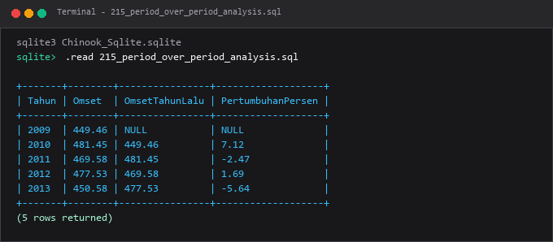

---

## Ringkasan Modul
Modul 12 merupakan perangkat esensial bagi data analyst dan business intelligence engineer untuk melakukan kalkulasi analitik tingkat lanjut.

Seluruh submodul di atas saling melengkapi untuk membentuk pemahaman terstruktur yang bertahap, mulai dari konsep fundamental hingga implementasi praktis yang siap pakai di lingkungan kerja nyata.
