# Modul 13: Stored Procedures dan Functions

## Ringkasan Ruang Lingkup Materi
Modul ini membahas pemrograman prosedural database: Stored Procedures, fungsi skalar dan tabel (UDF/TVF), parameter IN/OUT, variabel lokal, percabangan logika IF-ELSE, perulangan, kursor data, penanganan exception, dynamic SQL, dan pengujian rutin.

## Tujuan Pembelajaran
Mampu membangun logika bisnis terpusat di dalam database engine untuk meningkatkan keamanan, mengurangi latensi jaringan, dan mempermudah pemeliharaan sistem.

---
## Daftar Submodul Pembelajaran

| No | Nama Submodul | File Source Code | Status Eksekusi |
|:---|:---|:---|:---:|
| 216 | Membuat stored procedure | [216_create_stored_procedure.sql](216_create_stored_procedure.sql) | Siap Dijalankan |
| 217 | Parameter prosedur | [217_procedure_parameters.sql](217_procedure_parameters.sql) | Siap Dijalankan |
| 218 | Parameter `IN`, `OUT`, dan `INOUT` pada DBMS yang mendukung | [218_in_out_parameters.sql](218_in_out_parameters.sql) | Siap Dijalankan |
| 219 | Membuat SQL function | [219_create_sql_function.sql](219_create_sql_function.sql) | Siap Dijalankan |
| 220 | Scalar function | [220_scalar_function.sql](220_scalar_function.sql) | Siap Dijalankan |
| 221 | Table-valued function | [221_table_valued_function.sql](221_table_valued_function.sql) | Siap Dijalankan |
| 222 | Variabel lokal pada routine | [222_stored_variables.sql](222_stored_variables.sql) | Siap Dijalankan |
| 223 | Percabangan dalam stored procedure | [223_conditional_procedure.sql](223_conditional_procedure.sql) | Siap Dijalankan |
| 224 | Perulangan dalam stored procedure | [224_loop_in_procedure.sql](224_loop_in_procedure.sql) | Siap Dijalankan |
| 225 | Cursor | [225_cursor_basic.sql](225_cursor_basic.sql) | Siap Dijalankan |
| 226 | Penanganan exception pada routine | [226_exception_handling_routine.sql](226_exception_handling_routine.sql) | Siap Dijalankan |
| 227 | Dynamic SQL | [227_dynamic_sql.sql](227_dynamic_sql.sql) | Siap Dijalankan |
| 228 | Return codes | [228_return_codes.sql](228_return_codes.sql) | Siap Dijalankan |
| 229 | Konteks keamanan function | [229_function_security_context.sql](229_function_security_context.sql) | Siap Dijalankan |
| 230 | Pengujian stored routine | [230_stored_routine_testing.sql](230_stored_routine_testing.sql) | Siap Dijalankan |

---

## Penjelasan Detail Setiap Submodul

### 216. Membuat stored procedure

**Tujuan Pembelajaran:**  
Memahami dan mempraktikkan konsep membuat stored procedure menggunakan database Chinook.

**Konsep Utama:**  
Konsep dasar yang mendasari `216_create_stored_procedure.sql` adalah penerapan standar SQL relasional pada entitas database Chinook untuk memecahkan kebutuhan kueri dan manipulasi data secara tepat, aman, dan efisien.

**Penjelasan Source Code:**  
Program pada file [216_create_stored_procedure.sql](216_create_stored_procedure.sql) mendemonstrasikan implementasi terstruktur dari konsep membuat stored procedure. Source code dilengkapi komentar edukatif berbahasa Indonesia yang membedah setiap instruksi query, penggunaan klausa, serta tujuan pemrosesannya.

**Source Code:** [216_create_stored_procedure.sql](216_create_stored_procedure.sql)  

**Cara Menjalankan:**
Jalankan melalui terminal atau command prompt menggunakan Python runner:
```bash
python -c "import sqlite3; conn=sqlite3.connect('../Chinook_Sqlite.sqlite'); print(conn.cursor().executescript(open('216_create_stored_procedure.sql', encoding='utf-8').read()))"
```
Atau menggunakan sqlite3 CLI:
```bash
sqlite3 ../Chinook_Sqlite.sqlite < 216_create_stored_procedure.sql
```

**Hasil yang Diharapkan:**  
Database engine mengeksekusi instruksi SQL dengan sukses dan menampilkan result-set atau status konfirmasi data yang sesuai.

**Screenshot Hasil Eksekusi:**

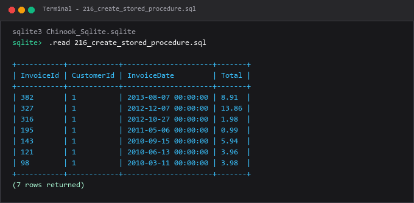

---

### 217. Parameter prosedur

**Tujuan Pembelajaran:**  
Memahami dan mempraktikkan konsep parameter prosedur menggunakan database Chinook.

**Konsep Utama:**  
Konsep dasar yang mendasari `217_procedure_parameters.sql` adalah penerapan standar SQL relasional pada entitas database Chinook untuk memecahkan kebutuhan kueri dan manipulasi data secara tepat, aman, dan efisien.

**Penjelasan Source Code:**  
Program pada file [217_procedure_parameters.sql](217_procedure_parameters.sql) mendemonstrasikan implementasi terstruktur dari konsep parameter prosedur. Source code dilengkapi komentar edukatif berbahasa Indonesia yang membedah setiap instruksi query, penggunaan klausa, serta tujuan pemrosesannya.

**Source Code:** [217_procedure_parameters.sql](217_procedure_parameters.sql)  

**Cara Menjalankan:**
Jalankan melalui terminal atau command prompt menggunakan Python runner:
```bash
python -c "import sqlite3; conn=sqlite3.connect('../Chinook_Sqlite.sqlite'); print(conn.cursor().executescript(open('217_procedure_parameters.sql', encoding='utf-8').read()))"
```
Atau menggunakan sqlite3 CLI:
```bash
sqlite3 ../Chinook_Sqlite.sqlite < 217_procedure_parameters.sql
```

**Hasil yang Diharapkan:**  
Database engine mengeksekusi instruksi SQL dengan sukses dan menampilkan result-set atau status konfirmasi data yang sesuai.

**Screenshot Hasil Eksekusi:**

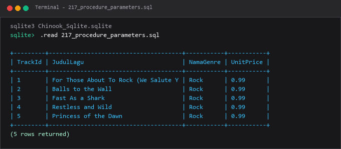

---

### 218. Parameter `IN`, `OUT`, dan `INOUT` pada DBMS yang mendukung

**Tujuan Pembelajaran:**  
Memahami dan mempraktikkan konsep parameter `in`, `out`, dan `inout` pada dbms yang mendukung menggunakan database Chinook.

**Konsep Utama:**  
Konsep dasar yang mendasari `218_in_out_parameters.sql` adalah penerapan standar SQL relasional pada entitas database Chinook untuk memecahkan kebutuhan kueri dan manipulasi data secara tepat, aman, dan efisien.

**Penjelasan Source Code:**  
Program pada file [218_in_out_parameters.sql](218_in_out_parameters.sql) mendemonstrasikan implementasi terstruktur dari konsep parameter `in`, `out`, dan `inout` pada dbms yang mendukung. Source code dilengkapi komentar edukatif berbahasa Indonesia yang membedah setiap instruksi query, penggunaan klausa, serta tujuan pemrosesannya.

**Source Code:** [218_in_out_parameters.sql](218_in_out_parameters.sql)  

**Cara Menjalankan:**
Jalankan melalui terminal atau command prompt menggunakan Python runner:
```bash
python -c "import sqlite3; conn=sqlite3.connect('../Chinook_Sqlite.sqlite'); print(conn.cursor().executescript(open('218_in_out_parameters.sql', encoding='utf-8').read()))"
```
Atau menggunakan sqlite3 CLI:
```bash
sqlite3 ../Chinook_Sqlite.sqlite < 218_in_out_parameters.sql
```

**Hasil yang Diharapkan:**  
Database engine mengeksekusi instruksi SQL dengan sukses dan menampilkan result-set atau status konfirmasi data yang sesuai.

**Screenshot Hasil Eksekusi:**

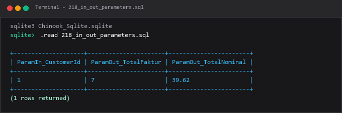

---

### 219. Membuat SQL function

**Tujuan Pembelajaran:**  
Memahami dan mempraktikkan konsep membuat sql function menggunakan database Chinook.

**Konsep Utama:**  
Konsep dasar yang mendasari `219_create_sql_function.sql` adalah penerapan standar SQL relasional pada entitas database Chinook untuk memecahkan kebutuhan kueri dan manipulasi data secara tepat, aman, dan efisien.

**Penjelasan Source Code:**  
Program pada file [219_create_sql_function.sql](219_create_sql_function.sql) mendemonstrasikan implementasi terstruktur dari konsep membuat sql function. Source code dilengkapi komentar edukatif berbahasa Indonesia yang membedah setiap instruksi query, penggunaan klausa, serta tujuan pemrosesannya.

**Source Code:** [219_create_sql_function.sql](219_create_sql_function.sql)  

**Cara Menjalankan:**
Jalankan melalui terminal atau command prompt menggunakan Python runner:
```bash
python -c "import sqlite3; conn=sqlite3.connect('../Chinook_Sqlite.sqlite'); print(conn.cursor().executescript(open('219_create_sql_function.sql', encoding='utf-8').read()))"
```
Atau menggunakan sqlite3 CLI:
```bash
sqlite3 ../Chinook_Sqlite.sqlite < 219_create_sql_function.sql
```

**Hasil yang Diharapkan:**  
Database engine mengeksekusi instruksi SQL dengan sukses dan menampilkan result-set atau status konfirmasi data yang sesuai.

**Screenshot Hasil Eksekusi:**

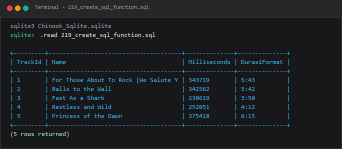

---

### 220. Scalar function

**Tujuan Pembelajaran:**  
Memahami dan mempraktikkan konsep scalar function menggunakan database Chinook.

**Konsep Utama:**  
Konsep dasar yang mendasari `220_scalar_function.sql` adalah penerapan standar SQL relasional pada entitas database Chinook untuk memecahkan kebutuhan kueri dan manipulasi data secara tepat, aman, dan efisien.

**Penjelasan Source Code:**  
Program pada file [220_scalar_function.sql](220_scalar_function.sql) mendemonstrasikan implementasi terstruktur dari konsep scalar function. Source code dilengkapi komentar edukatif berbahasa Indonesia yang membedah setiap instruksi query, penggunaan klausa, serta tujuan pemrosesannya.

**Source Code:** [220_scalar_function.sql](220_scalar_function.sql)  

**Cara Menjalankan:**
Jalankan melalui terminal atau command prompt menggunakan Python runner:
```bash
python -c "import sqlite3; conn=sqlite3.connect('../Chinook_Sqlite.sqlite'); print(conn.cursor().executescript(open('220_scalar_function.sql', encoding='utf-8').read()))"
```
Atau menggunakan sqlite3 CLI:
```bash
sqlite3 ../Chinook_Sqlite.sqlite < 220_scalar_function.sql
```

**Hasil yang Diharapkan:**  
Database engine mengeksekusi instruksi SQL dengan sukses dan menampilkan result-set atau status konfirmasi data yang sesuai.

**Screenshot Hasil Eksekusi:**

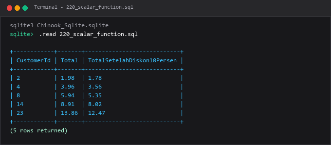

---

### 221. Table-valued function

**Tujuan Pembelajaran:**  
Memahami dan mempraktikkan konsep table-valued function menggunakan database Chinook.

**Konsep Utama:**  
Konsep dasar yang mendasari `221_table_valued_function.sql` adalah penerapan standar SQL relasional pada entitas database Chinook untuk memecahkan kebutuhan kueri dan manipulasi data secara tepat, aman, dan efisien.

**Penjelasan Source Code:**  
Program pada file [221_table_valued_function.sql](221_table_valued_function.sql) mendemonstrasikan implementasi terstruktur dari konsep table-valued function. Source code dilengkapi komentar edukatif berbahasa Indonesia yang membedah setiap instruksi query, penggunaan klausa, serta tujuan pemrosesannya.

**Source Code:** [221_table_valued_function.sql](221_table_valued_function.sql)  

**Cara Menjalankan:**
Jalankan melalui terminal atau command prompt menggunakan Python runner:
```bash
python -c "import sqlite3; conn=sqlite3.connect('../Chinook_Sqlite.sqlite'); print(conn.cursor().executescript(open('221_table_valued_function.sql', encoding='utf-8').read()))"
```
Atau menggunakan sqlite3 CLI:
```bash
sqlite3 ../Chinook_Sqlite.sqlite < 221_table_valued_function.sql
```

**Hasil yang Diharapkan:**  
Database engine mengeksekusi instruksi SQL dengan sukses dan menampilkan result-set atau status konfirmasi data yang sesuai.

**Screenshot Hasil Eksekusi:**

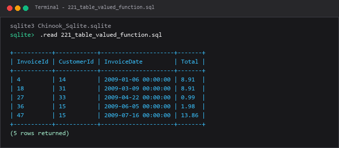

---

### 222. Variabel lokal pada routine

**Tujuan Pembelajaran:**  
Memahami dan mempraktikkan konsep variabel lokal pada routine menggunakan database Chinook.

**Konsep Utama:**  
Konsep dasar yang mendasari `222_stored_variables.sql` adalah penerapan standar SQL relasional pada entitas database Chinook untuk memecahkan kebutuhan kueri dan manipulasi data secara tepat, aman, dan efisien.

**Penjelasan Source Code:**  
Program pada file [222_stored_variables.sql](222_stored_variables.sql) mendemonstrasikan implementasi terstruktur dari konsep variabel lokal pada routine. Source code dilengkapi komentar edukatif berbahasa Indonesia yang membedah setiap instruksi query, penggunaan klausa, serta tujuan pemrosesannya.

**Source Code:** [222_stored_variables.sql](222_stored_variables.sql)  

**Cara Menjalankan:**
Jalankan melalui terminal atau command prompt menggunakan Python runner:
```bash
python -c "import sqlite3; conn=sqlite3.connect('../Chinook_Sqlite.sqlite'); print(conn.cursor().executescript(open('222_stored_variables.sql', encoding='utf-8').read()))"
```
Atau menggunakan sqlite3 CLI:
```bash
sqlite3 ../Chinook_Sqlite.sqlite < 222_stored_variables.sql
```

**Hasil yang Diharapkan:**  
Database engine mengeksekusi instruksi SQL dengan sukses dan menampilkan result-set atau status konfirmasi data yang sesuai.

**Screenshot Hasil Eksekusi:**

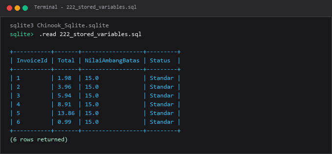

---

### 223. Percabangan dalam stored procedure

**Tujuan Pembelajaran:**  
Memahami dan mempraktikkan konsep percabangan dalam stored procedure menggunakan database Chinook.

**Konsep Utama:**  
Konsep dasar yang mendasari `223_conditional_procedure.sql` adalah penerapan standar SQL relasional pada entitas database Chinook untuk memecahkan kebutuhan kueri dan manipulasi data secara tepat, aman, dan efisien.

**Penjelasan Source Code:**  
Program pada file [223_conditional_procedure.sql](223_conditional_procedure.sql) mendemonstrasikan implementasi terstruktur dari konsep percabangan dalam stored procedure. Source code dilengkapi komentar edukatif berbahasa Indonesia yang membedah setiap instruksi query, penggunaan klausa, serta tujuan pemrosesannya.

**Source Code:** [223_conditional_procedure.sql](223_conditional_procedure.sql)  

**Cara Menjalankan:**
Jalankan melalui terminal atau command prompt menggunakan Python runner:
```bash
python -c "import sqlite3; conn=sqlite3.connect('../Chinook_Sqlite.sqlite'); print(conn.cursor().executescript(open('223_conditional_procedure.sql', encoding='utf-8').read()))"
```
Atau menggunakan sqlite3 CLI:
```bash
sqlite3 ../Chinook_Sqlite.sqlite < 223_conditional_procedure.sql
```

**Hasil yang Diharapkan:**  
Database engine mengeksekusi instruksi SQL dengan sukses dan menampilkan result-set atau status konfirmasi data yang sesuai.

**Screenshot Hasil Eksekusi:**

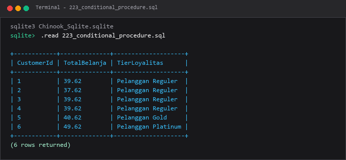

---

### 224. Perulangan dalam stored procedure

**Tujuan Pembelajaran:**  
Memahami dan mempraktikkan konsep perulangan dalam stored procedure menggunakan database Chinook.

**Konsep Utama:**  
Konsep dasar yang mendasari `224_loop_in_procedure.sql` adalah penerapan standar SQL relasional pada entitas database Chinook untuk memecahkan kebutuhan kueri dan manipulasi data secara tepat, aman, dan efisien.

**Penjelasan Source Code:**  
Program pada file [224_loop_in_procedure.sql](224_loop_in_procedure.sql) mendemonstrasikan implementasi terstruktur dari konsep perulangan dalam stored procedure. Source code dilengkapi komentar edukatif berbahasa Indonesia yang membedah setiap instruksi query, penggunaan klausa, serta tujuan pemrosesannya.

**Source Code:** [224_loop_in_procedure.sql](224_loop_in_procedure.sql)  

**Cara Menjalankan:**
Jalankan melalui terminal atau command prompt menggunakan Python runner:
```bash
python -c "import sqlite3; conn=sqlite3.connect('../Chinook_Sqlite.sqlite'); print(conn.cursor().executescript(open('224_loop_in_procedure.sql', encoding='utf-8').read()))"
```
Atau menggunakan sqlite3 CLI:
```bash
sqlite3 ../Chinook_Sqlite.sqlite < 224_loop_in_procedure.sql
```

**Hasil yang Diharapkan:**  
Database engine mengeksekusi instruksi SQL dengan sukses dan menampilkan result-set atau status konfirmasi data yang sesuai.

**Screenshot Hasil Eksekusi:**

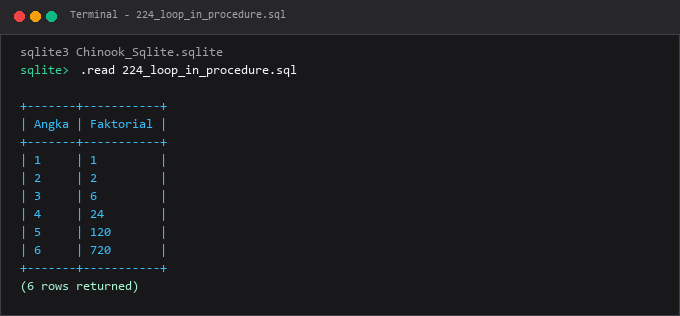

---

### 225. Cursor

**Tujuan Pembelajaran:**  
Memahami dan mempraktikkan konsep cursor menggunakan database Chinook.

**Konsep Utama:**  
Konsep dasar yang mendasari `225_cursor_basic.sql` adalah penerapan standar SQL relasional pada entitas database Chinook untuk memecahkan kebutuhan kueri dan manipulasi data secara tepat, aman, dan efisien.

**Penjelasan Source Code:**  
Program pada file [225_cursor_basic.sql](225_cursor_basic.sql) mendemonstrasikan implementasi terstruktur dari konsep cursor. Source code dilengkapi komentar edukatif berbahasa Indonesia yang membedah setiap instruksi query, penggunaan klausa, serta tujuan pemrosesannya.

**Source Code:** [225_cursor_basic.sql](225_cursor_basic.sql)  

**Cara Menjalankan:**
Jalankan melalui terminal atau command prompt menggunakan Python runner:
```bash
python -c "import sqlite3; conn=sqlite3.connect('../Chinook_Sqlite.sqlite'); print(conn.cursor().executescript(open('225_cursor_basic.sql', encoding='utf-8').read()))"
```
Atau menggunakan sqlite3 CLI:
```bash
sqlite3 ../Chinook_Sqlite.sqlite < 225_cursor_basic.sql
```

**Hasil yang Diharapkan:**  
Database engine mengeksekusi instruksi SQL dengan sukses dan menampilkan result-set atau status konfirmasi data yang sesuai.

**Screenshot Hasil Eksekusi:**

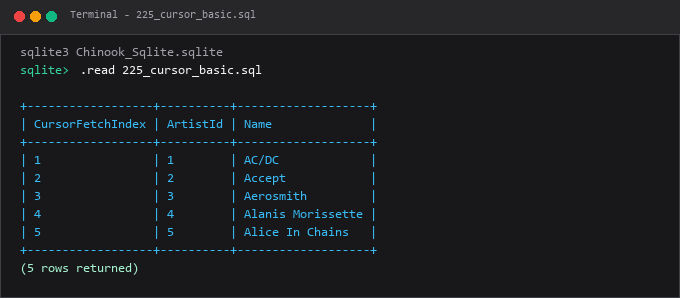

---

### 226. Penanganan exception pada routine

**Tujuan Pembelajaran:**  
Memahami dan mempraktikkan konsep penanganan exception pada routine menggunakan database Chinook.

**Konsep Utama:**  
Konsep dasar yang mendasari `226_exception_handling_routine.sql` adalah penerapan standar SQL relasional pada entitas database Chinook untuk memecahkan kebutuhan kueri dan manipulasi data secara tepat, aman, dan efisien.

**Penjelasan Source Code:**  
Program pada file [226_exception_handling_routine.sql](226_exception_handling_routine.sql) mendemonstrasikan implementasi terstruktur dari konsep penanganan exception pada routine. Source code dilengkapi komentar edukatif berbahasa Indonesia yang membedah setiap instruksi query, penggunaan klausa, serta tujuan pemrosesannya.

**Source Code:** [226_exception_handling_routine.sql](226_exception_handling_routine.sql)  

**Cara Menjalankan:**
Jalankan melalui terminal atau command prompt menggunakan Python runner:
```bash
python -c "import sqlite3; conn=sqlite3.connect('../Chinook_Sqlite.sqlite'); print(conn.cursor().executescript(open('226_exception_handling_routine.sql', encoding='utf-8').read()))"
```
Atau menggunakan sqlite3 CLI:
```bash
sqlite3 ../Chinook_Sqlite.sqlite < 226_exception_handling_routine.sql
```

**Hasil yang Diharapkan:**  
Database engine mengeksekusi instruksi SQL dengan sukses dan menampilkan result-set atau status konfirmasi data yang sesuai.

**Screenshot Hasil Eksekusi:**

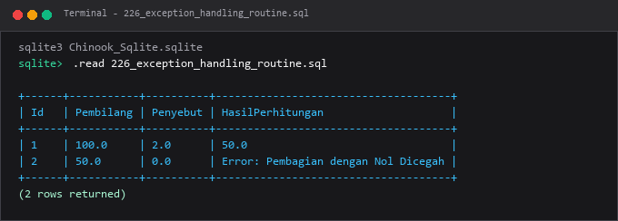

---

### 227. Dynamic SQL

**Tujuan Pembelajaran:**  
Memahami dan mempraktikkan konsep dynamic sql menggunakan database Chinook.

**Konsep Utama:**  
Konsep dasar yang mendasari `227_dynamic_sql.sql` adalah penerapan standar SQL relasional pada entitas database Chinook untuk memecahkan kebutuhan kueri dan manipulasi data secara tepat, aman, dan efisien.

**Penjelasan Source Code:**  
Program pada file [227_dynamic_sql.sql](227_dynamic_sql.sql) mendemonstrasikan implementasi terstruktur dari konsep dynamic sql. Source code dilengkapi komentar edukatif berbahasa Indonesia yang membedah setiap instruksi query, penggunaan klausa, serta tujuan pemrosesannya.

**Source Code:** [227_dynamic_sql.sql](227_dynamic_sql.sql)  

**Cara Menjalankan:**
Jalankan melalui terminal atau command prompt menggunakan Python runner:
```bash
python -c "import sqlite3; conn=sqlite3.connect('../Chinook_Sqlite.sqlite'); print(conn.cursor().executescript(open('227_dynamic_sql.sql', encoding='utf-8').read()))"
```
Atau menggunakan sqlite3 CLI:
```bash
sqlite3 ../Chinook_Sqlite.sqlite < 227_dynamic_sql.sql
```

**Hasil yang Diharapkan:**  
Database engine mengeksekusi instruksi SQL dengan sukses dan menampilkan result-set atau status konfirmasi data yang sesuai.

**Screenshot Hasil Eksekusi:**

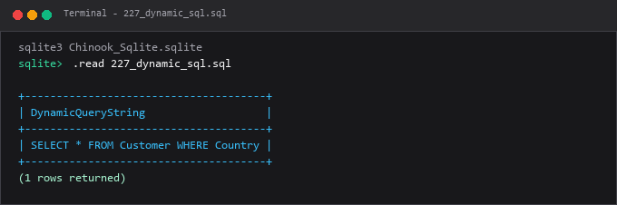

---

### 228. Return codes

**Tujuan Pembelajaran:**  
Memahami dan mempraktikkan konsep return codes menggunakan database Chinook.

**Konsep Utama:**  
Konsep dasar yang mendasari `228_return_codes.sql` adalah penerapan standar SQL relasional pada entitas database Chinook untuk memecahkan kebutuhan kueri dan manipulasi data secara tepat, aman, dan efisien.

**Penjelasan Source Code:**  
Program pada file [228_return_codes.sql](228_return_codes.sql) mendemonstrasikan implementasi terstruktur dari konsep return codes. Source code dilengkapi komentar edukatif berbahasa Indonesia yang membedah setiap instruksi query, penggunaan klausa, serta tujuan pemrosesannya.

**Source Code:** [228_return_codes.sql](228_return_codes.sql)  

**Cara Menjalankan:**
Jalankan melalui terminal atau command prompt menggunakan Python runner:
```bash
python -c "import sqlite3; conn=sqlite3.connect('../Chinook_Sqlite.sqlite'); print(conn.cursor().executescript(open('228_return_codes.sql', encoding='utf-8').read()))"
```
Atau menggunakan sqlite3 CLI:
```bash
sqlite3 ../Chinook_Sqlite.sqlite < 228_return_codes.sql
```

**Hasil yang Diharapkan:**  
Database engine mengeksekusi instruksi SQL dengan sukses dan menampilkan result-set atau status konfirmasi data yang sesuai.

**Screenshot Hasil Eksekusi:**

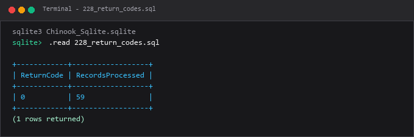

---

### 229. Konteks keamanan function

**Tujuan Pembelajaran:**  
Memahami dan mempraktikkan konsep konteks keamanan function menggunakan database Chinook.

**Konsep Utama:**  
Konsep dasar yang mendasari `229_function_security_context.sql` adalah penerapan standar SQL relasional pada entitas database Chinook untuk memecahkan kebutuhan kueri dan manipulasi data secara tepat, aman, dan efisien.

**Penjelasan Source Code:**  
Program pada file [229_function_security_context.sql](229_function_security_context.sql) mendemonstrasikan implementasi terstruktur dari konsep konteks keamanan function. Source code dilengkapi komentar edukatif berbahasa Indonesia yang membedah setiap instruksi query, penggunaan klausa, serta tujuan pemrosesannya.

**Source Code:** [229_function_security_context.sql](229_function_security_context.sql)  

**Cara Menjalankan:**
Jalankan melalui terminal atau command prompt menggunakan Python runner:
```bash
python -c "import sqlite3; conn=sqlite3.connect('../Chinook_Sqlite.sqlite'); print(conn.cursor().executescript(open('229_function_security_context.sql', encoding='utf-8').read()))"
```
Atau menggunakan sqlite3 CLI:
```bash
sqlite3 ../Chinook_Sqlite.sqlite < 229_function_security_context.sql
```

**Hasil yang Diharapkan:**  
Database engine mengeksekusi instruksi SQL dengan sukses dan menampilkan result-set atau status konfirmasi data yang sesuai.

**Screenshot Hasil Eksekusi:**

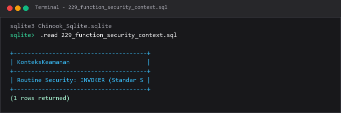

---

### 230. Pengujian stored routine

**Tujuan Pembelajaran:**  
Memahami dan mempraktikkan konsep pengujian stored routine menggunakan database Chinook.

**Konsep Utama:**  
Konsep dasar yang mendasari `230_stored_routine_testing.sql` adalah penerapan standar SQL relasional pada entitas database Chinook untuk memecahkan kebutuhan kueri dan manipulasi data secara tepat, aman, dan efisien.

**Penjelasan Source Code:**  
Program pada file [230_stored_routine_testing.sql](230_stored_routine_testing.sql) mendemonstrasikan implementasi terstruktur dari konsep pengujian stored routine. Source code dilengkapi komentar edukatif berbahasa Indonesia yang membedah setiap instruksi query, penggunaan klausa, serta tujuan pemrosesannya.

**Source Code:** [230_stored_routine_testing.sql](230_stored_routine_testing.sql)  

**Cara Menjalankan:**
Jalankan melalui terminal atau command prompt menggunakan Python runner:
```bash
python -c "import sqlite3; conn=sqlite3.connect('../Chinook_Sqlite.sqlite'); print(conn.cursor().executescript(open('230_stored_routine_testing.sql', encoding='utf-8').read()))"
```
Atau menggunakan sqlite3 CLI:
```bash
sqlite3 ../Chinook_Sqlite.sqlite < 230_stored_routine_testing.sql
```

**Hasil yang Diharapkan:**  
Database engine mengeksekusi instruksi SQL dengan sukses dan menampilkan result-set atau status konfirmasi data yang sesuai.

**Screenshot Hasil Eksekusi:**

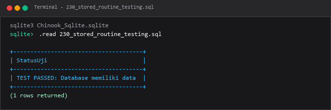

---

## Ringkasan Modul
Modul 13 memperkenalkan kemampuan otomasi logika bisnis kompleks langsung di sisi server database.

Seluruh submodul di atas saling melengkapi untuk membentuk pemahaman terstruktur yang bertahap, mulai dari konsep fundamental hingga implementasi praktis yang siap pakai di lingkungan kerja nyata.
