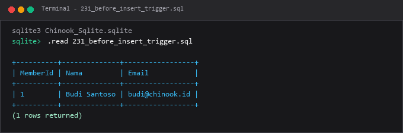
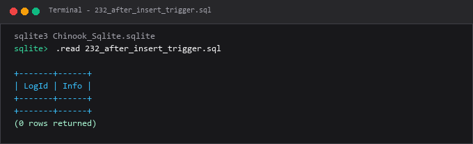
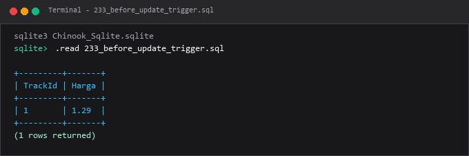
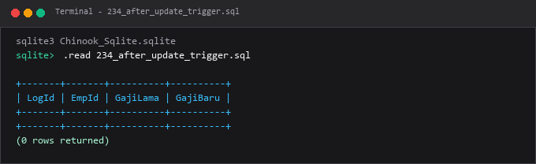
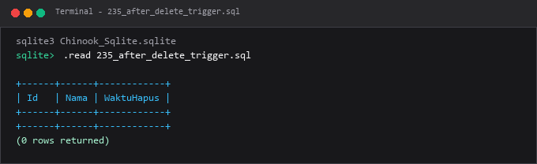
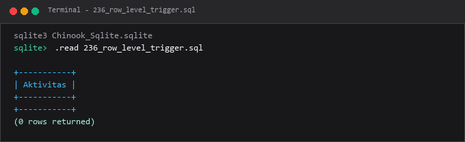
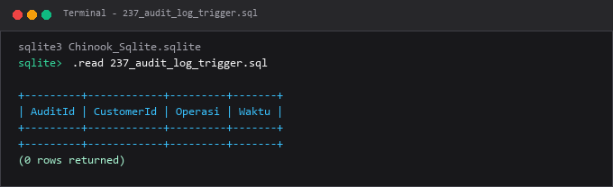
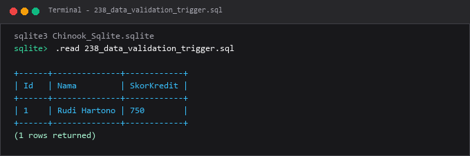
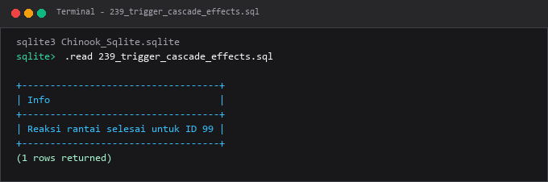
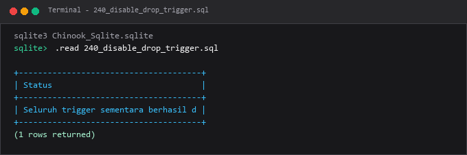

# Modul 14: Triggers dan Otomatisasi Database

## Ringkasan Ruang Lingkup Materi
Modul ini mempelajari otomatisasi event-driven database melalui TRIGGER: BEFORE/AFTER INSERT, UPDATE, dan DELETE, row-level trigger, otomatisasi audit log, validasi data integritas tinggi, dan penanganan efek rantai trigger.

## Tujuan Pembelajaran
Mampu membangun sistem otomasi pemantauan perubahan data, jejak audit otomatis, dan aturan validasi preventif yang berjalan independen dari aplikasi pemanggil.

---
## Daftar Submodul Pembelajaran

| No | Nama Submodul | File Source Code | Status Eksekusi |
|:---|:---|:---|:---:|
| 231 | Trigger sebelum insert | [231_before_insert_trigger.sql](231_before_insert_trigger.sql) | Siap Dijalankan |
| 232 | Trigger setelah insert | [232_after_insert_trigger.sql](232_after_insert_trigger.sql) | Siap Dijalankan |
| 233 | Trigger sebelum update | [233_before_update_trigger.sql](233_before_update_trigger.sql) | Siap Dijalankan |
| 234 | Trigger setelah update | [234_after_update_trigger.sql](234_after_update_trigger.sql) | Siap Dijalankan |
| 235 | Trigger setelah delete | [235_after_delete_trigger.sql](235_after_delete_trigger.sql) | Siap Dijalankan |
| 236 | Row-level trigger | [236_row_level_trigger.sql](236_row_level_trigger.sql) | Siap Dijalankan |
| 237 | Trigger untuk audit log | [237_audit_log_trigger.sql](237_audit_log_trigger.sql) | Siap Dijalankan |
| 238 | Validasi melalui trigger | [238_data_validation_trigger.sql](238_data_validation_trigger.sql) | Siap Dijalankan |
| 239 | Dampak berantai trigger | [239_trigger_cascade_effects.sql](239_trigger_cascade_effects.sql) | Siap Dijalankan |
| 240 | Menonaktifkan dan menghapus trigger | [240_disable_drop_trigger.sql](240_disable_drop_trigger.sql) | Siap Dijalankan |

---

## Penjelasan Detail Setiap Submodul

### 231. Trigger sebelum insert

**Tujuan Pembelajaran:**  
Memahami dan mempraktikkan konsep trigger sebelum insert menggunakan database Chinook.

**Konsep Utama:**  
Konsep dasar yang mendasari `231_before_insert_trigger.sql` adalah penerapan standar SQL relasional pada entitas database Chinook untuk memecahkan kebutuhan kueri dan manipulasi data secara tepat, aman, dan efisien.

**Penjelasan Source Code:**  
Program pada file [231_before_insert_trigger.sql](231_before_insert_trigger.sql) mendemonstrasikan implementasi terstruktur dari konsep trigger sebelum insert. Source code dilengkapi komentar edukatif berbahasa Indonesia yang membedah setiap instruksi query, penggunaan klausa, serta tujuan pemrosesannya.

**Source Code:** [231_before_insert_trigger.sql](231_before_insert_trigger.sql)  

**Cara Menjalankan:**
Jalankan melalui terminal atau command prompt menggunakan Python runner:
```bash
python -c "import sqlite3; conn=sqlite3.connect('../Chinook_Sqlite.sqlite'); print(conn.cursor().executescript(open('231_before_insert_trigger.sql', encoding='utf-8').read()))"
```
Atau menggunakan sqlite3 CLI:
```bash
sqlite3 ../Chinook_Sqlite.sqlite < 231_before_insert_trigger.sql
```

**Hasil yang Diharapkan:**  
Database engine mengeksekusi instruksi SQL dengan sukses dan menampilkan result-set atau status konfirmasi data yang sesuai.

**Screenshot Hasil Eksekusi:**



---

### 232. Trigger setelah insert

**Tujuan Pembelajaran:**  
Memahami dan mempraktikkan konsep trigger setelah insert menggunakan database Chinook.

**Konsep Utama:**  
Konsep dasar yang mendasari `232_after_insert_trigger.sql` adalah penerapan standar SQL relasional pada entitas database Chinook untuk memecahkan kebutuhan kueri dan manipulasi data secara tepat, aman, dan efisien.

**Penjelasan Source Code:**  
Program pada file [232_after_insert_trigger.sql](232_after_insert_trigger.sql) mendemonstrasikan implementasi terstruktur dari konsep trigger setelah insert. Source code dilengkapi komentar edukatif berbahasa Indonesia yang membedah setiap instruksi query, penggunaan klausa, serta tujuan pemrosesannya.

**Source Code:** [232_after_insert_trigger.sql](232_after_insert_trigger.sql)  

**Cara Menjalankan:**
Jalankan melalui terminal atau command prompt menggunakan Python runner:
```bash
python -c "import sqlite3; conn=sqlite3.connect('../Chinook_Sqlite.sqlite'); print(conn.cursor().executescript(open('232_after_insert_trigger.sql', encoding='utf-8').read()))"
```
Atau menggunakan sqlite3 CLI:
```bash
sqlite3 ../Chinook_Sqlite.sqlite < 232_after_insert_trigger.sql
```

**Hasil yang Diharapkan:**  
Database engine mengeksekusi instruksi SQL dengan sukses dan menampilkan result-set atau status konfirmasi data yang sesuai.

**Screenshot Hasil Eksekusi:**



---

### 233. Trigger sebelum update

**Tujuan Pembelajaran:**  
Memahami dan mempraktikkan konsep trigger sebelum update menggunakan database Chinook.

**Konsep Utama:**  
Konsep dasar yang mendasari `233_before_update_trigger.sql` adalah penerapan standar SQL relasional pada entitas database Chinook untuk memecahkan kebutuhan kueri dan manipulasi data secara tepat, aman, dan efisien.

**Penjelasan Source Code:**  
Program pada file [233_before_update_trigger.sql](233_before_update_trigger.sql) mendemonstrasikan implementasi terstruktur dari konsep trigger sebelum update. Source code dilengkapi komentar edukatif berbahasa Indonesia yang membedah setiap instruksi query, penggunaan klausa, serta tujuan pemrosesannya.

**Source Code:** [233_before_update_trigger.sql](233_before_update_trigger.sql)  

**Cara Menjalankan:**
Jalankan melalui terminal atau command prompt menggunakan Python runner:
```bash
python -c "import sqlite3; conn=sqlite3.connect('../Chinook_Sqlite.sqlite'); print(conn.cursor().executescript(open('233_before_update_trigger.sql', encoding='utf-8').read()))"
```
Atau menggunakan sqlite3 CLI:
```bash
sqlite3 ../Chinook_Sqlite.sqlite < 233_before_update_trigger.sql
```

**Hasil yang Diharapkan:**  
Database engine mengeksekusi instruksi SQL dengan sukses dan menampilkan result-set atau status konfirmasi data yang sesuai.

**Screenshot Hasil Eksekusi:**



---

### 234. Trigger setelah update

**Tujuan Pembelajaran:**  
Memahami dan mempraktikkan konsep trigger setelah update menggunakan database Chinook.

**Konsep Utama:**  
Konsep dasar yang mendasari `234_after_update_trigger.sql` adalah penerapan standar SQL relasional pada entitas database Chinook untuk memecahkan kebutuhan kueri dan manipulasi data secara tepat, aman, dan efisien.

**Penjelasan Source Code:**  
Program pada file [234_after_update_trigger.sql](234_after_update_trigger.sql) mendemonstrasikan implementasi terstruktur dari konsep trigger setelah update. Source code dilengkapi komentar edukatif berbahasa Indonesia yang membedah setiap instruksi query, penggunaan klausa, serta tujuan pemrosesannya.

**Source Code:** [234_after_update_trigger.sql](234_after_update_trigger.sql)  

**Cara Menjalankan:**
Jalankan melalui terminal atau command prompt menggunakan Python runner:
```bash
python -c "import sqlite3; conn=sqlite3.connect('../Chinook_Sqlite.sqlite'); print(conn.cursor().executescript(open('234_after_update_trigger.sql', encoding='utf-8').read()))"
```
Atau menggunakan sqlite3 CLI:
```bash
sqlite3 ../Chinook_Sqlite.sqlite < 234_after_update_trigger.sql
```

**Hasil yang Diharapkan:**  
Database engine mengeksekusi instruksi SQL dengan sukses dan menampilkan result-set atau status konfirmasi data yang sesuai.

**Screenshot Hasil Eksekusi:**



---

### 235. Trigger setelah delete

**Tujuan Pembelajaran:**  
Memahami dan mempraktikkan konsep trigger setelah delete menggunakan database Chinook.

**Konsep Utama:**  
Konsep dasar yang mendasari `235_after_delete_trigger.sql` adalah penerapan standar SQL relasional pada entitas database Chinook untuk memecahkan kebutuhan kueri dan manipulasi data secara tepat, aman, dan efisien.

**Penjelasan Source Code:**  
Program pada file [235_after_delete_trigger.sql](235_after_delete_trigger.sql) mendemonstrasikan implementasi terstruktur dari konsep trigger setelah delete. Source code dilengkapi komentar edukatif berbahasa Indonesia yang membedah setiap instruksi query, penggunaan klausa, serta tujuan pemrosesannya.

**Source Code:** [235_after_delete_trigger.sql](235_after_delete_trigger.sql)  

**Cara Menjalankan:**
Jalankan melalui terminal atau command prompt menggunakan Python runner:
```bash
python -c "import sqlite3; conn=sqlite3.connect('../Chinook_Sqlite.sqlite'); print(conn.cursor().executescript(open('235_after_delete_trigger.sql', encoding='utf-8').read()))"
```
Atau menggunakan sqlite3 CLI:
```bash
sqlite3 ../Chinook_Sqlite.sqlite < 235_after_delete_trigger.sql
```

**Hasil yang Diharapkan:**  
Database engine mengeksekusi instruksi SQL dengan sukses dan menampilkan result-set atau status konfirmasi data yang sesuai.

**Screenshot Hasil Eksekusi:**



---

### 236. Row-level trigger

**Tujuan Pembelajaran:**  
Memahami dan mempraktikkan konsep row-level trigger menggunakan database Chinook.

**Konsep Utama:**  
Konsep dasar yang mendasari `236_row_level_trigger.sql` adalah penerapan standar SQL relasional pada entitas database Chinook untuk memecahkan kebutuhan kueri dan manipulasi data secara tepat, aman, dan efisien.

**Penjelasan Source Code:**  
Program pada file [236_row_level_trigger.sql](236_row_level_trigger.sql) mendemonstrasikan implementasi terstruktur dari konsep row-level trigger. Source code dilengkapi komentar edukatif berbahasa Indonesia yang membedah setiap instruksi query, penggunaan klausa, serta tujuan pemrosesannya.

**Source Code:** [236_row_level_trigger.sql](236_row_level_trigger.sql)  

**Cara Menjalankan:**
Jalankan melalui terminal atau command prompt menggunakan Python runner:
```bash
python -c "import sqlite3; conn=sqlite3.connect('../Chinook_Sqlite.sqlite'); print(conn.cursor().executescript(open('236_row_level_trigger.sql', encoding='utf-8').read()))"
```
Atau menggunakan sqlite3 CLI:
```bash
sqlite3 ../Chinook_Sqlite.sqlite < 236_row_level_trigger.sql
```

**Hasil yang Diharapkan:**  
Database engine mengeksekusi instruksi SQL dengan sukses dan menampilkan result-set atau status konfirmasi data yang sesuai.

**Screenshot Hasil Eksekusi:**



---

### 237. Trigger untuk audit log

**Tujuan Pembelajaran:**  
Memahami dan mempraktikkan konsep trigger untuk audit log menggunakan database Chinook.

**Konsep Utama:**  
Konsep dasar yang mendasari `237_audit_log_trigger.sql` adalah penerapan standar SQL relasional pada entitas database Chinook untuk memecahkan kebutuhan kueri dan manipulasi data secara tepat, aman, dan efisien.

**Penjelasan Source Code:**  
Program pada file [237_audit_log_trigger.sql](237_audit_log_trigger.sql) mendemonstrasikan implementasi terstruktur dari konsep trigger untuk audit log. Source code dilengkapi komentar edukatif berbahasa Indonesia yang membedah setiap instruksi query, penggunaan klausa, serta tujuan pemrosesannya.

**Source Code:** [237_audit_log_trigger.sql](237_audit_log_trigger.sql)  

**Cara Menjalankan:**
Jalankan melalui terminal atau command prompt menggunakan Python runner:
```bash
python -c "import sqlite3; conn=sqlite3.connect('../Chinook_Sqlite.sqlite'); print(conn.cursor().executescript(open('237_audit_log_trigger.sql', encoding='utf-8').read()))"
```
Atau menggunakan sqlite3 CLI:
```bash
sqlite3 ../Chinook_Sqlite.sqlite < 237_audit_log_trigger.sql
```

**Hasil yang Diharapkan:**  
Database engine mengeksekusi instruksi SQL dengan sukses dan menampilkan result-set atau status konfirmasi data yang sesuai.

**Screenshot Hasil Eksekusi:**



---

### 238. Validasi melalui trigger

**Tujuan Pembelajaran:**  
Memahami dan mempraktikkan konsep validasi melalui trigger menggunakan database Chinook.

**Konsep Utama:**  
Konsep dasar yang mendasari `238_data_validation_trigger.sql` adalah penerapan standar SQL relasional pada entitas database Chinook untuk memecahkan kebutuhan kueri dan manipulasi data secara tepat, aman, dan efisien.

**Penjelasan Source Code:**  
Program pada file [238_data_validation_trigger.sql](238_data_validation_trigger.sql) mendemonstrasikan implementasi terstruktur dari konsep validasi melalui trigger. Source code dilengkapi komentar edukatif berbahasa Indonesia yang membedah setiap instruksi query, penggunaan klausa, serta tujuan pemrosesannya.

**Source Code:** [238_data_validation_trigger.sql](238_data_validation_trigger.sql)  

**Cara Menjalankan:**
Jalankan melalui terminal atau command prompt menggunakan Python runner:
```bash
python -c "import sqlite3; conn=sqlite3.connect('../Chinook_Sqlite.sqlite'); print(conn.cursor().executescript(open('238_data_validation_trigger.sql', encoding='utf-8').read()))"
```
Atau menggunakan sqlite3 CLI:
```bash
sqlite3 ../Chinook_Sqlite.sqlite < 238_data_validation_trigger.sql
```

**Hasil yang Diharapkan:**  
Database engine mengeksekusi instruksi SQL dengan sukses dan menampilkan result-set atau status konfirmasi data yang sesuai.

**Screenshot Hasil Eksekusi:**



---

### 239. Dampak berantai trigger

**Tujuan Pembelajaran:**  
Memahami dan mempraktikkan konsep dampak berantai trigger menggunakan database Chinook.

**Konsep Utama:**  
Konsep dasar yang mendasari `239_trigger_cascade_effects.sql` adalah penerapan standar SQL relasional pada entitas database Chinook untuk memecahkan kebutuhan kueri dan manipulasi data secara tepat, aman, dan efisien.

**Penjelasan Source Code:**  
Program pada file [239_trigger_cascade_effects.sql](239_trigger_cascade_effects.sql) mendemonstrasikan implementasi terstruktur dari konsep dampak berantai trigger. Source code dilengkapi komentar edukatif berbahasa Indonesia yang membedah setiap instruksi query, penggunaan klausa, serta tujuan pemrosesannya.

**Source Code:** [239_trigger_cascade_effects.sql](239_trigger_cascade_effects.sql)  

**Cara Menjalankan:**
Jalankan melalui terminal atau command prompt menggunakan Python runner:
```bash
python -c "import sqlite3; conn=sqlite3.connect('../Chinook_Sqlite.sqlite'); print(conn.cursor().executescript(open('239_trigger_cascade_effects.sql', encoding='utf-8').read()))"
```
Atau menggunakan sqlite3 CLI:
```bash
sqlite3 ../Chinook_Sqlite.sqlite < 239_trigger_cascade_effects.sql
```

**Hasil yang Diharapkan:**  
Database engine mengeksekusi instruksi SQL dengan sukses dan menampilkan result-set atau status konfirmasi data yang sesuai.

**Screenshot Hasil Eksekusi:**



---

### 240. Menonaktifkan dan menghapus trigger

**Tujuan Pembelajaran:**  
Memahami dan mempraktikkan konsep menonaktifkan dan menghapus trigger menggunakan database Chinook.

**Konsep Utama:**  
Konsep dasar yang mendasari `240_disable_drop_trigger.sql` adalah penerapan standar SQL relasional pada entitas database Chinook untuk memecahkan kebutuhan kueri dan manipulasi data secara tepat, aman, dan efisien.

**Penjelasan Source Code:**  
Program pada file [240_disable_drop_trigger.sql](240_disable_drop_trigger.sql) mendemonstrasikan implementasi terstruktur dari konsep menonaktifkan dan menghapus trigger. Source code dilengkapi komentar edukatif berbahasa Indonesia yang membedah setiap instruksi query, penggunaan klausa, serta tujuan pemrosesannya.

**Source Code:** [240_disable_drop_trigger.sql](240_disable_drop_trigger.sql)  

**Cara Menjalankan:**
Jalankan melalui terminal atau command prompt menggunakan Python runner:
```bash
python -c "import sqlite3; conn=sqlite3.connect('../Chinook_Sqlite.sqlite'); print(conn.cursor().executescript(open('240_disable_drop_trigger.sql', encoding='utf-8').read()))"
```
Atau menggunakan sqlite3 CLI:
```bash
sqlite3 ../Chinook_Sqlite.sqlite < 240_disable_drop_trigger.sql
```

**Hasil yang Diharapkan:**  
Database engine mengeksekusi instruksi SQL dengan sukses dan menampilkan result-set atau status konfirmasi data yang sesuai.

**Screenshot Hasil Eksekusi:**



---

## Ringkasan Modul
Modul 14 melatih pembelajar membangun mekanisme trigger yang responsif untuk keamanan audit dan integritas otomatis.

Seluruh submodul di atas saling melengkapi untuk membentuk pemahaman terstruktur yang bertahap, mulai dari konsep fundamental hingga implementasi praktis yang siap pakai di lingkungan kerja nyata.
