# Modul 18: Proyek Praktik SQL

## Ringkasan Ruang Lingkup Materi
Modul puncak ini menghadirkan 20 proyek praktik implementasi kasus nyata: sistem akademik, perpustakaan, inventaris gudang, kasir POS, e-commerce, HR, analitik penjualan musik Chinook, segmentasi pelanggan RFM, dashboard eksekutif, data warehouse star schema, pipeline ETL, dan proyek database terpadu.

## Tujuan Pembelajaran
Mengintegrasikan seluruh keahlian SQL dari DDL, DML, JOIN, Agregasi, Window Functions, hingga Optimasi ke dalam arsitektur aplikasi dan analitik dunia nyata.

---
## Daftar Submodul Pembelajaran

| No | Nama Submodul | File Source Code | Status Eksekusi |
|:---|:---|:---|:---:|
| 281 | Database mahasiswa dan nilai | [281_student_database_project.sql](281_student_database_project.sql) | Siap Dijalankan |
| 282 | Database perpustakaan | [282_library_database_project.sql](282_library_database_project.sql) | Siap Dijalankan |
| 283 | Database inventaris barang | [283_inventory_database_project.sql](283_inventory_database_project.sql) | Siap Dijalankan |
| 284 | Database sistem kasir | [284_cashier_database_project.sql](284_cashier_database_project.sql) | Siap Dijalankan |
| 285 | Database toko daring | [285_ecommerce_database_project.sql](285_ecommerce_database_project.sql) | Siap Dijalankan |
| 286 | Database sumber daya manusia | [286_human_resources_database_project.sql](286_human_resources_database_project.sql) | Siap Dijalankan |
| 287 | Analisis penjualan | [287_sales_analysis_project.sql](287_sales_analysis_project.sql) | Siap Dijalankan |
| 288 | Analisis toko musik menggunakan Chinook | [288_music_store_analysis_project.sql](288_music_store_analysis_project.sql) | Siap Dijalankan |
| 289 | Analisis penyewaan film menggunakan Sakila atau Pagila | [289_film_rental_analysis_project.sql](289_film_rental_analysis_project.sql) | Siap Dijalankan |
| 290 | Segmentasi pelanggan | [290_customer_segmentation_project.sql](290_customer_segmentation_project.sql) | Siap Dijalankan |
| 291 | Kumpulan query untuk dashboard penjualan | [291_sales_dashboard_queries_project.sql](291_sales_dashboard_queries_project.sql) | Siap Dijalankan |
| 292 | Desain data warehouse star schema | [292_data_warehouse_star_schema_project.sql](292_data_warehouse_star_schema_project.sql) | Siap Dijalankan |
| 293 | Proses staging dan transformasi data | [293_etl_staging_project.sql](293_etl_staging_project.sql) | Siap Dijalankan |
| 294 | Sistem audit perubahan data | [294_database_audit_project.sql](294_database_audit_project.sql) | Siap Dijalankan |
| 295 | Implementasi akses berbasis role | [295_role_based_access_project.sql](295_role_based_access_project.sql) | Siap Dijalankan |
| 296 | Transaksi pemrosesan pesanan | [296_transaction_order_processing_project.sql](296_transaction_order_processing_project.sql) | Siap Dijalankan |
| 297 | Business logic dengan stored procedure | [297_stored_procedure_business_logic_project.sql](297_stored_procedure_business_logic_project.sql) | Siap Dijalankan |
| 298 | Optimasi query database | [298_query_optimization_project.sql](298_query_optimization_project.sql) | Siap Dijalankan |
| 299 | Migrasi antardialek database | [299_cross_database_migration_project.sql](299_cross_database_migration_project.sql) | Siap Dijalankan |
| 300 | Proyek database terpadu | [300_comprehensive_database_project.sql](300_comprehensive_database_project.sql) | Siap Dijalankan |

---

## Penjelasan Detail Setiap Submodul

### 281. Database mahasiswa dan nilai

**Tujuan Pembelajaran:**  
Memahami dan mempraktikkan konsep database mahasiswa dan nilai menggunakan database Chinook.

**Konsep Utama:**  
Konsep dasar yang mendasari `281_student_database_project.sql` adalah penerapan standar SQL relasional pada entitas database Chinook untuk memecahkan kebutuhan kueri dan manipulasi data secara tepat, aman, dan efisien.

**Penjelasan Source Code:**  
Program pada file [281_student_database_project.sql](281_student_database_project.sql) mendemonstrasikan implementasi terstruktur dari konsep database mahasiswa dan nilai. Source code dilengkapi komentar edukatif berbahasa Indonesia yang membedah setiap instruksi query, penggunaan klausa, serta tujuan pemrosesannya.

**Source Code:** [281_student_database_project.sql](281_student_database_project.sql)  

**Cara Menjalankan:**
Jalankan melalui terminal atau command prompt menggunakan Python runner:
```bash
python -c "import sqlite3; conn=sqlite3.connect('../Chinook_Sqlite.sqlite'); print(conn.cursor().executescript(open('281_student_database_project.sql', encoding='utf-8').read()))"
```
Atau menggunakan sqlite3 CLI:
```bash
sqlite3 ../Chinook_Sqlite.sqlite < 281_student_database_project.sql
```

**Hasil yang Diharapkan:**  
Database engine mengeksekusi instruksi SQL dengan sukses dan menampilkan result-set atau status konfirmasi data yang sesuai.

**Screenshot Hasil Eksekusi:**

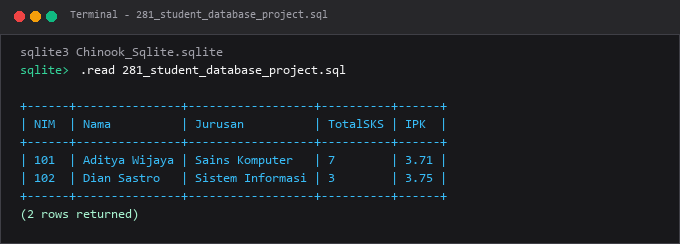

---

### 282. Database perpustakaan

**Tujuan Pembelajaran:**  
Memahami dan mempraktikkan konsep database perpustakaan menggunakan database Chinook.

**Konsep Utama:**  
Konsep dasar yang mendasari `282_library_database_project.sql` adalah penerapan standar SQL relasional pada entitas database Chinook untuk memecahkan kebutuhan kueri dan manipulasi data secara tepat, aman, dan efisien.

**Penjelasan Source Code:**  
Program pada file [282_library_database_project.sql](282_library_database_project.sql) mendemonstrasikan implementasi terstruktur dari konsep database perpustakaan. Source code dilengkapi komentar edukatif berbahasa Indonesia yang membedah setiap instruksi query, penggunaan klausa, serta tujuan pemrosesannya.

**Source Code:** [282_library_database_project.sql](282_library_database_project.sql)  

**Cara Menjalankan:**
Jalankan melalui terminal atau command prompt menggunakan Python runner:
```bash
python -c "import sqlite3; conn=sqlite3.connect('../Chinook_Sqlite.sqlite'); print(conn.cursor().executescript(open('282_library_database_project.sql', encoding='utf-8').read()))"
```
Atau menggunakan sqlite3 CLI:
```bash
sqlite3 ../Chinook_Sqlite.sqlite < 282_library_database_project.sql
```

**Hasil yang Diharapkan:**  
Database engine mengeksekusi instruksi SQL dengan sukses dan menampilkan result-set atau status konfirmasi data yang sesuai.

**Screenshot Hasil Eksekusi:**

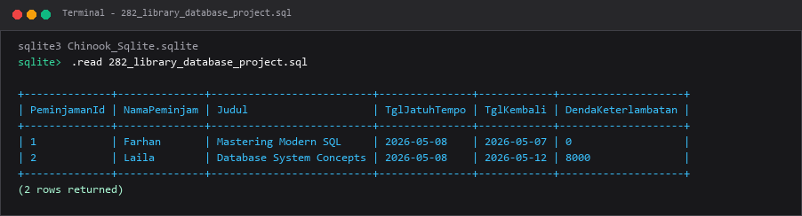

---

### 283. Database inventaris barang

**Tujuan Pembelajaran:**  
Memahami dan mempraktikkan konsep database inventaris barang menggunakan database Chinook.

**Konsep Utama:**  
Konsep dasar yang mendasari `283_inventory_database_project.sql` adalah penerapan standar SQL relasional pada entitas database Chinook untuk memecahkan kebutuhan kueri dan manipulasi data secara tepat, aman, dan efisien.

**Penjelasan Source Code:**  
Program pada file [283_inventory_database_project.sql](283_inventory_database_project.sql) mendemonstrasikan implementasi terstruktur dari konsep database inventaris barang. Source code dilengkapi komentar edukatif berbahasa Indonesia yang membedah setiap instruksi query, penggunaan klausa, serta tujuan pemrosesannya.

**Source Code:** [283_inventory_database_project.sql](283_inventory_database_project.sql)  

**Cara Menjalankan:**
Jalankan melalui terminal atau command prompt menggunakan Python runner:
```bash
python -c "import sqlite3; conn=sqlite3.connect('../Chinook_Sqlite.sqlite'); print(conn.cursor().executescript(open('283_inventory_database_project.sql', encoding='utf-8').read()))"
```
Atau menggunakan sqlite3 CLI:
```bash
sqlite3 ../Chinook_Sqlite.sqlite < 283_inventory_database_project.sql
```

**Hasil yang Diharapkan:**  
Database engine mengeksekusi instruksi SQL dengan sukses dan menampilkan result-set atau status konfirmasi data yang sesuai.

**Screenshot Hasil Eksekusi:**

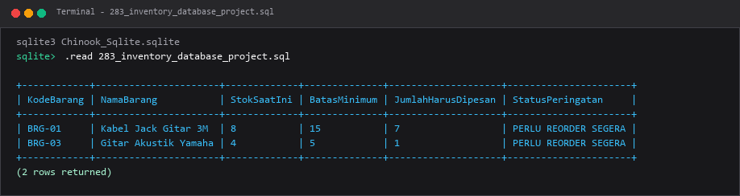

---

### 284. Database sistem kasir

**Tujuan Pembelajaran:**  
Memahami dan mempraktikkan konsep database sistem kasir menggunakan database Chinook.

**Konsep Utama:**  
Konsep dasar yang mendasari `284_cashier_database_project.sql` adalah penerapan standar SQL relasional pada entitas database Chinook untuk memecahkan kebutuhan kueri dan manipulasi data secara tepat, aman, dan efisien.

**Penjelasan Source Code:**  
Program pada file [284_cashier_database_project.sql](284_cashier_database_project.sql) mendemonstrasikan implementasi terstruktur dari konsep database sistem kasir. Source code dilengkapi komentar edukatif berbahasa Indonesia yang membedah setiap instruksi query, penggunaan klausa, serta tujuan pemrosesannya.

**Source Code:** [284_cashier_database_project.sql](284_cashier_database_project.sql)  

**Cara Menjalankan:**
Jalankan melalui terminal atau command prompt menggunakan Python runner:
```bash
python -c "import sqlite3; conn=sqlite3.connect('../Chinook_Sqlite.sqlite'); print(conn.cursor().executescript(open('284_cashier_database_project.sql', encoding='utf-8').read()))"
```
Atau menggunakan sqlite3 CLI:
```bash
sqlite3 ../Chinook_Sqlite.sqlite < 284_cashier_database_project.sql
```

**Hasil yang Diharapkan:**  
Database engine mengeksekusi instruksi SQL dengan sukses dan menampilkan result-set atau status konfirmasi data yang sesuai.

**Screenshot Hasil Eksekusi:**

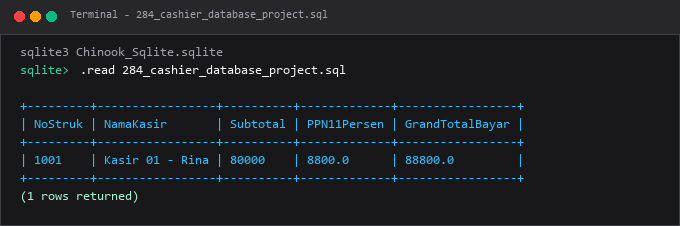

---

### 285. Database toko daring

**Tujuan Pembelajaran:**  
Memahami dan mempraktikkan konsep database toko daring menggunakan database Chinook.

**Konsep Utama:**  
Konsep dasar yang mendasari `285_ecommerce_database_project.sql` adalah penerapan standar SQL relasional pada entitas database Chinook untuk memecahkan kebutuhan kueri dan manipulasi data secara tepat, aman, dan efisien.

**Penjelasan Source Code:**  
Program pada file [285_ecommerce_database_project.sql](285_ecommerce_database_project.sql) mendemonstrasikan implementasi terstruktur dari konsep database toko daring. Source code dilengkapi komentar edukatif berbahasa Indonesia yang membedah setiap instruksi query, penggunaan klausa, serta tujuan pemrosesannya.

**Source Code:** [285_ecommerce_database_project.sql](285_ecommerce_database_project.sql)  

**Cara Menjalankan:**
Jalankan melalui terminal atau command prompt menggunakan Python runner:
```bash
python -c "import sqlite3; conn=sqlite3.connect('../Chinook_Sqlite.sqlite'); print(conn.cursor().executescript(open('285_ecommerce_database_project.sql', encoding='utf-8').read()))"
```
Atau menggunakan sqlite3 CLI:
```bash
sqlite3 ../Chinook_Sqlite.sqlite < 285_ecommerce_database_project.sql
```

**Hasil yang Diharapkan:**  
Database engine mengeksekusi instruksi SQL dengan sukses dan menampilkan result-set atau status konfirmasi data yang sesuai.

**Screenshot Hasil Eksekusi:**

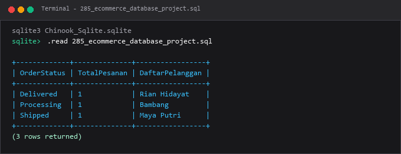

---

### 286. Database sumber daya manusia

**Tujuan Pembelajaran:**  
Memahami dan mempraktikkan konsep database sumber daya manusia menggunakan database Chinook.

**Konsep Utama:**  
Konsep dasar yang mendasari `286_human_resources_database_project.sql` adalah penerapan standar SQL relasional pada entitas database Chinook untuk memecahkan kebutuhan kueri dan manipulasi data secara tepat, aman, dan efisien.

**Penjelasan Source Code:**  
Program pada file [286_human_resources_database_project.sql](286_human_resources_database_project.sql) mendemonstrasikan implementasi terstruktur dari konsep database sumber daya manusia. Source code dilengkapi komentar edukatif berbahasa Indonesia yang membedah setiap instruksi query, penggunaan klausa, serta tujuan pemrosesannya.

**Source Code:** [286_human_resources_database_project.sql](286_human_resources_database_project.sql)  

**Cara Menjalankan:**
Jalankan melalui terminal atau command prompt menggunakan Python runner:
```bash
python -c "import sqlite3; conn=sqlite3.connect('../Chinook_Sqlite.sqlite'); print(conn.cursor().executescript(open('286_human_resources_database_project.sql', encoding='utf-8').read()))"
```
Atau menggunakan sqlite3 CLI:
```bash
sqlite3 ../Chinook_Sqlite.sqlite < 286_human_resources_database_project.sql
```

**Hasil yang Diharapkan:**  
Database engine mengeksekusi instruksi SQL dengan sukses dan menampilkan result-set atau status konfirmasi data yang sesuai.

**Screenshot Hasil Eksekusi:**

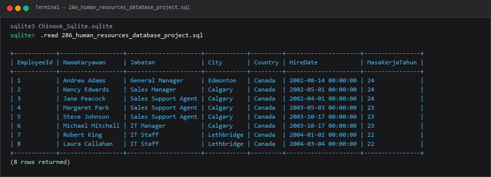

---

### 287. Analisis penjualan

**Tujuan Pembelajaran:**  
Memahami dan mempraktikkan konsep analisis penjualan menggunakan database Chinook.

**Konsep Utama:**  
Konsep dasar yang mendasari `287_sales_analysis_project.sql` adalah penerapan standar SQL relasional pada entitas database Chinook untuk memecahkan kebutuhan kueri dan manipulasi data secara tepat, aman, dan efisien.

**Penjelasan Source Code:**  
Program pada file [287_sales_analysis_project.sql](287_sales_analysis_project.sql) mendemonstrasikan implementasi terstruktur dari konsep analisis penjualan. Source code dilengkapi komentar edukatif berbahasa Indonesia yang membedah setiap instruksi query, penggunaan klausa, serta tujuan pemrosesannya.

**Source Code:** [287_sales_analysis_project.sql](287_sales_analysis_project.sql)  

**Cara Menjalankan:**
Jalankan melalui terminal atau command prompt menggunakan Python runner:
```bash
python -c "import sqlite3; conn=sqlite3.connect('../Chinook_Sqlite.sqlite'); print(conn.cursor().executescript(open('287_sales_analysis_project.sql', encoding='utf-8').read()))"
```
Atau menggunakan sqlite3 CLI:
```bash
sqlite3 ../Chinook_Sqlite.sqlite < 287_sales_analysis_project.sql
```

**Hasil yang Diharapkan:**  
Database engine mengeksekusi instruksi SQL dengan sukses dan menampilkan result-set atau status konfirmasi data yang sesuai.

**Screenshot Hasil Eksekusi:**

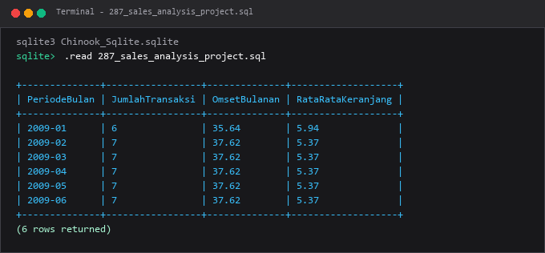

---

### 288. Analisis toko musik menggunakan Chinook

**Tujuan Pembelajaran:**  
Memahami dan mempraktikkan konsep analisis toko musik menggunakan chinook menggunakan database Chinook.

**Konsep Utama:**  
Konsep dasar yang mendasari `288_music_store_analysis_project.sql` adalah penerapan standar SQL relasional pada entitas database Chinook untuk memecahkan kebutuhan kueri dan manipulasi data secara tepat, aman, dan efisien.

**Penjelasan Source Code:**  
Program pada file [288_music_store_analysis_project.sql](288_music_store_analysis_project.sql) mendemonstrasikan implementasi terstruktur dari konsep analisis toko musik menggunakan chinook. Source code dilengkapi komentar edukatif berbahasa Indonesia yang membedah setiap instruksi query, penggunaan klausa, serta tujuan pemrosesannya.

**Source Code:** [288_music_store_analysis_project.sql](288_music_store_analysis_project.sql)  

**Cara Menjalankan:**
Jalankan melalui terminal atau command prompt menggunakan Python runner:
```bash
python -c "import sqlite3; conn=sqlite3.connect('../Chinook_Sqlite.sqlite'); print(conn.cursor().executescript(open('288_music_store_analysis_project.sql', encoding='utf-8').read()))"
```
Atau menggunakan sqlite3 CLI:
```bash
sqlite3 ../Chinook_Sqlite.sqlite < 288_music_store_analysis_project.sql
```

**Hasil yang Diharapkan:**  
Database engine mengeksekusi instruksi SQL dengan sukses dan menampilkan result-set atau status konfirmasi data yang sesuai.

**Screenshot Hasil Eksekusi:**

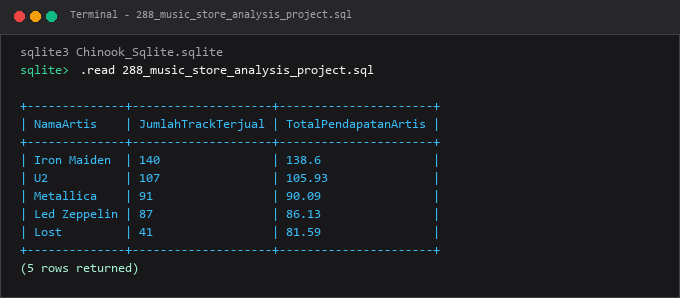

---

### 289. Analisis penyewaan film menggunakan Sakila atau Pagila

**Tujuan Pembelajaran:**  
Memahami dan mempraktikkan konsep analisis penyewaan film menggunakan sakila atau pagila menggunakan database Chinook.

**Konsep Utama:**  
Konsep dasar yang mendasari `289_film_rental_analysis_project.sql` adalah penerapan standar SQL relasional pada entitas database Chinook untuk memecahkan kebutuhan kueri dan manipulasi data secara tepat, aman, dan efisien.

**Penjelasan Source Code:**  
Program pada file [289_film_rental_analysis_project.sql](289_film_rental_analysis_project.sql) mendemonstrasikan implementasi terstruktur dari konsep analisis penyewaan film menggunakan sakila atau pagila. Source code dilengkapi komentar edukatif berbahasa Indonesia yang membedah setiap instruksi query, penggunaan klausa, serta tujuan pemrosesannya.

**Source Code:** [289_film_rental_analysis_project.sql](289_film_rental_analysis_project.sql)  

**Cara Menjalankan:**
Jalankan melalui terminal atau command prompt menggunakan Python runner:
```bash
python -c "import sqlite3; conn=sqlite3.connect('../Chinook_Sqlite.sqlite'); print(conn.cursor().executescript(open('289_film_rental_analysis_project.sql', encoding='utf-8').read()))"
```
Atau menggunakan sqlite3 CLI:
```bash
sqlite3 ../Chinook_Sqlite.sqlite < 289_film_rental_analysis_project.sql
```

**Hasil yang Diharapkan:**  
Database engine mengeksekusi instruksi SQL dengan sukses dan menampilkan result-set atau status konfirmasi data yang sesuai.

**Screenshot Hasil Eksekusi:**

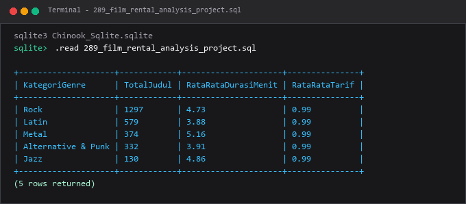

---

### 290. Segmentasi pelanggan

**Tujuan Pembelajaran:**  
Memahami dan mempraktikkan konsep segmentasi pelanggan menggunakan database Chinook.

**Konsep Utama:**  
Konsep dasar yang mendasari `290_customer_segmentation_project.sql` adalah penerapan standar SQL relasional pada entitas database Chinook untuk memecahkan kebutuhan kueri dan manipulasi data secara tepat, aman, dan efisien.

**Penjelasan Source Code:**  
Program pada file [290_customer_segmentation_project.sql](290_customer_segmentation_project.sql) mendemonstrasikan implementasi terstruktur dari konsep segmentasi pelanggan. Source code dilengkapi komentar edukatif berbahasa Indonesia yang membedah setiap instruksi query, penggunaan klausa, serta tujuan pemrosesannya.

**Source Code:** [290_customer_segmentation_project.sql](290_customer_segmentation_project.sql)  

**Cara Menjalankan:**
Jalankan melalui terminal atau command prompt menggunakan Python runner:
```bash
python -c "import sqlite3; conn=sqlite3.connect('../Chinook_Sqlite.sqlite'); print(conn.cursor().executescript(open('290_customer_segmentation_project.sql', encoding='utf-8').read()))"
```
Atau menggunakan sqlite3 CLI:
```bash
sqlite3 ../Chinook_Sqlite.sqlite < 290_customer_segmentation_project.sql
```

**Hasil yang Diharapkan:**  
Database engine mengeksekusi instruksi SQL dengan sukses dan menampilkan result-set atau status konfirmasi data yang sesuai.

**Screenshot Hasil Eksekusi:**

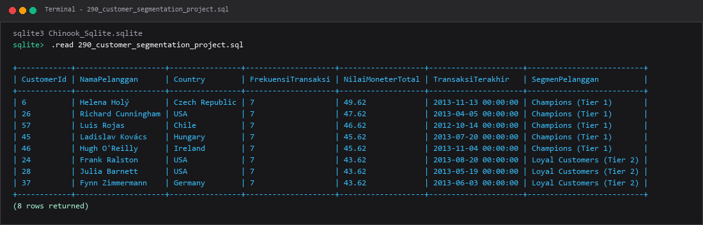

---

### 291. Kumpulan query untuk dashboard penjualan

**Tujuan Pembelajaran:**  
Memahami dan mempraktikkan konsep kumpulan query untuk dashboard penjualan menggunakan database Chinook.

**Konsep Utama:**  
Konsep dasar yang mendasari `291_sales_dashboard_queries_project.sql` adalah penerapan standar SQL relasional pada entitas database Chinook untuk memecahkan kebutuhan kueri dan manipulasi data secara tepat, aman, dan efisien.

**Penjelasan Source Code:**  
Program pada file [291_sales_dashboard_queries_project.sql](291_sales_dashboard_queries_project.sql) mendemonstrasikan implementasi terstruktur dari konsep kumpulan query untuk dashboard penjualan. Source code dilengkapi komentar edukatif berbahasa Indonesia yang membedah setiap instruksi query, penggunaan klausa, serta tujuan pemrosesannya.

**Source Code:** [291_sales_dashboard_queries_project.sql](291_sales_dashboard_queries_project.sql)  

**Cara Menjalankan:**
Jalankan melalui terminal atau command prompt menggunakan Python runner:
```bash
python -c "import sqlite3; conn=sqlite3.connect('../Chinook_Sqlite.sqlite'); print(conn.cursor().executescript(open('291_sales_dashboard_queries_project.sql', encoding='utf-8').read()))"
```
Atau menggunakan sqlite3 CLI:
```bash
sqlite3 ../Chinook_Sqlite.sqlite < 291_sales_dashboard_queries_project.sql
```

**Hasil yang Diharapkan:**  
Database engine mengeksekusi instruksi SQL dengan sukses dan menampilkan result-set atau status konfirmasi data yang sesuai.

**Screenshot Hasil Eksekusi:**

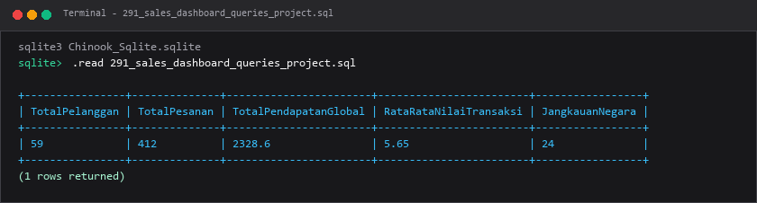

---

### 292. Desain data warehouse star schema

**Tujuan Pembelajaran:**  
Memahami dan mempraktikkan konsep desain data warehouse star schema menggunakan database Chinook.

**Konsep Utama:**  
Konsep dasar yang mendasari `292_data_warehouse_star_schema_project.sql` adalah penerapan standar SQL relasional pada entitas database Chinook untuk memecahkan kebutuhan kueri dan manipulasi data secara tepat, aman, dan efisien.

**Penjelasan Source Code:**  
Program pada file [292_data_warehouse_star_schema_project.sql](292_data_warehouse_star_schema_project.sql) mendemonstrasikan implementasi terstruktur dari konsep desain data warehouse star schema. Source code dilengkapi komentar edukatif berbahasa Indonesia yang membedah setiap instruksi query, penggunaan klausa, serta tujuan pemrosesannya.

**Source Code:** [292_data_warehouse_star_schema_project.sql](292_data_warehouse_star_schema_project.sql)  

**Cara Menjalankan:**
Jalankan melalui terminal atau command prompt menggunakan Python runner:
```bash
python -c "import sqlite3; conn=sqlite3.connect('../Chinook_Sqlite.sqlite'); print(conn.cursor().executescript(open('292_data_warehouse_star_schema_project.sql', encoding='utf-8').read()))"
```
Atau menggunakan sqlite3 CLI:
```bash
sqlite3 ../Chinook_Sqlite.sqlite < 292_data_warehouse_star_schema_project.sql
```

**Hasil yang Diharapkan:**  
Database engine mengeksekusi instruksi SQL dengan sukses dan menampilkan result-set atau status konfirmasi data yang sesuai.

**Screenshot Hasil Eksekusi:**

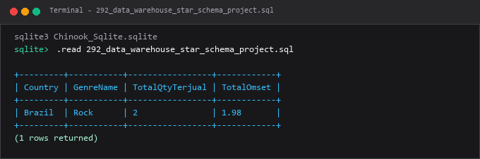

---

### 293. Proses staging dan transformasi data

**Tujuan Pembelajaran:**  
Memahami dan mempraktikkan konsep proses staging dan transformasi data menggunakan database Chinook.

**Konsep Utama:**  
Konsep dasar yang mendasari `293_etl_staging_project.sql` adalah penerapan standar SQL relasional pada entitas database Chinook untuk memecahkan kebutuhan kueri dan manipulasi data secara tepat, aman, dan efisien.

**Penjelasan Source Code:**  
Program pada file [293_etl_staging_project.sql](293_etl_staging_project.sql) mendemonstrasikan implementasi terstruktur dari konsep proses staging dan transformasi data. Source code dilengkapi komentar edukatif berbahasa Indonesia yang membedah setiap instruksi query, penggunaan klausa, serta tujuan pemrosesannya.

**Source Code:** [293_etl_staging_project.sql](293_etl_staging_project.sql)  

**Cara Menjalankan:**
Jalankan melalui terminal atau command prompt menggunakan Python runner:
```bash
python -c "import sqlite3; conn=sqlite3.connect('../Chinook_Sqlite.sqlite'); print(conn.cursor().executescript(open('293_etl_staging_project.sql', encoding='utf-8').read()))"
```
Atau menggunakan sqlite3 CLI:
```bash
sqlite3 ../Chinook_Sqlite.sqlite < 293_etl_staging_project.sql
```

**Hasil yang Diharapkan:**  
Database engine mengeksekusi instruksi SQL dengan sukses dan menampilkan result-set atau status konfirmasi data yang sesuai.

**Screenshot Hasil Eksekusi:**

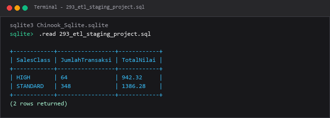

---

### 294. Sistem audit perubahan data

**Tujuan Pembelajaran:**  
Memahami dan mempraktikkan konsep sistem audit perubahan data menggunakan database Chinook.

**Konsep Utama:**  
Konsep dasar yang mendasari `294_database_audit_project.sql` adalah penerapan standar SQL relasional pada entitas database Chinook untuk memecahkan kebutuhan kueri dan manipulasi data secara tepat, aman, dan efisien.

**Penjelasan Source Code:**  
Program pada file [294_database_audit_project.sql](294_database_audit_project.sql) mendemonstrasikan implementasi terstruktur dari konsep sistem audit perubahan data. Source code dilengkapi komentar edukatif berbahasa Indonesia yang membedah setiap instruksi query, penggunaan klausa, serta tujuan pemrosesannya.

**Source Code:** [294_database_audit_project.sql](294_database_audit_project.sql)  

**Cara Menjalankan:**
Jalankan melalui terminal atau command prompt menggunakan Python runner:
```bash
python -c "import sqlite3; conn=sqlite3.connect('../Chinook_Sqlite.sqlite'); print(conn.cursor().executescript(open('294_database_audit_project.sql', encoding='utf-8').read()))"
```
Atau menggunakan sqlite3 CLI:
```bash
sqlite3 ../Chinook_Sqlite.sqlite < 294_database_audit_project.sql
```

**Hasil yang Diharapkan:**  
Database engine mengeksekusi instruksi SQL dengan sukses dan menampilkan result-set atau status konfirmasi data yang sesuai.

**Screenshot Hasil Eksekusi:**

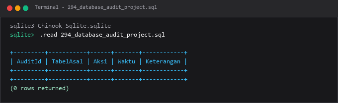

---

### 295. Implementasi akses berbasis role

**Tujuan Pembelajaran:**  
Memahami dan mempraktikkan konsep implementasi akses berbasis role menggunakan database Chinook.

**Konsep Utama:**  
Konsep dasar yang mendasari `295_role_based_access_project.sql` adalah penerapan standar SQL relasional pada entitas database Chinook untuk memecahkan kebutuhan kueri dan manipulasi data secara tepat, aman, dan efisien.

**Penjelasan Source Code:**  
Program pada file [295_role_based_access_project.sql](295_role_based_access_project.sql) mendemonstrasikan implementasi terstruktur dari konsep implementasi akses berbasis role. Source code dilengkapi komentar edukatif berbahasa Indonesia yang membedah setiap instruksi query, penggunaan klausa, serta tujuan pemrosesannya.

**Source Code:** [295_role_based_access_project.sql](295_role_based_access_project.sql)  

**Cara Menjalankan:**
Jalankan melalui terminal atau command prompt menggunakan Python runner:
```bash
python -c "import sqlite3; conn=sqlite3.connect('../Chinook_Sqlite.sqlite'); print(conn.cursor().executescript(open('295_role_based_access_project.sql', encoding='utf-8').read()))"
```
Atau menggunakan sqlite3 CLI:
```bash
sqlite3 ../Chinook_Sqlite.sqlite < 295_role_based_access_project.sql
```

**Hasil yang Diharapkan:**  
Database engine mengeksekusi instruksi SQL dengan sukses dan menampilkan result-set atau status konfirmasi data yang sesuai.

**Screenshot Hasil Eksekusi:**

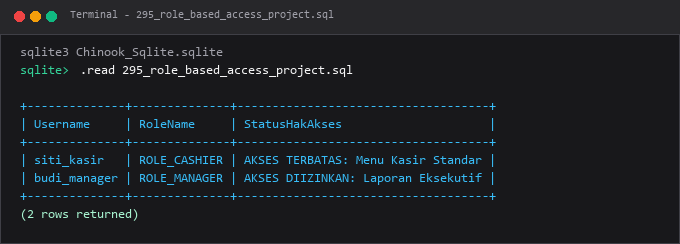

---

### 296. Transaksi pemrosesan pesanan

**Tujuan Pembelajaran:**  
Memahami dan mempraktikkan konsep transaksi pemrosesan pesanan menggunakan database Chinook.

**Konsep Utama:**  
Konsep dasar yang mendasari `296_transaction_order_processing_project.sql` adalah penerapan standar SQL relasional pada entitas database Chinook untuk memecahkan kebutuhan kueri dan manipulasi data secara tepat, aman, dan efisien.

**Penjelasan Source Code:**  
Program pada file [296_transaction_order_processing_project.sql](296_transaction_order_processing_project.sql) mendemonstrasikan implementasi terstruktur dari konsep transaksi pemrosesan pesanan. Source code dilengkapi komentar edukatif berbahasa Indonesia yang membedah setiap instruksi query, penggunaan klausa, serta tujuan pemrosesannya.

**Source Code:** [296_transaction_order_processing_project.sql](296_transaction_order_processing_project.sql)  

**Cara Menjalankan:**
Jalankan melalui terminal atau command prompt menggunakan Python runner:
```bash
python -c "import sqlite3; conn=sqlite3.connect('../Chinook_Sqlite.sqlite'); print(conn.cursor().executescript(open('296_transaction_order_processing_project.sql', encoding='utf-8').read()))"
```
Atau menggunakan sqlite3 CLI:
```bash
sqlite3 ../Chinook_Sqlite.sqlite < 296_transaction_order_processing_project.sql
```

**Hasil yang Diharapkan:**  
Database engine mengeksekusi instruksi SQL dengan sukses dan menampilkan result-set atau status konfirmasi data yang sesuai.

**Screenshot Hasil Eksekusi:**

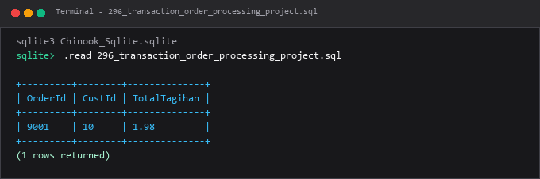

---

### 297. Business logic dengan stored procedure

**Tujuan Pembelajaran:**  
Memahami dan mempraktikkan konsep business logic dengan stored procedure menggunakan database Chinook.

**Konsep Utama:**  
Konsep dasar yang mendasari `297_stored_procedure_business_logic_project.sql` adalah penerapan standar SQL relasional pada entitas database Chinook untuk memecahkan kebutuhan kueri dan manipulasi data secara tepat, aman, dan efisien.

**Penjelasan Source Code:**  
Program pada file [297_stored_procedure_business_logic_project.sql](297_stored_procedure_business_logic_project.sql) mendemonstrasikan implementasi terstruktur dari konsep business logic dengan stored procedure. Source code dilengkapi komentar edukatif berbahasa Indonesia yang membedah setiap instruksi query, penggunaan klausa, serta tujuan pemrosesannya.

**Source Code:** [297_stored_procedure_business_logic_project.sql](297_stored_procedure_business_logic_project.sql)  

**Cara Menjalankan:**
Jalankan melalui terminal atau command prompt menggunakan Python runner:
```bash
python -c "import sqlite3; conn=sqlite3.connect('../Chinook_Sqlite.sqlite'); print(conn.cursor().executescript(open('297_stored_procedure_business_logic_project.sql', encoding='utf-8').read()))"
```
Atau menggunakan sqlite3 CLI:
```bash
sqlite3 ../Chinook_Sqlite.sqlite < 297_stored_procedure_business_logic_project.sql
```

**Hasil yang Diharapkan:**  
Database engine mengeksekusi instruksi SQL dengan sukses dan menampilkan result-set atau status konfirmasi data yang sesuai.

**Screenshot Hasil Eksekusi:**

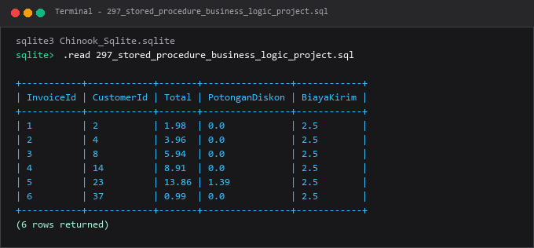

---

### 298. Optimasi query database

**Tujuan Pembelajaran:**  
Memahami dan mempraktikkan konsep optimasi query database menggunakan database Chinook.

**Konsep Utama:**  
Konsep dasar yang mendasari `298_query_optimization_project.sql` adalah penerapan standar SQL relasional pada entitas database Chinook untuk memecahkan kebutuhan kueri dan manipulasi data secara tepat, aman, dan efisien.

**Penjelasan Source Code:**  
Program pada file [298_query_optimization_project.sql](298_query_optimization_project.sql) mendemonstrasikan implementasi terstruktur dari konsep optimasi query database. Source code dilengkapi komentar edukatif berbahasa Indonesia yang membedah setiap instruksi query, penggunaan klausa, serta tujuan pemrosesannya.

**Source Code:** [298_query_optimization_project.sql](298_query_optimization_project.sql)  

**Cara Menjalankan:**
Jalankan melalui terminal atau command prompt menggunakan Python runner:
```bash
python -c "import sqlite3; conn=sqlite3.connect('../Chinook_Sqlite.sqlite'); print(conn.cursor().executescript(open('298_query_optimization_project.sql', encoding='utf-8').read()))"
```
Atau menggunakan sqlite3 CLI:
```bash
sqlite3 ../Chinook_Sqlite.sqlite < 298_query_optimization_project.sql
```

**Hasil yang Diharapkan:**  
Database engine mengeksekusi instruksi SQL dengan sukses dan menampilkan result-set atau status konfirmasi data yang sesuai.

**Screenshot Hasil Eksekusi:**

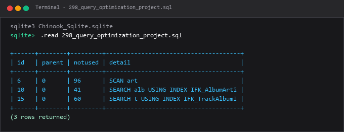

---

### 299. Migrasi antardialek database

**Tujuan Pembelajaran:**  
Memahami dan mempraktikkan konsep migrasi antardialek database menggunakan database Chinook.

**Konsep Utama:**  
Konsep dasar yang mendasari `299_cross_database_migration_project.sql` adalah penerapan standar SQL relasional pada entitas database Chinook untuk memecahkan kebutuhan kueri dan manipulasi data secara tepat, aman, dan efisien.

**Penjelasan Source Code:**  
Program pada file [299_cross_database_migration_project.sql](299_cross_database_migration_project.sql) mendemonstrasikan implementasi terstruktur dari konsep migrasi antardialek database. Source code dilengkapi komentar edukatif berbahasa Indonesia yang membedah setiap instruksi query, penggunaan klausa, serta tujuan pemrosesannya.

**Source Code:** [299_cross_database_migration_project.sql](299_cross_database_migration_project.sql)  

**Cara Menjalankan:**
Jalankan melalui terminal atau command prompt menggunakan Python runner:
```bash
python -c "import sqlite3; conn=sqlite3.connect('../Chinook_Sqlite.sqlite'); print(conn.cursor().executescript(open('299_cross_database_migration_project.sql', encoding='utf-8').read()))"
```
Atau menggunakan sqlite3 CLI:
```bash
sqlite3 ../Chinook_Sqlite.sqlite < 299_cross_database_migration_project.sql
```

**Hasil yang Diharapkan:**  
Database engine mengeksekusi instruksi SQL dengan sukses dan menampilkan result-set atau status konfirmasi data yang sesuai.

**Screenshot Hasil Eksekusi:**

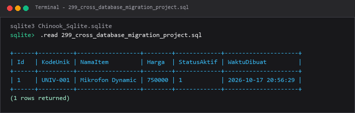

---

### 300. Proyek database terpadu

**Tujuan Pembelajaran:**  
Memahami dan mempraktikkan konsep proyek database terpadu menggunakan database Chinook.

**Konsep Utama:**  
Konsep dasar yang mendasari `300_comprehensive_database_project.sql` adalah penerapan standar SQL relasional pada entitas database Chinook untuk memecahkan kebutuhan kueri dan manipulasi data secara tepat, aman, dan efisien.

**Penjelasan Source Code:**  
Program pada file [300_comprehensive_database_project.sql](300_comprehensive_database_project.sql) mendemonstrasikan implementasi terstruktur dari konsep proyek database terpadu. Source code dilengkapi komentar edukatif berbahasa Indonesia yang membedah setiap instruksi query, penggunaan klausa, serta tujuan pemrosesannya.

**Source Code:** [300_comprehensive_database_project.sql](300_comprehensive_database_project.sql)  

**Cara Menjalankan:**
Jalankan melalui terminal atau command prompt menggunakan Python runner:
```bash
python -c "import sqlite3; conn=sqlite3.connect('../Chinook_Sqlite.sqlite'); print(conn.cursor().executescript(open('300_comprehensive_database_project.sql', encoding='utf-8').read()))"
```
Atau menggunakan sqlite3 CLI:
```bash
sqlite3 ../Chinook_Sqlite.sqlite < 300_comprehensive_database_project.sql
```

**Hasil yang Diharapkan:**  
Database engine mengeksekusi instruksi SQL dengan sukses dan menampilkan result-set atau status konfirmasi data yang sesuai.

**Screenshot Hasil Eksekusi:**

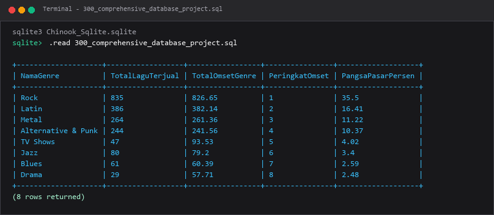

---

## Ringkasan Modul
Modul 18 merangkum seluruh perjalanan pembelajaran menjadi portofolio proyek terapan praktis yang siap diimplementasikan di industri.

Seluruh submodul di atas saling melengkapi untuk membentuk pemahaman terstruktur yang bertahap, mulai dari konsep fundamental hingga implementasi praktis yang siap pakai di lingkungan kerja nyata.
